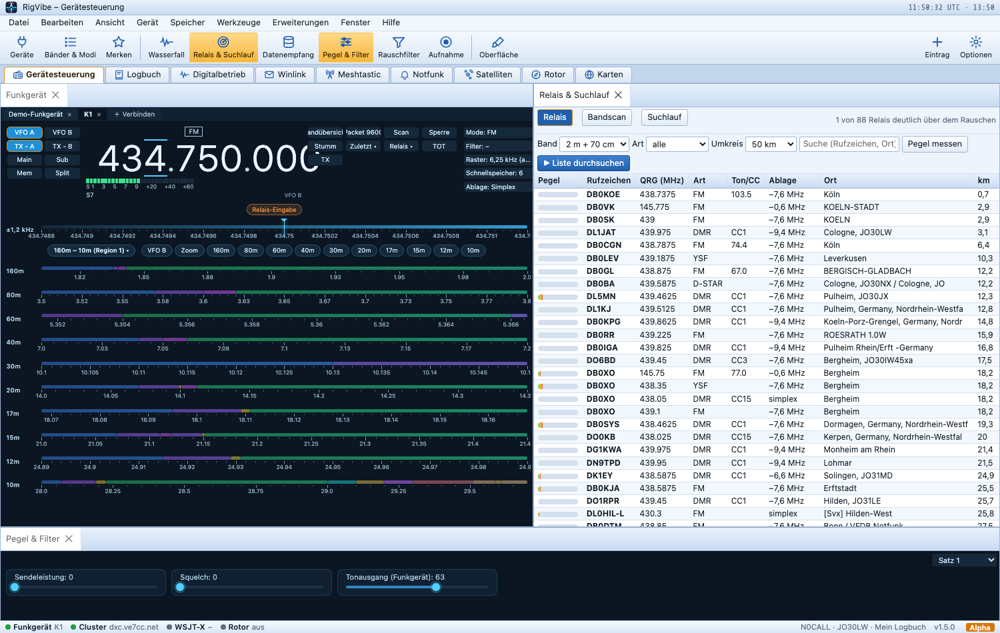
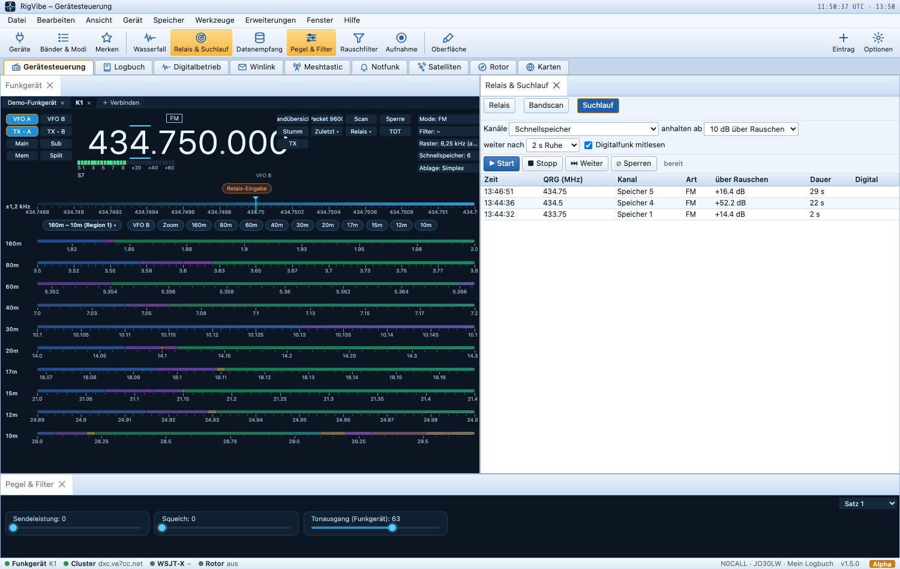
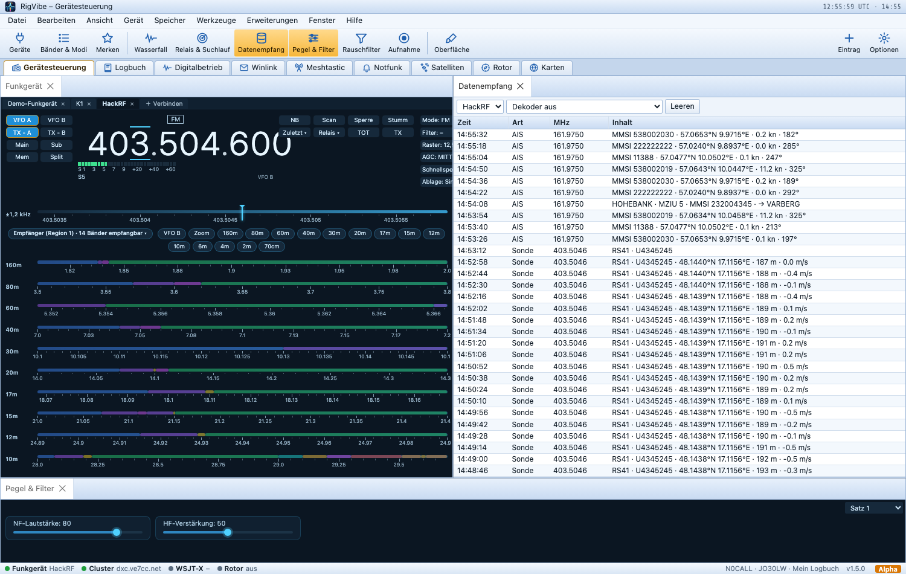
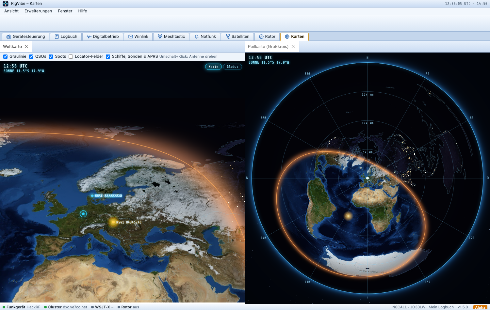
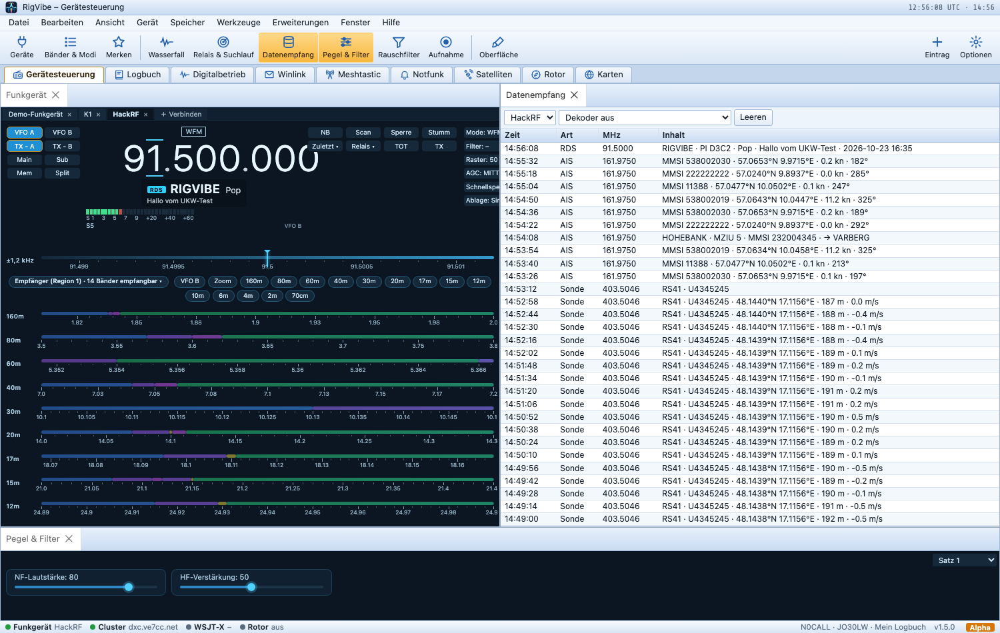
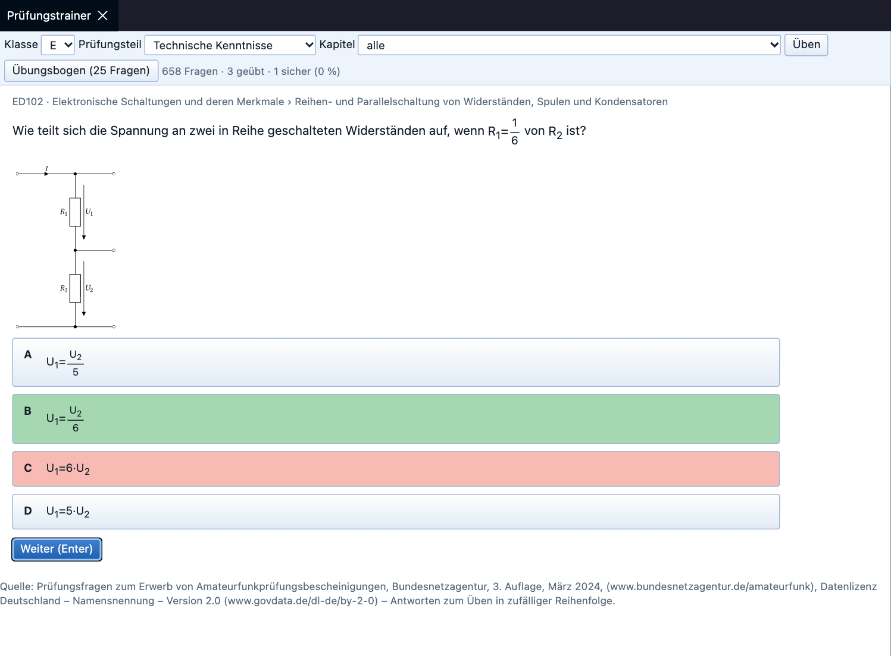
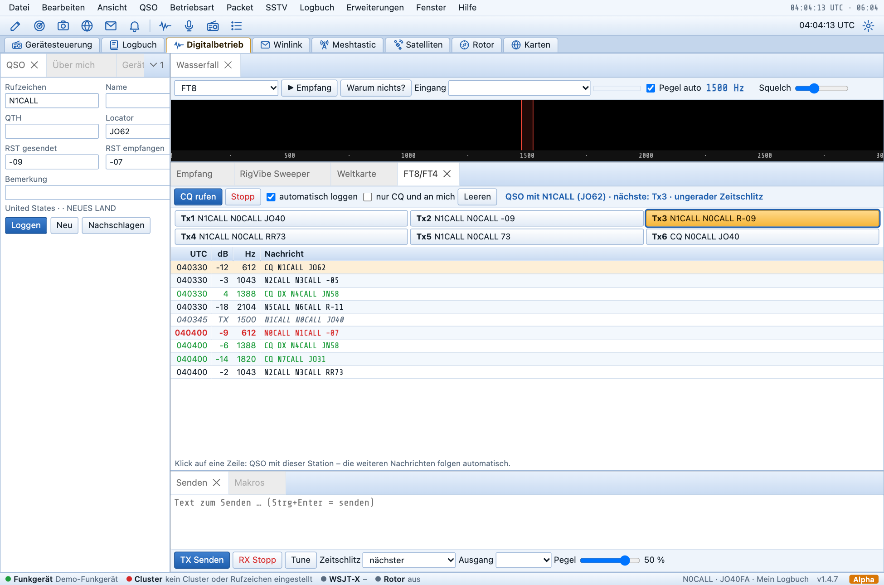
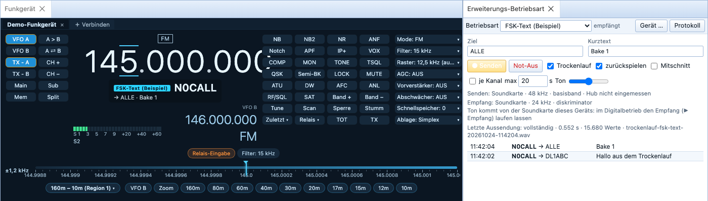

# RigVibe – Anleitung

RigVibe ist ein Programm für die Funkstation: Funkgerät steuern, Logbuch führen, Digitalbetrieb (PSK, RTTY, Olivia, MT63, SSTV und mehr), Winlink-E-Mail über Funk, Satelliten, Rotor und Karten – alles in einem Fenster.

> **Lizenz und Haftung:** RigVibe ist kostenlos nutzbar, alle Rechte vorbehalten (Lizenzbedingungen in der Datei LICENSE bzw. im Programm unter **Hilfe → Lizenzen und Fremdkomponenten**). Für die Steuerung von Sendern, Funkgeräten und Rotoren ist die bedienende Person verantwortlich. Für die Einhaltung der Amateurfunk-Vorschriften ist die bedienende Person verantwortlich. Einzelheiten und alle Fremdlizenzen: [LIZENZEN.md](../LIZENZEN.md) bzw. im Programm unter **Hilfe → Lizenzen und Fremdkomponenten**.

**Inhalt**
1. [Installation](#1-installation)
2. [Erster Start](#2-erster-start)
3. [Funkgerät verbinden](#3-funkgerät-verbinden)
4. [Gerätesteuerung](#4-gerätesteuerung)
5. [Fenster anordnen und Layouts](#5-fenster-anordnen-und-layouts)
6. [Rechtsklick-Menüs](#6-rechtsklick-menüs)
7. [Logbuch](#7-logbuch)
8. [DX-Cluster, Alarme und WSJT-X](#8-dx-cluster-alarme-und-wsjt-x)
9. [Online-Dienste (QRZ.com, LoTW, eQSL, Club Log)](#9-online-dienste)
10. [Digitalbetrieb](#10-digitalbetrieb)
11. [SSTV (Bildübertragung)](#11-sstv-bildübertragung)
12. [Winlink (E-Mail über Funk)](#12-winlink-e-mail-über-funk)
13. [Satelliten](#13-satelliten)
14. [Rotor](#14-rotor)
15. [Karten](#15-karten)
16. [Tastenkürzel](#16-tastenkürzel)
17. [Daten, Sicherung und Umzug](#17-daten-sicherung-und-umzug)
18. [Zugang, API und KI-Assistenten](#18-zugang-api-und-ki-assistenten)
19. [Fehlerbericht und Aktualisierung](#19-fehlerbericht-und-aktualisierung)
20. [Probleme lösen](#20-probleme-lösen)
21. [Notfunk](#21-notfunk)

---

## 1. Installation

Die Installationsdateien gibt es unter **Releases** in diesem Repository.

| System | Datei | Hinweis |
|---|---|---|
| Windows 10/11 | `RigVibe-x.y.z-Windows-Setup.exe` | Windows warnt beim ersten Start („Unbekannter Herausgeber“): **Weitere Informationen → Trotzdem ausführen**. |
| Mac mit Apple-Chip (M1–M4) | `RigVibe-x.y.z-Mac-AppleSilicon.dmg` | DMG öffnen, RigVibe in „Programme“ ziehen. Erster Start: **Rechtsklick → Öffnen**. |
| Mac mit Intel-Chip | `RigVibe-x.y.z-Mac-Intel.dmg` | wie oben |
| Linux | `.AppImage` oder `.deb` | AppImage ausführbar machen (`chmod +x`) und starten. Benutzer in die Gruppe `dialout` aufnehmen (`sudo usermod -aG dialout $USER`, danach neu anmelden). |

Für die Steuerung braucht es nichts weiter – die Funkgeräte-/Rotorsteuerung (Hamlib) ist eingebaut. Ggf. den **USB-Treiber des Funkgeräts** installieren (z. B. Silicon Labs CP210x bei Icom und Yaesu, FTDI bei manchen Kenwood/Elecraft).

## 2. Erster Start

Beim ersten Start öffnen sich die **Programmoptionen**. Tragen Sie mindestens **Rufzeichen** und **Locator** ein – sie werden für Entfernungen, Richtungen, Makros, den DX-Cluster und die Logbuch-Uploads gebraucht.

Die Optionen erreichen Sie jederzeit mit **F8** oder über **Optionen** (Zahnrad rechts in der Werkzeugleiste). Wichtige Registerkarten:

- **Station:** Rufzeichen, Locator, Name/QTH für Makros, **DMR-ID** (für Digitalfunk; RigVibe prüft in der RadioID-Liste, ob sie zum Rufzeichen gehört)
- **DX-Cluster:** Server (z. B. `dxc.ve7cc.net`, Port 23) und Anmeldebefehle
- **Online-Dienste:** Zugangsdaten für Callbook und Uploads (siehe [Kapitel 9](#9-online-dienste))
- **WSJT-X:** UDP-Port (Standard 2237)
- **Kommunikation:** wie oft das Funkgerät abgefragt wird
- **CW / WinKeyer:** CW über das Funkgerät oder einen K1EL-WinKeyer
- **Darstellung:** Farbschema (Klassisch, Hell, Dunkel, Nachtsicht)

Zum Ausprobieren ist ein **Demo-Funkgerät** voreingestellt – damit lässt sich alles bedienen, ohne dass ein Gerät angeschlossen ist.

## 3. Funkgerät verbinden

**Datei → Verbinden …** (oder **Geräte**, das Stecker-Symbol ganz links in der Werkzeugleiste).

1. **Hersteller** und **Funkgerät** wählen (über 300 Modelle).
2. **COM-Port** wählen. Unter Windows `COM3`, `COM4` …, am Mac `/dev/cu.usbserial-…` bzw. `/dev/cu.SLAB_USBtoUART`, unter Linux `/dev/ttyUSB0`. Die Registerkarte **Serielle Ports** zeigt, welcher Port zu welchem USB-Gerät gehört.
3. **Geschwindigkeit** wie im Menü des Funkgeräts (CAT/CI-V-Baudrate). Unbekannt? **Baudrate suchen** probiert alle durch.
4. **Icom:** CI-V-Adresse eintragen (z. B. IC-7300 = 94, IC-705 = A4, IC-9700 = A2). Im Gerät „CI-V USB Echo Back“ meist aus.
5. **PTT über:** normalerweise „CAT-Befehl“. Bei Interfaces ohne CAT-PTT: DTR- oder RTS-Leitung.
6. **Verbinden**. Antwortet das Gerät nicht, steht die Ursache im Feld **Status**.

Weitere Einstellungen:
- **Beim Start immer verbinden** – für das Hauptgerät.
- **Panadapter: Scope-Daten vom Gerät** – bei Icom-Geräten mit eingebautem Spektrum (IC-7300/705/9700/7610 …). Im Gerät „CI-V USB Port“ auf **Unlinked** und 115200 Baud stellen.
- **Für andere Rechner freigeben** – siehe unten.
- **Frequenzversatz (Transverter, LNB, QO-100)** – siehe unten.

**Frequenzversatz für Transverter und QO-100:** Im aufklappbaren Bereich **Frequenzversatz** (bei eingetragenem Versatz automatisch offen) werden ein RX- und ein TX-Versatz in MHz im Geräteprofil gespeichert. RigVibe zeigt dann überall die tatsächliche Frequenz an (Gerätefrequenz + Versatz) und rechnet beim Abstimmen zurück. Der **TX-Versatz** gilt für die Sendefrequenz im Split-Betrieb (VFO B); leer bedeutet „wie RX“. Der Knopf **QO-100** trägt RX 9750 MHz (LNB) und TX 1968 MHz (Aufwärtsumsetzer 432 → 2400 MHz) ein, **Transverter 2 m** je 116 MHz (28 → 144 MHz). Beispiel QO-100 mit Split: Empfang auf 10489,550 MHz (Gerät 739,550 MHz), Senden auf 2400,050 MHz (Gerät 432,050 MHz). Den LNB-Versatz bei Bedarf um die Ablage des eigenen LNB korrigieren (z. B. 9749,982). Programme, die das Gerät über die Freigabe mitbenutzen (WSJT-X …), sehen weiter die Gerätefrequenz.

**Mehrere Funkgeräte** gleichzeitig: einfach nacheinander verbinden. Jedes Gerät bekommt einen eigenen Reiter oben in der Gerätesteuerung.

**Funkgerät mit anderen Programmen teilen** (WSJT-X, JTDX, N1MM, fldigi, Log4OM): In der Registerkarte **Gespeichert** steht in der Spalte „Für andere Programme“ eine Adresse wie `127.0.0.1:4600`. Im anderen Programm als Funkgerät **Hamlib NET rigctl** mit dieser Adresse wählen. Beide Programme steuern dann dasselbe Gerät gleichzeitig.

**Entfernte Station über wfview, FLRig oder eine andere RigVibe-Station:** Im Verbinden-Dialog oben eine **Vorlage** wählen. Bei **wfview** (Icom-Geräte im Netz/Internet) in wfview *Einstellungen → External Control → Enable RigCtld* einschalten; wfview verbindet sich mit der entfernten Station, RigVibe steuert über Port 4533. Den Ton liefert wfview als virtuelle Soundkarte.

**TCI:** Viele Log-, Contest- und Digimode-Programme (z. B. Log4OM, N1MM+, JTDX, MSHV) können ein Funkgerät über **TCI** steuern. **F8 → Kommunikation → TCI-Schnittstelle** einschalten und im Programm „TCI“ bzw. „ExpertSDR/SunSDR (TCI)“ mit der Adresse `localhost` und Port `40001` wählen (für andere Rechner im Heimnetz „auch aus dem Heimnetz erreichbar“ ankreuzen und die Adresse des RigVibe-Rechners eintragen). Das Programm steuert dann das gerade gewählte Funkgerät oder den Empfänger: Frequenz (VFO A/B), Betriebsart, Senden, Abstimmen, Leistung, Split, RIT/XIT, S-Meter und CW-Text. Spots, die das Programm meldet (z. B. aus N1MM+), erscheinen im Wasserfall. Ton über TCI überträgt RigVibe nicht – dafür bleibt die Soundkarte bzw. der Digitalbetrieb von RigVibe.

**Programme ohne Hamlib-Netzanbindung** (nur „serielles Funkgerät“): **F8 → Kommunikation → CAT-Emulation** einschalten. RigVibe verhält sich dann wie ein **Kenwood TS-2000**. Unter macOS/Linux erscheint ein Port wie `/dev/ttys003` (zusätzlich immer als `~/.rigvibe-cat`; der frühere Name `~/.wellenwerk-cat` funktioniert weiter), unter Windows ein virtuelles Port-Paar mit **com0com** anlegen, das eine Ende (z. B. COM11) in RigVibe eintragen, das andere (COM12) im Fremdprogramm; alternativ ein TCP-Port. Im Fremdprogramm „Kenwood TS-2000“, 9600 Baud wählen. Frequenz, Betriebsart, PTT, S-Meter, Leistung und Lautstärke werden an das gerade gewählte Funkgerät weitergegeben.

## 4. Gerätesteuerung

- **Frequenzanzeige:** Mausrad über einer Ziffer verstellt genau diese Stelle. Klick auf eine Ziffer macht sie „aktiv“ (Balken), dann **↑/↓** oder **+/−** zum Verstellen, **←/→** zum Wechseln, Zifferntasten zum Eintippen. **Enter** öffnet die Frequenzeingabe.
- **Betriebsart:** Schaltfläche über der Frequenz.
- **Links:** VFO A/B, TX-A/B, A>B, A⇄B, Main/Sub, Speicher, Kanal ±. **Rechts:** Funktionstasten (NB, NR, Notch, ATU, Tune …) und Auswahllisten (Filter, AGC, Vorverstärker, Abschwächer …). Welche Tasten erscheinen, hängt davon ab, was das Gerät kann.
- **Zustand:** Unter der Anzeige erscheinen als kleine Kennzeichen nur die Dinge, die gerade aktiv sind (z. B. Busy, Split, RIT, Lock); beim Senden Leistung, SWR und ALC.
- **Feinskala** („±1,2 kHz“): die Skala unter der Anzeige; bei großem Fenster kommt eine zweite mit ±400 Hz dazu; ziehen oder Mausrad (Shift = doppelt, Strg = fünffach). Die Nadel zeigt die eingestellte Frequenz.
- **Bandleiste:** links der **Bandplan** (Amateurfunk Region 1/2/3 oder **Rundfunk** mit LW, MW, den Kurzwellen-Rundfunkbändern 120 m bis 11 m und UKW), **VFO B** stimmt den zweiten VFO ab, **Zoom** verteilt ein Band auf mehrere Zeilen, die Bandknöpfe springen auf die zuletzt benutzte Frequenz und Betriebsart des Bandes. Dabei zeigt der Wasserfall das **ganze Band auf voller Breite** – z. B. 80 m von 3,5 bis 3,8 MHz oder das 49-m-Rundfunkband von 5,9 bis 6,2 MHz. Im Rundfunk-Bandplan stellt RigVibe beim ersten Besuch AM ein (UKW: Breitband-FM). Bei Empfängern erscheinen nur die Bänder, die der Empfänger auch empfangen kann.
- **Bandskalen:** je Band eine Skala über den ganzen Bandbereich; Klick oder Ziehen stimmt ab. Cluster-Spots und Schnellspeicher erscheinen als Marken.
- **Pegel & Filter** (unten): die Regler des Geräts als Kärtchen; bis zu sechs **Sätze**, z. B. einer für SSB und einer für CW.
- **Bänder & Betriebsarten** (Werkzeugleiste): Favoriten in Ordnern (Klick stimmt ab), die Menüs des Geräts und alle Einstellungen.
- **Merken** (Werkzeugleiste): die aktuelle Frequenz als Schnellspeicher (Marke auf der Skala) oder als Favorit sichern. Alles zum Speichern steht auch im Menü **Speicher**. **Hotspots und Relais mit Sprechgruppe:** Ist eine Erweiterungs-Betriebsart gewählt (z. B. DMR, D-STAR, YSF), speichert der Favorit sie mit ihren Eingabefeldern – Ziel bzw. Sprechgruppe, Colorcode, Zeitschlitz, RPT1/RPT2, DG-ID. Ein Klick auf den Favoriten stellt Frequenz, Betriebsart und Felder wieder ein. So lassen sich auf derselben Frequenz mehrere Einträge anlegen, etwa „Hotspot TG 91“ und „Hotspot TG 262“.
- **Digitalfunk im Display:** Hört ein Dekoder gerade eine Station (DMR, D-STAR, C4FM/YSF, M17, NXDN, P25 – vom Empfänger des Geräts, dem SDR, das ihm als Panadapter folgt, oder aus dem Soundkarten-Ton in der Betriebsart **Digitalfunk** des Digitalbetriebs), steht sie wie bei einem Digitalfunkgerät unter der Frequenz: Rufzeichen und Name (bei DMR aus der DMR-ID), darunter Sprechgruppe mit Namen, Zeitschlitz, Raum bzw. Relais und Kurztext. Nach der Aussendung wird die Zeile blass und verschwindet nach fünf Minuten. Ein Klick zeigt **zuletzt gehört**; ein Eintrag daraus übernimmt das Rufzeichen ins Logbuch.

- **Tasten, die RigVibe selbst umsetzt** (für jedes Gerät, rechts in der Anzeige): **Sperre** (Frequenz und Betriebsart lassen sich nicht verstellen – auch nicht per Mausrad, Spot oder MIDI-Pult), **Stumm** (NF auf 0 und zurück), **Zuletzt ▾** (die zuletzt benutzten Frequenzen; gemerkt wird eine Frequenz, auf der man mindestens vier Sekunden bleibt), **Relais ▾** (Relais im aktuellen Band, nächste zuerst – ein Klick stellt Frequenz und bei FM-Relais auch Ablage und CTCSS ein) und **TOT** (Sendezeitbegrenzung: nach 1, 2, 3 oder 5 Minuten am Stück schaltet RigVibe das Senden ab). Wie alle Tasten lassen sie sich unter **Oberfläche bearbeiten** verschieben oder entfernen.

Die Werkzeugleiste ist nach Aufgaben gegliedert: **Geräte · Bänder & Modi · Merken**, dann **Wasserfall · Datenempfang · Pegel & Filter**, dann **Oberfläche**; rechts **Eintrag** (neues QSO) und **Optionen**. Zu Logbuch, Digitalbetrieb usw. wechselst du über die Reiter darunter. Die Menüs: **Gerät** (VFO, Split, Scanner, Bandplan, Mausrad-Schritt, Schnappschüsse), **Speicher** (Schnellspeicher, Favoriten, Speicherkanäle, Makros), **Werkzeuge** (Panadapter, Sprach-Keyer, Fernbetrieb-Audio, Oberfläche bearbeiten).

Ein geschlossenes Fenster **Funkgerät** holt **Ansicht → Funkgerät** zurück (auch **Datei → Verbinden …** öffnet es wieder). Weitere Fenster über **Ansicht** bzw. **Werkzeuge**: Rundfunk-Sendeplan (Rundfunksender nach Frequenz und Zeit, EiBi), Band-Durchlauf (fährt ein Band ab und zeichnet das S-Meter), Scanner, Makros, Sprachspeicher, **Panadapter**, **Speicherkanäle**.

**Oberfläche bearbeiten** (**Strg+F8**, Werkzeugleiste **Oberfläche**): Tasten zwischen links und rechts verschieben, eigene Tasten anlegen (Betriebsart, Frequenz, CAT-Befehl, Makro), Farbschema (Standard ist das blaue RigVibe-Schema; außerdem Dunkel, LCD, Plastik blau, LCD grün, Nachtsicht), Farben, Größe, Regler-Sätze und Bandplan. Mit **Layout als Datei speichern / laden** lässt sich alles auf andere Rechner übertragen.

### Handfunkgerät Quansheng UV-K1 / UV-K5 V3 (USB-C)

Das Funkgerät hängt mit seinem USB-C-Kabel am Rechner. **Datei → Verbinden → Neu**, Hersteller **Quansheng**, Funkgerät **UV-K1 / UV-K5 V3 (USB-C)**:

- **USB-Port:** „automatisch“ genügt – RigVibe nimmt nur Geräte mit der USB-Kennung des Funkgeräts, andere Schnittstellen bleiben unberührt.
- **Soundkarte Empfang / Senden:** die USB-Soundkarte, an der Interface oder APRS-Kabel hängen. RigVibe merkt sie sich für dieses Gerät; Digitalbetrieb, APRS und Funkruf nehmen sie beim Wechsel auf das Gerät von selbst.
- **Lautsprecher (Empfangston am PC):** wo RigVibe selbst Ton ausgibt, z. B. den Ton von M17 oder die Sprache aus Erweiterungen – meist die eingebaute Soundkarte, nicht die USB-Soundkarte am Funkgerät. „Standard“ ist das Standardgerät des Systems. Das Mikrofon zum Sprechen stellst du unter **Werkzeuge → Sendeton** ein; Erweiterungs-Betriebsarten nehmen es ebenfalls.
- **Wege je Betriebsart (USB-C oder Soundkarte):** Mit der RigVibe-Firmware hat der Quansheng zwei Tonwege – USB-C und die USB-Soundkarte an Lautsprecher- und Mikrofonbuchse. In der Tabelle legst du für **Sprache (FM, AM)**, **Digitalbetrieb** (FT8, PSK, RTTY, SSTV, Packet, Digitalfunk) und jede **Erweiterungs-Betriebsart** (DMR, D-STAR, YSF, M17 …) getrennt fest, worüber **empfangen** und worüber **gesendet** wird; RigVibe schaltet beim Wechsel der Betriebsart selbst um. **Automatisch** heißt USB-C, wo das Funkgerät es kann, sonst die Soundkarte. Sprache sendet immer über die Soundkarte (Mikrofonbuchse); beim Senden einer Erweiterung wählt „automatisch“ je Betriebsart – D-STAR als Bitstrom über USB-C, ab Firmware-Stand 18 auch DMR und M17 (4 Stufen) über USB-C, YSF (großer Hub) über die Soundkarte. Über den Pi-Star-Hotspot gemessen: DMR 0,9–3 % Bitfehler, D-STAR 0,5 %; YSF über USB-C (erzwingbar) verliert der Hotspot noch, deshalb automatisch die Soundkarte. Gemischt geht auch, z. B. DMR über USB-C empfangen und über die Soundkarte senden. Geht ein gewählter Weg nicht (z. B. DMR senden über USB-C), ist die PTT ausgegraut und nennt den Grund.
- **Verbinden.** Ohne RigVibe-Firmware bietet RigVibe an, sie aufzuspielen (siehe unten); der Knopf **Firmware aufspielen …** steht auch direkt im Dialog.
- Ändern: **Verbinden → Gespeichert → Bearbeiten**.

#### Firmware aufspielen

RigVibe bringt die passende Firmware mit und spielt sie selbst auf – ohne Zusatzprogramm, ohne Port-Auswahl. Der Assistent öffnet sich über **Gerät → Quansheng-Firmware aufspielen …**, über den Knopf beim Einrichten (Art „Quansheng“) oder von selbst, wenn ein Quansheng ohne aktuelle RigVibe-Firmware verbunden wird.

1. **Firmware wählen:** **RigVibe-Firmware (empfohlen)** – das ist F4HWN Fusion 6.3.0 mit allen Funktionen, dazu die Steuerung durch RigVibe. Ein vorheriges Aufspielen von F4HWN ist nicht nötig. **Original-Firmware F4HWN Fusion** führt zurück zur normalen Fusion. **Weiter**.
2. **Funkgerät in den Update-Modus bringen:** ausschalten, **Sendetaste (PTT) gedrückt halten und einschalten** (das Display bleibt leer), Taste loslassen, mit dem USB-C-Kabel anschließen.
3. RigVibe erkennt das Funkgerät und schreibt die Firmware (etwa 30 Sekunden, Fortschrittsbalken). Danach startet das Funkgerät neu; ein eingerichtetes Gerät verbindet sich von selbst wieder.

Einstellungen, Speicherkanäle und der Abgleich des Funkgeräts bleiben erhalten. RigVibe prüft vorher den Bootloader und beschreibt nur UV-K1 und UV-K5 V3; andere Geräte (z. B. ältere UV-K5) bleiben unverändert. Geht etwas schief, bleibt das Funkgerät im Update-Modus und lässt sich einfach noch einmal bespielen.

#### Mit RigVibe-Firmware (volle Steuerung)

RigVibe und Funkgerät arbeiten wie ein Gerät: Die eigene Bedienlogik des Funkgeräts ruht, das Display zeigt „RigVibe“ und die Frequenz.

- **Frequenz** auf 10 Hz genau, **Betriebsart** FM, AM, USB und Paket-FM, **Sendeleistung** – alles aus RigVibe.
- **Senden über USB:** PTT aus RigVibe, ohne VOX und ohne PTT-Leitung. Sicherheit: Hört das Funkgerät länger als 1,5 Sekunden nichts von RigVibe, beendet es das Senden selbst; nach 10 Sekunden ohne Verbindung startet es wieder als normales Funkgerät.
- **Rauschsperre** und **S-Meter** rechnet RigVibe; **Bandübersicht** zeigt das Band als Spektrum und Wasserfall (das Funkgerät tastet es ab). Während Digitalfunk oder eine Erweiterungs-Betriebsart empfängt, pausiert die Abtastung – sie würde den Ton jeweils kurz unterbrechen. Ton, den RigVibe oder eine Erweiterung dekodiert (z. B. M17), kommt dann aus dem Lautsprecher des PCs, nicht aus dem Funkgerät.
- **Tonausgang (Funkgerät)** unter „Pegel & Filter“: fester Pegel für die Soundkarte, unabhängig vom Lautstärkeregler am Gerät.
- Beim Trennen in RigVibe kehrt das Funkgerät in den normalen Betrieb zurück.

#### Ton und Daten über USB-C – ohne Soundkarte (RigVibe-Firmware ab Stand 6)

Mit der RigVibe-Firmware ab Stand 6 braucht der Digitalbetrieb mit dem UV-K1 / UV-K5 V3 keine Soundkarte, kein APRS-Kabel und keine Übertrager mehr – nur das USB-C-Kabel:

- **Empfang:** Das Funkgerät tastet seinen Empfangston selbst ab (9,6 kHz) und schickt ihn über USB-C an RigVibe. Der Digitalbetrieb nimmt ihn automatisch als Eingang („Empfänger“), APRS, Packet, SSTV, RTTY und die anderen Dekoder arbeiten damit. Brumm und Knacken durch Masseschleifen gibt es auf diesem Weg nicht.
- **Senden:** RigVibe rechnet den Sendeton in eine Folge aus Tönen um, die der Tongenerator im Funkgerät taktgenau erzeugt; die PTT schaltet dabei der Dienst und hält sie genau bis zum letzten Ton. Das geht für **APRS und Packet 1200 Bd, SSTV, KG-STV, RTTY, CW, DTMF, FT8, FT4, MFSK, DominoEX, THOR, Hellschreiber, PSK31/63/125, QPSK31/63/125, Olivia und Contestia**. Für PSK, QPSK, Olivia und Contestia erzeugt RigVibe dabei eine eigene Form aus reinen Tönen (gleichbleibende Lautstärke; bei PSK dreht die Phase in der Symbolmitte über einen kurz höheren Ton) – jede Gegenstation dekodiert sie wie gewohnt, auch fldigi. Mit anderen Funkgeräten und über eine Soundkarte sendet RigVibe weiter die normale Form. **MT63** (viele Töne gleichzeitig), **Throb** und Sprache gehen weiter nur über eine Soundkarte – RigVibe meldet das dann. Senden mit 9600 Bd geht mit dem Quansheng nicht (siehe unten), der Empfang ab Stand 12 schon.
- **Über Funk in die Oberfläche geprüft (HackRF → K1 → RigVibe-Oberfläche, 26.10.2026):** PSK, QPSK, RTTY, MFSK, DominoEX, THOR, Olivia, Contestia, APRS (5/5), SSTV Robot 36/Martin M1/Scottie S1/PD 120, FT8, FT4, JS8 (alle vier Untermodi), CW und POCSAG (über das Funkruf-Fenster, 512/1200/2400 Bd) dekodiert. Dabei gefunden und behoben: Wechsel der Betriebsart im Digitalbetrieb ohne Wirkung (1.6.3/1.6.4), PSK-Dekoder rastete nach gestörtem Anfang nicht wieder ein, POCSAG mit dem K1 ging nicht, SSTV-VIS ging ab ~60 Hz Verstimmung verloren (Bild nur als Teilbild), JS8 meldete teils die Tonhöhe eines schwachen Abbilds, dt bei FT8/FT4/JS8 enthielt den Fenstervorlauf (+1,5 s). Beim Senden über USB-C gingen Pausen zwischen Tönen verloren (die Pause lief als Ton weiter): Hellschreiber kam verschmiert an, bei APRS und SSTV lag zwischen Rahmen bzw. vor der Kennung Ton statt Stille – behoben. Nach dem Verbinden lief der Ton 17 s lang rund 0,7 % neben dem Takt des K1 (der Takt wurde erst dann gemessen) – RigVibe merkt sich den Takt jetzt je Gerät (Datei `quansheng-takt.json` im Datenordner). Die Dekoder verkraften so eine Abweichung allerdings (KG-STV offline auch bei 1,2 % fehlerfrei); die fehlenden KG-STV-Blöcke im Test lagen an Einbrüchen der Funkstrecke, nicht am Takt. Ebenso scheiterten einzelne FT8-/JS8-Durchgänge am Testsender (HackRF driftete bis 1,4 Hz/s innerhalb einer Aussendung). Packet 9600: ohne Endstufe des HackRF (Keller) kam zu wenig Signal an (selbst ein idealer Entzerrer 6 % Bitfehler); mit Endstufe 3 von 5 Paketen in der Oberfläche (FM und PKTFM), am Rohsignal 0,7–1,7 % Bitfehler nach idealem Entzerrer – der Dekoder holt heraus, was die Strecke hergibt (1 bzw. 4 von 5 Paketen an denselben Aufnahmen).
- **Geprüft ohne Funk:** `node tests/k1modes.cjs` schickt alle 42 Text-Betriebsarten (PSK, QPSK, RTTY, MFSK, DominoEX, THOR, Olivia, Contestia) in normaler Form und in der Tonfolgen-Form des Quansheng durch Sender und Empfänger von RigVibe, dazwischen die Strecke des K1 (Hochpass im Empfangsweg, Rest-Taktfehler, Rauschen 20 und 10 dB). Ergebnis: alle 42 in beiden Formen auch bei 10 dB dekodiert.
- **Über Funk geprüft (25.10.2026, 434,900 MHz, kleinste Leistung, K1 an Windows-Laptop, HackRF im Keller):** In beide Richtungen sauber dekodiert: PSK31/63/125, QPSK31/63/125, RTTY, MFSK8/16/32, DominoEX 11/22, THOR 11/22, Olivia 8/250, 16/500, 32/1000, Contestia 8/250, 16/500, APRS/Packet 1200 (5 von 5 Rahmen) und SSTV Robot 36, Martin M1, Scottie S1, PD 120. Vom K1 aus außerdem POCSAG (5 von 5); CW in USB ist lesbar, mit einzelnen Fehlzeichen. **FT8, FT4 und JS8 (alle vier Untermodi) ab Firmware-Stand 16 feinstufig** (siehe unten): je 2 von 2 dekodiert, +8 bis +17 dB, ohne Driftausgleich.
- **Feinstufige FSK für FT8, FT4 und JS8 (ab Firmware-Stand 16):** Die Träger-Umtastung stimmt den Sender nur in 10-Hz-Schritten um. Bei FT8 (6,25 Hz Tonabstand) fielen dadurch drei der acht Töne paarweise zusammen, und jedes Umstimmen reißt kurz aus. RigVibe versetzt den Träger deshalb nur einmal um den groben Teil und erzeugt den feinen Teil als Hub der FSK-Einheit des Funkchips (200 bzw. 250 Schritte pro Sekunde, Genauigkeit ~1 Hz, weiche Übergänge wie WSJT-X). Damit gehen jetzt auch **JS8 Normal und Slow**. Die Sendung wird vorab ins Funkgerät geladen und startet genau zum Zeitschlitz. Ein anfänglicher Verdacht, der K1 drifte beim Senden durch Erwärmung, hat sich nicht bestätigt: Gemessen driftete der Empfänger (HackRF beim Aufwärmen), der K1 bleibt innerhalb einer Aussendung stabil.
- **Langsamer Rechner:** Die Tonfolge wird in einem eigenen Faden nachgefüllt, unabhängig vom übrigen Dienst. Vorher verrutschten SSTV-Bilder und gingen Packet-Rahmen verloren, wenn der Rechner kurz hing (gemessen bis 2 s auf einem älteren Windows-Laptop).
- **Takt:** Der UV-K1 hat keinen Quarz für seine Uhr; sie geht bis etwa 1 % falsch (gemessen: 0,6 % zu langsam). RigVibe misst den Takt laufend am Empfangston und gleicht ihn beim Empfang und beim Senden aus – sonst laufen z. B. SSTV-Bilder schräg. Der Abgleich braucht nach dem Verbinden etwa 15 Sekunden Empfang. Ab **Stand 7** hält die Firmware die Tonwechsel außerdem auf festem Zeitplan und hat einen doppelt so großen Vorrat – SSTV über USB läuft damit in allen Modi sauber; der Assistent bietet das Update an.
- **Träger-Umtastung (ab Stand 8):** Die Firmware kann statt eines Tons den Sender selbst umstimmen (Raster 10 Hz) und die Endstufe takten. Damit sendet der Quansheng **FT8, FT4 und JS8 in USB** wie ein SSB-Gerät (die Töne liegen 10-Hz-genau; die Fehlerkorrektur von FT8 gleicht das aus – im 10-Hz-Raster fallen bei FT8 allerdings drei Tonpaare zusammen – ab Firmware-Stand 16 sendet RigVibe FT8, FT4 und JS8 deshalb feinstufig über die FSK-Einheit, siehe unten) und **echtes CW** (Träger an/aus statt Ton in FM; in USB liegt der Träger um die CW-Tonhöhe höher, Profil-Parameter `cw_pitch`, Tempo `wpm`). Steht das Funkgerät auf FM, gehen FT8/FT4 als Tonfolge in FM. POCSAG auf diesem Weg ist noch nicht zuverlässig (der Synthesizer schwingt nach jedem Umstimmen zu langsam ein) – dafür weiter Soundkarte oder ein anderes Gerät.
- **Frequenzkorrektur:** Der Quansheng hat keinen temperaturgeführten Quarz. Weicht er ab, gleicht der Profil-Parameter `ppm=…` das beim Empfang, beim Senden und in der Bandabtastung aus (mit RigVibe-Firmware; wie beim HackRF: sendet das Gerät zu hoch bzw. erscheinen Signale zu hoch, ist der Wert positiv). Messen lässt sich die Abweichung mit einem kalibrierten Gerät, z. B. einem eingemessenen Hotspot oder SDR: 1 ppm sind bei 433 MHz etwa 430 Hz.
- **Packet/APRS:** RigVibe stellt beim Quansheng normale FM in voller Bandbreite ein – der ungefilterte Daten-Demodulator und die schmale Bandbreite verschlechtern über USB den Empfang deutlich (gemessen).
- **Firmware-Updates über USB:** Ist Stand 6 einmal drauf, spielt der Assistent neue Firmware über USB ein – ohne Update-Modus und ohne Tastendruck: RigVibe schreibt sie in ein freies Firmware-Fach im Speicher des Funkgeräts, das Funkgerät prüft die Prüfsumme, spielt sie ein und startet neu (wenige Sekunden). Einstellungen, Speicherkanäle und Abgleich bleiben. Als Rückweg hält die Firmware eine geschützte Sicherung „Main“: **MENU** beim Einschalten halten, „Main“ wählen.
- **Stand 11 (Basis F4HWN Fusion 6.3.0):** gleiche RigVibe-Funktionen auf der neuesten F4HWN-Fassung; der Assistent bietet das Update an.
- **Stand 13 und 14 (für Erweiterungs-Betriebsarten):** flacher Sende-Tonweg über die Mikrofonbuchse (Chip-Filter, Preemphasis, Kompander und Mikrofon-Regelung während der Aussendung aus) und **fortlaufender Bitstrom über die FSK-Einheit** – 1 200 bis 6 000 bit/s ohne Längengrenze, ohne Soundkarte. Beides nutzen Erweiterungen mit eigener Betriebsart (siehe Kapitel „Zugang, API und KI-Assistenten“ → Eigene Betriebsarten).
- **Stand 15 bis 20 (4FSK über USB-C):** Erweiterungen (Plugins), die über die Form „Symbole“ senden und empfangen, können den Quansheng in beide Richtungen über USB-C nutzen – unter bestimmten Voraussetzungen: Empfang über den rohen Breitband-Weg, Senden als 4FSK mit 4 800 Symbolen pro Sekunde und höchstens etwa 2 kHz Hub; sonst nimmt RigVibe automatisch die Soundkarte. Die FSK-Einheit kennt nur zwei Stufen; die Firmware versetzt deshalb den Träger nach unten und stellt bei jedem Symbol den Hub aus einer Tabelle ein (alle vier Stufen mit positivem Hub, weil der Chip Vorzeichenwechsel nur träge umsetzt), Register 40 bringt den Hub auf den gewünschten Wert, und der Zeitgeber schreibt mit schnellem Registerzugriff 4 800 Werte pro Sekunde. Welche Betriebsarten damit laufen, bestimmt die jeweilige Erweiterung – deren Inhalte gehören nicht zu RigVibe.
- **Aussetzer beim Senden:** HF, die beim Senden auf das USB-Kabel gelangt, kann die USB-Verbindung zurücksetzen (auch F4HWN weist darauf hin). Abhilfe: kurzes Kabel, Antenne vom Kabel und vom Rechner weg, bei Bedarf einen für 2 m/70 cm geeigneten Klappferrit am Funkgerät-Ende.
- **Packet 9600 Bd empfangen (ab Stand 12):** In der Gerätesteuerung **Packet 9600** einschalten. RigVibe schaltet den Funkchip auf den ungefilterten Diskriminator (wie die AIS-App von F4HWN: Hoch-/Tiefpass, Deemphasis und AFC aus, breitestes ZF-Filter), das Funkgerät tastet mit 38,4 kHz ab, und RigVibe dekodiert G3RUH/AX.25 selbst – mit einem Entzerrer gegen den Hoch- und Tiefpass auf der Platine, an dem z. B. Direwolf scheitert. Die Pakete erscheinen wie gewohnt im Packet-Monitor, bei APRS und im Notfunk. Gemessen: 20 von 20 Paketen über Funk (HackRF als Sender). Beim Ausschalten stellt RigVibe die Register wieder her.
- **Packet 9600 Bd senden:** geht mit dem Quansheng nicht. Gemessen: Die FSK-Einheit des Funkchips taktet genau mit ihrem Tongenerator, der höchstens etwa 6 350 Hz erreicht (1 200, 4 800 und 6 000 bit/s bestätigt); die Tonfolge erzeugt nur Töne, kein Basisband, und das Umstimmen des Trägers dauert 20–40 ms je Wechsel. Für 9600 Bd senden: ein Funkgerät mit 9600-Daten-Buchse oder ein SDR.

#### Mit der normalen F4HWN-Firmware

- **Frequenz:** liest RigVibe vom Display ab; eine Frequenz aus RigVibe tippt es am Funkgerät ein (nur in der Hauptanzeige im VFO-Betrieb).
- **Ansicht → Funkgerät-Display (Quansheng):** das Display live, darunter die Tasten.
- **Senden:** Die normale Firmware lässt die PTT über USB nicht zu – VOX oder PTT-Leitung eines Interfaces (Parameter `ptt=rts:/dev/cu.usbserial-…` bzw. `ptt=dtr:COM5`).

#### Ton

Über ein Interface (Digirig, AIOC) oder ein APRS-Kabel an einer USB-Soundkarte; im Digitalbetrieb diese Soundkarte wählen (wird für das Gerät gespeichert). Der Mikrofoneingang ist sehr empfindlich: Unter **Funkgerät → Verbinden** steht deshalb der **Sendepegel zur Soundkarte** für Quansheng auf **4 %** (bei voll aufgedrehter Soundkarte). Gemessen mit USB-Soundkarte und zwei Übertragern: APRS kommt mit 2–8 % sauber an, ab etwa 15 % begrenzt das Funkgerät und es verzerrt. Andere Soundkarten brauchen eventuell einen anderen Wert – mit **Tune** im Digitalbetrieb prüfen.

**Wichtig bei USB-C und Soundkarte am selben Rechner:** Der Lautsprecherausgang des Funkgeräts ist nicht massebezogen. Hängen Funkgerät und Soundkarte beide am Rechner, schließt die gemeinsame Masse ihn kurz – an der Soundkarte kommt dann nur Knacken an, kein Ton. Abhilfe: je ein **Massetrennfilter (Übertrager, „Ground Loop Isolator“) in der Lautsprecher- und in der Mikrofonleitung**. Ohne USB-C-Verbindung (nur Akku) tritt das nicht auf.

**Soundkarte nicht gefunden:** Browser vergeben der Soundkarte je Profil eine eigene Kennung. RigVibe merkt sich deshalb auch ihren Namen und findet sie darüber wieder. Ist die Karte wirklich nicht angeschlossen, sendet RigVibe nicht (kein stummer Träger) und meldet „Soundkarte … nicht gefunden“.

- Ein verbundenes SDR (HackRF, OpenWebRX …) kann dem Handfunkgerät als **Panadapter** folgen (siehe unten).

### Panadapter und Speicherkanäle

- **Panadapter** (oben im Bild): Spektrum und Wasserfall; Klick stimmt ab. Quelle entweder das **Scope des Funkgeräts** (Icom) oder eine **IQ-Soundkarte** (SDR, z. B. über DAX-IQ oder einen IQ-Ausgang). Bei IQ: Eingang wählen, **Start**; bei Bedarf **ZF-Ablage** und **I/Q tauschen** (wenn das Spektrum gespiegelt ist).
- **Speicherkanäle** (unten im Bild): **Lesen** holt die Kanäle aus dem Gerät. Kanal anklicken, dann **Speicher → VFO** (oder Doppelklick), **VFO → Speicher** oder **Löschen**. **CSV-Export** speichert die Liste, **CHIRP-Datei** im Format der Programmiersoftware CHIRP.
- **CHIRP** (Menü **Speicher**): **Relais in der Nähe als CHIRP-Datei** – ein „Speicherpaket“ fürs Handfunkgerät mit den Relais auf 2 m und 70 cm im Umkreis (FM, auf Wunsch auch D-STAR, DMR, C4FM), mit Ablage und CTCSS; **Favoriten als CHIRP-Datei**; **CHIRP-Datei als Favoriten einlesen** – jeder Kanal wird ein Favorit (mit Ablage und CTCSS, die beim Abrufen am Funkgerät eingestellt werden). Ins Funkgerät schreibt man die Datei mit CHIRP (chirpmyradio.com, „Datei → Importieren“).

### Schnappschüsse und Synchronisieren

**PTT-Tasten:** Unter der Frequenzanzeige steht für jedes verbundene Gerät eine eigene **PTT**-Taste – in jeder Betriebsart gleich, auch bei Digitalfunk aus Erweiterungen (DMR, D-STAR, YSF, M17 …). **Halten** sendet, solange du drückst; **kurz tippen** rastet ein (noch einmal tippen, Leertaste oder `Esc` beendet). Die **Leertaste** (halten) ist ebenfalls PTT – für das Gerät, dessen PTT-Taste du zuletzt benutzt hast, sonst das aktuelle; beim Schreiben in Feldern und bei offenem Fenster wirkt sie nicht, abschaltbar mit **Leertaste**. Kann ein Gerät gerade nicht senden, ist seine Taste **ausgegraut** und nennt den Grund: Empfänger (WebSDR, KiwiSDR …), Frequenz außerhalb der Amateurfunkbänder, Band, auf dem das Gerät nicht senden kann (der UV-K1/K5 sendet nur auf 2 m und 70 cm, Hamlib-Geräte laut ihren Sendebereichen), fehlendes Rufzeichen, bei Erweiterungs-Betriebsarten deren Sendeweg und Sendesperre. Die PTT eines anderen Geräts macht es **nicht** zum aktuellen Gerät: Jedes Gerät kann in seiner eigenen Betriebsart laufen (z. B. FT8 am einen, DMR, FM, YSF, M17 oder D-STAR am anderen), Anzeige und Digitalbetrieb bleiben, wo sie sind; der Sendeton geht an die Soundkarte bzw. die Erweiterung des sendenden Geräts.
- **Mikrofon:** Daneben (🎤) wählst du das Mikrofon, in das du sprichst – es gilt für jede PTT (FM, DMR, D-STAR, YSF …), dieselbe Wahl wie unter **Werkzeuge → Sendeton** und im Verbinden-Dialog des Quansheng. Meist ist das eingebaute Mikrofon oder ein Headset richtig, nicht die USB-Soundkarte am Funkgerät.
- **Ziel bei Digitalfunk:** Neben der PTT steht bei Erweiterungs-Betriebsarten das Ziel, z. B. **DMR → TG 9990** – ein Klick wählt eine zuletzt benutzte oder gerade gehörte Sprechgruppe oder öffnet die Eingabe (bei DMR mit Gruppen- oder Einzelruf). D-STAR zeigt UR, YSF das Ziel.
- **Halbduplex (Standard):** immer nur ein Sender; solange gesendet wird, ist jeder Empfang stumm, auch der eigene eines Vollduplex-Geräts (keine Rückkopplung ins Mikrofon).
- **Duplex** (bei mehreren Geräten oder einem Gerät, das selbst Vollduplex kann – ADALM-Pluto, Geräte mit Satellitenmodus wie IC-9700, IC-910, TS-2000, FT-847): Der Empfang bleibt beim Senden zu hören (Kopfhörer!) – die anderen Geräte und beim Vollduplex-Gerät auch es selbst, z. B. der eigene Downlink über QO-100 –, und zwei Geräte dürfen zugleich senden. Für Satellitenbetrieb und Parallelbetrieb.

**Gerät → Schnappschüsse …** speichert den kompletten Gerätezustand unter einem Namen – Frequenz, Betriebsart und Bandbreite, Split mit Sendefrequenz, RIT und alle Regler und Schalter, die das Gerät setzen kann – und stellt ihn mit **Abrufen** wieder her (z. B. „40 m FT8“, „Contest SSB“). Einmal-Aktionen wie Tuner-Start oder Tonruf werden dabei nie ausgelöst.

**Funkgerät → Synchronisieren …**: Ein zweites verbundenes Gerät folgt dem ersten – Frequenz plus einstellbarer **Versatz** und auf Wunsch die Betriebsart (Zweitempfänger, SDR als Panadapter, Transverter-ZF).

### Empfänger ohne eigenes Funkgerät (KiwiSDR, OpenWebRX, WebSDR)

RigVibe kann öffentliche Internet-Empfänger wie ein Funkgerät benutzen – zum Hören, für den Digitalbetrieb oder als zweiten Empfänger neben dem eigenen Gerät. Ideal auch zum Ausprobieren ohne Lizenz und ohne Funkgerät.

1. **Datei → Empfänger (WebSDR/KiwiSDR) …** (oder im Verbinden-Dialog der Reiter **Empfänger (SDR)**). Die Liste zeigt über 1800 öffentliche Empfänger aus receiverbook.de und kiwisdr.com, nach Entfernung zur eigenen Station sortiert. Filter: Art, Suchtext (Ort, Rufzeichen, Locator, Antenne), **freie Plätze**, **empfängt aktuelle Frequenz**.
2. **verbinden** macht den Empfänger zum Hauptgerät; **2. Empf.** verbindet ihn zusätzlich, das eigene Funkgerät bleibt Hauptgerät.
3. Ton, S-Meter und Wasserfall kommen sofort; Abstimmen, Betriebsart, Lautstärke, AGC und Störaustaster wie beim Funkgerät. Senden ist bei Internet-Empfängern natürlich gesperrt (mit eigenem HackRF oder Hermes Lite 2 geht es, siehe unten).

Ist ein Empfänger das aktuelle Gerät, zeigt die Geräteanzeige nur die Bänder, die er empfangen kann, und oben neben den Geräte-Reitern eine **Auswahlliste mit weiteren Empfängern** (freie Plätze, nach Entfernung) – ein Klick wechselt den Server; klappt das nicht, verbindet RigVibe wieder mit dem vorherigen.

**Fenster „Empfänger“** (*Ansicht*): alle verbundenen Empfänger mit eigener Frequenz, Betriebsart, Lautstärke, Ton an/aus, S-Meter und kleinem Wasserfall. **folgt dem Hauptgerät** lässt einen Zweitempfänger der Frequenz des Funkgeräts folgen (z. B. zum Vergleich mit einer entfernten Antenne). **Zu hören ist nur das Hauptgerät:** Zweitempfänger und ein SDR als Panadapter bleiben von sich aus stumm und liefern Wasserfall, Datenempfang und Dekoder. Mit **Ton an** schaltest du einen Zweitempfänger dazu; das bleibt gemerkt. Wechselst du das Hauptgerät, wechselt der Ton mit. Der **Quansheng** gibt seinen FM-/AM-Ton über USB-C in RigVibe aus (abschaltbar mit **Ton aus**, wenn du lieber den Lautsprecher am Gerät hörst) – in den digitalen Betriebsarten (Digitalfunk, Erweiterungen, Packet 9600, AIS) nur die dekodierte Sprache, nie das Rohsignal. Beim Senden sind im Halbduplex alle Empfänger stumm, im **Duplex** bleiben sie zu hören (siehe PTT-Tasten).

**Eigene Adresse und Parameter:** unten im Reiter einen Empfänger direkt eintragen. Parameter mit `;` getrennt, z. B. `password=…; span=200; freq=7074; mode=USB; user=Name` (KiwiSDR) oder `profile=40m; smeter_offset=-30` (OpenWebRX).

**Digitalbetrieb:** als Eingang **Empfänger (OpenWebRX/KiwiSDR/SDR)** wählen – PSK, RTTY, FT8, SSTV, APRS usw. dekodieren dann den Ton des Empfängers.

**Eigene SDR-Hardware** (unten im Reiter, „Empfänger direkt eintragen“):
- **RTL-SDR-Stick direkt am USB:** Art **„RTL-SDR (USB direkt)“** wählen. RigVibe sucht den Stick selbst und trägt seine Seriennummer ein, Adresse leer lassen. Ein Zusatzprogramm ist nicht nötig; die Treiberbibliothek (Fassung von RTL-SDR Blog) ist im Desktop-Programm enthalten. Auch der **RTL-SDR Blog V4** empfängt so Kurzwelle ab 500 kHz. Ältere Sticks ohne eingebauten Konverter brauchen für Kurzwelle `direct=2`. Weitere Parameter: `gain=auto` oder dB, `ppm=…`, `bias=1` (Speisespannung für aktive Antennen).
- **HackRF One direkt am USB:** Art **„HackRF One (USB)“**. Empfang von 1 MHz bis 6 GHz mit 4,8 MS/s. Parameter: `gain=auto` oder 0–102 dB, `amp=1` (Vorverstärker), `bias=1`.
- **RTL-SDR über das Netz:** Art „RTL-SDR (rtl_tcp)“ und als Adresse `127.0.0.1:1234` bzw. den Rechner mit `rtl_tcp` eintragen.
- **Hermes Lite 2** (und andere openHPSDR-Geräte): Adresse leer lassen – RigVibe sucht das Gerät im Netz – oder die IP eintragen. Parameter `rate=192000`, `gain=20`.
- **Windows:** Der **HackRF One** (Firmware ab 2017) bringt Windows 10/11 selbst dazu, den passenden Treiber zu laden – einfach einstecken. Für **RTL-SDR**-Sticks (und HackRF mit sehr alter Firmware) braucht Windows einmalig den WinUSB-Treiber: RigVibe erkennt das beim Verbinden und zeigt den Knopf **„Treiber einrichten (einmalig)“**. Ein Klick, Windows fragt einmal nach Administratorrechten, fertig – ein Zusatzprogramm wie Zadig ist nicht nötig. **Linux:** udev-Regeln aus den Paketen *rtl-sdr* bzw. *hackrf* installieren; beim RTL-SDR den DVB-T-Treiber sperren (`blacklist dvb_usb_rtl28xxu`).

**Senden mit SDR (ADALM-Pluto, HackRF One, Hermes Lite 2)** – nur mit Amateurfunkzulassung:
- Im Profil den Parameter **`tx=1`** setzen, sonst bleibt das Senden gesperrt. Gesendet wird ausschließlich innerhalb der Amateurfunkbänder (IARU Region 1, das ganze Signal muss im Band liegen); eigene Bereiche mit `tx_ranges=von-bis,…` in kHz, z. B. für Region 2.
- **PTT** wie beim Funkgerät (Taste TX, Leertaste, Digitalbetrieb). Bei gedrückter PTT geht das **Mikrofon** über die Aufbereitung auf Sendung (Mikrofon, Pegel, Kompressor und Equalizer im Fenster **Sendeton**, siehe [Sendeton](#sendeton-mikrofon-kompressor-equalizer-vox)). **Digitalbetrieb und SSTV** schicken ihren Ton direkt ans SDR, nicht an die Soundkarte. Betriebsarten USB, LSB, CW, AM, FM und die Datenarten. Nach spätestens drei Minuten am Stück schaltet RigVibe die PTT selbst ab.
- **HackRF One:** Mit `ppm=…` gleichst du die Quarzabweichung aus (wirkt auch beim Senden; erscheinen Signale zu hoch, ist der Wert negativ, z. B. `ppm=-9`). CW-Text (Digitalbetrieb → CW oder Makros) sendet RigVibe mit allen sendefähigen SDRs selbst, Tempo mit `wpm=20`. Parameter `power=0…47` (Sendeverstärkung, Vorgabe 20) und `tx_amp=1` (Endverstärker). Der HackRF gibt je nach Band nur einige Milliwatt ab und schaltet beim Senden den Empfang ab. **Der HackRF hat kein Oberwellenfilter – am Ausgang gehört unbedingt ein Tiefpass bzw. Bandpass für das jeweilige Band, sonst strahlt er Oberwellen ab.**
- **Hermes Lite 2:** Parameter `power=0…15` (Vorgabe 4) und `pa=1` (eingebaute Endstufe, bis etwa 5 W). Der HL2 hat eigene Tiefpassfilter.
- RigVibe begrenzt den Pegel und filtert den Ton auf die Sprachbandbreite. Im Test lag das unterdrückte Seitenband 50 dB und mehr tiefer, alles außerhalb von 3 kHz über 85 dB.

RigVibe berechnet Spektrum, Wasserfall und Ton (USB, LSB, CW, AM, FM) selbst; das S-Meter ist nicht kalibriert (`smeter_offset=…`).

**WebSDR.org-Empfänger** (Universität Twente u. a.) haben keine offene Schnittstelle: **im Browser** öffnet ihre Seite auf der aktuellen Frequenz – im Desktop-Programm als eigenes RigVibe-Fenster. **Dekodieren:** im Digitalbetrieb den Eingang **WebSDR-Fenster / Browser-Tab (Ton übernehmen)** wählen. Das Desktop-Programm übernimmt dann den Ton des WebSDR-Fensters; im Browser (Chrome/Edge) fragt er, welcher Tab geteilt werden soll – den WebSDR-Tab wählen und **Tab-Audio teilen** anhaken. Geprüft: APRS über den 2-m-WebSDR Maasbree (36 Rahmen in 5 Minuten, Direwolf auf demselben Ton 35), FT8 über Twente.

Manche OpenWebRX-Server lassen nur Hörer mit Namen zu. RigVibe meldet sich dort automatisch mit deinem Rufzeichen aus den Programmoptionen (oder dem Parameter `user=…`) an.

> Die Empfänger sind freiwillige Angebote von Funkamateuren mit wenigen Plätzen – bitte nach Gebrauch trennen.

### QO-100 (Es'hail-2)

**Mit eigener Hardware** – am besten dem **ADALM-Pluto** (Art „ADALM-Pluto (USB/Netzwerk, auch QO-100)“, Adresse `ip:192.168.2.1` oder `usb:`):

- **Empfang** über einen LNB: Parameter `rx_offset=9750000000` (LNB mit 9750 MHz, bei 25-MHz-Quarz-LNBs den eigenen Wert). Die Anzeige zeigt dann die echte Downlink-Frequenz 10489,5–10490 MHz. Das geht genauso mit RTL-SDR und HackRF.
- **LNB-Drift ausgleichen:** RigVibe sucht laufend die PSK-Bake auf 10489,750 MHz und gleicht die Abweichung des LNB aus (Anzeige im Empfänger-Status). Aus mit `lnbfix=0`, andere Bake mit `beacon=Hz`.
- **Senden (nur Pluto und HackRF, mit `tx=1`):** Du stimmst auf der Downlink-Frequenz ab; gesendet wird automatisch auf dem Uplink (Downlink −8089,5 MHz, also 2400,0–2400,5 MHz). Der Pluto empfängt dabei weiter – dein eigenes Signal erscheint im Wasserfall. Sendepegel mit `power=-89…0` (dB), Feinkorrektur des Uplinks mit `qo100_tx_off=Hz`. Ein Endverstärker mit Filter für 2,4 GHz gehört dazwischen.
- **Bandplan:** Baken, CW, Schmalband-Digi, Digimodes und SSB des Transponders stehen in der Abstimmskala und im Wasserfall; Betriebsart und Filter folgen wie auf Kurzwelle. Bandtaste **3cm** springt auf die PSK-Bake.
- **Logbuch:** QSOs über QO-100 werden als Satelliten-QSO gespeichert (Ausbreitung SAT, Satellit QO-100, Frequenz/Band = Uplink 13 cm, Empfangsfrequenz/-band = Downlink 3 cm) – so erwarten es LoTW und andere Dienste.

**Pluto im Netzwerk:** Der Pluto lässt sich statt per USB auch über das Netzwerk betreiben – mit USB-Netzwerkadapter am Pluto, als Pluto+ mit eingebauter Netzwerkbuchse oder direkt am Spiegel. Bleibt das Adressfeld leer, sucht RigVibe den Pluto selbst: am USB, unter `pluto.local`, `192.168.2.1` und im eigenen Heimnetz. Gefundene Geräte erscheinen beim Verbinden mit Bezeichnung und Seriennummer. Von Hand trägst du einen Namen oder eine IP-Adresse ein, z. B. `192.168.1.50` oder `pluto.local`, bei Bedarf mit Port (`10.0.0.5:30431`). RigVibe prüft vorher, ob der Pluto antwortet, und nennt sonst den Grund. Bricht die Verbindung ab, verbindet RigVibe selbst neu. Für 2,4 MS/s Empfang und gleichzeitiges Senden braucht es eine **Kabelverbindung** (mindestens 100 Mbit); WLAN reicht meist nicht. Unter Linux funktionieren `.local`-Namen nur mit avahi (libnss-mdns) – sonst die IP-Adresse eintragen. Die IP-Adresse des Pluto legst du in der Datei `config.txt` auf seinem USB-Laufwerk fest.

**Über das Netz:** In der Empfängerliste findest du OpenWebRX-Empfänger mit QO-100 (Suche „QO-100“) – sie funktionieren wie alle anderen. Die bekannten QO-100-WebSDRs (z. B. BATC) laufen mit der WebSDR-Software von PA3FWM, die keine offene Schnittstelle hat; sie öffnen sich im Browser auf der aktuellen Frequenz.

### Wasserfall und 3D-Wasserfall

**Ansicht → Wasserfall (2D/3D)** zeigt Spektrum und Wasserfall jeder Quelle (Empfänger oder Scope des Funkgeräts; oben wählbar). Der **Durchlassbereich** ist als leuchtender Rahmen über Spektrum und Wasserfall gezeichnet – passend zu Betriebsart und Filter (USB oberhalb, LSB unterhalb der gestrichelt gezeigten Trägerfrequenz, CW/AM/FM mittig bzw. so, wie der Empfänger tatsächlich hört); so trifft man ein Signal genau. Oben zeigt ein farbiger Streifen die Bandplan-Bereiche. Beim Hineinzoomen mit dem Mausrad fordert RigVibe bei RTL-SDR, Hermes Lite und KiwiSDR automatisch einen feineren Ausschnitt an (echte höhere Auflösung); OpenWebRX liefert gleich sein volles Spektrum mit bis zu 4096 Punkten. Skala, Beschriftung und die bereits gezeichneten Wasserfall-Zeilen gehen beim Zoomen und Verschieben mit. Der Ausschnitt folgt der Frequenz nur beim Abstimmen, von Hand verschoben bleibt er, wo du ihn hinziehst. **2D:** Mausrad zoomt, Ziehen verschiebt, der Durchlassbereich ist hell hinterlegt. **Klick aufs Signal** stimmt so ab, dass der Rahmen mittig über der Klickstelle liegt. Liegt die Stelle in einem anderen Bandplan-Bereich, wird die Betriebsart (z. B. LSB statt USB, CW) gleich mit umgestellt, und der Rahmen sitzt trotzdem auf dem Signal. **3D:** die letzten Zeilen als Landschaft – Ziehen dreht, Mausrad ändert den Abstand. Auch im Fenster **Empfänger** stimmt ein Klick in den kleinen Wasserfall den Empfänger auf die angeklickte Frequenz ab.

In der Leiste über dem Wasserfall:
- **Breite** – angezeigter Ausschnitt von 3 kHz bis 1,5 MHz oder **ganzer Bereich** (⤢). Der Ausschnitt liegt um die Empfangsfrequenz und wandert mit, wenn man aus dem Bild abstimmt. Bei SDR-Hardware (RTL-SDR, Hermes Lite 2) rechnet RigVibe schmale Ausschnitte mit feinerer Auflösung neu (bei 12 kHz etwa 12 Hz je Punkt statt 750 Hz), beim KiwiSDR wird dessen Zoom gestellt, bei Icom-Geräten mit Scope die Spanne des Geräts.
- **Kontrast** (◐) und **Helligkeit** (☀): Kontrast spreizt den Pegelbereich, Helligkeit hebt oder senkt den Rauschboden. Doppelklick setzt einen Regler zurück. Die automatische Pegelanpassung läuft darunter weiter.
- **Grafikkarte:** Der Wasserfall wird auf der Grafikkarte gezeichnet (WebGL – Intel-Onboard-Grafik, NVIDIA, AMD und Apple gleichermaßen) – in voller Bildschirmauflösung auch in der Höhe (bei 150 % Skalierung 1,5-mal so viele Zeilen, kurze Signale wie CW-Punkte und FT8-Töne bleiben scharf getrennt). Zoomen und Verschieben wirken auch auf die älteren Zeilen, Kontrast und Helligkeit auf das ganze Bild. Ohne WebGL zeichnet der Prozessor wie bisher. Abschaltbar unter **F8 → Wasserfall**.
- **Spektrum ▾** (rechts in der Leiste) – Darstellung der Spektrumkurve, wie man sie von SDR#, SDR++ oder GQRX kennt: **Linie**, **gefüllte Fläche** oder beides; **Glättung** (aus, leicht, mittel, stark – das Rauschen wird ruhiger, schwache Träger treten hervor); **Spitzenwert halten** (gelbe Linie, die langsam zurückgeht); **stärkste Signale beschriften** (Frequenz über den Spitzen); **Raster**; **Bildrate** (Standard 30 Bilder je Sekunde, 60 für sehr flüssig, 15 spart auf langsamen Rechnern Leistung). Die Kurve wird im Takt des Bildschirms gezeichnet und gleitet weich von einer Messung zur nächsten – auch wenn ein Empfänger seltener Daten liefert. Eigene SDRs liefern 25–30 Spektrumzeilen je Sekunde. Linienstärke und Abklingzeit des Spitzenwerts unter **F8 → Wasserfall**.

- **Je Band gemerkt:** Ausschnitt (Zoom), Kontrast und Helligkeit merkt sich der Wasserfall für jedes Band. Kommt man auf ein Band – per Bandknopf, Frequenzeingabe, Spot oder Speicher –, erscheint es wieder so, wie man es verlassen hat; ohne eigenen Zoom zeigt es sich ganz. Der Bandknopf zeigt immer das ganze Band. Eigene Empfänger (HackRF, RTL-SDR, Hermes Lite 2, Pluto) legen ihre Mitte dafür ins Band, wenn es in ihre Bandbreite passt (40 m mit 200 kHz z. B. erst ab 384 kS/s).

Der Wasserfall läuft mit fester Geschwindigkeit, auch wenn eine Quelle ihre Zeilen stoßweise schickt (KiwiSDR, OpenWebRX, Internet): RigVibe zeigt die Zeilen um einen kleinen Vorlauf verzögert und blendet zwischen ihnen über. Geschwindigkeit, Farben, Pegel und 3D-Tiefe unter **F8 → Wasserfall**.

### SDR als Panadapter für ein Funkgerät ohne Scope

Viele Funkgeräte haben kein eigenes Spektrum. Wird zusätzlich ein SDR verbunden – z. B. ein **RTL-SDR** an derselben Antenne (über ein Antennenrelais/TX-Schutz oder an einem eigenen Empfangsdraht) –, übernimmt es die Rolle des Panadapters:
1. Funkgerät wie gewohnt verbinden, dann das SDR über **Verbinden → Empfänger (SDR)** als **2. Empf.** dazu verbinden.
2. Im **Wasserfall** (Quelle „aktuelles Gerät“) und im Fenster **Panadapter** erscheint jetzt das Spektrum des SDR, oben steht „Panadapter für …“.
3. Das SDR folgt Frequenz und Betriebsart des Funkgeräts. Ein Klick in den Wasserfall stimmt das **Funkgerät** ab; bedient wird das Funkgerät ganz normal.

Das SDR bleibt trotzdem ein vollwertiger Empfänger: im Fenster **Empfänger** lässt sich sein Ton einschalten, und **als Hauptgerät** macht es zum aktuellen Gerät – dann stimmt ein Klick wieder das SDR selbst ab. In der Quellenauswahl des Wasserfalls kann man auch ausdrücklich „… als Panadapter für …“ wählen. Unter **F8 → Wasserfall → SDR als Panadapter** lässt sich die Automatik abschalten oder ein bestimmtes SDR festlegen; Funkgeräte mit eigenem Scope (Icom) behalten in der Automatik ihr Scope. Hat das Funkgerät einen Frequenzversatz (z. B. QO-100), braucht das SDR denselben Empfangsversatz (`rx_offset`), damit es folgen kann.

Empfänger-Ton wird mit etwa einer halben Sekunde Vorlauf abgespielt; bei stockender Internetverbindung wächst der Puffer selbst (bis 2 s). Bricht die Verbindung zu einem Empfänger ab, verbindet RigVibe sich von selbst neu. Nach einem Neustart oder einer Aktualisierung werden die vorher verbundenen Geräte und Empfänger wieder verbunden – mit der zuletzt eingestellten Frequenz und Betriebsart.

### Abstimmraster

Frequenzen zwischen den Kanälen bringen nichts – RigVibe stimmt deshalb im **Raster des Bandes** ab. Die Auswahl **Raster** am Gerät zeigt den aktuellen Schritt; „automatisch“ wählt ihn nach Band und Betriebsart:

| Bereich / Betriebsart | Raster |
|---|---|
| Lang- und Mittelwelle (AM) | 9 kHz (Region 1), 10 kHz (Region 2) |
| Kurzwellen-Rundfunkbänder (AM) | 5 kHz |
| CB-Funk | 10 kHz (Kanäle 26,965 … 27,405 MHz) |
| 10 m und 6 m FM | 10 kHz |
| UKW-Rundfunk | 50 kHz |
| Flugfunk (AM) | 8,33 kHz |
| 2 m FM, Freenet, Seefunk, 23 cm | 12,5 kHz |
| 70 cm FM (auch DMR/D-STAR), PMR446 | 6,25 kHz |
| SSB | 100 Hz |
| CW, Digitalbetrieb | 10 Hz |

Von Hand lässt sich jeder Schritt von 10 Hz bis 100 kHz festlegen. Ein **Klick in den Wasserfall** rastet im Raster ein (die Signalerkennung legt ihre gemessene Frequenz ebenfalls aufs Raster, AM-Rundfunk z. B. auf 5 kHz), **Bild ↑/Bild ↓** gehen einen Schritt weiter, und das Mausrad auf der Abstimmskala springt bei Kanalrastern von Kanal zu Kanal.

### Bandplan: Betriebsart und Filter automatisch

RigVibe kennt den Bandplan (Region 1 nach dem IARU-Bandplan von 160 m bis 23 cm, Region 2 und 3 vereinfacht; Region an der Bandleiste wählen). Die Bereiche sind auf den Bandskalen farbig: **blau** CW, **violett** Schmalband/Digimodes, **grün** SSB, **türkis** alle Betriebsarten, **gelb** Baken, **orange** FM und Relais, **rot** Satelliten. Der aktuelle Bereich steht als Kennzeichen unter der Anzeige (z. B. „CW“, „SSB“, „Digimodes / APRS“ oder „FT8 · WSJT-X Standardfrequenz“).

Wechselst du in einen anderen Bereich oder stimmst du auf eine bekannte Digi-Frequenz ab (z. B. FT8 auf 7,074 MHz), stellt RigVibe **Betriebsart und Filter** passend ein: CW mit 500 Hz, SSB mit 2,4 kHz (unter 10 MHz LSB, darüber USB), Digimodes PKTUSB mit 3 kHz, FM. Stellst du die Betriebsart von Hand um, bleibt sie, bis du den Bereich verlässt. Bei Bandtasten mit gemerkter Betriebsart und während der Signalerkennung greift die Automatik nicht. Abschalten unter **Optionen → Bandplan**.

**Frequenzliste der Digimodes:** FT8, FT4, JS8, WSPR, MSK144, PSK31, RTTY, Olivia, SSTV, FreeDV und CW-QRP mit ihren Aktivitätsfrequenzen je Band – ein Klick stellt Frequenz, Betriebsart und Filter ein (im Digitalbetrieb auch die passende Betriebsart dort). Zu finden unter **Speicher → Frequenzen der Digimodes** (Gerätesteuerung), **Frequenzen** in der Werkzeugleiste des Digitalbetriebs sowie als Ausklappliste **Frequenzen ▾** im FreeDV- und im SSTV-Fenster.

### Rauschfilter: NB, Rauschminderung (auch KI) und Notch

**Ansicht → Rauschfilter** (oder die Taste **Rauschfilter** in der Werkzeugleiste) bereitet den Ton auf, den du hörst. Das funktioniert für jede Quelle: SDR-Hardware, KiwiSDR, OpenWebRX und WebSDR sowie Funkgeräte über CAT, deren Ton du über die Soundkarte am PC hörst.

- **NB (Störimpulsaustaster):** blendet kurze Störimpulse aus (Zündfunken, Weidezaun, Schaltnetzteile). Der Regler stellt die Empfindlichkeit ein. Bei eigener SDR-Hardware (RTL-SDR, Hermes Lite) gibt es zusätzlich **„im Empfänger (IQ)“** bzw. die Taste **NB** an der Geräteanzeige. Dort wird schon auf den IQ-Daten ausgetastet, bevor ein Filter die Impulse verschmiert – das wirkt deutlich besser.
- **NR (Rauschminderung):**
  - **Spektral** schätzt laufend das Rauschen je Frequenz und senkt es zwischen und unter der Sprache ab (Wiener-Filter mit laufender Schätzung des Rauschbodens). Der Regler bestimmt, wie stark.
  - **KI (RNNoise)** ist ein neuronales Netz, das Sprache von Rauschen trennt. Das Rauschen zwischen und unter der Sprache verschwindet weitgehend. Es wird beim ersten Einschalten geladen (ca. 5 MB) und arbeitet ganz auf deinem Rechner.
  - Im Test mit Sprache und kräftigem Rauschen senkten beide das Rauschen in den Sprechpausen um 15–20 dB, ohne die Sprache leiser zu machen.
- **ANF (Auto-Notch):** entfernt gleichbleibende Pfeiftöne (Träger, Tuner) automatisch, Sprache bleibt.
- **Eigene Notches:** Rechtsklick im Wasserfall → **„Notch hier“**. Die Stelle wird rot gestrichelt markiert und bleibt beim Abstimmen auf derselben Frequenz im Band. Breite 40–300 Hz, bis zu sechs Notches; entfernen per Rechtsklick oder im Fenster.
- **Funkgerät über CAT:** Haken bei **„Ton des Funkgeräts über den PC hören“** setzen und die USB-Soundkarte des Funkgeräts als Eingang wählen; den Lautsprecher am Gerät leise stellen. Das geht im Desktop-Programm (im Browser nur über localhost oder https). Die eingebauten Filter des Funkgeräts (NB, NR, Notch) schaltest du weiterhin über die Tasten der Geräteanzeige.

Digitale Dekoder (FT8, RTTY, DMR, APRS …) bekommen immer den unbearbeiteten Ton – die Filter gelten nur fürs Hören.

**Digitalbetrieb: NB und NR automatisch aus.** Störaustaster, Rauschminderung und Auto-Notch verbiegen Digitalsignale. Sobald digital gearbeitet wird – Betriebsart PKT/DATA, RTTY oder Digitalfunk, der Digitalbetrieb läuft oder WSJT-X meldet FT8/FT4 –, schaltet RigVibe **NB, NB2, NR und ANF im Funkgerät bzw. Empfänger** und im Rauschfilter aus. Zurück in SSB, AM oder CW wird genau das wieder eingeschaltet, was vorher an war; was aus war, bleibt aus. Ein Hinweis zeigt jeweils, was geschaltet wurde.

### Markierungen im Wasserfall: typische Frequenzen, Rundfunk, Relais

Unter der Frequenzskala zeigt der Wasserfall, was wo zu erwarten ist – ein Klick auf eine Markierung stellt Frequenz **und** Betriebsart ein, das Überfahren mit der Maus zeigt Einzelheiten:
- **Typische Frequenzen** (türkis): FT8, FT4, WSPR, JS8, PSK31, RTTY, SSTV, FreeDV, QRP- und Notfunk-Aktivitätszentren, Anruffrequenzen, APRS, ISS, NCDXF-Baken, QO-100-Baken; dazu Wetter- und Zeitsender (DWD-RTTY und -Fax, NAVTEX, VOLMET, DCF77, WWV), CB-, PMR446- und Freenet-Kanäle, Seefunk 16/70, AIS, Flugnotfunk. Die Liste gehört zum Programm und wird täglich aus dem Projekt auf GitHub aktualisiert – Ergänzungen kommen also ohne neue Version an.
- **Rundfunk** (gelb): Sender, die **jetzt** auf dieser Frequenz senden, aus dem Sendeplan EiBi (eibispace.de) mit Sprache und Zielgebiet.
- **Relais** (grün = FM, blau = digital): Relais im Umkreis (Standard 100 km) mit Rufzeichen, Betriebsart, CTCSS bzw. DMR-Colorcode. Mittelpunkt ist der **Standort des Empfängers** (OpenWebRX meldet ihn) – bei eigenen Geräten (RTL-SDR, Funkgerät) die eigene Station (Locator). Quellen: DARC-Relaisliste von DL3EL (relais.dl3el.de – sie führt auch EchoLink, IRLP, D-STAR, Wires-X, DMR und FM-Funknetz zusammen), EchoLink direkt (weltweit, mit aktuellem Status), BrandMeister (DMR, mit letztem Kontakt) und hearham.com. Nennt eine Quelle nur die Ausgabefrequenz, ergänzt RigVibe die übliche Ablage (2 m −600 kHz, 70 cm −7,6 MHz).

- **Spots** (Rufzeichen mit Landesflagge): Stationen aus dem **DX-Cluster** und Aktivierungen von **POTA, SOTA und WWFF** (mit Referenz) stehen direkt an ihrer Frequenz im Wasserfall. Farbe beim Cluster: magenta = neues DXCC-Gebiet, orange = neu auf dem Band, grau = schon gearbeitet; POTA/SOTA/WWFF grün. Ein Klick stimmt auf die Station ab und stellt die Betriebsart des Spots ein. Unter Windows steht statt der Flagge das Landeskürzel (Windows zeigt keine Flaggen-Symbole). Abschaltbar unter **F8 → Wasserfall**.

**Relais: nichts raten.** Ein Klick auf ein Relais – oder irgendwo in dessen Kanal – nimmt die Daten aus der Datenbank: Bei **DMR, D-STAR, YSF** schaltet RigVibe am OpenWebRX direkt den passenden Dekoder ein, bei **FM-Relais** stellt es an einem echten Funkgerät auch **Ablage und CTCSS-Ton** ein. **TETRA-Relais** (in der DARC-Liste am Zusatz „Tetra“ beim Ort erkennbar, im Wasserfall als dauerhafter, 25 kHz breiter Träger) werden nur angezeigt – TETRA kann RigVibe nicht hörbar machen, das Funkgerät bleibt unverändert. Die Karte zeigt Rufzeichen, Ablage, Ton bzw. Colorcode, Ort, Entfernung und Quelle. Nur Frequenzen, die in keiner Liste stehen, werden mit der Signalerkennung ermittelt. Ein- und ausschalten lassen sich die drei Arten unter **F8 → Wasserfall**. Die Listen werden im Datenordner zwischengespeichert und höchstens einmal pro Woche neu abgerufen.

### Relais im Umkreis, Bandscan und Suchlauf

**Ansicht → Relais & Suchlauf** (oder die Taste **Relais & Suchlauf** in der Werkzeugleiste) – vor allem für Handfunkgeräte ohne Wasserfall wie den Quansheng.

- **Relais:** alle Relais im Umkreis (DARC-Liste, BrandMeister, hearham) mit Rufzeichen, Ausgabefrequenz, Betriebsart (FM, DMR, D-STAR, YSF, M17 …), CTCSS bzw. Colorcode, Ablage, Ort und Entfernung – nach Band, Art, Umkreis und Suchtext filterbar. **Ein Klick stimmt ab:** an einem echten Funkgerät mit Ablage und CTCSS; bei DMR, D-STAR, YSF und M17 liest RigVibe den Digitalfunk gleich mit (Rufzeichen und Sprechgruppe im **Datenempfang** und im Display). **Pegel messen** zeigt mit dem Quansheng (RigVibe-Firmware) in rund einer Sekunde, welche Relais gerade aktiv sind.
- **Bandscan:** misst einen Bereich (2 m, 70 cm, nur die Relaisausgaben oder ein eigener Bereich) über die Bandabtastung des Quansheng – das ganze 70-cm-Relaisband in etwa 2 Sekunden – und listet die gefundenen Signale mit Pegel über dem Rauschen; bekannte Relais werden benannt. Ein Klick stimmt ab, **fortlaufend** misst immer wieder.
- **Suchlauf** wie bei einem Scanner-Funkgerät: Kanäle aus der Relaisliste (mit den Filtern des Reiters Relais), den Favoriten, dem Schnellspeicher oder einem Bandbereich. Der Suchlauf **hält an, wo etwas los ist**, bleibt dort, solange gesprochen wird, und sucht nach der eingestellten Ruhezeit weiter. **Weiter** überspringt einen Kanal für 30 Sekunden, **Sperren** lässt ihn für diesen Suchlauf aus. Jede Aktivität steht mit Zeit, Kanal, Pegel und Dauer in der Liste darunter; bei Digitalfunk wird mitgelesen.
  - **Betriebsart je Kanal:** Beim Anhalten springt jedes Gerät in die Betriebsart des Kanals – FM, AM, SSB …; DMR, D-STAR, YSF und M17 in die passende **Erweiterungs-Betriebsart** (bei Favoriten mit deren Sprechgruppe bzw. Ziel), ohne Erweiterung FM mit dem eingebauten Dekoder. Ein analoger Kanal schaltet eine gewählte Erweiterung ab, damit der FM-Ton zu hören ist. Kennt ein Gerät eine Betriebsart nicht, nähert RigVibe sie an (NFM → FM, RTTY → LSB) oder lässt sie stehen und vermerkt das in der Liste – der Suchlauf läuft weiter. Ein Klick auf ein DMR-, D-STAR- oder YSF-Relais im Reiter Relais wählt ebenfalls die Erweiterung.
  - **Squelch, Lautstärke, HF** des aktuellen Geräts stehen direkt im Reiter Suchlauf.
- **Einstellungen je Betriebsart:** Squelch, HF-Verstärkung, AGC, Vorverstärker, Abschwächer, Sendeleistung, Rauschminderung und Störaustaster merkt sich RigVibe **je Gerät und Betriebsart** – ob in RigVibe oder am Gerät eingestellt. Wechselt die Betriebsart (von Hand, Favorit, Suchlauf, Signalerkennung), stellt RigVibe die dort zuletzt benutzten Werte wieder ein, z. B. FM mit geschlossener und DMR mit offener Rauschsperre (Erweiterungs-Betriebsarten haben eigene Werte). Die Lautstärke bleibt, wie sie ist. **Squelch** gibt es jetzt auch bei Empfängern ohne eigene Rauschsperre (RTL-SDR, HackRF, Hermes Lite, Pluto, KiwiSDR): RigVibe sperrt den Ton unter der Schwelle am S-Meter (0 % = offen, sonst S0 bis S9+20 dB).

**Schwelle über dem Rauschen:** RigVibe lernt für jeden Kanal das eigene Grundrauschen und hält erst an, wenn das Signal so viele dB darüber liegt – das Rauschen ist je Band sehr verschieden (am K1 gemessen: 2 m rund 20 dB lauter als 70 cm), und feste Störträger lösen keinen Halt aus. **Quansheng mit RigVibe-Firmware:** gemessen wird mit der Bandabtastung des Funkchips, ohne umzustimmen (etwa 7 ms je Kanal, 100 Relais also in unter einer Sekunde). **Andere Funkgeräte:** der Suchlauf stimmt Kanal für Kanal ab und liest das S-Meter (langsamer); Pegel messen und Bandscan gehen nur mit Bandabtastung.

### Signalerkennung per Klick

**CW:** Ein Klick auf ein CW-Signal (Betriebsart CW, auch automatisch im CW-Bereich des Bandplans) stimmt ab und öffnet den **CW-Dekoder**: Er sucht die Tonhöhe des Signals und zeigt den Text live mit Tempo (WpM), bis du das Fenster schließt oder umstimmst. Bei SSB-Sprache meldet die Erkennung kein AM mehr, nur weil eine Sprachspitze oder ein Nachbarsignal wie ein Träger aussieht – AM gilt erst bei einem schmalen, gleichbleibenden Träger.

Welche Betriebsart ist das? In **USB/LSB** genügt ein Klick auf das Signal im Wasserfall (Fenster **Wasserfall**, **Empfänger** oder im Wasserfall des **Digitalbetriebs**). RigVibe stimmt so ab, dass das Signal bei 1500 Hz im Ton liegt, hört bis zu 15 Sekunden zu und zeigt in einer kleinen Karte, was es erkannt hat – mit Sicherheit in Prozent, Mitte, Breite und Abstand zum Rauschen:

- **Digitalbetrieb:** RTTY (mit Baud und Shift), SITOR-B/NAVTEX, PSK31/63/125, QPSK, CW (mit Tempo), Hellschreiber, MFSK, Olivia/Contestia, DominoEX/THOR, MT63, ALE
- **WSJT-Verfahren:** FT8, FT4 (an ihren Synchronmustern), WSPR, JT9, JT65
- **Bild und Sprache:** SSTV (mit Modus, z. B. „Martin M1“ – schon nach 4 Sekunden, auch verstimmt, bei Schwund und mitten im Bild), Wetterfax, FreeDV **RADE, RADE V2, 700D, 700E und 1600** (am Symboltakt, auch schwach und verstimmt), Sprache (auch „anderes Seitenband“), AM-Rundfunk, unmodulierter Träger

Wo RigVibe selbst dekodieren kann, wird zur Bestätigung probehalber dekodiert; lesbarer Text erscheint in der Karte. Knöpfe führen direkt weiter: **Im Digitalbetrieb dekodieren** (Betriebsart, Baud/Shift und Tonfrequenz werden übernommen), **SSTV-Empfang öffnen**, **FreeDV öffnen**, **Als LSB abstimmen**, **AM/CW einstellen** oder bei FT8 **Auf die Standardfrequenz abstimmen**. Erkannte Signale bekommen im Wasserfall für 30 Sekunden ein Etikett.

**Automatisch umschalten und live mitlesen:** Nach der Erkennung stellt RigVibe AM-Rundfunk auf AM und Sprache im falschen Seitenband auf das richtige Seitenband um. Bei Betriebsarten, die RigVibe dekodiert (RTTY, PSK, CW, MFSK, Olivia, Contestia, DominoEX, THOR, MT63 …), läuft der Text danach **live in der Karte** weiter – mit **Stopp**; die Anzeige endet von selbst, wenn umgestimmt wird. Abschaltbar unter **F8 → Wasserfall**.

**Signal suchen statt raten:** RigVibe sucht das Signal zuerst im Spektrum – den belegten Bereich, der dem Klick am nächsten liegt – und wertet nur diesen aus; Nachbarsignale und Rauschen im übrigen Durchlassbereich werden weggefiltert. Ein Klick daneben oder ein zu breites Filter stören deshalb kaum noch.

**FT8 und FT4 liest RigVibe selbst** (Dekoder ft8_lib): Ein Klick irgendwo ins FT8-Band genügt. RigVibe wartet, bis ein ganzer Zeitschlitz (15 s, FT4 7,5 s, nach UTC) aufgenommen ist, liest die Telegramme und zeigt danach **live jeden Zeitschlitz** in der Karte – mit Name und Ort zu bekannten Rufzeichen, z. B. „CQ DO5HOK JO41 (Holger, Harsewinkel)“. WSJT-X wird dafür nicht gebraucht; die Rechneruhr sollte genau gehen (Abweichung unter einer Sekunde).

**Genau abstimmen:** Ein Klick trifft selten exakt. Nach der Erkennung stimmt RigVibe deshalb selbst nach (Hinweis in der Karte, z. B. „auf Signalmitte abgestimmt (−240 Hz)“):
- **Datensignale und CW** (RTTY, PSK, Olivia, CW …): Die gemessene Signalmitte kommt genau auf 1500 Hz im Ton.
- **SSTV:** Der Synchronton kommt auf 1200 Hz (dort erwartet ihn jeder SSTV-Empfänger). Ein Klick auf die sichtbare Mitte eines SSTV-Signals liegt sonst rund 250 Hz daneben; erkannt wird SSTV bis etwa ±550 Hz Versatz.
- **SSB-Sprache:** Bei USB/LSB ist nicht die Signalmitte der Abstimmpunkt, sondern der unterdrückte Träger an der Kante des Seitenbands. RigVibe misst, wo die Sprache im Ton beginnt (richtig abgestimmt etwa 300 Hz über dem Träger), und stimmt auf den Träger. Liegt die Sprache im falschen Seitenband, wird auf das richtige Seitenband umgeschaltet und der Träger an der Oberkante gesucht. Ist die Lage nicht sicher bestimmbar (die Filter der Geräte schneiden unterschiedlich ab), bleibt die Abstimmung unverändert.
- **AM:** auf den Träger. AM erkennt RigVibe beim SDR-Wasserfall auch am HF-Spektrum (Träger mit zwei gleich starken Seitenbändern), selbst wenn der Empfänger auf USB steht.

**Signal-Datenbank:** Unter dem Ergebnis nennt die Karte bekannte Signale, die auf dieser Frequenz mit passender Modulation und Breite vorkommen – aus einem Auszug des *Signal Identification Wiki* ([sigidwiki.com](https://www.sigidwiki.com), rund 550 Einträge: Name, Frequenzen, Modulation, Bandbreite). Ein Klick öffnet die Beschreibung mit Hörprobe und Wasserfallbild.

**VHF/UHF: DMR, D-STAR, APRS, Funksensoren, Wettersonden.** Viele OpenWebRX-Empfänger (z. B. „OpenWebRX+“) haben eigene Dekoder. RigVibe nutzt sie: Ein Klick oberhalb von 30 MHz misst im HF-Spektrum die **Mitte des Signals** (das dem Klick nächste – ein starker Nachbarkanal zieht nicht weg), stellt den Empfänger auf FM und genau auf diese Mitte – liegt sie innerhalb der Messgenauigkeit am Kanalraster (6,25 kHz), auf das Raster – und probiert dann
- nach Frequenz: **APRS** (144,800 MHz u. a.), **Funksensoren** von Wetterstationen, Thermometern usw. (433,05–434,79 MHz und 868 MHz, Auswertung mit rtl_433 auf dem Server – bei eigenen SDRs siehe unten), **Wettersonden** (400–406 MHz, falls der Server sie anbietet),
- sonst die digitalen Sprachverfahren **DMR, D-STAR, YSF (C4FM), M17, NXDN, P25**.

**Schnell und gleichzeitig:** RigVibe wertet das Signal selbst aus – bei eigenen Geräten (RTL-SDR, Hermes Lite 2 …) direkt aus den IQ-Daten, bei OpenWebRX und KiwiSDR aus dem FM-Ton. In 1,5 Sekunden werden die Synchronmuster aller Verfahren **auf einmal** gesucht (DMR mit Basis-/Mobilstation und Sprache/Daten, D-STAR, YSF, P25, NXDN48/96, M17); gleichzeitig prüft RigVibe, ob analoges FM mit Sprache oder Unterton vorliegt. Ergebnis meist nach 2–3 Sekunden. Bei einem OpenWebRX wird danach direkt der passende Dekoder eingeschaltet – kein Durchprobieren mehr (ein Server gibt jeder Verbindung nur einen Demodulator; mehrere Verbindungen gleichzeitig würden Plätze belegen und eine Sperre auslösen). Findet die eigene Erkennung nichts und ist das Signal nicht analog, probiert RigVibe die Dekoder des Servers wie bisher nacheinander durch (zuerst die nach gemessener Breite wahrscheinlichsten). Bei eigenen Geräten liest RigVibe danach DMR, D-STAR, YSF und M17 selbst aus (siehe unten); NXDN und P25 zeigt die Karte als erkanntes Verfahren.

Sendet die Station beim Klick gerade nicht (Relais in der Pause, DMR zwischen den Aussendungen), wird nachgestimmt, sobald das Signal erscheint. Solange der Dekoder läuft, führt RigVibe die Frequenz weiter nach (Sender mit Ablage oder Drift); von Hand umstimmen beendet das. In den Schmalband-Segmenten (z. B. 144,0–144,5 und 432,0–432,5 MHz, QO-100-Schmalband) wird wie auf Kurzwelle mit SSB/CW-Erkennung gearbeitet.

**Analoges FM:** Findet keiner der Digitaldekoder etwas, hört RigVibe 6 Sekunden in den FM-Ton und meldet **FM-Sprechfunk**, **FM mit Packet-/APRS-Tönen** oder anderen Daten, einen **CTCSS-Unterton** (z. B. „CTCSS 123 Hz“ – der Ton, den man zum Öffnen eines Relais braucht), einen **Träger ohne Modulation** oder **nur Rauschen**.

**Schutz vor Sperren:** OpenWebRX+-Server sperren Adressen für 12 Stunden, wenn Profile zu schnell hintereinander gewechselt werden (Schutz vor Robotern). RigVibe hält zwischen zwei Profilwechseln mindestens 10,5 Sekunden Abstand (Hinweis „Profilwechsel in … s“) und versucht es nach einer Sperre nicht erneut; die Meldung lautet dann „der Betreiber hat diese Internet-Adresse gesperrt“. Ist ein Server voll, wartet RigVibe mehrere Minuten bis zum nächsten Versuch. **Geteilter Empfänger:** Alle Hörer eines OpenWebRX teilen sich ein SDR. Schaltet ein anderer Nutzer (oder der Zeitplan des Servers) auf ein anderes Profil um, folgt RigVibe wie die Weboberfläche dem neuen Ausschnitt und meldet das über dem Spektrum – zurückgeschaltet wird nicht von selbst. Liegt die Empfangsfrequenz außerhalb des gezeigten Ausschnitts, steht das ebenfalls dort.

Die Karte zeigt die Meldungen live – **mit Namen**: bei DMR Zeitschlitz, **wer spricht** (DMR-ID → Rufzeichen, Vorname, Ort aus der RadioID-Datenbank) und **in welcher Talkgroup** (Nummer und Name, z. B. „TG 262 Deutschland“, aus der BrandMeister-Liste), bei D-STAR, YSF und M17 Rufzeichen mit Name, bei NXDN die ID mit Rufzeichen, bei APRS Rufzeichen, Text und Position, bei Sensoren Modell, Temperatur (in °C), Feuchte, Wind, Regen. Über den Meldungen zeigt eine Statuszeile je DMR-Zeitschlitz, was gerade läuft (Leerlauf, Daten, Sprache bzw. der Sprecher) – so sieht man auch ohne laufendes QSO, dass dekodiert wird. Kennungen, die in keiner Liste stehen (z. B. aus anderen Netzen als BrandMeister), bleiben als Zahl stehen. Die Namenslisten (rund 300 000 Einträge) lädt RigVibe einmal pro Woche in den Datenordner; nachgeschlagen wird nur auf dem eigenen Rechner.

**DMR liest RigVibe bei eigenen Geräten selbst** (RTL-SDR, Hermes Lite 2 …): Zeitschlitz, Colorcode, Burst-Art, Sprachkopf und Abschluss mit Quelle und Ziel (Gruppe/Einzelruf), Präambeln – jeweils mit Fehlerkorrektur und Prüfsumme (Golay, BPTC, Reed-Solomon, CRC), danach mit Namen und Talkgroup wie oben. Steigst du mitten in einen Durchgang ein, liest RigVibe Quelle und Ziel aus den laufenden Sprachbursts (Embedded LC). **Bietet ein OpenWebRX den passenden Dekoder nicht an, dekodiert RigVibe DMR, D-STAR, YSF und M17 aus dessen Ton selbst** (die Klangfilterung des Servers wird dafür ausgeglichen). Am zuverlässigsten gelingen dort Sprachkopf und Abschluss; bei schwachem Signal oder starker Kompression des Servers kann der Spät-Einstieg ausbleiben. KiwiSDR empfängt nur Kurzwelle, wo diese Verfahren kaum vorkommen.

Ebenso selbst gelesen werden:

- **D-STAR:** Kopf mit eigenem Rufzeichen (MY), Gegenstation (UR, meist CQCQCQ) und den Relais-Feldern (RPT1/RPT2), geprüft mit Viterbi und CRC. Steigt man mitten in eine Aussendung ein, kommt der Kopf aus den „langsamen Daten“. Die 20-Zeichen-Textnachricht wird über die Wiederholungen hinweg abgestimmt und mit jedem Durchgang sauberer.
- **YSF (C4FM):** Quelle, Ziel und Down-/Uplink, auch beim Späteinstieg (jeder Rahmen trägt ein Feld), geprüft mit Golay, Viterbi und CRC.
- **M17:** Quelle, Ziel (auch Reflektor wie „#M17-XLX“ oder „@ALL“), CAN, Meta-Text und Verschlüsselung. Gelesen aus dem Link-Setup-Rahmen oder, beim Späteinstieg, aus den sechs LICH-Teilen der Stream-Rahmen, mit CRC. Den Ton gibt RigVibe selbst aus (Codec2, Knopf **🔈 Ton** in der Live-Karte) – auch beim Quansheng über USB-C; verschlüsselte Aussendungen bleiben stumm.

**Funksensoren mit eigenen SDRs:** RTL-SDR, HackRF und Pluto dekodieren Funksensoren selbst – Wetterstationen, Thermometer, Reifendruck, Rauchmelder, Tür- und Fensterkontakte, Fernbedienungen und Zähler mit Wireless M-Bus (Wasser, Wärme, Strom). Dafür liegt dem Programm **rtl_433** bei, das über 250 Gerätearten kennt. Auf die Frequenz stimmen (433,92 MHz, 868,3 bzw. 868,95 MHz für M-Bus-Zähler, 315 oder 915 MHz) und im Fenster **Datenempfang** den Dekoder **Funksensoren** wählen – oder im Wasserfall auf ein Sensorsignal klicken. Im 868-MHz-Band arbeitet RigVibe mit der für M-Bus nötigen höheren Abtastrate. Viele Zähler übertragen ihre Werte verschlüsselt; dann zeigt RigVibe Hersteller, Gerätenummer und Art, aber keinen Zählerstand.

**Schiffe (AIS) und Wettersonden mit eigenen Empfängern:** RigVibe dekodiert AIS (Schiffspositionen, Namen, Ziele auf 161,975/162,025 MHz) und die Wettersonde **Vaisala RS41** des Deutschen Wetterdienstes (400–406 MHz, Seriennummer, Position, Höhe, Steig-/Sinkrate) selbst – mit RTL-SDR, HackRF und Pluto (breiter Kanal direkt aus dem IQ-Strom) und mit dem **Quansheng UV-K1/K5** ab RigVibe-Firmware Stand 12 über USB (Breitband-Weg mit Entzerrer). Im Fenster **Datenempfang** den Empfänger und den Dekoder **AIS** bzw. **Wettersonden RS41** wählen; beim Quansheng stellt RigVibe dafür Frequenz und Betriebsart selbst ein und beim Ausschalten zurück. Die Meldungen erscheinen in der Liste und in der **Weltkarte** (Ebene „Schiffe, Sonden & APRS“, Sonden mit Flugbahn). Für einen guten Empfang braucht es freie Sicht: Schiffe hört man in Küsten- und Flussnähe, Sonden steigen zweimal täglich (und an manchen Orten öfter) auf und sind dann im Umkreis von 200–300 km zu hören.

**UKW-Rundfunk mit RDS (eigene SDRs):** RTL-SDR, HackRF und Pluto empfangen UKW-Rundfunk (87,5–108 MHz) in der Betriebsart **WFM** – mit eigenem breitem Kanal, Ton in voller Bandbreite (48 kHz, mono) und **RDS**: Unter der Frequenz erscheinen Sendername, Programmart und Radiotext, im Fenster **Datenempfang** zusätzlich Senderkennung (PI) und die vom Sender übertragene Uhrzeit. WFM über die Betriebsart-Taste wählen oder unter den Bandtasten den Bandplan **Rundfunk (LW, MW, KW, UKW)** wählen und **UKW** drücken. Der Quansheng kann das nicht: Sein UKW-Radio-Chip hat kein RDS, und dessen Ton läuft nicht über USB.

**Weitere Dekoder der Empfänger:** Bietet ein OpenWebRX+ sie an, stehen im Fenster *Datenempfang* und in der Karte auch **FT8, FT4, WSPR, JT65, JT9, FST4, Q65, MSK144, JS8Call** (mit Name zum Rufzeichen), **PSK31/63, RTTY** (auch 50 Bd/450 Hz des Wetterdienstes), **CW, NAVTEX, SITOR-B, DSC, AIS** (Schiffe), **ADS-B/Mode S** (Flugzeuge mit Kennung, Höhe, Geschwindigkeit, Position), **LoRa-APRS, Meshtastic, MeshCom, MeshCore** und **FANET** zur Verfügung. Ein Klick auf 162 MHz (AIS), 1090 MHz (ADS-B), 433,775 MHz (LoRa-APRS), 433,175 MHz (MeshCom), 869,5 MHz (Meshtastic), 156,525 MHz bzw. die Kurzwellen-DSC-Frequenzen und 490/518 kHz (NAVTEX) schaltet den passenden Dekoder direkt ein; bei erkanntem FT8 & Co. bietet die Karte „Vom Empfänger dekodieren lassen“ an. Bewusst nicht angeboten werden Pager außerhalb der Amateurfunkbänder (Funkruf im DAPNET siehe Abschnitt „Funkruf“), Selektivruf/ZVEI, Firmendaten der Luftfahrt (ACARS, VDL2, HFDL), Verbrauchszähler und LoRaWAN – deren Empfang ist in Deutschland nicht erlaubt (§ 5 TDDDG). Schiffsradar (9 GHz) liegt außerhalb der Empfänger. Alle Meldungen sammelt das Fenster **Ansicht → Datenempfang**; dort lässt sich ein Dekoder auch von Hand wählen. Welche Dekoder ein Empfänger bietet, meldet er selbst. Hinweis: Sprache digitaler Verfahren hörst du nur, wenn der Server sie ausgibt; RigVibe zeigt die Kennungen und Texte.

**Alt+Klick** stimmt nur ab, ohne Erkennung. In AM, FM und CW stimmt ein Klick wie bisher direkt ab. Ein- und ausschalten und die Höchstdauer einstellen unter **F8 → Wasserfall**. Die Erkennung ist eine gut begründete Schätzung, kein Beweis: bei sehr schwachen oder sich überlagernden Signalen meldet sie lieber „unbekanntes Signal“ mit Vermutungen.

### Fernbetrieb-Audio

Für den Betrieb aus einem anderen Raum oder unterwegs: **Ansicht → Fernbetrieb-Audio**.

1. **Am Stationsrechner** (dort, wo die Soundkarte am Funkgerät hängt): **Empfang vom Funkgerät** und **Senden zum Funkgerät** wählen, **Audio freigeben**.
2. **Am anderen Rechner/Tablet** RigVibe im Browser öffnen – wegen des Mikrofons über **https** (Port 8443), im Heimnetz z. B. `https://stationsrechner:8443` – und **Verbinden**. Der Empfang ist sofort zu hören.
3. **PTT – Senden** gedrückt halten (oder „rastet ein“ wählen): das Funkgerät sendet, das Mikrofon geht zur Station. Loslassen = Empfang.

Das Audio läuft direkt zwischen den Rechnern (WebRTC, Opus); außerhalb des Heimnetzes in den Optionen (**Kommunikation**) einen STUN-Server eintragen. Dein Mikrofon geht dabei durch die Aufbereitung aus **Sendeton**.

### Sendeton: Mikrofon, Kompressor, Equalizer, VOX

**Werkzeuge → Sendeton** bereitet dein Mikrofon auf, bevor es auf Sendung geht. Das wirkt auf jeden Sendeweg: SDR mit Senden (Pluto, HackRF, Hermes Lite 2), Funkgerät über seine USB-Soundkarte, Fernbetrieb-Audio, FreeDV und den Sprachspeicher.

- **Mikrofon** wählen und mit **🎧 Test** ausprobieren: Das Mikrofon geht über die ganze Aufbereitung, ohne zu senden. Mit „eigenen Sendeton abhören“ hörst du dich selbst im Kopfhörer. Den **Pegel** so einstellen, dass die Eingangsanzeige beim Sprechen bis etwa drei Viertel ausschlägt.
- **Weg** (nur bei Funkgeräten): „Mikrofon am Funkgerät“ lässt alles wie gewohnt; der PC sendet dann nur den Sprachspeicher. Mit „PC-Mikrofon über die Soundkarte zum Funkgerät“ geht bei jeder PTT das aufbereitete PC-Mikrofon zum Gerät. Dazu den **Ausgang zum Funkgerät** (dessen USB-Soundkarte) wählen und am Gerät für Sprache den USB-Eingang einstellen (z. B. IC-7300: „DATA OFF MOD = USB“). In den Datenbetriebsarten (PKT, DATA) und bei Digimodes bleibt das Mikrofon aus.
- **Voreinstellungen:** „SSB – ausgewogen“, „DX – Durchsetzung“ (schmaler, stärker komprimiert, mit Sprachprozessor), „Warm – Gespräch“, „FM / Relais“ und „Neutral“. Jede Änderung wird zur „eigenen Einstellung“.
- **Rauschsperre:** schließt in den Sprechpausen und blendet so Lüfter und Raumgeräusche aus.
- **Hochpass / Tiefpass:** begrenzen den Ton auf das Sprachband (z. B. 120 Hz–2,9 kHz). Tiefe Töne kosten Leistung, ohne die Verständlichkeit zu verbessern.
- **Equalizer** mit zehn Bändern von 63 Hz bis 3,2 kHz, je ±12 dB. Taste **0** stellt ihn gerade.
- **Kompressor:** hebt leise Silben an und hält laute zurück, so steigt die mittlere Sendeleistung. Schwelle, Verhältnis, Ansprech- und Abklingzeit sowie Aufholverstärkung sind einstellbar. Die orange Anzeige zeigt, wie stark er gerade eingreift.
- **Sprachprozessor:** begrenzt Spitzen weich und macht die Sprache durchsetzungsfähiger, aber etwas rauer. Für DX und Contest, nicht für Gespräche.
- **Begrenzer:** verhindert Übersteuerung am Ende der Kette. Am besten immer anlassen.
- **VOX:** Sprechen schaltet auf Senden, nach der Haltezeit geht es zurück auf Empfang. VOX nur mit Kopfhörer verwenden – sonst schaltet der Empfangston aus dem Lautsprecher auf Senden.

Am Funkgerät selbst Kompressor und Equalizer ausschalten oder sehr zurückhaltend einstellen, sonst wirken beide doppelt. Die ALC des Geräts sollte kaum ausschlagen – sonst den Ausgang in RigVibe oder den USB-Pegel am Gerät zurücknehmen.

### Rekorder: Empfang aufnehmen und abspielen

Die rote Taste **Aufnahme** in der Werkzeugleiste der Gerätesteuerung nimmt den **empfangenen Ton** auf; nochmal drücken stoppt und speichert. Das Fenster **Rekorder** (auch **Ansicht → Rekorder**) zeigt Laufzeit und Pegel und listet alle Aufnahmen mit Zeit, Frequenz, Betriebsart und Gerät; jede Aufnahme lässt sich benennen.

- **Quelle:** bei Empfängern (eigenes SDR, WebSDR/KiwiSDR, OpenWebRX) der Ton direkt aus dem Programm, bei Funkgeräten der Soundkarten-Eingang, der im Digitalbetrieb für das Gerät eingestellt ist. Gespeichert wird als WAV (16 kHz, mono) im Datenordner unter `recordings`; Länge begrenzt (5 Minuten bis 2 Stunden wählbar).
- **▶ Anhören** über den Lautsprecher des Rechners.
- **📡 Senden** spielt die Aufnahme auf Sendung ab – so hört die Gegenstation, wie sie bei dir ankommt. Das läuft wie beim Sprachspeicher: PTT, Sendeton-Aufbereitung und Ziel (Funkgerät über seine USB-Soundkarte, SDR mit Senden oder Fernbetrieb-Audio). **Esc** oder nochmal klicken beendet das Senden; bei Aufnahmen über 3 Minuten fragt RigVibe vorher nach. Eigenes Rufzeichen muss eingetragen sein.
- **⬇** lädt die Datei herunter, **×** löscht sie.

### Baken-Monitor (NCDXF/IARU)

**Ansicht → Baken-Monitor** zeigt die 18 Baken des internationalen Bakenprojekts, die reihum je 10 Sekunden auf 14,100 / 18,110 / 21,150 / 24,930 und 28,200 MHz senden. **Start** stimmt das Gerät auf das gewählte Bakenband in CW ab; die Zeile der gerade sendenden Bake ist umrandet. RigVibe misst jede Aussendung im empfangenen Ton (wie beim Rekorder: Empfänger direkt oder Soundkarten-Eingang): **grün** = gehört mit Signal-Rausch-Abstand in dB, die **Punkte** zeigen, bis zu welcher Leistungsstufe die Bake hörbar war (100 W · 10 W · 1 W · 0,1 W). Mit **alle Bänder nacheinander** wechselt RigVibe nach jedem 3-Minuten-Zyklus aufs nächste Band – so entsteht ein Bild der aktuellen Ausbreitung. Die Rechneruhr muss stimmen.

### Sprachspeicher (CQ-Ruf automatisch)

**Werkzeuge → Sprachspeicher** nimmt bis zu sechs Durchsagen auf, z. B. CQ-Ruf, Rufzeichen oder Rapport, und sendet sie auf Knopfdruck.

- **● Auf.** startet die Aufnahme, **■ Ende** beendet sie. Stille am Anfang und Ende schneidet RigVibe ab und gleicht die Lautstärke an. Statt aufzunehmen kannst du mit 📂 eine Audiodatei laden (WAV, MP3, OGG …).
- **▶** spielt die Durchsage zum Anhören ab, ohne zu senden. **📡 Senden** schaltet die PTT, sendet die Durchsage über die Aufbereitung aus „Sendeton“ und geht danach wieder auf Empfang.
- **Wiederholen:** Ist das Häkchen gesetzt, ruft RigVibe in einer Schleife – senden, die eingestellte Pause hören (z. B. 8 s), wieder senden – bis zur Höchstzahl. Die Schleife endet mit **Stopp**, **Esc**, sobald du selbst die PTT drückst oder sobald du abstimmst. So kannst du CQ rufen lassen und antwortest einfach, wenn sich jemand meldet.
- **Tasten F1–F6** senden M1–M6 (im Programmteil Gerätesteuerung); nochmal drücken stoppt.
- **Sendewege:** SDR mit Senden direkt; beim Funkgerät über dessen USB-Soundkarte (unter „Sendeton“ den **Ausgang zum Funkgerät** wählen); beim Fernbetrieb über die Audio-Verbindung zur Station.
- Die Aufnahmen liegen auf dem RigVibe-Rechner. Die Handy-Ansicht zeigt sie als Tasten und kann sie ebenfalls senden. Aufnahmen des früheren Sprach-Keyers übernimmt RigVibe beim ersten Öffnen.

Bitte beim automatischen Rufen die Frequenz beobachten und die Pausen nicht zu kurz wählen.

### Messinstrumente (S-Meter, Leistung, SWR)

**Ansicht → Messinstrumente** öffnet Zeigerinstrumente als eigenes Fenster (frei andockbar, die Größe passt sich an):

- **Instrumente ▾:** S-Meter, Leistung, SWR, ALC und Kompression einzeln an- und abschalten. **Automatisch** zeigt beim Empfang das S-Meter und beim Senden Leistung, SWR und ALC.
- **Ausführung ▾:** **klassisch beleuchtet** (cremefarbene Skala mit warmem Licht), **modern dunkel**, **LED-Balken** oder **Kreuzzeiger** – Leistung und SWR in einem Instrument: Vorlauf von links, Rücklauf von rechts, das SWR steht dort, wo sich die Zeiger kreuzen (Kurven 1,5 / 2 / 3).
- **Zeiger ▾:** **träge** wie ein Drehspulinstrument, **normal** oder **schnell**; dazu ein **Spitzenzeiger**, der den Höchstwert kurz hält.

Gezeichnet wird nur, solange sich ein Zeiger bewegt – das Fenster kostet in Ruhe keine Rechenzeit. Kalibrierung des S-Meters wie bisher unter **F8 → S-Meter**.

### MIDI-Pult und DJ-Controller

Ein MIDI-Pult oder DJ-Controller wird zur Bedienkonsole: **Jogwheel** = VFO, **Fader und Drehregler** = Lautstärke, HF-Verstärkung, Rauschsperre, Sendeleistung, Mikrofon, Filterbreite, **Tasten** = PTT (gedrückt halten oder ein/aus), Band ±, Betriebsart, Abstimmschritt, Sperre, Stumm, Split, A⇄B, Tune, Suchlauf, Sprachspeicher 1–4. Das Pult wird einfach per USB angesteckt – kein Treiber nötig (Windows, macOS, Linux; im Desktop-Programm oder in Chrome/Edge).

- **Gerät → MIDI-Pult / DJ-Controller …** zeigt das angeschlossene Pult und alle Funktionen.
- **Einrichten (Assistent):** fragt nacheinander „Jogwheel drehen“, „Lautstärke-Fader bewegen“, „PTT-Taste drücken“ usw. – nach etwa einer Minute ist das Pult belegt. Einzeln geht es mit **Lernen** neben jeder Funktion: anklicken, am Pult bewegen, fertig. **⇄** kehrt die Richtung um, **×** löscht die Belegung.
- **Drehgeber** erkennt RigVibe beim Lernen selbst (die verschiedenen Arten, wie Pulte Drehungen melden). Schnelles Drehen am Jogwheel macht größere Schritte (bis fünffach); der Grundschritt ist der Abstimmschritt bzw. das Kanalraster und lässt sich mit den Tasten „Abstimmschritt größer/kleiner“ ändern.
- **LEDs am Pult** zeigen den Zustand belegter Tasten: PTT, Sperre, Stumm, Split, Suchlauf.
- **Exportieren / Importieren:** Belegungen als Datei sichern oder an andere weitergeben.

## 5. Fenster anordnen und Layouts

**Bildschirmgröße:** RigVibe passt sich der Auflösung an – vom Laptop (auch 4:3, ab etwa 1024 × 660 Bildpunkten im Browser) bis 4K. Dabei wird nichts einfach größer gezogen: Auf großen Bildschirmen siehst du **mehr Details und mehr Fenster**, auf kleinen weniger.
- **Drei Bildschirmklassen mit eigener Anordnung:** klein (Laptop, unter etwa 1366 × 720), mittel (Full HD) und groß (ab etwa 2200 × 1100, z. B. 2560 × 1440 oder 4K). Jede Klasse hat eine eigene Standardanordnung – groß zeigt in der Gerätesteuerung zusätzlich Bänder & Betriebsarten, Datenempfang und den Wasserfall über die volle Breite, im Logbuch zusätzlich Uhr, Rotor, Audio-Rekorder und DX-Histogramm, im Digitalbetrieb die Weltkarte als eigenes Fenster. Klein legt Bandkarte und Graulinie als Reiter zum DX-Cluster und die Makros zum Senden-Fenster. RigVibe merkt sich deine Änderungen **je Klasse**: Ziehst du das Fenster vom Laptop auf den großen Monitor, springt die Anordnung um, und zurück wieder die alte. **Fenster → Standardanordnung wiederherstellen** stellt die Anordnung der aktuellen Klasse wieder her.
- **Details je Fenstergröße:** Jedes Fenster entscheidet nach seinem Platz. Das Logbuch blendet in schmalen Fenstern Nebenspalten aus (Submode, QTH, gesendete QSL-Bestätigungen, Club Log, QRZ …) und zeigt in breiten zusätzlich Frequenz, Locator, Kontinent, CQ-Zone und Bemerkung. Die Geräteanzeige zeigt in großen Fenstern zusätzlich eine Skala mit ±400 Hz.
- Auf niedrigen oder schmalen Bildschirmen werden Kopfzeilen kompakter; Werkzeugleisten, die nicht in eine Zeile passen, zeigen nur Symbole (Beschriftung beim Darüberfahren).
- Die Geräteanzeige verkleinert sich bei Bedarf, statt Scrollbalken zu zeigen; Klicks auf Skalen und Ziffern treffen weiterhin genau.
- Wird der **Wasserfall** geöffnet, wandert die Geräteanzeige schmal an die linke Seite – Frequenz, S-Meter und Tasten untereinander – und der Wasserfall bekommt die Breite. Beim Schließen des Wasserfalls springt die vorherige Anordnung zurück. Abschaltbar unter **F8 → Wasserfall**.
- Wer trotzdem größere Schrift möchte, stellt sie unter **F8 → Darstellung → Größe der Oberfläche** ein (80–200 %); eine automatische Vergrößerung gibt es nicht mehr.
- **Alles bleibt erhalten:** Fensteranordnung, Ansichten und Einstellungen der Oberfläche speichert RigVibe im Browser und zusätzlich beim RigVibe-Dienst. Nach einem Neustart, in einem anderen Browser oder nach dem Löschen der Browserdaten ist alles wieder da. Verbundene Funkgeräte und Empfänger werden beim nächsten Start mit der letzten Frequenz und Betriebsart wieder verbunden.

Jeder Bereich ist ein eigenes Fenster, das sich frei anordnen lässt:

- **Verschieben:** am Reiter (Titel) ziehen und an einer Kante oder in der Mitte eines anderen Fensters ablegen (dann als Reiter).
- **Größe:** an den Trennlinien ziehen.
- **Lösen:** Taste ⇱ rechts im Fensterkopf – das Fenster schwebt frei (im Bild oben: „Bänder & Betriebsarten“).
- **Auf einen zweiten Bildschirm:** Taste ⧉ – das Fenster wird zu einem eigenen Programmfenster.
- **Maximieren:** Taste □.
- **Fenster-Menü:** Nebeneinander anordnen, Alle Fenster andocken, Standardanordnung wiederherstellen, **Layout A/B** speichern und laden, Vollbild (**F11**).

Die Anordnung wird je Bereich (Gerätesteuerung, Logbuch, Digitalbetrieb …) automatisch gespeichert.

## 6. Rechtsklick-Menüs

Fast jedes Element hat ein Rechtsklick-Menü mit den passenden Befehlen – zum Beispiel die Frequenzanzeige:

Eine Auswahl:

| Rechtsklick auf … | Befehle |
|---|---|
| Frequenzanzeige | Frequenz eingeben/kopieren/einfügen, als Favorit, Schnellspeicher, Betriebsart, Abstimmschritt, VFO-Befehle, Split |
| Funktionstaste | Auslösen, verschieben, ausblenden, Oberfläche bearbeiten |
| Bandknopf | Band wählen, gemerkte Frequenz vergessen, Zoom, Bandplan |
| Bandskala | Hier abstimmen, Favorit, Schnellspeicher-Marken löschen; auf einem Spot: alle Rufzeichen-Befehle |
| Regler (Pegel & Filter) | Minimum / Mitte / Maximum, Regler-Satz |
| Favorit / Ordner | Abstimmen, umbenennen, verschieben, löschen |
| Logbuch-Zeile | Bearbeiten, löschen, kopieren, ADIF, QSL, Hochladen, auf QSO-Frequenz abstimmen, Filtern, Antenne drehen, Spot senden |
| Logbuch-Spaltenkopf | Sortieren, Spalten ein-/ausblenden |
| Cluster-Spot, FT8-Decode, Bandkarte | Abstimmen, Logbuch-Eintrag, Nachschlagen, Antenne drehen (kurzer/langer Weg), QRZ.com, Spot senden, Alarm |
| Karte | Locator und Richtung des Punktes, Antenne dorthin drehen, Locator kopieren |
| Rotor | Auf Grad drehen, Stopp, Parken, Himmelsrichtungen |
| Wasserfall | Hier empfangen, Frequenz kopieren, Betriebsart, AFC |
| Wort im Empfangstext | als Rufzeichen/Name/QTH/Locator/RST ins QSO, Nachschlagen |
| Sendefeld | Senden, Makro oder Platzhalter einfügen, Ausschneiden/Kopieren/Einfügen |
| Fensterreiter | Lösen, eigenes Fenster, maximieren, schließen, anordnen |
| Eingabefelder | Ausschneiden, Kopieren, Einfügen, Alles markieren |

## 7. Logbuch

- **Oben:** das Logbuch mit eigener Leiste: **Neu · Bearbeiten · Löschen**, **Suchen · Filter · Spalten · Auswahl ändern**, **QSL · LoTW hoch · LoTW holen**, **Contest · Diplome · Mehr …** (dort u. a. Ausschneiden/Kopieren/Einfügen in ein anderes Logbuch, Neu laden, Spaltenbreiten, QRZ.com, Sicherung, ADIF, Cabrillo, Drucken). Spalten per Ziehen am Kopf verbreitern, Klick auf den Kopf sortiert.
- **Rechts:** Rufzeichen-Info (Callbook mit Foto, Name, Adresse; Matrix „gearbeitet/bestätigt“ je Band und Betriebsart für Rufzeichen und Land), Favoriten, Gerätestatus.
- **Unten:** DX-Cluster (mit Spot-Alarm (FT8), POTA / SOTA / WWFF und Kalender als Reiter), Bandkarte mit Spots, Graulinie (mit Sonnendaten und Sonnenzyklus).
- **Über Ansicht** zusätzlich: Uhr, Rotor, Audio-Monitor, DX-Histogramm, Audio-Rekorder, Netzwerk, Statistik.

Die Werkzeugleiste des Logbuchs: **Logbücher · Neuer Eintrag**, **DX-Cluster · Spot-Alarm · QSL & Online · Diplome**, **Einstellungen**; rechts ein Kästchen mit Rufzeichen, Locator, Frequenz (Klick: VFO A abstimmen) und UTC. Menüs: **QSO & QSL** (Logbücher, QSL-Abgleich, Diplome, Statistik) und **Werkzeuge** (Einstellungen, Stationsprofile, POTA/SOTA/WWFF, Cluster-Alarme, Kalender); VFO A/B abstimmen unter **Bearbeiten**.

**QSO eintragen:** **Neu** (oder **Eintrag** in der Werkzeugleiste). Rufzeichen eintippen – Land, Entfernung, Richtung, frühere QSOs und Callbook-Daten erscheinen sofort. Frequenz, Band und Betriebsart kommen vom Funkgerät. **Enter** speichert, **Esc** leert.

**Mehrere Logbücher:** **Mehr … → Logbuch-Verwaltung**: anlegen, umbenennen, sichern, wiederherstellen. QSOs lassen sich per Ausschneiden/Kopieren und Einfügen zwischen Logbüchern verschieben.

**Papierlog nachtragen** (**Mehr …** bzw. **Datei → Papierlog nachtragen**): alte Logbuchseiten schnell abtippen – je Zeile ein QSO. Datum, Band, Betriebsart und Rapport werden aus der Zeile darüber übernommen, die Zeit genügt als „1405“ oder nur als Minuten („12“ = gleiche Stunde wie darüber). Enter springt ins nächste Feld, am Zeilenende in eine neue Zeile. Land und „neues Land“ erscheinen sofort, doppelte QSOs werden markiert und nicht gespeichert.

**Hot-Ordner** (**F8 → Programme & Sicherung**): ADIF-Dateien, die in diesem Ordner landen – z. B. von einem anderen Programm oder über einen Cloud-Ordner vom Handy –, kommen automatisch ins aktive Logbuch; doppelte QSOs werden übersprungen, die Datei wandert danach in den Unterordner „importiert“.

**Zwei Installationen abgleichen** (z. B. Shack-PC und Laptop; **F8 → Programme & Sicherung**): Adresse der anderen RigVibe-Installation eintragen (im eigenen Netz oder über Tailscale, dort unter **Zugang & API** fürs Netz freigeben) und **Jetzt abgleichen** – oder **alle 15 Minuten automatisch**. Fehlende QSOs werden in beide Richtungen übernommen, QSL-Vermerke zusammengeführt (bestätigt gewinnt). Gelöscht wird beim Abgleich nie; abgeglichen wird nur mit einer Installation desselben Rufzeichens.

**QSL-Karten** (**Mehr …**, **Datei** oder Bereich **QSL & Online**):

- **QSL-Karte gestalten:** Hintergrundbild oder Farbverlauf, großes Rufzeichen, eigene Textzeilen mit Platzhaltern (`<NAME>`, `<QTH>`, `<LOC>`, `<COUNTRY>`, `<CQZ>`, `<ITU>`), Feld mit bis zu drei QSOs und „via Büro/direkt“. Auf Wunsch druckt RigVibe einen **QR-Code** mit den QSO-Daten (ADIF) auf die Karte.
- **Per E-Mail senden (Auswahl):** je Gegenstation eine Karte als Bild, dazu die QSO-Daten als ADIF-Datei; die Adresse kommt aus dem Logbuch oder Callbook. Gesendete QSOs werden als „QSL gesendet (E-Mail)“ markiert. Nötig ist ein E-Mail-Konto unter **F8 → Fehler & Updates → SMTP-Server**. Bemerkungen und andere private Felder werden nie mitgeschickt.
- **Drucken (Auswahl):** Karten im Format 14 × 9 cm.
- **Karte einlesen (QR-Code):** QR-Code einer eingegangenen Karte vor die Kamera halten oder ein Foto wählen – RigVibe sucht die QSOs im Logbuch und markiert sie als bestätigt (Büro, direkt oder E-Mail). Gelesen werden QR-Codes mit QSO-Daten im ADIF-Format, z. B. von RigVibe-Karten.

**Import/Export:** **Mehr … → ADIF importieren/exportieren**, Cabrillo-Export, Logbuch drucken, QSL-Etiketten drucken.

**Contest-Modus:** Taste **Contest** öffnet die Einstellungen: **Contest-Name** (wird als Contest-ID in jedes QSO geschrieben), **Wertung** und nächste **laufende Nummer**.

- **Super Check Partial:** Schon beim Tippen zeigt RigVibe passende Rufzeichen aus der weltweiten Contest-Liste MASTER.SCP (wird wöchentlich geladen) – ein Klick übernimmt das Rufzeichen. Steht ein Rufzeichen nicht darin, ist es oft vertippt.
- **Doppel und Wertung beim Tippen:** **DOPPELT** (mit Band, Zeit und Nummer des ersten QSOs) oder die Punkte, die das QSO bringt, und welche **Multiplikatoren** neu wären (z. B. „neu: CQ-Zone 39“, „neu: DXCC 13“). Doppelt ist eine Station je nach Wertung auf demselben Band bzw. Band und Betriebsart – nur innerhalb dieses Contests.
- **Wertungen:** Vorlagen für **CQ World Wide**, **CQ WPX**, **IARU HF Championship**, **UKW-Contest** (Punkte = Entfernung in km), **DOK-Contest** und **Allgemein**; dazu eine **eigene Wertung** (Punkte für eigenes Land / Kontinent / anderen Kontinent oder km; Multiplikatoren DXCC, CQ-Zone, ITU-Zone, Präfix, DOK, Locatorfeld – je Band oder einmal). Die Punktzahl ist die eigene Schätzung (Claimed Score), maßgeblich sind die Regeln des Contests.
- **F-Tasten und „Enter sendet Text“:** **F1** CQ, **F2** Rapport, **F3** TU, **F4** eigenes Rufzeichen, **F5** Rufzeichen der Gegenstation, **F7** AGN?, **F8** NR? – in CW über den Keyer bzw. CAT, in SSB über die Sprachspeicher 1–3. Mit „Enter sendet Text“: Enter im leeren Rufzeichenfeld ruft CQ, mit Rufzeichen geht der Rapport raus (und der Cursor springt zur empfangenen Nummer), Enter dort sendet TU und loggt. Texte und Platzhalter ({MY}, {CALL}, {NR}) im Contest-Dialog.
- **Contest-Punktestand** (öffnet sich beim Start, sonst **Ansicht → Contest-Punktestand**): Punktzahl, QSOs, Punkte, Multiplikatoren, **Rate** der letzten 10 und 60 Minuten und eine Tabelle je Band.

- **Cabrillo-Export** (**Mehr … → Cabrillo**): nur die QSOs dieses Contests, mit Kategorie (Betrieb, Band, Betriebsart, Leistung) und auf Wunsch der eigenen Punktzahl (CLAIMED-SCORE).
- **EDI-Export** (**Mehr … → EDI-Export (UKW-Contest)**): EDI-Datei (REG1TEST) für UKW-Contests nach IARU Region 1, z. B. den DARC-UKW-Contest – je Band eine Datei, Punkte = Entfernung in km, neue Großfelder und doppelte QSOs markiert, Summen und ODX im Kopf.

**Diplome:** **Diplome** zeigt DXCC, DXCC-Challenge, WAZ, WAS, WAC, WPX, ITU-Zonen, Europa, DOK, IOTA, VUCC-Locatorfelder, US-Counties und den CQ DX Marathon – wahlweise gearbeitet oder bestätigt.

**Suchen, Filter und gespeicherte Ansichten:** **Suchen** blendet die Filterleiste ein (Text, Band, Mode, QSL-Status, Zeitraum). Im Feld **Bedingung** lassen sich beliebige Felder abfragen, mehrere mit `;` getrennt: `=`, `!=`, `<`, `>`, `<=`, `>=`, `~` (enthält), `!~` (enthält nicht), `leer`, `nicht leer` – z. B. `cqz=14; iota nicht leer` oder `band=20m; country~Japan; qso_date>=20260101`. **Ansicht … → Aktuelle Ansicht speichern** merkt sich Filter, Spalten und Sortierung unter einem Namen.

**Betriebsarten und RST:** **F8 → Betriebsarten** – eine Zeile je Mode mit RST-Vorgabe (z. B. `FT8 -10`, `CW 599`). Die Liste erscheint im Feld Mode des Eintrags, beim Wechsel der Betriebsart werden die RST-Felder vorbelegt.

**POTA, SOTA und WWFF:** Fenster **POTA / SOTA / WWFF** im Logbuch (Menü **Werkzeuge**) zeigt aktuelle Spots (Klick stimmt ab, Doppelklick öffnet den Eintrag mit Referenz), im Eintrag gibt es eine Referenzsuche. Für eigene Aktivierungen **Stationsprofile** anlegen (Rufzeichen, Locator, eigene Park-/Gipfel-Referenz) – der Zähler zeigt die QSOs des Tages, **Selbst-Spot** meldet die Aktivierung, **Export** erzeugt die Logdatei fürs Portal.

**Andere Programme anbinden** (**F8 → Programme & Sicherung**):
- **QSOs weiterleiten** an andere Programme (UDP; ADIF, WSJT-X „Logged ADIF“ für GridTracker/Log4OM oder N1MM-Format).
- **Empfangen:** N1MM Logger+ (Contacts), **ADIF per UDP** – z. B. von **VarAC**, **JTAlert** oder **GridTracker** – sowie WSJT-X/JTDX. Doppelte QSOs werden erkannt.
- **WSJT-X-Pakete weiterreichen** an GridTracker oder JTAlert.

**Weitere Werkzeuge** unter **Mehr …**: Google-Earth-Datei (KML), Datenbank prüfen und optimieren, Callbook für die Auswahl abfragen (leere Felder füllen), Adressetiketten drucken. **Automatische tägliche Sicherung** in einen Ordner, z. B. einen Cloud-Ordner.

**Club-Anzeigetafel** (**Ansicht → Club-Anzeigetafel**): zeigt, was die Mitglieder deines Clubs oder OVs funken – **Rangliste** (QSOs, Länder, Bänder, DOKs, Punkte = QSOs + 10 je Land + 3 je DOK, zuletzt gefunkt, Verlauf der letzten 14 Tage, grüner Punkt = RigVibe läuft gerade), **gemeinsame Ziele** mit Fortschrittsbalken, eine **Weltkarte** der Länder, die der Club gearbeitet hat (Farbe und Größe nach Zahl der Mitglieder, Klick zeigt wer), und einen **Live-Ticker** mit neuen Verbindungen – „neues Land für den Club!“ wird hervorgehoben. Zeitraum (heute, Woche, Monat, Jahr, gesamt oder eigener, z. B. ein Contest oder Aktivitätstag), Bänder (KW/UKW) und Betriebsart wählbar; **Vollbild** für den Beamer am OV-Abend.
- **Einrichten:** Ein RigVibe ist **Gastgeber** (Name des Clubs, Beitrittscode, Ziele). Es nimmt auf einem eigenen Port (Standard **8095**) nur die Club-Meldungen an – sonst nichts von RigVibe – und zählt selbst als Mitglied. Die anderen wählen **Mitglied**, tragen Adresse und Beitrittscode ein; im eigenen Netz (Clubstation, Fieldday) findet **Im Netz suchen** den Gastgeber selbst. Über das Internet: Port 8095 (TCP) im Router auf den Gastgeber-Rechner weiterleiten oder ein VPN wie Tailscale nutzen. Unter Windows fragt die Firewall beim ersten Mal nach einer Freigabe – für private Netzwerke zulassen.
- **Datensparsam:** Übertragen werden je QSO nur Datum, Band, Betriebsartengruppe, Land und DOK – kein Logbuch und keine Rufzeichen der Gegenstationen. Nur wer den **Live-Ticker** eingeschaltet lässt, zeigt dort das gearbeitete Rufzeichen. Der Gastgeber kann Mitglieder entfernen; ein neuer Beitrittscode sperrt alle aus, die ihn nicht bekommen.

### Für deutsche Stationen

Diese Funktionen erscheinen nur, wenn das eigene Rufzeichen deutsch ist (**F8 → Station**); DARC-Funktionen nur mit dem Haken **DARC-Mitglied**.

- **Ausbildungsfunkbetrieb (§ 12 AFuV):** In den **Stationsprofilen** ein Profil mit dem Ausbildungsrufzeichen als Rufzeichen und dem eigenen Rufzeichen als **Ausbilder** anlegen und aktivieren. Der Eintrag fragt dann nach der/dem **Auszubildenden**. **Mehr … → Ausbildungsnachweis drucken** erstellt je Auszubildendem eine Liste aller Verbindungen mit Ausbildungsrufzeichen, Ausbilder, Zeitraum und Unterschriftszeilen.
- **Rufzeichenliste der Bundesnetzagentur** als Callbook-Ersatz (siehe [Online-Dienste](#9-online-dienste)).
- **Prüfungstrainer** (**Werkzeuge → Prüfungstrainer**): alle 1750 Fragen der Bundesnetzagentur für die Klassen N, E und A (3. Auflage, März 2024; wird beim ersten Öffnen direkt bei der BNetzA geladen). **Üben** fragt nach Klasse, Prüfungsteil und Kapitel und merkt sich, was sicher sitzt – unsichere Fragen kommen öfter. Der **Übungsbogen** stellt 25 zufällige Fragen je Prüfungsteil und zeigt am Ende Ergebnis und Lösungen. Tasten 1–4 bzw. A–D wählen die Antwort, Enter geht weiter.
- **Amateurfunk-Lexikon** (**Werkzeuge**, bei deutscher Oberfläche): Q-Gruppen, Abkürzungen und Begriffe mit Suche.

## 8. DX-Cluster, Alarme und WSJT-X

- **DX-Cluster:** Server in den Optionen eintragen. Spots werden markiert: **rot = neues Land**, **orange = neues Band**, grau = schon gearbeitet. Klick stimmt Funkgerät und Betriebsart ab. **Alarme** meldet neue Länder/Bänder oder bestimmte Rufzeichen (mit Ton). **Spot** sendet einen eigenen Spot.
- **Filter und Alarme:** **nur DX** blendet Stationen vom eigenen Kontinent aus. Unter **Alarme** gibt es eine **Ausschlussliste** (Wörter oder Rufzeichen im Rufzeichen, Kommentar oder Spotter, `*` am Ende = Anfang, z. B. `SKIMMER*`) – solche Spots erscheinen nicht und lösen keinen Alarm aus. Läuft ein Contest, meldet **Spot wäre ein neuer Multiplikator** jede Station, die dir einen neuen Multiplikator bringen würde.
- **WSJT-X / JTDX:** In WSJT-X unter *Einstellungen → Berichte* „UDP-Server“ auf `127.0.0.1` und Port `2237` stellen, Haken bei „Akzeptiere UDP-Anfragen“. Geloggte QSOs landen automatisch im Logbuch. Das Fenster **Spot-Alarm (FT8)** zeigt alle Decodes mit Land und Status; **Doppelklick** ruft die Station in WSJT-X an, **TX stopp** beendet das Senden.
- **Was fehlt mir?** (**Ansicht → Was fehlt mir?**): Stationen aus DX-Cluster und WSJT-X, geordnet danach, was sie deinem Log bringen – **neues Land**, Land neu auf dem Band oder in der Betriebsartengruppe (CW, Sprache, Digital), **neue CQ-Zone**, auf UKW **neues Locatorfeld**. Je mehr, desto höher der Wert. Klick stimmt auf einen Cluster-Spot ab bzw. lässt WSJT-X die Station anrufen. Auf Wunsch eine **Desktop-Benachrichtigung** bei neuem Land oder allem Neuen. Nach dem Loggen fällt die Station heraus.

- **Warum dekodiert nichts?** (Knopf **Warum nichts?** im Spot-Alarm und im Digitalbetrieb, oder **Werkzeuge**): prüft der Reihe nach die **Rechneruhr** gegen einen Zeitserver (FT8/FT4 brauchen weniger als etwa 1 s Abweichung), ob **WSJT-X** noch Daten schickt, ob Funkgerät und WSJT-X auf **derselben Frequenz** stehen und ob es eine **übliche FT8/FT4-Frequenz** ist, **Betriebsart** (USB bzw. Daten-USB), **Filterbreite**, **Rauschsperre**, ob gerade gesendet wird und – im Digitalbetrieb – ob **Ton von der Soundkarte** ankommt oder übersteuert. Zu jedem Befund gibt es, wo möglich, einen Knopf zum Beheben.

## 9. Online-Dienste

In den Optionen unter **Online-Dienste**:

- **Callbook:** HamQTH (kostenlos) und/oder QRZ.com (XML-Abo) – liefern Name, QTH, Locator, Foto beim Tippen des Rufzeichens.
- **Rufzeichenliste der Bundesnetzagentur** (nur bei deutschem Rufzeichen): Name, Ort und Klasse deutscher Stationen auch ohne Callbook-Zugang. RigVibe lädt die Liste monatlich direkt bei der BNetzA (rund 10 MB) und füllt beim Tippen Name und QTH; mit HamQTH/QRZ.com ergänzt sie fehlende Angaben. Abschaltbar unter **Online-Dienste**.
- **QRZ.com-Logbuch:** API-Schlüssel aus dem QRZ-Logbuch.
- **eQSL:** Benutzername und Passwort.
- **LoTW:** Zugangsdaten für den Abgleich und das **.p12-Zertifikat** (aus TQSL exportieren) mit Passwort für den Upload.
- **Club Log:** E-Mail, Passwort, Rufzeichen.

Neue QSOs können automatisch hochgeladen werden (Haken „Neue QSOs sofort …“). Bestätigungen holt **LoTW holen** (Werkzeugleiste des Logbuchs) bzw. der Bereich **QSL & Online** ab.

## 10. Digitalbetrieb

**Einrichten:** Funkgerät-Audio mit dem Rechner verbinden (USB-Soundkarte im Funkgerät oder Interface). Im **Wasserfall** den **Eingang** wählen und **Empfang** einschalten, im Fenster **Senden** den **Ausgang** und den **Pegel** (so einstellen, dass die ALC des Funkgeräts nicht ausschlägt). Der Pegel ist fein abgestuft (1 % … 100 %, kleine Werte in feinen Schritten) und wird beim Funkgerät gespeichert – er gilt damit auch in anderen Browsern und am Handy. Eintragen lässt er sich auch unter **Funkgerät → Verbinden → Sendepegel zur Soundkarte** (Komma erlaubt, leer = Voreinstellung: 50 %, Quansheng 4 %). Er gilt für Digitalbetrieb, APRS/Packet, SSTV und Funkruf. Funkgerät auf USB bzw. die Daten-Betriebsart (USB-D/PKTUSB) stellen.

**Je Gerät getrennt:** Eingang, Ausgang, Sendepegel (in der Gerätekonfiguration), Pegelautomatik und die Sendeverzögerung für Packet merkt sich RigVibe für jedes Gerät einzeln. Wechselst du z. B. vom Kurzwellengerät zum Handfunkgerät, schaltet der Digitalbetrieb auf dessen Soundkarte um. **Pegel auto** (neben der Pegelanzeige) gleicht den Eingang automatisch aus – praktisch bei Handfunkgeräten, deren Lautstärkeregler jedes Mal anders steht; daneben steht die aktuelle Verstärkung. Geschlossene Rauschsperre (Stille) wird nicht hochgezogen. Übersteuert schon die Soundkarte, meldet RigVibe „Eingang übersteuert“ – dann die Lautstärke am Funkgerät zurückdrehen.

**Betriebsarten** (Auswahl oben links im Wasserfall oder Menü **Betriebsart**):

| Gruppe | Varianten |
|---|---|
| PSK | BPSK31/63/125, QPSK31/63/125 |
| RTTY | 45,45 Baud / 170 Hz (Amateurfunk); einstellbar 50, 75, 100 Baud und 200, 425, 450, 850 Hz Shift – z. B. Wetterdienst DWD: 50 Baud, 450 Hz, Lage „umgekehrt“ oder „automatisch“, USOS aus |
| CW | über Funkgerät oder WinKeyer |
| MFSK | MFSK8, MFSK16, MFSK32 |
| DominoEX, THOR | 4, 5, 8, 11, 16, 22 |
| Olivia, Contestia | 4/125 … 64/2000 |
| Throb | 1, 2, 4 |
| MT63 | 500, 1000, 2000 Hz, kurzes und langes Interleave |
| Hellschreiben | Feld-Hell (Bildanzeige statt Text) |
| SSTV | siehe [Kapitel 11](#11-sstv-bildübertragung) |

**Bedienung:**
- **Klick in den Wasserfall** stellt die Empfangsfrequenz auf das Signal (die Mitte wird automatisch gesucht).
- Der **Empfangstext** läuft im Fenster **Empfang**. **Klick auf ein Wort** übernimmt es als Rufzeichen, Name, QTH, Locator oder RST ins QSO-Fenster.
- **Senden:** Text eintippen, **Strg+Enter** oder **TX Senden**. PTT wird automatisch geschaltet. **RX Stopp** bricht ab, **Tune** sendet 4 s Dauerton.
- **Makros F1–F12** mit Platzhaltern wie `<CALL>`, `<NAME>`, `<RST>`, `<MYCALL>`, `<MYQTH>`, `<MYLOC>`, `<TIME>` – **Bearbeiten …** zum Ändern. Die eigenen Angaben stehen unter **Über mich**.
- **QSO-Fenster:** Rufzeichen, Name, RST … sammeln und **Loggen** – Betriebsart und Frequenz werden automatisch eingetragen.
- **RigVibe Sweeper:** dekodiert bis zu 16 Signale gleichzeitig (BPSK, RTTY oder CW); Klick übernimmt ein Signal in den Haupt-Dekoder.
- **Weltkarte:** zeigt die gehörten Stationen.

### FT8 und FT4

Betriebsart **FT8** oder **FT4** (Gruppe FT8/FT4) im Digitalbetrieb, dann **Empfang**. RigVibe dekodiert nach jedem UTC-Zeitschlitz (FT8 15 s, FT4 7,5 s) alle Signale im Durchlass – wie WSJT-X, mit ft8_lib. Jede Zeile: Uhrzeit (UTC), Störabstand in dB, Tonhöhe in Hz, Text. Rufzeichen in spitzen Klammern sind nur als Kurzzeichen übertragen (z. B. lange oder ungewöhnliche Rufzeichen). Die Rechneruhr muss auf etwa eine Sekunde genau gehen.

- **Senden:** Text eintippen (z. B. `CQ <MYCALL> <MYLOC>`, `N1CALL <MYCALL> -12`, `N1CALL <MYCALL> RR73`) und **TX Senden** – RigVibe sendet im **nächsten** Zeitschlitz, 0,5 s nach dessen Beginn, auf der Tonhöhe der roten Marke im Wasserfall (Klick in den Wasserfall stellt sie). Unter **Zeitschlitz** lässt sich fest **gerade** (:00/:30) oder **ungerade** (:15/:45) wählen. Ein sechsstelliger Locator wird auf vier Stellen gekürzt. Was FT8 nicht kodieren kann, lehnt RigVibe mit einem Hinweis ab.
- **Welche Geräte:** jedes Funkgerät über die Soundkarte (Ton wie WSJT-X), sendefähige SDRs, und der Quansheng UV-K1/K5 über USB-C: mit RigVibe-Firmware ab Stand 8 in USB direkt als Träger-Umtastung, sonst als Tonfolge. Empfang auch über Empfänger und WebSDR.

#### QSO mit einem Klick

Mit FT8 oder FT4 geht das Fenster **FT8/FT4** auf (sonst über **Ansicht**). Es listet jeden Zeitschlitz: CQ-Rufe grün, Nachrichten an dich rot, die Station deines laufenden QSO gelb hinterlegt, deine eigenen Durchgänge grau.

- **Station anklicken:** ein Klick auf eine Zeile beginnt das QSO – RigVibe ruft die Station an und sendet danach von selbst die jeweils passende Nachricht, immer im Gegen-Zeitschlitz der Station: Anruf mit Locator → Rapport → R-Rapport → RR73 → 73. Klickst du eine Nachricht an dich an (z. B. einen Rapport), steigt RigVibe an der passenden Stelle ein. Wiederholt die Gegenstation ihre Nachricht, wiederholt RigVibe seine.
- **CQ rufen:** RigVibe ruft CQ und antwortet dem ersten (bei mehreren dem stärksten) Anrufer; nach dem QSO geht der CQ-Ruf weiter.
- **Tx1–Tx6:** die sechs Nachrichten des QSO; ein Klick legt fest, welche als nächste rausgeht. Der Rapport ist der gemessene Störabstand der Gegenstation.
- **Schon im Log:** Stationen, die auf diesem Band in dieser Betriebsart schon im Logbuch stehen, erscheinen blass mit **B4** (FT8 und FT4 zählen getrennt). Beim CQ-Ruf übergeht RigVibe sie und antwortet dem nächsten Anrufer; klickst du so eine Station an, fragt RigVibe vorher nach. Mit **Doppelte zulassen** ist das abgeschaltet, z. B. für Contests. Das Band ergibt sich aus der Frequenz des Funkgeräts – ohne Gerätesteuerung gibt es keine Markierung.
- **Loggen:** nach RR73 bzw. 73 landet das QSO mit Rapporten und Locator im Logbuch (**automatisch loggen**; ohne Haken nur im QSO-Bereich zum Prüfen).
- **Stopp** beendet den Ablauf (auch **RX Stopp**). Kommt 6 Minuten lang keine passende Antwort, hört RigVibe von selbst auf (auch beim CQ-Ruf). Antwortet die gerufene Station jemand anderem nahe deiner Sendefrequenz, beendet RigVibe den Anruf, damit du das andere QSO nicht störst. Der Empfang muss laufen – die nächste Nachricht richtet sich nach dem, was ankommt. Rufzeichen und Locator stehen in den Optionen.
- Gesendet wird auf der Tonhöhe der roten Marke im Wasserfall. Kommt die Antwort spät an, beginnt der Durchgang auch noch bis zu 1,5 s nach dem Zeitschlitz – das dekodiert die Gegenstation noch.

### JS8 (JS8Call)

Betriebsart **JS8 Normal**, **JS8 Fast**, **JS8 Turbo** oder **JS8 Slow** (Gruppe JS8) – kompatibel mit JS8Call, gegen das Original in beide Richtungen geprüft. Perioden 15 s, 10 s, 6 s bzw. 30 s; am meisten genutzt wird Normal. RigVibe dekodiert nach jeder Periode alle Signale im Durchlass und setzt mehrteilige Nachrichten zusammen; eine fertige Nachricht endet mit ♢. Jede Zeile: Uhrzeit (UTC), Störabstand, Tonhöhe, Text.

- **Senden:** Text eintippen und **TX Senden** – RigVibe zerlegt ihn in Rahmen und sendet sie in aufeinanderfolgenden Perioden auf der Tonhöhe der roten Marke. Wie JS8Call versteht RigVibe `CQ CQ CQ <MYLOC>` (CQ), `HEARTBEAT`, gerichtete Befehle wie `N1CALL SNR?`, `N1CALL HW CPY?`, `N1CALL ACK`, `N1CALL MSG Text` sowie Freitext (das eigene Rufzeichen wird vorangestellt). Unter **Zeitschlitz** lässt sich die Periode wie bei FT8 festlegen.
- **Freitext lesen:** JS8Call schickt Freitext als Nummern aus einem großen Wörterbuch (262 144 Wörter). Ohne das Wörterbuch erscheinen solche Wörter als ▯ – CQ, Heartbeat, gerichtete Befehle und Text von RigVibe sind immer lesbar. RigVibe liefert das Wörterbuch nicht mit (es gehört zu JS8Call und steht unter der GPLv3). Wer JS8Call-Freitext lesen möchte, richtet es einmal selbst ein:
  1. Die Datei **`jsc_map.cpp`** aus dem JS8Call-Quelltext herunterladen: auf **github.com/js8call/js8call** die Datei `jsc_map.cpp` öffnen und über **Raw** bzw. **Download raw file** speichern (rund 6 MB).
  2. Die Datei unverändert in den Ordner **`js8`** im Datenordner von RigVibe legen – `~/Library/Application Support/RigVibe/js8` (Mac), `%APPDATA%\RigVibe\js8` (Windows) bzw. `~/.local/share/rigvibe/js8` (Linux). Den Ordner legt RigVibe beim ersten Start von JS8 an.
  3. RigVibe neu laden (Browser: Seite neu laden). Beim nächsten JS8-Empfang liest RigVibe die Datei ein und zeigt den Freitext vollständig.

  RigVibe selbst sendet Freitext Zeichen für Zeichen – das liest jedes JS8Call auch ohne Wörterbuch, braucht aber etwas mehr Rahmen.
- **Geräte:** jedes Funkgerät über die Soundkarte, sendefähige SDRs, Empfänger und WebSDR (nur Empfang). **Quansheng UV-K1/K5** mit RigVibe-Firmware in USB: ab Stand 16 **alle vier Untermodi** feinstufig über die FSK-Einheit (über Funk geprüft: Normal, Fast, Turbo und Slow je 2 von 2), mit Stand 8 bis 15 nur **JS8 Fast und Turbo** als Träger-Umtastung im 10-Hz-Raster.
- **Tonhöhe und Zeitversatz:** Taucht dieselbe Nachricht auf mehreren Tonhöhen auf (schwaches Abbild aus dem Empfänger, z. B. ein Mischprodukt), zeigt RigVibe die stärkste – über Funk mit dem K1 lag ein Abbild 25 dB unter dem Signal bei rund 130 Hz und wurde vorher teils gemeldet. Der Zeitversatz (dt) bei FT8, FT4 und JS8 ist wie bei WSJT-X/JS8Call bezogen: 0 = pünktlich gesendet.
- Automatische Antworten, Relais und die Nachrichten-Ablage von JS8Call sind nicht eingebaut.

### Digitalfunk (DMR, D-STAR, YSF, M17) über die Soundkarte

Betriebsart **Digitalfunk** (Gruppe Digitalfunk) im Digitalbetrieb, dann **Empfang**: RigVibe erkennt im Ton der Soundkarte selbst, ob DMR, D-STAR, C4FM/YSF oder M17 gesendet wird (P25 und NXDN werden nur erkannt), und dekodiert Rufzeichen, Ziel bzw. Sprechgruppe, Relais und Kurztext. Die Zeilen erscheinen im Empfangsfenster und wie bei den Empfängern als **Digitalfunk im Display**. Senden geht in dieser Betriebsart mit **M17** (siehe unten). Die Sprache selbst spielt RigVibe nur bei **M17** ab (Codec2); bei DMR, D-STAR und YSF zeigt es, wer spricht und wohin – den Sprachinhalt dekodiert es nicht.

- **Welcher Ton:** am besten der unverfälschte Demodulator (Datenbuchse „9600“/Diskriminator) – dann klappen alle Verfahren. Am Lautsprecher- bzw. Kopfhörerausgang fehlen die tiefen Töne; das verkraftet D-STAR (zwei Stufen) gut, DMR, YSF und M17 (vier Stufen) meist nicht.
- **Quansheng UV-K1/K5 mit RigVibe-Firmware:** RigVibe schaltet für die Dauer des Empfangs auf den Roh-Demodulator in voller Bandbreite und danach zurück. Gemessen am Tonausgang mit USB-Soundkarte: **D-STAR 119 von 120** Funkköpfen, DMR praktisch nicht. **Ohne Soundkarte (Eingang = Funkgerät/Empfänger) geht Digitalfunk ab Firmware Stand 12 über USB-C – besser als über die Soundkarte:** RigVibe umgeht dann die Tonfilter des Funkchips, tastet mit 38,4 kHz ab und gleicht die Kopplung auf der Platine aus. Über Funk gemessen, sobald das Verfahren erkannt ist (der erste Durchgang dient der Erkennung): **D-STAR, DMR, YSF und M17 jeder Durchgang** mit Rufzeichen bzw. ID (vorher über USB: DMR, YSF und M17 gar nicht erkannt).
- **Sicher für alle Verfahren:** ein Empfänger (SDR wie RTL-SDR/HackRF, KiwiSDR, OpenWebRX) – dort dekodiert RigVibe aus dem unverfälschten Demodulator (Fenster **Empfänger**, Signal anklicken bzw. Signal-Erkennung).

**M17 senden** (Sprache mit Codec2, frei): In der Betriebsart Digitalfunk steht in der Sendeleiste **🎙 M17**. Drücken: RigVibe schaltet die PTT und sendet, während du ins Mikrofon sprichst – in Echtzeit mit etwa einer Viertelsekunde Verzögerung (Absender = dein Rufzeichen, **Ziel** z. B. `@ALL`, ein Rufzeichen oder Reflektor-Modul). Das Signal geht über den **Ausgang** (Soundkarte) in den Mikrofoneingang des FM-Funkgeräts. Noch einmal drücken beendet den Durchgang; nach 5 Minuten endet er von selbst.

- **Pegel:** Der Sendepegel bestimmt den Hub. Voller M17-Hub (2,4 kHz) beim Quansheng UV-K1 mit USB-Soundkarte: etwa **17 %**. Zu viel Pegel begrenzt das Funkgerät und das Signal wird unlesbar.
- **Tonweg:** Der Mikrofonweg eines Handfunkgeräts ist für Sprache gebaut (Tiefen gedämpft, Überhöhung um 125 Hz, Abfall über 3 kHz). **Quansheng** gleicht den am UV-K1 gemessenen Frequenzgang vor dem Senden aus; **flach** sendet ohne Ausgleich (für Geräte mit Datenbuchse „9600“).
- **Frequenz:** Der Quansheng sendete im Versuch etwa 2,9 kHz neben der eingestellten Frequenz; M17-Empfänger gleichen das meist aus.
- Gemessen über Funk (UV-K1 → HackRF): mit Ausgleich kommen Rufzeichen und Ton durch, ohne Ausgleich ist etwa jedes fünfte Symbol falsch.

### FreeDV (digitale Sprache)

**Ansicht → FreeDV (digitale Sprache)** im Digitalbetrieb. Modus wählen (**RADE**, **RADE V2**, **700D**, **700E** oder **1600** – auf den FreeDV-Frequenzen heute meist RADE), **Empfang von** (Soundkarte des Funkgeräts oder ein Empfänger/WebSDR), **Lautsprecher**, **Mikrofon** und **Senden zum Funkgerät** einstellen, **▶ Empfang**. Grün = synchronisiert, daneben der Störabstand. Zum Sprechen **PTT** gedrückt halten (oder „rastet ein“). Das Funkgerät steht dabei auf USB.

Mit einem sendefähigen SDR (ADALM-Pluto, HackRF One, Hermes Lite 2, Parameter `tx=1`) geht der FreeDV-Ton beim Senden direkt ans SDR, nicht an die Soundkarte.

**FreeDV RADE und FreeDV Reporter:** Neben 700D, 700E und 1600 beherrscht RigVibe **RADE** (V1, die heute meistgenutzte FreeDV-Betriebsart) und **RADE V2**. RADE überträgt Sprache mit einem neuronalen Netz und klingt auch bei schwachem Signal (bis etwa 0 dB SNR) noch natürlich. Funkgerät auf USB stellen und auf die FreeDV-Frequenz abstimmen; RADE verzeiht etwa ±50 Hz Abweichung, RADE V2 etwa ±20 Hz. Beim Loslassen der PTT sendet RigVibe das Ende-Signal, damit die Gegenstation sofort umschaltet. Im FreeDV-Fenster zeigt **FreeDV Reporter** (qso.freedv.org), wer gerade in FreeDV aktiv ist: Rufzeichen, Locator, Frequenz, Betriebsart und wann zuletzt gesendet wurde. Ein Klick auf eine Zeile stimmt dorthin ab. Die eigene Station wird nur gemeldet, wenn du „eigene Station melden“ ankreuzt (Rufzeichen und Locator aus den Optionen, dazu Frequenz und Sendezustand).

### APRS: Karte im Umkreis, Nachrichten und Bake

**Packet → APRS** (oder die Taste **APRS**) im Digitalbetrieb. RigVibe dekodiert APRS selbst aus dem Ton (AFSK 1200 Baud) – Empfang wie bei den anderen Digimodes über die Soundkarte des Funkgeräts oder einen Empfänger starten. **APRS-Frequenz** stellt 144,800 MHz FM ein (Region 2: 144,390).

- **Karte und Liste:** alle gehörten Stationen mit Position, Entfernung, Kommentar bzw. Wetterdaten. Mit **APRS-IS** kommen auf Wunsch die Meldungen aus dem Internet für den gewählten Umkreis dazu (grau, nur lesen – RigVibe gibt nichts ins Internet weiter).
- **Nachrichten:** Empfänger eintragen (ein Klick in der Liste übernimmt ihn) und Text bis 67 Zeichen senden. RigVibe wiederholt bis zu dreimal, bis die Quittung kommt („✓ quittiert“). Nachrichten an dein Rufzeichen erscheinen im Fenster und werden automatisch quittiert.
- **Bake:** **Bake jetzt** sendet deine Position (aus dem Locator); auf Wunsch regelmäßig, frühestens alle 10 Minuten. Unter **„Bake einstellen“**: **Gerät für die Bake** (fest eingestellt sendet die Bake auch, wenn gerade ein anderes Gerät gewählt ist), Pfad (Vorgabe `WIDE1-1,WIDE2-1`), Symbol (Haus, Auto, Fahrrad, Wohnmobil, Digipeater, Notfunk … oder ein **eigenes Symbol** als zwei Zeichen, z. B. `\a`), **persönlicher Text**, **DOK**, **QRV-Frequenz** (steht als „145.500MHz“ vorn im Kommentar – so zeigen APRS-Karten und Funkgeräte sie an), **Höhe** über NN und ein **Statustext**, der zusätzlich zur Position gesendet wird. Die Zeile „Wird gesendet“ zeigt das fertige Paket; der Kommentar darf höchstens 43 Zeichen haben – wird es zu lang, kürzt RigVibe nur den freien Text.
- Gesendet wird wie im Digitalbetrieb: über die Soundkarte zum Funkgerät (PTT per CAT) oder direkt über ein sendefähiges SDR.

### Funkruf (POCSAG / DAPNET)

**Packet → Funkruf** (oder die Taste **Funkruf**) im Digitalbetrieb. Funkruf im Amateurfunk läuft über das **DAPNET** (hampager.de) mit POCSAG auf **439,9875 MHz**.

- **Empfangen:** **DAPNET-Frequenz** stellt 439,9875 MHz FM ein; Empfang wie bei den anderen Digimodes starten (Soundkarte des Funkgeräts, eigenes SDR oder OpenWebRX). RigVibe dekodiert POCSAG selbst – 512, 1200 und 2400 Baud, mit Fehlerkorrektur, auch aus dem Lautsprecherton eines Funkgeräts. Die Liste zeigt Zeit, Weg, Rufadresse (RIC), Funktion und Text; bekannte DAPNET-Adressen (Uhrzeit, Rubriken der Skyper-Pager) sind beschriftet. Unter **Meine RICs** eingetragene Adressen werden hervorgehoben und melden sich mit einem Hinweis – dann hört RigVibe auch bei geschlossenem Fenster mit. Bietet ein OpenWebRX einen eigenen Pager-Dekoder, kann er im Fenster *Datenempfang* gewählt werden; seine Rufe erscheinen ebenfalls hier. **Quansheng UV-K1/K5 mit RigVibe-Firmware ab Stand 12:** Solange das Funkruf-Fenster offen ist, dekodiert RigVibe direkt am rohen Diskriminator des Funkgeräts (über USB-C, ohne Soundkarte; auch im Fenster *Datenempfang* als „POCSAG-Funkrufe“ wählbar, ebenso bei eigenen SDRs). Der Lautsprecherton über USB-C taugt dafür nicht – Hochpass und Deemphasis zerstören bei 1200 Baud längere gleiche Bitfolgen. Über Funk geprüft (HackRF → K1): 512, 1200 und 2400 Baud, jeder Ruf fehlerfrei. Währenddessen ist der FM-Ton zum Mithören stumm; beim Schließen stellt RigVibe den vorigen Zustand wieder her. Dekodiert wird **nur in Amateurfunkbändern** – BOS- und kommerzielle Pager mitzulesen ist nicht erlaubt.
- **Über DAPNET senden (Internet):** Rufzeichen des Empfängers (mehrere mit Komma), Sendergruppe (Vorgabe `dl-all`) und Text bis 80 Zeichen; Benutzer und Passwort deines Kontos bei hampager.de werden gespeichert. Das DAPNET strahlt den Ruf über seine Sender an den Pager des Empfängers aus.
- **Selbst aussenden (Funk):** einen Ruf direkt mit dem eigenen Gerät senden – RIC, Funktion (3 = Text, wie im DAPNET; 0 = Ziffern), Text und Datenrate. Sendefähige SDRs (HackRF, ADALM-Pluto, Hermes Lite; Profil-Parameter `tx=1`) senden direkt mit 4,5 kHz Hub. Ein Funkgerät bekommt den Ton über die Soundkarte; dafür braucht es einen **Dateneingang mit geradem Frequenzgang** (9k6-Datenbuchse bzw. USB im Daten-FM) – über das Mikrofon kommt POCSAG nicht zuverlässig an. RigVibe stellt dazu Sendefrequenz und Betriebsart ein und danach wieder zurück.
- **DAPNET-Sender (Node):** RigVibe arbeitet als DAPNET-Sender wie ein UniPager. Den Sender zuerst auf hampager.de anlegen (Rufzeichen, Standort, Leistung); dort gibt es den **Auth-Key**. Sender-Rufzeichen und Auth-Key eintragen, unter **Gerät zum Senden** das Funkgerät bzw. SDR für die Aussendungen festlegen (sonst das jeweils gewählte), einschalten, **Übernehmen**. RigVibe verbindet sich mit dem DAPNET-Kern (Vorgabe `dapnet.afu.rwth-aachen.de`, Port 43434), bekommt die Rufe für seine Sendergruppen und sendet sie **nur in den zugeteilten Zeitschlitzen** (16 Schlitze zu 6,4 s – die PC-Uhr muss genau gehen). Die Statuszeile zeigt Verbindung, Zeitschlitze, empfangene und gesendete Rufe; die Rufe erscheinen auch in der Liste (Weg „DAPNET“). Für ein Funkgerät gelten Sendepegel und Polarität der Soundkarte aus diesem Reiter; das Programmfenster muss dann offen bleiben.

### Packet-Chat (AX.25)

**Packet → Packet-Chat:** Verbindung mit einer anderen Station oder einer Mailbox über Packet Radio (1200 Baud), mit RigVibes eigenem Modem – kein TNC und kein Zusatzprogramm nötig. Rufzeichen der Gegenstation eintragen (z. B. `DB0ABC-8`), **Verbinden**, Text eingeben und mit Enter senden. Verlorene Rahmen wiederholt RigVibe selbst; nach acht Versuchen ohne Antwort wird getrennt. **Anrufe annehmen** lässt andere Stationen zu dir verbinden.

**Frequenz nach Bandplan:** Die Auswahlliste links in Packet-Chat und Packet-Monitor enthält je Band die Kanäle, auf denen Packet laut IARU-Region-1-Bandplan (Bereich „Digitale Kommunikation“) erlaubt ist – 10 m 29,210–29,290, 6 m 50,625–50,750, 2 m 144,8125–144,9875 MHz (144,800 = APRS), 70 cm 433,625–433,775 und 438,025–438,175 MHz, 23 cm 1298,025–1298,975 MHz; Raster 12,5 kHz (10 m 20 kHz, 23 cm 25 kHz). Eine Auswahl stimmt das Gerät ab und stellt FM ein (Daten-FM, wo das Gerät es kann). **Eigene Frequenz …** erlaubt jede andere; mit Bandplan Region 2 erscheinen die dortigen Packet-Frequenzen.

### Packet-Monitor (alle Rahmen)

**Packet → Packet-Monitor:** zeigt jeden empfangenen AX.25-Rahmen (1200 Baud AFSK) wie ein TNC im Monitor-Betrieb – auch Verbindungen anderer Stationen, Knoten- und Mailbox-Verkehr, nicht nur APRS. Je Zeile: Uhrzeit, Absender > Ziel mit Digipeatern, Rahmenart (**I** mit Folgenummern S/R, **RR/RNR/REJ**, **SABM**, **UA**, **DISC**, **DM**, **UI** …, C = Kommando, R = Antwort, P/F) und der Text. **NET/ROM-Knotenlisten** (Rundruf an NODES) werden lesbar aufgelöst: Alias, Rufzeichen, Nachbar, Qualität. Filter nach Rufzeichen oder Text; APRS und Quittungen lassen sich ein- und ausblenden; **Kopieren** übernimmt den Mitschnitt als Text. Ton kommt wie bei APRS aus dem Digitalbetrieb (Funkgerät, eigenes SDR oder OpenWebRX, Betriebsart FM).

**Schwache Signale:** Der Demodulator repariert wie Direwolf ein bis zwei falsche Bits über die Prüfsumme (ein falsch erkannter Ton verfälscht zwei benachbarte Bits). Bei 4 dB Rauschabstand kommen so rund 17 % mehr Rahmen durch, bei 3 dB rund 60 % mehr. Reparierte Rahmen sind im Monitor mit **repariert** markiert – in seltenen Fällen kann eine Reparatur danebenliegen. Ist dasselbe Signal gleichzeitig fehlerfrei empfangen worden, wird die Reparatur verworfen.

## 11. SSTV (Bildübertragung)

**SSTV-Fenster** über die Werkzeugleiste (**SSTV**) oder das Menü **SSTV**.

- **Empfang** einschalten. Der Modus wird am Bildanfang (VIS-Kennung) automatisch erkannt; Schräglauf durch ungenaue Soundkarten wird ausgeglichen.
- **Einstieg mitten im Bild:** Läuft ein Bild schon, wenn du einschaltest oder auf die Frequenz gehst, erkennt RigVibe den Modus nach wenigen Zeilen am Zeilentakt (Martin M1 nach etwa 3 Sekunden) und dekodiert ab dort. Das Bild heißt dann **Teilbild** und endet, sobald nur noch Rauschen kommt. Auch eine schwache VIS-Kennung, die nicht gelesen werden konnte, schadet so nicht mehr. Von Hand geht es weiterhin: Modus wählen und **Jetzt starten**.
- **Verstimmt?** Liegt der Synchronton nicht genau auf 1200 Hz (Klick neben die Mitte, Gerät ohne CAT), gleicht der Empfang Versätze bis etwa ±550 Hz selbst aus und führt die Frequenz während des Bildes nach. Die VIS-Kennung am Bildanfang wird bis ±250 Hz Versatz gelesen (gemessen am Vorlaufton); vorher ging sie ab etwa 60 Hz verloren, das Bild lief dann nur als Teilbild an.
- Empfangene Bilder werden automatisch in **SSTV-Bilder** (Galerie) gespeichert.
- 18 Modi: Martin M1/M2, Scottie S1/S2/DX, Robot 36/72, PD 50/90/120/160/180/240/290, Wraase SC2-180, Pasokon P3/P5/P7.

**Senden:** **Bild senden …**

Hintergrund wählen (Testbild, eigene Bilddatei, zuletzt empfangenes Bild), bis zu drei Textzeilen mit Platzhaltern (`<CALL> de <MYCALL>`, `ur <RST>` …), Textfarbe und -lage. Mit **Empfangenes Bild der Gegenstation klein einfügen** sieht die Gegenstation, wie ihr Bild angekommen ist. Die Vorschau zeigt das Ergebnis und die Sendedauer.

### KG-STV (digitale Bilder)

KG-STV überträgt das Bild digital in Blöcken zu 16 × 16 Bildpunkten, jeder mit eigener Prüfsumme – ein gestörter Block fehlt einfach, der Rest des Bildes bleibt scharf. Die Bilder sind mit dem Original-Programm KG-STV (JJ0OBZ) verträglich, das z. B. ARISS für Aussendungen von der ISS nutzt.

- **Empfang:** läuft automatisch mit, sobald im SSTV-Fenster **Empfang** an ist – neben dem analogen SSTV, ohne Moduswahl. Das Bild baut sich Block für Block auf (Anzeige „Block 216 / 300“), das Rufzeichen der Gegenstation steht dabei. Fertige Bilder landen mit Rufzeichen in der Galerie; Textnachrichten erscheinen im Empfangsfenster.
- **Senden:** **Bild senden …**, Modus **KG-STV 4L-FSK** (schneller, ca. 70 s für 320 × 240) oder **KG-STV MSK** (robuster, ca. 90 s). **Bildqualität** 0–15 (10 = Standard; kleiner = schärfer, aber länger) und **Fehlerschutz (FEC)** für schwierige Verbindungen (dauert etwa die Hälfte länger). Gesendet wird immer 320 × 240.
- Funkgerät auf USB bzw. FM wie bei SSTV; Ton zwischen 1200 und 1800 Hz. Leichtes Verstimmen (±60 Hz) stört nicht.
- Beim **Quansheng UV-K1/K5 mit RigVibe-Firmware** geht KG-STV auch ohne Soundkarte über USB-C (senden und empfangen).

## 12. Winlink (E-Mail über Funk)

Das Register **Winlink** ist ein vollständiges Winlink-Postfach: Nachrichten schreiben, über Funk oder Internet austauschen, lesen, beantworten. Links die Ordner (**Posteingang**, **Postausgang**, **Gesendet**, **Archiv**), in der Mitte die Nachrichten und darunter das Lesefenster, rechts die Verbindung mit Protokoll.

**Einrichten** (**Einstellungen** bzw. **F8 → Winlink**): Winlink-Rufzeichen (leer = Stationsrufzeichen) und **Winlink-Passwort** des Kontos auf winlink.org. Für Funkbetrieb zusätzlich das Modem:

| Verbindungsweg | Was gebraucht wird |
|---|---|
| **Telnet – Winlink-Server** | nur Internet (Austausch direkt mit dem Winlink-Server, z. B. zum Testen) |
| **Telnet – Peer** | Adresse und Port einer anderen Station im Netz (Station-zu-Station ohne Server) |
| **ARDOP** (Kurzwelle) | das freie Modem **ardopcf** läuft auf diesem Rechner, z. B. `ardopcf 8515 <Soundkarte> <Soundkarte>` |
| **VARA** | das Programm **VARA** (eigenständig, eigene Lizenz) läuft; RigVibe nutzt nur seine TCP-Schnittstelle (Port 8300) |
| **Packet** (VHF/UHF) | **Direwolf** (oder ein anderes Modem mit AGW-Schnittstelle) läuft, AGW-Port 8000 |

Bei ARDOP und VARA tastet RigVibe das Funkgerät, sobald das Modem senden will (oder das Modem macht es selbst bzw. per VOX – Einstellung **PTT**).

**Nachricht schreiben:** **Neu** – Empfänger (Rufzeichen oder E-Mail-Adresse, mehrere mit Komma), Betreff, Text, Anhänge. Die Nachricht wartet im **Ausgang** auf die nächste Verbindung. Über Funk Anhänge klein halten.

**Verbinden:** Verbindungsweg wählen, bei Funk die **Gegenstation** (Rufzeichen des RMS-Gateways bzw. der Station) und optional die **Frequenz** in kHz eintragen – das Funkgerät wird vorher darauf gestellt. **Verbinden** tauscht in beide Richtungen aus: Ausgang wird gesendet, neue Nachrichten landen im Eingang (fett = ungelesen). **Nur empfangen** lässt den Ausgang liegen. Das Protokoll zeigt jeden Schritt.

**Lesen und weiter:** Klick auf eine Nachricht zeigt sie unten an; Knöpfe bzw. Rechtsklick: **Antworten**, **Allen antworten**, **Weiterleiten**, **Archivieren**, **Löschen**, im Ordner Gesendet **Erneut senden**. Anhänge per Klick speichern.

**Chat (Tastatur-QSO):** Im Register Winlink das Fenster **Chat** öffnen. Verbindungsweg (ARDOP, VARA, Packet oder Telnet zu `host:port`) und Gegenstation wählen, **Anrufen** – oder **Auf Anrufe warten**, dann nimmt RigVibe eingehende Verbindungen an (und wartet danach weiter). Text eintippen, Enter sendet. **Loggen** übernimmt die Gegenstation ins Logbuch. Gesendet wird reiner Text zeilenweise; das passt zu einfachen Terminal-Programmen. Chat und Winlink teilen sich das Modem – es geht immer nur eins.

> Die Nachrichten liegen als Dateien im Datenordner unter `winlink/` (ein Ordner je Postfach-Ordner) und sind damit Teil der Sicherung.

### Meshtastic-Knoten und Winlink unterwegs

Im Programm **Meshtastic** bedienst du deinen eigenen Meshtastic-Knoten vom PC aus.

- **Verbinden:** im Fenster **Verbindung** entweder **Netzwerk** (IP-Adresse des Knotens, Port 4403 – Knoten mit WLAN oder Ethernet), **USB** (serielle Schnittstelle, „automatisch“ findet den Knoten meist selbst) oder **Bluetooth** – praktisch unterwegs mit dem Notebook: **Suchen** listet die Knoten in Reichweite, Knoten wählen, **Verbinden**. Beim ersten Mal fragt das System nach der Kopplungs-PIN aus dem Display des Knotens (ohne Display meist 123456). Der Knoten darf nicht gleichzeitig mit dem Handy verbunden sein; reißt die Verbindung ab (außer Reichweite), verbindet RigVibe nach 20 Sekunden von selbst neu. RigVibe verbindet sich beim nächsten Start wieder. Neuere Firmware (im Test 2.7) lässt mehrere Programme gleichzeitig über das Netz zu, z. B. RigVibe und ein Skript, das Meldungen verschickt. Ältere Firmware erlaubt nur eine Verbindung – dann andere Programme vorher trennen. Bricht die Verbindung ab, verbindet sich RigVibe nach einer Minute selbst wieder.
- **Nachrichten:** je Kanal ein Reiter (Namen wie im Knoten eingestellt). Ein Klick auf einen Absender oder ein Doppelklick in der Knotenliste öffnet eine **Direktnachricht**. Lange Texte werden automatisch in Teile zu höchstens 200 Byte zerlegt und mit Abstand gesendet, damit das Mesh nicht überlastet wird.
- **Knoten:** alle bekannten Knoten mit Gerät, SNR, Sprüngen, Akku, Entfernung zu deinem Standort und wann sie zuletzt gehört wurden; Suche oben.
- **Karte:** beim Hineinzoomen mit einer dunklen Straßenkarte (OpenStreetMap) statt der Erdtextur; die Knoten mit Position, dein eigener Knoten hervorgehoben (grün = direkt gehört, orange = über andere Knoten, grau = über MQTT).
- **Eigener Knoten:** langen und kurzen Namen ändern; Region, Modem-Voreinstellung und Firmware werden angezeigt.

**Winlink-Brücke für unterwegs:** RigVibe verbindet Winlink mit einer festgelegten Meshtastic-Gruppe (Kanal). So liest und beantwortest du deine Winlink-Post mit einem Meshtastic-Handgerät, wenn du nicht an der Station bist.

1. Im Fenster **Verbindung** unter „Winlink-Brücke“ den Haken setzen und die **Gruppe** wählen. Am besten eine eigene Gruppe mit eigenem Schlüssel anlegen – im offenen Kanal könnte jeder mitlesen.
2. Unter **Freigegebene Knoten** die IDs deiner eigenen Handgeräte eintragen (z. B. `!435915ec`, auch über die Auswahlliste). Befehle von anderen Knoten ignoriert RigVibe.
3. Optional **automatisch abrufen** alle *n* Minuten und den Weg wählen (Telnet über das Internet oder per Funk über ARDOP, VARA, Packet mit Gegenstation).

Neue Winlink-Nachrichten kündigt RigVibe in der Gruppe an, z. B. „📨 Winlink von DL1ABC: Treffen Samstag – „wl lies OP7F““. Befehle aus der Gruppe oder als Direktnachricht an den Stationsknoten (Befehlswort einstellbar, Vorgabe `wl`):

| Befehl | Wirkung |
|---|---|
| `wl liste` | die letzten fünf Nachrichten im Posteingang mit Kurzcode |
| `wl lies OP7F` | Nachricht lesen (in Teilen, höchstens zwölf) |
| `wl an DL1ABC Betreff: Text` | Nachricht in den Postausgang legen (mehrere Empfänger mit Komma) |
| `wl abruf` | Winlink-Verbindung starten: senden und abholen |
| `wl status` | Anzahl der Nachrichten in Ein- und Ausgang |
| `wl hilfe` | Befehlsübersicht |

Antworten gehen dorthin zurück, wo der Befehl kam – in die Gruppe oder als Direktnachricht.

## 13. Satelliten

Bahndaten und Sender werden automatisch geladen. Links die Liste mit aktueller Elevation (über dem Horizont grün), **Satelliten wählen** (Werkzeugleiste) legt bis zu 100 Satelliten fest. Daneben das Überflug-Diagramm (Himmel von oben, leuchtende Bahn des nächsten Überflugs), die **3D-Erde** mit allen ausgewählten Satelliten als kleinen 3D-Figuren in Echtzeit (die ISS mit eigener Form; im Erdschatten dunkler), Bahn und Sichtbereich des gewählten Satelliten in echter Flughöhe, Position und Frequenzen sowie die nächsten Überflüge. Auf dem Globus dreht die Erde gleichmäßig mit dem gewählten Satelliten mit; mit gedrückter Maustaste drehst du selbst (das Mitdrehen pausiert), das Mausrad zoomt, ein **Doppelklick** schaltet das Mitdrehen wieder ein. Klick auf einen Satelliten wählt ihn aus.

- **Sender** des Satelliten wählen – Downlink/Uplink werden angezeigt.
- **Funkgerät nachführen (Doppler):** stellt die Empfangsfrequenz laufend nach; **Uplink per Split** stellt die Sendefrequenz am selben Gerät mit ein; Geräte mit Satellitenmodus (IC-9700, TS-2000 …) schaltet RigVibe dafür in den Satellitenmodus und **Duplex** ein, damit du den eigenen Downlink hörst. **Uplink über** ein zweites Gerät: Das aktuelle Gerät hört den Downlink, das zweite sendet den Uplink, beide mit Doppler nachgeführt. Dabei schaltet RigVibe **Duplex** ein und legt PTT-Taste und Leertaste auf das Uplink-Gerät – du hörst dich selbst über den Satelliten (Kopfhörer verwenden).
- **Rotor nachführen (Az/El):** dreht die Antenne mit.
- **Zeitplan:** alle ausgewählten Satelliten der nächsten Stunden nach Beginn sortiert, mit Mindest-Elevation und Filter „nur mit Sprechfunk/Transponder“. Klick wählt den Satelliten.
- **Gemeinsame Sichtbarkeit:** Rufzeichen oder Locator der Gegenstation eingeben – die Liste zeigt, wann ein Satellit für **beide** Stationen über dem Horizont steht (für einen oder alle ausgewählten Satelliten).

## 14. Rotor

**Rotor verbinden:** Hersteller/Modell, Port und Geschwindigkeit (wie beim Funkgerät). Bedienung: Klick ins Rundinstrument dreht dorthin, Gradzahl eingeben, Stopp, Parken. Die Karte rechts zeigt die Strahlrichtung (Mercator oder Großkreis um den eigenen Standort). Ziel per **Rufzeichen, Land oder Locator** eingeben, **Kurz/Lang** für den kurzen bzw. langen Weg, dann **Rotor drehen**. Aus Logbuch, Cluster und Karten geht es per Rechtsklick → **Antenne drehen**.

Im Verbinden-Dialog außerdem: **Anschlag** im Norden (0°…360°) oder Süden (−180°…+180°), **Azimut-Versatz** zum Kalibrieren (zeigt der Rotor 10° zu viel, −10 eintragen), eigener **Drehbereich** für Rotoren mit Überlauf (z. B. 0…450° – RigVibe nimmt dann den kürzeren Weg) und ein **Bewegungsprotokoll**.

## 15. Karten

Alle Karten zeigen die Erde **fotorealistisch in 3D** aus NASA-Satellitenbildern: tagsüber das „Blue Marble“-Bild mit Relief und Meeresboden, nachts die Stadtlichter („Black Marble“), dazwischen die leuchtende **Graulinie**; am Rand Uhrzeit und Sonnenstand. Die **Weltkarte** lässt sich oben rechts zwischen **Karte** und **Globus** umschalten (ziehen dreht bzw. verschiebt, Mausrad zoomt, Doppelklick zentriert auf den eigenen Standort) und zeigt eigene Station, QSOs, Spots, Locator-Felder und den Großkreisbogen zur DX-Station mit wanderndem Lichtpunkt. Dazu die **Peilkarte** (mittabstandstreu um den eigenen Standort – Richtungen stimmen dort exakt) mit Entfernungsringen und leuchtender Antennenkeule. Dieselbe Darstellung nutzen Graulinie (Logbuch), Rotorkarte (Großkreis, Karte, Globus), Satellitenkarte (folgt dem Satelliten) und die Karte im Digitalbetrieb; die Rotor-Skalen sind als leuchtende Holo-Anzeigen gestaltet. Eine Grafikbeschleunigung (WebGL) wird gebraucht. Rechtsklick auf einen Punkt zeigt Locator, Richtung und Entfernung und dreht auf Wunsch die Antenne.

## 16. Tastenkürzel

| Taste | Wirkung |
|---|---|
| F8 | Programmoptionen |
| Strg+F8 | Oberfläche bearbeiten |
| F11 | Vollbild |
| Mausrad über einer Ziffer | diese Stelle verstellen (auf den Leisten: Shift ×2, Strg ×5) |
| ← / → | aktive Ziffer wechseln |
| ↑ / ↓, + / − | aktive Ziffer erhöhen / verringern |
| 0–9 | Ziffer eintippen |
| Enter | Frequenzeingabe (Gerätesteuerung) bzw. QSO speichern (Eintrag) |
| Esc | Eingabe leeren, Menü schließen, Sprachspeicher stoppen |
| F1–F6 | Sprachspeicher M1–M6 senden (Gerätesteuerung) |
| F1–F12 | Makros im Digitalbetrieb |
| Strg+Enter | Text senden (Digitalbetrieb) |

Eigene Tastenkürzel: **Optionen → Tastenkürzel**.

## 17. Daten, Sicherung und Umzug

Alle Daten (Logbücher, Einstellungen, Favoriten, SSTV-Bilder) liegen im Benutzerordner:

- Windows: `%APPDATA%\RigVibe`
- macOS: `~/Library/Application Support/RigVibe`
- Linux: `~/.local/share/rigvibe`

**Sichern:** **Mehr … → Sicherung jetzt** (Logbuch-Leiste) legt eine Kopie des aktuellen Logbuchs an; **Mehr … → Sicherungen** stellt wieder her. Für einen Rechnerwechsel den ganzen Ordner kopieren oder das Logbuch als ADIF exportieren und auf dem neuen Rechner importieren. Das Layout der Gerätesteuerung überträgt **Oberfläche bearbeiten → Layout als Datei speichern / laden**.

### RigVibe auf dem Handy (auch von unterwegs mit Tailscale)

Unter **/m** gibt es eine eigene **Handy-Ansicht** mit großen Tasten; Handys werden beim Aufruf von RigVibe automatisch dorthin geleitet (große Ansicht über ⤢ oben rechts). Reiter unten:

- **Gerät:** Frequenz (antippen zum Eingeben), Schritt ±, Band, Betriebsart, S-Meter, Lautstärke, Rauschfilter (NR, KI, NB) und eine große **PTT**-Taste zum Halten. Ton: bei Empfängern direkt; beim Funkgerät über **Fernbetrieb-Audio** der Station (an der Station unter Gerätesteuerung → Werkzeuge freigeben) – dann geht beim Halten der PTT auch das Mikrofon des Handys auf Sendung. Bei sendefähigen SDRs geht das Mikrofon direkt ans SDR. Belegte Plätze des **Sprachspeichers** erscheinen als Tasten (📡 CQ …): antippen sendet, mit „wiederholen“ als CQ-Schleife; nochmal antippen stoppt.
- **Wasserfall:** antippen stimmt ab.
- **Mesh:** Meshtastic-Nachrichten je Kanal lesen und schreiben.
- **Winlink:** Posteingang lesen, Nachrichten verfassen, **Abrufen** startet die Winlink-Verbindung der Station.
- **APRS:** Nachrichten über die Station senden und den Verlauf sehen (an der Station muss im Digitalbetrieb das APRS-Fenster offen sein).
- **Log:** schneller Logbuch-Eintrag mit Frequenz und Betriebsart des Geräts.

Über das Browsermenü **„Zum Startbildschirm“** wird daraus eine App.

**Von unterwegs mit Tailscale:** Tailscale verbindet deine Geräte über ein privates Netz, ohne Portfreigabe am Router.

1. Tailscale auf dem Stationsrechner und dem Handy installieren und mit demselben Konto anmelden.
2. In RigVibe **Programmoptionen → Zugang & API → Unterwegs mit dem Handy → HTTPS über Tailscale einrichten**. RigVibe richtet dafür „tailscale serve“ ein und zeigt die Adresse (z. B. `https://station.tailnet-name.ts.net/m`) samt QR-Code zum Scannen. Falls Tailscale ein Zertifikat ablehnt: im Tailscale-Admin unter *DNS* „HTTPS Certificates“ einschalten.
3. **Unbedingt ein Passwort setzen** (gleiche Seite oben). Zugriffe über Tailscale gelten als fremde Geräte und müssen sich dann einmal anmelden.

Über die HTTPS-Adresse funktionieren auch Mikrofon und App-Installation – im Heimnetz über http geht das aus Sicherheitsgründen der Browser nicht.

## 18. Zugang, API und KI-Assistenten

Einstellungen unter **F8 → Zugang & API**.

**Passwort:** Am Rechner, auf dem RigVibe läuft, ist nie eine Anmeldung nötig. Ist ein Passwort gesetzt, fragt RigVibe bei Zugriffen von anderen Geräten (Tablet, Handy, zweiter PC – auch über `https://…:8443`) einmal danach. **Vor jedem Zugriff aus dem Internet unbedingt setzen.**

**Stationsdaten an einer Stelle:** Rufzeichen, Locator, Operator und Leistung kommen aus **Station** bzw. dem aktiven **Stationsprofil** und gelten für alle Programmteile (Logbuch, Winlink, Karten, Rotor, Satelliten …), für die Schnittstelle und für Erweiterungen. Wechselt das Profil, wissen es sofort alle.

**API:** Alles, was die Oberfläche kann, geht auch über die Schnittstelle. Die Beschreibung aller Funktionen zum Ausprobieren: **API-Dokumentation** (Adresse `/api/docs`). Programme auf anderen Rechnern brauchen einen **API-Schlüssel** (**Neuen Schlüssel erzeugen**) und schicken ihn als `Authorization: Bearer <Schlüssel>`. Ereignisse (Frequenz, Spots, QSOs, Stationsdaten …) kommen in Echtzeit über den WebSocket `/ws`.

**KI-Assistenten (MCP):** RigVibe bringt einen MCP-Server mit. Damit können z. B. Claude Desktop oder andere KI-Programme die Station abfragen und bedienen: Frequenz und Betriebsart, Rufzeichen nachschlagen, im Logbuch suchen, QSOs eintragen, DX-Spots, Rotor, Winlink-Nachrichten. Den fertigen Eintrag zeigt das Feld **MCP-Eintrag** – **Kopieren** und in die Konfiguration des KI-Programms einfügen (bei Claude Desktop: *Einstellungen → Entwickler → Konfiguration bearbeiten*). RigVibe muss dabei laufen.

**Erweiterungen:** Unter **F8 → Erweiterungen** lassen sich Erweiterungen (Plugins) installieren (ZIP), ein- und ausschalten und einstellen. Ein Beispiel liegt bei. Wie man selbst welche schreibt, steht in der [Anleitung für Entwickler](Erweiterungen.md) (im Programm: Link im selben Reiter). Erweiterungen bekommen die Stationsdaten und alle Ereignisse automatisch mit. Schnittstellen für Erweiterungen: **Oberfläche** (eigene Fenster, Register, Menüpunkte), **Server** (eigene API-Funktionen, Ereignisse, Funkgerät, Logbuch), **Empfänger-Arten** (eigene Empfänger anbinden) und die **Rahmen-Schnittstelle** (Nutzrahmen von DMR, D-STAR, YSF und M17 aus dem eigenen Dekodieren entgegennehmen und Ton zurückgeben).

**Eigene Betriebsarten aus Erweiterungen:** Eine Erweiterung kann eine komplette Betriebsart mitbringen (Kodierung, Modulation, Dekodierung) – RigVibe stellt Gerät, PTT, Mikrofon, Ton und Anzeige. Sie wird wie eine eigene Betriebsart behandelt: Sie steht in jeder Betriebsartenwahl (Mode-Taste am Funkgerät, Bänder & Betriebsarten, Digitalbetrieb, Handy), lässt sich in Favoriten und Speicherkanälen ablegen, und die Signalerkennung (Klick in den Wasserfall, Suchlauf) erkennt bzw. probiert sie mit und schaltet in ihren Weg. Bedient wird sie im Fenster **Erweiterungs-Betriebsart** (Gerätesteuerung bzw. Digitalbetrieb → Ansicht). Solange sie gewählt ist, gehen **alle** PTT-Wege dieses Geräts (Sendetaste, Leertaste, MIDI, Handy, Sprachspeicher) über die Erweiterung, mit denselben Sperren wie sonst: Rufzeichen, Amateurfunkband, Höchstdauer, Sendesperre, **Not-Aus**. Während gesendet wird, steht oben **„sendet (Erweiterung …)“** – ein Klick oder `Esc` beendet.

Im Fenster: Eingabefelder der Betriebsart (Werte werden gemerkt, mit „je Kanal“ je Frequenz), **Senden**, **Not-Aus**, Tonquelle (Mikrofon, ohne Ton, Sprachspeicher), „Aufbereitung“ (Mikrofon mit RigVibes Sendeton-Kette), **Trockenlauf** (ohne PTT, Signal in eine Datei, mit „zurückspielen“ in den eigenen Empfänger), **Mitschnitt**, Höchstdauer und Lautstärke des Tons. Darunter Sende- und Empfangsweg des Geräts, die letzte Aussendung und die empfangenen Stationen (sie erscheinen auch unter der Frequenz und in „zuletzt gehört“). **Gerät …** stellt Vorlaufzeit (PTT → erster Wert), Vorrat, Polarität, Sendesperre ein und **misst den Hub ein**: 2 s Prüfton, gemessen mit einem eigenen SDR auf derselben Frequenz (danach den Sendepegel nicht mehr ändern). **Protokoll** zeigt Unterläufe, Lücken und Fehler der Erweiterung. Funkgeräte an der Soundkarte brauchen ein offenes RigVibe-Fenster: Dort läuft der Ton unbearbeitet zur Soundkarte, und der Empfang kommt aus dem Eingang des Digitalbetriebs. Zum Ausprobieren: **F8 → Erweiterungen → Beispiel „Eigene Betriebsart: FSK-Text“**.