# RigVibe – Manual

RigVibe is a program for the radio station: radio control, logbook, digital modes (PSK, RTTY, Olivia, MT63, SSTV and more), Winlink e-mail over radio, satellites, rotator and maps – all in one window.

*Deutsche Anleitung: [Anleitung.md](Anleitung.md)*

> **License and liability:** RigVibe is free of charge, all rights reserved (licence terms in the file LICENSE or in the program under **Help → Licenses and third-party components**). The operator is responsible for controlling transmitters, radios and rotators. The operator is responsible for complying with amateur radio regulations. Details and all third-party licenses: [LIZENZEN.md](../LIZENZEN.md) or in the program under **Help → Licenses and third-party components**.

**Language:** RigVibe shows its interface in German or English. Switch under **Options (F8) → Appearance → Sprache / Language**. A new browser follows the language of the station until a language is chosen there.

**Contents**
1. [Installation](#1-installation)
2. [First start](#2-first-start)
3. [Connecting a radio](#3-connecting-a-radio)
4. [Radio control](#4-radio-control)
5. [Arranging windows and layouts](#5-arranging-windows-and-layouts)
6. [Right-click menus](#6-right-click-menus)
7. [Logbook](#7-logbook)
8. [DX cluster, alerts and WSJT-X](#8-dx-cluster-alerts-and-wsjt-x)
9. [Online services (QRZ.com, LoTW, eQSL, Club Log)](#9-online-services)
10. [Digital modes](#10-digital-modes)
11. [SSTV (picture transmission)](#11-sstv-picture-transmission)
12. [Winlink (e-mail over radio)](#12-winlink-e-mail-over-radio)
13. [Satellites](#13-satellites)
14. [Rotator](#14-rotator)
15. [Maps](#15-maps)
16. [Keyboard shortcuts](#16-keyboard-shortcuts)
17. [Data, backup and moving](#17-data-backup-and-moving)
18. [Access, API and AI assistants](#18-access-api-and-ai-assistants)
19. [Error reports and updates](#19-error-reports-and-updates)
20. [Troubleshooting](#20-troubleshooting)
21. [Emergency communication](#21-emergency-communication)

The screenshots show the German interface; the English one is laid out identically.

---

## 1. Installation

The installation files are available under **Releases** in this repository.

| System | File | Note |
|---|---|---|
| Windows 10/11 | `RigVibe-x.y.z-Windows-Setup.exe` | Windows warns on first start (“Unknown publisher”): **More info → Run anyway**. |
| Mac with Apple chip (M1–M4) | `RigVibe-x.y.z-Mac-AppleSilicon.dmg` | Open the DMG, drag RigVibe into “Applications”. First start: **right-click → Open**. |
| Mac with Intel chip | `RigVibe-x.y.z-Mac-Intel.dmg` | as above |
| Linux | `.AppImage` or `.deb` | Make the AppImage executable (`chmod +x`) and start it. Add the user to the `dialout` group (`sudo usermod -aG dialout $USER`, then log in again). |

Nothing else is needed for control – radio/rotator control (Hamlib) is built in. If necessary install the **USB driver of the radio** (e.g. Silicon Labs CP210x for Icom and Yaesu, FTDI for some Kenwood/Elecraft).

## 2. First start

On the first start the **program options** open. Enter at least your **callsign** and **locator** – they are needed for distances, directions, macros, the DX cluster and logbook uploads.

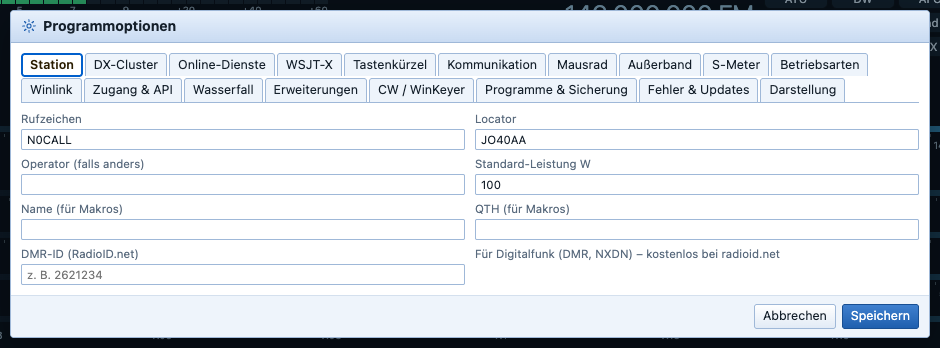

The options can be opened at any time with **F8** or via **Options** (gear icon on the right of the toolbar). Important tabs:

- **Station:** callsign, locator, name/QTH for macros, **DMR ID** (for digital voice; RigVibe checks in the RadioID list that it belongs to your callsign)
- **DX cluster:** server (e.g. `dxc.ve7cc.net`, port 23) and login commands
- **Online services:** credentials for callbook and uploads (see [chapter 9](#9-online-services))
- **WSJT-X:** UDP port (default 2237)
- **Communication:** how often the radio is polled
- **CW / WinKeyer:** CW via the radio or a K1EL WinKeyer
- **Appearance:** colour scheme (Classic, Light, Dark, Night vision) and language

A **demo radio** is preset for trying things out – everything can be operated without a radio attached.

## 3. Connecting a radio

**File → Connect …** (or **Devices**, the plug icon on the far left of the toolbar).

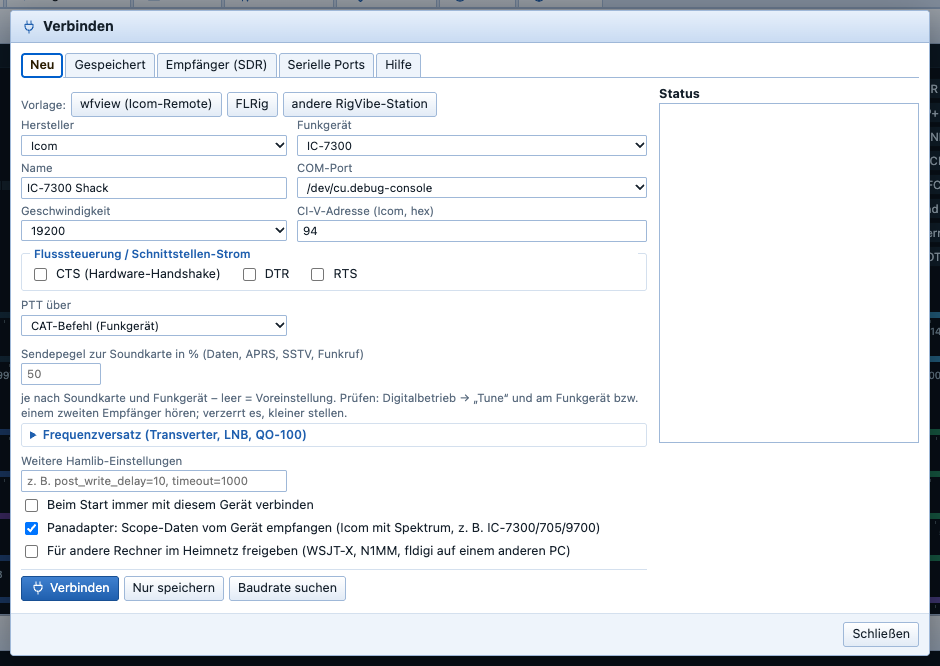

1. Choose **manufacturer** and **radio** (more than 300 models).
2. Choose the **COM port**. On Windows `COM3`, `COM4` …, on the Mac `/dev/cu.usbserial-…` or `/dev/cu.SLAB_USBtoUART`, on Linux `/dev/ttyUSB0`. The **Serial ports** tab shows which port belongs to which USB device.
3. **Speed** as in the radio's menu (CAT/CI-V baud rate). Unknown? **Search baud rate** tries them all.
4. **Icom:** enter the CI-V address (e.g. IC-7300 = 94, IC-705 = A4, IC-9700 = A2). In the radio “CI-V USB Echo Back” is usually off.
5. **PTT via:** normally “CAT command”. For interfaces without CAT PTT: DTR or RTS line.
6. **Connect**. If the radio does not answer, the reason is shown in the **Status** field.

More settings:
- **Always connect on start** – for the main radio.
- **Panadapter: scope data from the radio** – for Icom radios with built-in spectrum (IC-7300/705/9700/7610 …). In the radio set “CI-V USB Port” to **Unlinked** and 115200 baud.
- **Share with other computers** – see below.
- **Frequency offset (transverter, LNB, QO-100)** – see below.

**Frequency offset for transverters and QO-100:** the collapsible **Frequency offset** section (opens automatically when an offset is set) stores an RX and a TX offset in MHz in the radio profile. RigVibe then shows the real frequency everywhere (radio frequency + offset) and converts back when tuning. The **TX offset** applies to the transmit frequency in split operation (VFO B); empty means “same as RX”. The **QO-100** button enters RX 9750 MHz (LNB) and TX 1968 MHz (upconverter 432 → 2400 MHz), **Transverter 2 m** 116 MHz each (28 → 144 MHz). Example QO-100 with split: receive on 10489.550 MHz (radio 739.550 MHz), transmit on 2400.050 MHz (radio 432.050 MHz). Correct the LNB offset for your own LNB's drift if needed (e.g. 9749.982). Programs sharing the radio (WSJT-X …) still see the radio frequency.

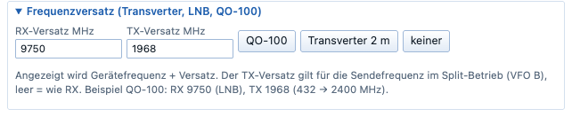

**Several radios** at once: simply connect one after the other. Each radio gets its own tab at the top of radio control.

**Sharing the radio with other programs** (WSJT-X, JTDX, N1MM, fldigi, Log4OM): on the **Saved** tab the column “For other programs” shows an address like `127.0.0.1:4600`. In the other program choose **Hamlib NET rigctl** as radio with this address. Both programs then control the same radio at the same time.

**Remote station via wfview, FLRig or another RigVibe station:** choose a **template** at the top of the Connect dialog. For **wfview** (Icom radios on the network/internet) switch on *Settings → External Control → Enable RigCtld* in wfview; wfview connects to the remote station, RigVibe controls it via port 4533. wfview provides the audio as a virtual sound card.

**TCI:** Many logging, contest and digital-mode programs (e.g. Log4OM, N1MM+, JTDX, MSHV) can control a radio via **TCI**. Switch on **F8 → Communication → TCI interface** and in the program choose “TCI” or “ExpertSDR/SunSDR (TCI)” with address `localhost` and port `40001` (for other computers in the home network tick “also reachable from the home network” and enter the RigVibe computer's address). The program then controls the currently selected radio or receiver: frequency (VFO A/B), mode, transmit, tune, power, split, RIT/XIT, S-meter and CW text. Spots reported by the program (e.g. from N1MM+) appear in the waterfall. RigVibe does not send audio over TCI – use the sound card or RigVibe's digital modes for that.

**Programs without a Hamlib network connection** (“serial radio” only): switch on **F8 → Communication → CAT emulation**. RigVibe then behaves like a **Kenwood TS-2000**. On macOS/Linux a port like `/dev/ttys003` appears (always also as `~/.rigvibe-cat`; the former name `~/.wellenwerk-cat` keeps working); on Windows create a virtual port pair with **com0com**, enter one end (e.g. COM11) in RigVibe and the other (COM12) in the other program; alternatively a TCP port. In the other program choose “Kenwood TS-2000”, 9600 baud. Frequency, mode, PTT, S-meter, power and volume are passed to the currently selected radio.

## 4. Radio control

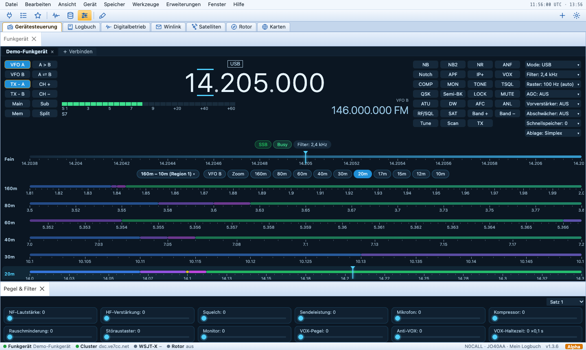

- **Frequency display:** the mouse wheel over a digit changes exactly that digit. Clicking a digit makes it “active” (bar); then **↑/↓** or **+/−** to change, **←/→** to move, number keys to type. **Enter** opens frequency entry.
- **Mode:** button above the frequency.
- **Left:** VFO A/B, TX A/B, A>B, A⇄B, Main/Sub, memory, channel ±. **Right:** function buttons (NB, NR, notch, ATU, tune …) and selection lists (filter, AGC, preamp, attenuator …). Which buttons appear depends on what the radio can do.
- **State:** below the display small tags show only what is currently active (e.g. Busy, Split, RIT, Lock); when transmitting power, SWR and ALC.
- **Fine scale** (“Fine”): the scale below the display; drag or use the mouse wheel (Shift = double, Ctrl = five times). The needle shows the tuned frequency.
- **Band row:** on the left the **band plan** (amateur radio region 1/2/3 or **broadcast** with LW, MW, the shortwave broadcast bands 120 m to 11 m and FM), **VFO B** tunes the second VFO, **Zoom** spreads one band over several rows, the band buttons jump to the last used frequency and mode of the band. The waterfall then shows the **whole band at full width** – e.g. 80 m from 3.5 to 3.8 MHz or the 49 m broadcast band from 5.9 to 6.2 MHz. In the broadcast band plan RigVibe selects AM on the first visit (FM band: wideband FM). With receivers only the bands the receiver can actually receive appear.
- **Band scales:** one scale per band across the whole band; click or drag to tune. Cluster spots and quick memories appear as markers.
- **Levels & filters** (bottom): the radio's controls as cards; up to six **sets**, e.g. one for SSB and one for CW.
- **Bands & modes** (toolbar): favourites in folders (a click tunes), the radio's menus and all settings.
- **Remember** (toolbar): save the current frequency as a quick memory (marker on the scale) or as a favourite. Everything about storing is also in the **Memory** menu. **Hotspots and repeaters with a talkgroup:** if an extension mode is selected (e.g. DMR, D-STAR, YSF), the favourite stores it together with its input fields – destination or talkgroup, colour code, time slot, RPT1/RPT2, DG-ID. Clicking the favourite restores frequency, mode and fields. This allows several entries on the same frequency, e.g. “Hotspot TG 91” and “Hotspot TG 262”.
- **Digital voice in the display:** when a decoder hears a station (DMR, D-STAR, C4FM/YSF, M17, NXDN, P25 – from the radio's receiver, the SDR following it as panadapter, or from the sound card audio in the **Digital voice** mode of digital modes), it appears under the frequency like on a digital radio: callsign and name (DMR: from the DMR ID), below that the talkgroup with its name, time slot, room or repeater and short text. After the transmission the line fades and disappears after five minutes. A click shows **last heard**; an entry from it takes the callsign into the logbook.

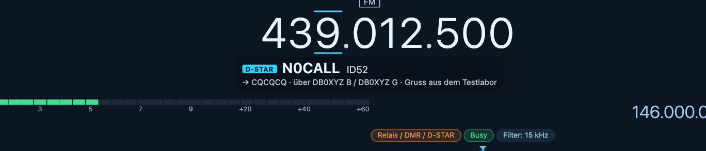

- **Buttons RigVibe implements itself** (for every radio, on the right of the display): **Lock** (frequency and mode cannot be changed – not even by mouse wheel, spot or MIDI controller), **Mute** (AF to 0 and back), **Recent ▾** (recently used frequencies; a frequency is remembered once you stay on it for four seconds), **Repeaters ▾** (repeaters in the current band, nearest first – a click sets the frequency and for FM repeaters also offset and CTCSS) and **TOT** (transmit time limit: RigVibe stops transmitting after 1, 2, 3 or 5 minutes at a time). Like all buttons they can be moved or removed under **Edit interface**.

The toolbar is grouped by task: **Devices · Bands & modes · Remember**, then **Waterfall · Data reception · Levels & filters**, then **Interface**; on the right **Entry** (new QSO) and **Options**. Switch to the logbook, digital modes etc. with the tabs below. The menus: **Device** (VFO, split, scanner, band plan, mouse-wheel step, snapshots), **Memory** (quick memory, favourites, memory channels, macros), **Tools** (panadapter, voice keyer, remote audio, edit interface).

A closed **Radio** window comes back via **View → Radio** (**File → Connect …** reopens it as well). More windows via **View** or **Tools**: broadcast schedule (broadcast stations by frequency and time, EiBi), band sweep (sweeps a band and plots the S-meter), scanner, macros, voice keyer, **Panadapter**, **Memory channels**.

**Edit interface** (**Ctrl+F8**, toolbar **Interface**): move buttons between left and right, create your own buttons (mode, frequency, CAT command, macro), colour scheme (default is the blue RigVibe scheme; also Dark, LCD, Plastic blue, LCD green, Night vision), colours, size, slider sets and band plan. **Save layout as file / Load layout from file** transfers everything to other computers.

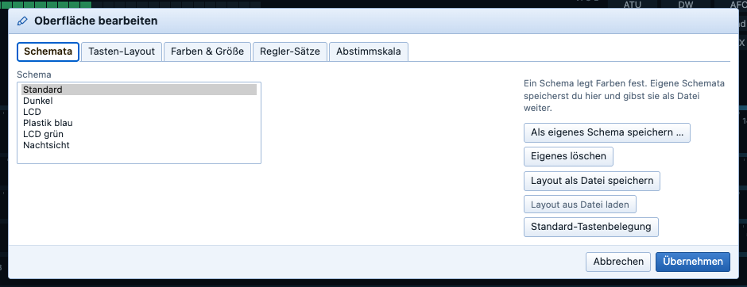

### Handheld Quansheng UV-K1 / UV-K5 V3 (USB-C)

The radio connects to the computer with its USB-C cable. **File → Connect → New**, manufacturer **Quansheng**, radio **UV-K1 / UV-K5 V3 (USB-C)**:

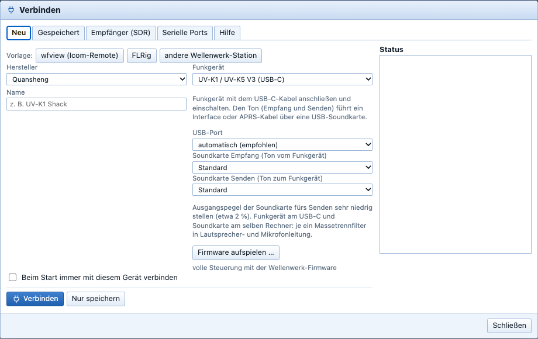

- **USB port:** “automatic” is enough – RigVibe only takes devices with the radio's USB ID; other interfaces are left untouched.
- **Sound card receive / transmit:** the USB sound card the interface or APRS cable is plugged into. RigVibe remembers it for this radio; digital modes, APRS and paging use it automatically when you switch to the radio.
- **Speaker (receive audio on the PC):** where RigVibe plays audio itself, e.g. M17 audio or speech from extensions – usually the built-in sound card, not the USB sound card at the radio. “Default” is the system default device. The microphone for speaking is set under **Tools → Transmit audio**; extension modes use it as well.
- **Several devices at once in digital mode:** every device has its **own session** with its own mode, input, received text and waterfall frequency. When you change the main device the other sessions **keep running** (e.g. APRS on the Quansheng and FT8 on the HackRF); the window shows the session of the selected device. Next to **Clear**, a strip lists the background sessions: click the name to switch to it, **🔊/🔇** turns that device's audio on or off, **■** stops its reception. Limits: the automatic FT8/FT4 sequencing (replies, CQ) works only on the selected device; in the background the messages are collected and shown when you switch. You can listen to several devices at the same time (turn the audio on).
- **An SDR as the radio's ears:** if an SDR follows the radio as panadapter (Options → “SDR as panadapter”), digital mode offers **Listen via SDR “…” (transmit via …)** under **Input**. The radio then receives with the SDR's ears (whole band, several signals) and transmits as usual. The SDR gets no session of its own. If you select another device, the session falls back to the radio's own audio and returns by itself when you select the radio again. Set USB (not FM) on the radio – the SDR follows its mode.
- **Large screens (4K):** from about 2200 × 1100 px window width RigVibe shows more at once: in digital mode “About me”, “Device status” and the sweeper sit beside the receive window, in Emergency comms the log and transports below the messages, in Winlink the chat beside the reader, and the receive text is larger. Smaller screens keep tabs. **Options → Interface size** enlarges everything further.
- **Choosing FreeDV as a mode:** the mode list in digital mode now ends with **FreeDV**. Choosing it opens or shows the *FreeDV* window (modem in the service, RADE, 700D/700E/1600); **▶ Receive** starts reception there.
- **Choosing USB-C directly in digital mode:** with a Quansheng running RigVibe firmware, the **Input** (window *Receive*) and **Output** (window *Transmit*) lists show **USB-C (device name)** as the first entry; it applies to all digital modes including APRS/Packet and is the same setting as the “digital mode” group in the table below. Choosing a sound card switches the route to the sound card.
- **Paths per mode (USB-C or sound card):** with the RigVibe firmware the Quansheng has two audio paths – USB-C and the USB sound card at the speaker and microphone jacks. In the table you set separately for **Voice (FM, AM)**, **Digital modes** (FT8, PSK, RTTY, SSTV, packet, digital voice) and every **extension mode** (DMR, D-STAR, YSF, M17 …) which path is used to **receive** and to **transmit**; RigVibe switches by itself when the mode changes. **Automatic** means USB-C where the radio supports it, otherwise the sound card. Voice always transmits via the sound card (microphone jack); for transmitting an extension mode “automatic” decides per mode – D-STAR as a bit stream via USB-C, from firmware 18 also DMR and M17 (4 levels) via USB-C, YSF (large deviation) via the sound card. Measured via the Pi-Star hotspot: DMR 0.9–3 % bit errors, D-STAR 0.5 %; YSF via USB-C (can be forced) is still lost by the hotspot, so automatic uses the sound card. Mixed works too, e.g. receive DMR via USB-C and transmit via the sound card. If a chosen path is impossible (e.g. transmitting DMR via USB-C), the PTT is greyed out and names the reason.
- **Connect.** Without the RigVibe firmware RigVibe offers to install it (see below); the **Install firmware …** button is also right in the dialog.
- To change: **Connect → Saved → Edit**.

#### Installing the firmware

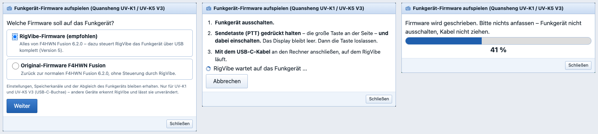

RigVibe ships the matching firmware and installs it itself – no extra program, no port selection. Open the assistant via **Radio → Install Quansheng firmware …**, via the button when setting up (type “Quansheng”), or it opens by itself when a Quansheng without the current RigVibe firmware is connected.

1. **Choose the firmware:** **RigVibe firmware (recommended)** – this is F4HWN Fusion 6.3.0 with all its features plus control by RigVibe. Installing F4HWN first is not necessary. **Original F4HWN Fusion firmware** goes back to the regular Fusion. **Next**.
2. **Put the radio into update mode:** switch it off, **hold the transmit key (PTT) and switch it on** (the display stays blank), release the key, connect the USB-C cable.
3. RigVibe detects the radio and writes the firmware (about 30 seconds, progress bar). The radio then restarts; a radio set up in RigVibe reconnects by itself.

Settings, memory channels and the radio's calibration are kept. RigVibe checks the bootloader first and only writes to UV-K1 and UV-K5 V3; other devices (e.g. older UV-K5) are left unchanged. If something goes wrong, the radio stays in update mode and can simply be flashed again.

#### With the RigVibe firmware (full control)

RigVibe and the radio work as one device: the radio's own operating logic rests, its display shows “RigVibe” and the frequency.

- **Frequency** to 10 Hz, **mode** FM, AM, USB and packet FM, **TX power** – all from RigVibe.
- **Transmitting via USB:** PTT from RigVibe, no VOX and no PTT line needed. Safety: if the radio hears nothing from RigVibe for 1.5 seconds it stops transmitting itself; after 10 seconds without a connection it restarts as a normal radio.
- **Squelch** and **S-meter** are computed by RigVibe; **Band overview** shows the band as spectrum and waterfall (the radio sweeps it). While digital voice or an extension mode is receiving, the sweep pauses – it would briefly interrupt the audio. Audio decoded by RigVibe or an extension (e.g. M17) then plays from the PC speaker, not from the radio.
- **Audio output (radio)** under “Levels & filters”: a fixed level for the sound card, independent of the radio's volume knob.
- Disconnecting in RigVibe returns the radio to normal operation.

#### Audio and data over USB-C – no sound card (RigVibe firmware version 6 or later)

With the RigVibe firmware version 6 or later, digital modes with the UV-K1 / UV-K5 V3 need no sound card, no APRS cable and no isolation transformers – just the USB-C cable:

- **Receive:** the radio samples its receive audio itself (9.6 kHz) and sends it to RigVibe over USB-C. Digital modes take it automatically as input (“receiver”); APRS, packet, SSTV, RTTY and the other decoders work with it. Hum and clicks from ground loops cannot happen on this path.
- **Transmit:** RigVibe turns the transmit audio into a sequence of tones that the radio's tone generator produces with exact timing; the service keys PTT and holds it exactly until the last tone. This works for **APRS and packet 1200 Bd, SSTV, KG-STV, RTTY, CW, DTMF, FT8, FT4, MFSK, DominoEX, THOR, Hellschreiber, PSK31/63/125, QPSK31/63/125, Olivia and Contestia**. For PSK, QPSK, Olivia and Contestia RigVibe generates a special form made of pure tones (constant level; for PSK the phase turns in the middle of the symbol via a briefly higher tone) – every other station decodes it as usual, fldigi included. With other radios and via a sound card RigVibe keeps sending the normal form. **MT63** (many simultaneous tones), **Throb** and voice still need a sound card – RigVibe says so. Transmitting 9600 Bd packet is not possible with the Quansheng (see below); receiving is, from version 12.
- **Checked over the air into the user interface (HackRF → K1 → RigVibe UI, 2026-10-26):** PSK, QPSK, RTTY, MFSK, DominoEX, THOR, Olivia, Contestia, APRS (5/5), SSTV Robot 36/Martin M1/Scottie S1/PD 120, FT8, FT4, JS8 (all four submodes), CW and POCSAG (via the paging window, 512/1200/2400 Bd) decoded. Found and fixed along the way: changing the mode in Digital modes had no effect (1.6.3/1.6.4), the PSK decoder did not re-lock after a disturbed start, POCSAG with the K1 did not work, the SSTV VIS was lost from ~60 Hz off frequency (picture only as partial picture), JS8 sometimes reported the pitch of a weak image, dt for FT8/FT4/JS8 included the window lead (+1.5 s). When sending over USB-C, pauses between tones were lost (the pause continued as a tone): Hellschreiber arrived smeared, and APRS and SSTV had a tone instead of silence between frames or before the ID – fixed. After connecting, the audio ran about 0.7 % off the K1's clock for 17 s (the clock was only measured then) – RigVibe now remembers the clock per radio (file `quansheng-takt.json` in the data folder). The decoders do cope with such a deviation, though (KG-STV error-free offline even at 1.2 %); the missing KG-STV blocks in the test were caused by dips on the radio path, not by the clock. Likewise, individual FT8/JS8 runs failed because of the test transmitter (the HackRF drifted up to 1.4 Hz/s within one transmission). Packet 9600: without the HackRF's amplifier (basement) too little signal arrived (even an ideal equaliser 6 % bit errors); with the amplifier 3 of 5 packets in the user interface (FM and PKTFM), 0.7–1.7 % bit errors on the raw signal after an ideal equaliser – the decoder gets out what the path allows (1 and 4 of 5 packets on the same recordings).
- **Checked without radio:** `node tests/k1modes.cjs` passes all 42 text modes (PSK, QPSK, RTTY, MFSK, DominoEX, THOR, Olivia, Contestia) in normal form and in the Quansheng tone-sequence form through RigVibe's transmitter and receiver, with the K1 path in between (high-pass in the receive path, residual clock error, noise at 20 and 10 dB). Result: all 42 decoded in both forms, even at 10 dB.
- **Checked over the air (2026-10-25, 434.900 MHz, lowest power, K1 on a Windows laptop, HackRF in the basement):** decoded cleanly in both directions: PSK31/63/125, QPSK31/63/125, RTTY, MFSK8/16/32, DominoEX 11/22, THOR 11/22, Olivia 8/250, 16/500, 32/1000, Contestia 8/250, 16/500, APRS/packet 1200 (5 of 5 frames) and SSTV Robot 36, Martin M1, Scottie S1, PD 120. From the K1 also POCSAG (5 of 5); CW in USB is readable with a few wrong characters. **FT8, FT4 and JS8 (all four submodes) fine-stepped from firmware version 16** (see below): 2 of 2 decoded each, +8 to +17 dB, without drift correction.
- **Fine-step FSK for FT8, FT4 and JS8 (firmware version 16 or later):** carrier keying retunes the transmitter only in 10 Hz steps. With FT8 (6.25 Hz tone spacing) three of the eight tones fell together in pairs, and every retune causes a short glitch. RigVibe therefore offsets the carrier only once by the coarse part and produces the fine part as deviation of the radio chip's FSK unit (200 or 250 steps per second, accuracy ~1 Hz, smooth transitions like WSJT-X). This also makes **JS8 Normal and Slow** possible. The transmission is loaded into the radio beforehand and starts exactly on the time slot. An initial suspicion that the K1 drifts while transmitting as it warms up was not confirmed: the measured drift was the receiver's (HackRF warming up); the K1 stays stable within a transmission.
- **Slow computer:** the tone sequence is refilled in its own thread, independent of the rest of the service. Before, SSTV pictures slipped and packet frames were lost when the computer stalled briefly (measured up to 2 s on an older Windows laptop).
- **Clock:** the UV-K1 has no crystal for its clock; it can be off by about 1 % (measured: 0.6 % slow). RigVibe keeps measuring the clock on the receive audio and corrects it for receiving and transmitting – otherwise SSTV pictures, for example, come out slanted. After connecting, the correction needs about 15 seconds of receive audio. From **version 7** the firmware also keeps tone changes on a fixed schedule and has twice the buffer – SSTV over USB then works cleanly in all modes; the assistant offers the update.
- **Carrier keying (version 8 or later):** instead of a tone the firmware can retune the transmitter itself (10 Hz steps) and key the power amplifier. The Quansheng then sends **FT8, FT4 and JS8 in USB** like an SSB radio (tones are placed to within 10 Hz; FT8's error correction absorbs that – on the 10 Hz grid, however, three FT8 tone pairs fall together – from firmware version 16 RigVibe therefore sends FT8, FT4 and JS8 fine-stepped via the FSK unit, see below) and **real CW** (carrier on/off instead of a tone in FM; in USB the carrier sits higher by the CW pitch, profile parameter `cw_pitch`, speed `wpm`). With the radio in FM, FT8/FT4 go out as a tone sequence in FM. POCSAG this way is not reliable yet (the synthesizer settles too slowly after each retune) – keep using a sound card or another device for it.
- **Repeaters: offset, CTCSS and 1750 Hz (RigVibe mode):** the Quansheng transmits on the receive frequency plus the **offset** (drop-down **Offset**, or one click in **Repeaters ▾** / the repeater list sets frequency, offset and tone together). The **transmit CTCSS** (drop-down **CTCSS**, 67.0 … 254.1 Hz) is added by the radio chip on every transmission – not under tone sequences (digital modes). The transmit CTCSS needs firmware version 21 or later (update over USB, see below). **Tone squelch** (button **Tone squelch**, or the entry in the CTCSS list) opens the receiver only while the chip hears the chosen tone; the chip searches for any CTCSS tone itself and the display shows the tone it hears (**Rx 88.5**). The **1750 Hz** button sends a half-second call tone to open a repeater (tone generator, without CTCSS; firmware 6 and later). There is no DCS. Checked on the K1 against an HackRF transmission with 88.5 Hz: the chip reported 88.6 Hz.
- **Frequency correction:** the Quansheng has no temperature-controlled crystal. If it is off frequency, the profile parameter `ppm=…` compensates in receive, transmit and band scan (with the RigVibe firmware; as with the HackRF: if the radio transmits too high or signals appear too high, the value is positive). Measure the offset against a calibrated device, e.g. a calibrated hotspot or SDR: 1 ppm is about 430 Hz at 433 MHz.
- **Packet/APRS:** with the Quansheng, RigVibe selects normal FM at full bandwidth – the unfiltered data demodulator and the narrow bandwidth clearly worsen reception over USB (measured).
- **Firmware updates over USB:** once version 6 is installed, the assistant installs new firmware over USB – no update mode, no key press: RigVibe writes it into a free firmware slot in the radio's memory, the radio checks the checksum, installs it and restarts (a few seconds). Settings, memory channels and calibration are kept. As a way back the firmware keeps a protected backup “Main”: hold **MENU** while switching on and choose “Main”.
- **Versions 13 and 14 (for extension modes):** flat transmit audio path via the microphone socket (chip filters, pre-emphasis, compander and microphone AGC off during the transmission) and a **continuous bit stream via the FSK unit** – 1200 to 6000 bit/s without length limit, no sound card. Both are used by extensions with their own operating mode (see chapter “Access, API and AI assistants” → custom operating modes).
- **Versions 15 to 20 (4FSK via USB-C):** extensions (plugins) that send and receive via the “Symbols” form can use the Quansheng in both directions over USB-C – under certain conditions: receiving via the raw wideband path, sending as 4FSK at 4,800 symbols per second with at most about 2 kHz deviation; otherwise RigVibe automatically uses the sound card. The FSK unit only knows two levels; the firmware therefore shifts the carrier down and sets the deviation from a table for every symbol (all four levels with positive deviation, because the chip changes sign only sluggishly), register 40 scales the deviation to the required value, and the timer writes 4,800 values per second using fast register access. Which modes run this way is up to the respective extension – its contents are not part of RigVibe.
- **Version 11 (based on F4HWN Fusion 6.3.0):** the same RigVibe features on the latest F4HWN release; the wizard offers the update.
- **Dropouts while transmitting:** RF picked up by the USB cable during transmission can reset the USB connection (F4HWN points this out too). Remedy: a short cable, antenna away from the cable and the computer, and if needed a clip-on ferrite suitable for 2 m/70 cm at the radio end.
- **Receiving packet 9600 Bd (version 12 or later):** switch on **Packet 9600** in Radio control. RigVibe switches the radio chip to the unfiltered discriminator (like F4HWN's AIS app: high/low-pass, de-emphasis and AFC off, widest IF filter), the radio samples at 38.4 kHz and RigVibe decodes G3RUH/AX.25 itself – with an equaliser against the board's high- and low-pass, which defeats e.g. Direwolf. The packets show up as usual in the packet monitor, in APRS and in emergency communication. Measured: 20 of 20 packets over the air (HackRF as transmitter). When switched off, RigVibe restores the registers.
- **Transmitting packet 9600 Bd:** not possible with the Quansheng. Measured: the radio chip's FSK unit clocks exactly at its tone generator, which reaches about 6,350 Hz at most (1,200, 4,800 and 6,000 bit/s confirmed); the tone sequence only produces tones, not baseband, and retuning the carrier takes 20–40 ms per change. To transmit 9600 Bd use a radio with a 9600 data jack or an SDR.

#### With the regular F4HWN firmware

- **Frequency:** RigVibe reads it from the display; a frequency from RigVibe is typed in on the radio (only in the main screen in VFO mode).
- **View → Funkgerät-Display (Quansheng):** the radio's display live, with its keys below.
- **Transmitting:** the regular firmware does not allow PTT via USB – use VOX or the PTT line of an interface (parameter `ptt=rts:/dev/cu.usbserial-…` or `ptt=dtr:COM5`).

#### Audio

Via an interface (Digirig, AIOC) or an APRS cable on a USB sound card; select that sound card in digital mode (remembered per device). The microphone input is very sensitive, so under **Radio → Connect** the **transmit level to the sound card** defaults to **4 %** for Quansheng (sound card turned fully up). Measured with a USB sound card and two isolation transformers: APRS decodes cleanly at 2–8 %; from about 15 % the radio limits and distorts. Other sound cards may need a different value – check with **Tune** in digital mode.

**Important with USB-C and a sound card on the same computer:** the radio's speaker output is not ground-referenced. If both the radio and the sound card are connected to the computer, the common ground shorts it – the sound card then only gets clicks, no audio. Remedy: one **ground loop isolator (transformer) each in the speaker and in the microphone line**. Without the USB-C connection (battery only) this does not happen.

**Sound card not found:** browsers give the sound card a separate ID per profile, so RigVibe also remembers its name and finds it again that way. If the card really is not connected, RigVibe does not transmit (no silent carrier) and reports “sound card … not found”.

- A connected SDR (HackRF, OpenWebRX …) can follow the handheld as a **panadapter** (see below).

### Panadapter and memory channels

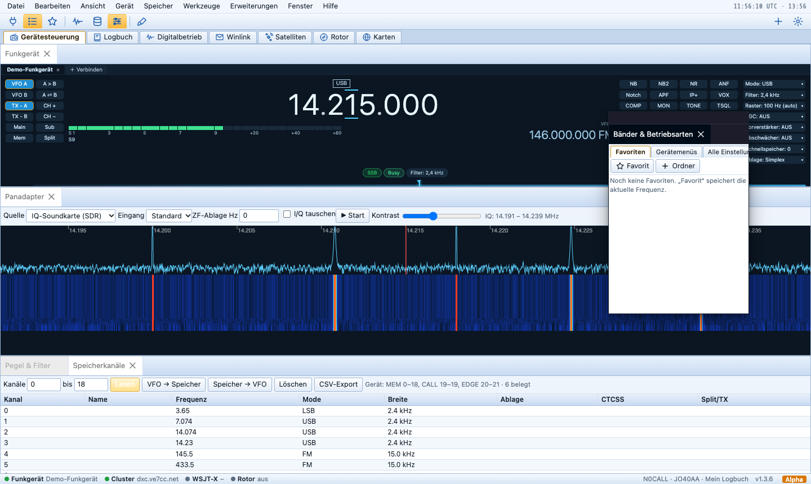

- **Panadapter** (top of the picture): spectrum and waterfall; a click tunes. Source is either the **radio scope** (Icom) or an **IQ sound card** (SDR, e.g. via DAX IQ or an IQ output). For IQ: choose the input, **Start**; if needed **IF offset** and **Swap I/Q** (if the spectrum is mirrored).
- **Memory channels** (bottom of the picture): **Read** fetches the channels from the radio. Click a channel, then **Memory → VFO** (or double-click), **VFO → memory** or **Delete**. **CSV export** saves the list, **CHIRP file** in the format of the programming software CHIRP.
- **CHIRP** (menu **Memory**): **nearby repeaters as CHIRP file** – a “memory pack” for the handheld with the 2 m and 70 cm repeaters around you (FM, optionally D-STAR, DMR, C4FM), with offset and CTCSS; **favourites as CHIRP file**; **import CHIRP file as favourites** – every channel becomes a favourite (with offset and CTCSS, which are set on the radio when recalled). Write the file to the radio with CHIRP (chirpmyradio.com, “File → Import”).

### Snapshots and synchronizing

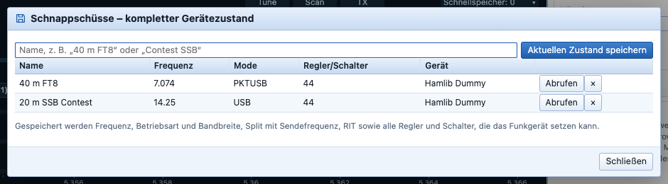

**PTT buttons:** below the frequency display there is a **PTT** button for every connected radio – the same in every mode, including digital voice from extensions (DMR, D-STAR, YSF, M17 …). **Hold** to transmit while pressed; a **short tap** latches (tap again, space bar or `Esc` ends). Holding the **space bar** is PTT as well – for the radio whose PTT button you used last, otherwise the current one; it does nothing while you type in a field or a window is open, and can be switched off with **Space bar**. If a radio cannot transmit right now, its button is **greyed out** and names the reason: receiver (WebSDR, KiwiSDR …), frequency outside the amateur bands, a band the radio cannot transmit on (the UV-K1/K5 only transmits on 2 m and 70 cm, Hamlib radios according to their TX ranges), missing callsign, and for extension modes their transmit path and TX lock. Pressing another radio's PTT does **not** make it the current radio: every radio can run its own mode (e.g. FT8 on one, DMR, FM, YSF, M17 or D-STAR on the other), display and digital modes stay where they are; the transmit audio goes to the sound card or extension of the transmitting radio.
- **Microphone:** next to it (🎤) you choose the microphone you speak into – it applies to every PTT (FM, DMR, D-STAR, YSF …), the same choice as under **Tools → Transmit audio** and in the Quansheng connect dialog. Usually the built-in microphone or a headset is right, not the USB sound card at the radio.
- **Destination for digital voice:** with extension modes the destination sits next to the PTT, e.g. **DMR → TG 9990** – a click picks a recently used or just heard talkgroup or opens the entry (for DMR with group or private call). D-STAR shows UR, YSF the destination.
- **Half duplex (default):** only one transmitter at a time; while transmitting, all reception is muted, including a full-duplex radio's own (no feedback into the microphone).
- **Duplex** (with several radios or one radio that is full duplex itself – ADALM-Pluto, radios with a satellite mode such as IC-9700, IC-910, TS-2000, FT-847): reception stays audible while transmitting (headphones!) – the other radios and, on a full-duplex radio, the radio itself, e.g. your own downlink via QO-100 – and two radios may transmit at the same time. For satellite work and parallel operation.

**Device → Snapshots …** saves the complete radio state under a name – frequency, mode and bandwidth, split with transmit frequency, RIT and all controls and switches the radio can set – and restores it with **Recall** (e.g. “40 m FT8”, “Contest SSB”). One-shot actions like starting the tuner or a tone burst are never triggered.

**Device → Couple two devices …**: a second connected radio follows the first – frequency plus an adjustable **offset** and optionally the mode (second receiver, SDR as panadapter, transverter IF).

### Receivers without a radio of your own (KiwiSDR, OpenWebRX, WebSDR)

RigVibe can use public internet receivers like a radio – for listening, for digital modes or as a second receiver next to your own radio. Also ideal for trying things out without a license and without a radio.

1. **File → Receivers (WebSDR/KiwiSDR) …** (or the **Receiver (SDR)** tab in the Connect dialog). The list shows more than 1800 public receivers from receiverbook.de and kiwisdr.com, sorted by distance from your station. Filters: type, search text (place, callsign, locator, antenna), **free slots**, **receives current frequency**.
2. **connect** makes the receiver the main radio; **2nd rx** connects it in addition, your own radio stays the main radio.
3. Audio, S-meter and waterfall arrive immediately; tuning, mode, volume, AGC and noise blanker work as with a radio. Transmitting is of course blocked for internet receivers (with your own HackRF or Hermes Lite 2 it works, see below).

When a receiver is the current radio, the display only shows the bands it can receive, and next to the radio tabs a **list with more receivers** appears (free slots, by distance) – one click switches the server; if that fails, RigVibe reconnects to the previous one.

**“Receivers” window** (*View*): all connected receivers with their own frequency, mode, volume, sound on/off, S-meter and a small waterfall. **follows the main radio** lets a second receiver follow the radio's frequency (e.g. to compare with a remote antenna). **Only the main radio is audible:** second receivers and an SDR used as panadapter stay muted by default and provide waterfall, data reception and decoders. **Sound on** adds a second receiver; this is remembered. If you switch the main radio, the sound follows. The **Quansheng** plays its FM/AM audio in RigVibe via USB-C (switch it off with **Sound off** if you prefer the radio's own speaker) – in the digital modes (digital voice, extensions, packet 9600, AIS) only the decoded voice, never the raw signal. While transmitting in half duplex all receivers are muted; in **duplex** they stay audible (see PTT buttons).

**Own address and parameters:** enter a receiver directly at the bottom of the tab. Parameters separated by `;`, e.g. `password=…; span=200; freq=7074; mode=USB; user=Name` (KiwiSDR) or `profile=40m; smeter_offset=-30` (OpenWebRX).

**Digital modes:** choose **Audio from the receiver (SDR, WebSDR, KiwiSDR)** as input – PSK, RTTY, FT8, SSTV, APRS etc. then decode the receiver's audio.

**Your own SDR hardware** (bottom of the tab, “enter receiver directly”):
- **RTL-SDR stick directly on USB:** choose the type **“RTL-SDR (USB direct)”**. RigVibe finds the stick and enters its serial number; leave the address empty. No extra program is needed; the driver library (RTL-SDR Blog version) is included in the desktop program. The **RTL-SDR Blog V4** receives shortwave from 500 kHz this way. Older sticks without a built-in converter need `direct=2` for shortwave. Further parameters: `gain=auto` or dB, `ppm=…`, `bias=1` (supply voltage for active antennas).
- **HackRF One directly on USB:** type **“HackRF One (USB)”**. Reception from 1 MHz to 6 GHz at 4.8 MS/s. Parameters: `gain=auto` or 0–102 dB, `amp=1` (preamplifier), `bias=1`.
- **SoapySDR (Airspy, SDRplay, LimeSDR, RX-888 …):** Type **“SoapySDR (Airspy, SDRplay, LimeSDR, RX-888 …)”**. RigVibe uses the *SoapySDR* library and its **driver modules** for this. **The finished packages already include SoapySDR and the drivers for Airspy (R2/Mini) and Airspy HF+** – just plug those devices in. For other devices (SDRplay, LimeSDR, RX-888 …) the driver module has to be installed separately and must match the bundled SoapySDR version (0.8) (Linux: `apt install soapysdr-tools soapysdr-module-all`, macOS: `brew install soapysdr` plus the module for your device, e.g. `soapyairspy`, Windows: PothosSDR). The dialog lists the devices found and fills in the identifier. Parameters: `args=driver=airspy,serial=…` (exact device), `driver=…`, `index=…`, `rate=…` (default: the largest suitable rate of 2.4 / 3 / 1.2 / 4.8 / 6 MS/s …), `gain=auto|<dB>` (for devices without gain control RigVibe chooses cautiously; **strong nearby signals overload the receiver otherwise**), `antenna=…`, `bandwidth=…`, `ppm=…`, `channel=…`. **Receive only.** RigVibe needs a sample rate that is a multiple of 12 kHz; devices that only offer other rates (Airspy R2 with 2.5 and 10 MS/s) do not work yet. **Only the HackRF via SoapySDR has been tested so far** (with real radio, skimmer on); Airspy, SDRplay, LimeSDR and RX-888 were not tried on the device.
- **RTL-SDR over the network:** type “RTL-SDR (rtl_tcp)” and enter `127.0.0.1:1234` or the computer running `rtl_tcp` as address.
- **SDRplay over the network:** type “SDRplay RSP (rsp_tcp)”, address `host:1234` of the computer running `rsp_tcp -E`. Parameters as for rtl_tcp. Not yet tested with real hardware.
- **SpyServer (Airspy, RTL-SDR, Airspy HF+ over the network):** type “SpyServer”, address `host:5555`. RigVibe picks the sample rate closest to `rate=500000` (integer divisions of the server rate; shown converted to a multiple of 12 kHz) and fetches only IQ data, all processing runs locally. Parameters: `gain=auto` or a server gain step, `format=uint8|int16|float`. If the server does not allow tuning you hear the frequency the operator set. Tested against a test server written here, not against a real SpyServer (the public ones were unreachable from here).
- **Play an IQ recording:** type “IQ-Aufnahme (Datei abspielen)”, address = file path. Readable: `.wav` (2 channels I/Q as written by SDR#, SDR++, HDSDR), `.cf32`, `.cs16`, `.cu8`, `.cs8`; give `rate=…` for raw files. The centre frequency is often in the file name (`…_7100000Hz…`) or set with `freq=` (kHz). For practice, analysis and testing without a radio.
- **Hermes Lite 2** (and other openHPSDR devices): leave the address empty – RigVibe searches the network – or enter the IP. Parameters `rate=192000`, `gain=20`. **Band decoder:** with `oc80=1;oc40=2;oc20=4` (names `oc160 … oc6`, value 0–127) RigVibe sets the device's open-collector outputs per band, e.g. for filter or antenna switches; they are off outside these bands.
- **Windows:** The **HackRF One** (firmware from 2017 on) makes Windows 10/11 load the right driver by itself – just plug it in. **RTL-SDR** sticks (and HackRFs with very old firmware) need the WinUSB driver once: RigVibe detects this when connecting and shows the button **“Set up driver (once)”**. One click, Windows asks once for administrator rights, done – no extra tool such as Zadig needed. **Linux:** install the udev rules from the *rtl-sdr* or *hackrf* packages; for the RTL-SDR block the DVB-T driver (`blacklist dvb_usb_rtl28xxu`).

**Transmitting with an SDR (ADALM-Pluto, HackRF One, Hermes Lite 2)** – amateur radio licence required:
- Set the parameter **`tx=1`** in the profile, otherwise transmitting stays locked. RigVibe transmits only inside the amateur bands (IARU Region 1; the whole signal must be in the band); own ranges with `tx_ranges=from-to,…` in kHz, e.g. for Region 2.
- **PTT** as with a radio (TX button, space bar, digital modes). While PTT is pressed the **microphone** goes on air through the audio processing (microphone, level, compressor and equaliser in the **Transmit audio** window, see [Transmit audio](#transmit-audio-microphone-compressor-equaliser-vox)). **Digital modes and SSTV** send their audio straight to the SDR instead of the sound card. Modes USB, LSB, CW, AM, FM and the data modes. After at most three minutes in one go RigVibe releases the PTT itself.
- **HackRF One:** `ppm=…` corrects the crystal error (also when transmitting; if signals appear too high the value is negative, e.g. `ppm=-9`). RigVibe sends CW text (Digital modes → CW or macros) with all transmit-capable SDRs itself, speed with `wpm=20`. Parameters `power=0…47` (transmit gain, default 20) and `tx_amp=1` (power amplifier). Depending on the band the HackRF delivers only a few milliwatts and switches reception off while transmitting. **The HackRF has no harmonic filter – a low-pass or band-pass filter for the band in use is mandatory at the output, otherwise it radiates harmonics.**
- **Hermes Lite 2:** parameters `power=0…15` (default 4) and `pa=1` (built-in power amplifier, up to about 5 W). The HL2 has its own low-pass filters.
  - **PureSignal (predistortion), status: simulation only.** The **PS** button on the radio display switches on an adaptive predistortion: RigVibe multiplies the transmit signal by a learned curve that exactly reverses the error of a non-linear power amplifier (tube, transistor PA). It needs a **feedback path** that reads back what was actually transmitted. Learning and alignment (delay down to fractions of a sample, gain, curve over many level steps) are done and tested. **The real HL2's feedback path is not connected yet**, so for now there is only the test with the parameter `pasim=tube`: the transmit signal then runs through a **simulated tube amplifier** (soft compression, phase shift, class-AB knee, supply sag) and comes back as the feedback, nothing is transmitted. The receiver list then shows the learning state and the adjacent-band level. Simulation results: in a two-tone test third-order intermodulation drops from −29 to −61 dBc at medium drive and from −25 to −63 dBc at high drive; with speech the adjacent bands become 6 to 13 dB quieter depending on drive. PureSignal cannot correct anything above saturation or the amplifier's memory effects (supply sag).
- RigVibe limits the level and filters the audio to voice bandwidth. In tests the unwanted sideband was 50 dB or more down, everything outside 3 kHz more than 85 dB.

RigVibe computes spectrum, waterfall and audio (USB, LSB, CW, AM, FM) itself; the S-meter is not calibrated (`smeter_offset=…`).

**WebSDR.org receivers** (University of Twente and others) have no open interface: **in the browser** opens their page on the current frequency – in the desktop program as a RigVibe window of its own. **Decoding:** in digital modes choose the input **WebSDR window / browser tab (take over audio)**. The desktop program then takes the audio of the WebSDR window; in the browser (Chrome/Edge) it asks which tab to share – pick the WebSDR tab and tick **Share tab audio**. Tested: APRS via the 2 m WebSDR Maasbree (36 frames in 5 minutes, Direwolf on the same audio 35), FT8 via Twente.

Some OpenWebRX servers only admit listeners with a name. RigVibe logs in there automatically with your callsign from the program options (or the parameter `user=…`).

> The receivers are voluntary offers by radio amateurs with few slots – please disconnect after use.

### QO-100 (Es'hail-2)

**With your own hardware** – best the **ADALM-Pluto** (type “ADALM-Pluto (USB/network, also QO-100)”, address `ip:192.168.2.1` or `usb:`):

- **Reception** via an LNB: parameter `rx_offset=9750000000` (LNB with 9750 MHz; for 25-MHz-crystal LNBs your own value). The display then shows the real downlink frequency 10489.5–10490 MHz. This works the same way with RTL-SDR and HackRF.
- **LNB drift correction:** RigVibe continuously finds the PSK beacon on 10489.750 MHz and corrects the LNB's offset (shown in the receiver status). Off with `lnbfix=0`, another beacon with `beacon=Hz`.
- **Transmitting (Pluto and HackRF only, with `tx=1`):** you tune on the downlink frequency; transmission goes automatically to the uplink (downlink −8089.5 MHz, i.e. 2400.0–2400.5 MHz). The Pluto keeps receiving – your own signal appears in the waterfall. Transmit level with `power=-89…0` (dB), fine correction of the uplink with `qo100_tx_off=Hz`. A power amplifier with a 2.4 GHz filter belongs in between.
- **Band plan:** beacons, CW, narrowband digital, digital modes and SSB of the transponder appear in the tuning scale and the waterfall; mode and filter follow as on shortwave. Band button **3cm** jumps to the PSK beacon.
- **Logbook:** QSOs via QO-100 are stored as satellite QSOs (propagation SAT, satellite QO-100, frequency/band = uplink 13 cm, receive frequency/band = downlink 3 cm) – as LoTW and other services expect.

**Pluto over the network:** Instead of USB, the Pluto can be used over the network – with a USB Ethernet adapter on the Pluto, as a Pluto+ with built-in Ethernet, or mounted at the dish. Leave the address empty and RigVibe finds the Pluto itself: on USB, as `pluto.local`, at `192.168.2.1` and in your home network. Devices found are listed with model and serial number. You can also enter a name or IP address, e.g. `192.168.1.50` or `pluto.local`, optionally with a port (`10.0.0.5:30431`). RigVibe checks beforehand whether the Pluto answers and tells you why if it doesn't. If the connection drops, RigVibe reconnects by itself. 2.4 MS/s receive plus simultaneous transmit needs a **wired link** (100 Mbit or more); Wi-Fi is usually not enough. On Linux, `.local` names only work with avahi (libnss-mdns) – otherwise enter the IP address. The Pluto's IP address is set in `config.txt` on its USB drive.

**Over the network:** the receiver list contains OpenWebRX receivers with QO-100 (search “QO-100”) – they work like all others. The well-known QO-100 WebSDRs (e.g. BATC) run PA3FWM's WebSDR software, which has no open interface; they open in the browser on the current frequency.

### Waterfall and 3D waterfall

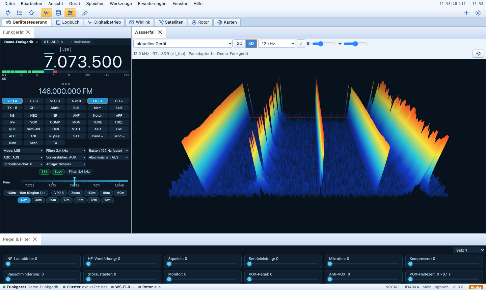

**View → Waterfall (2D/3D)** shows spectrum and waterfall of every source (receiver or radio scope; selectable at the top). The **passband** is drawn as a glowing frame over spectrum and waterfall – matching mode and filter (USB above, LSB below the dashed carrier frequency, CW/AM/FM centred or exactly where the receiver listens); so you can hit a signal precisely. A coloured strip at the top shows the band-plan segments. When zooming in with the mouse wheel, RigVibe automatically requests a finer section from RTL-SDR, Hermes Lite and KiwiSDR (real higher resolution); OpenWebRX delivers its full spectrum with up to 4096 points right away. Scale, labels and the waterfall lines already drawn follow zooming and panning. The view follows the frequency only when you tune; panned by hand it stays where you drag it. **2D:** mouse wheel zooms, dragging pans, the passband is highlighted. **Clicking a signal** tunes so that the frame sits centred on the clicked spot. If the spot lies in another band-plan segment, the mode (e.g. LSB instead of USB, CW) is switched at the same time and the frame still lands on the signal. **3D:** the latest lines as a landscape – dragging rotates, the mouse wheel changes the distance. In the **Receivers** window, too, a click into the small waterfall tunes that receiver to the clicked frequency.

In the toolbar above the waterfall:
- **Width** – displayed span from 3 kHz to 1.5 MHz or the **whole range** (⤢). The span is centred on the receive frequency and follows when you tune out of the picture. With SDR hardware (RTL-SDR, Hermes Lite 2) RigVibe recomputes narrow spans at finer resolution (about 12 Hz per point at 12 kHz instead of 750 Hz); with a KiwiSDR its zoom is set, with Icom radios with a scope the radio's span.
- **Contrast** (◐) and **brightness** (☀): contrast spreads the level range, brightness raises or lowers the noise floor. Double-click resets a slider. Automatic level adjustment keeps working underneath.
- **Graphics card:** the waterfall is drawn on the graphics card (WebGL – Intel onboard graphics, NVIDIA, AMD and Apple alike), at full screen resolution vertically too (at 150 % scaling 1.5 times as many lines, so short signals such as CW dots and FT8 tones stay sharply separated). Zooming and panning also apply to older lines, contrast and brightness to the whole picture. Without WebGL the processor draws as before. Can be switched off under **F8 → Waterfall**.
- **Spectrum ▾** (right of the bar) – display of the spectrum trace as known from SDR#, SDR++ or GQRX: **line**, **filled area** or both; **smoothing** (off, light, medium, strong – noise calms down, weak carriers stand out); **peak hold** (yellow line slowly falling back); **label the strongest signals** (frequency above the peaks); **grid**; **frame rate** (default 30 frames per second, 60 for very smooth, 15 saves power on slow computers). The trace is drawn in step with the screen and glides smoothly from one measurement to the next – even when a receiver delivers data less often. Local SDRs deliver 25–30 spectrum lines per second. Line width and peak decay time under **F8 → Waterfall**.

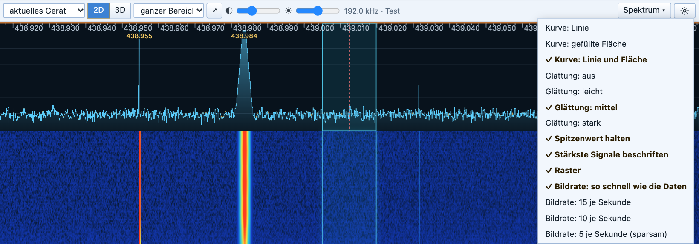

- **Remembered per band:** the waterfall remembers the section (zoom), contrast and brightness for every band. When you come to a band – by band button, frequency entry, spot or memory – it looks the way you left it; without your own zoom it shows the whole band. The band button always shows the whole band. Own receivers (HackRF, RTL-SDR, Hermes Lite 2, Pluto) move their centre into the band for this if it fits their bandwidth (40 m with 200 kHz, for example, needs 384 kS/s).

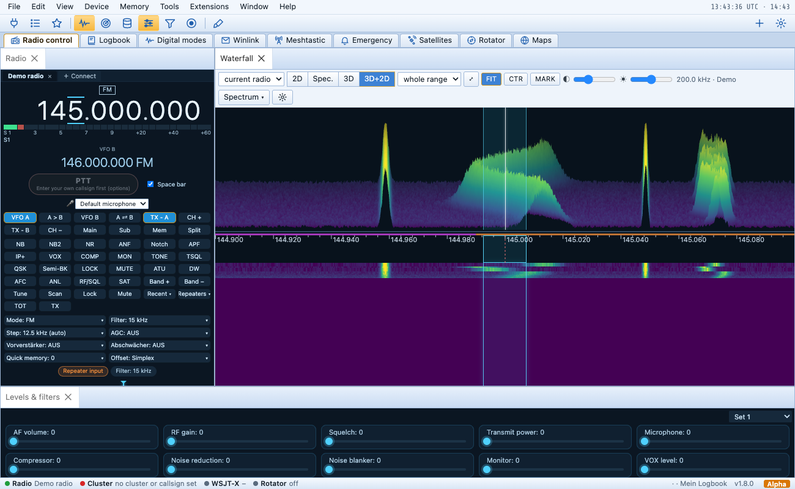

**3D+2D:** The *3D+2D* button in the window bar shows the 3D landscape on top (the latest lines as a filled surface on a dark red background: newest line in front at full width, older lines receding in perspective; a level scale on the left belongs to the front line) and the scale and 2D waterfall below – on the **same frequency axis**: a peak above stands exactly over its trace below. Zooming, panning and click-to-tune work in both parts as in the 2D view; the tuning line and passband also run across the landscape. Peak height and depth are set under **F8 → Waterfall**. The landscape moves smoothly at the display's refresh rate (not in jumps with each new line). The default colours are now *Spectrum* (blue – green – yellow – red); others under **Colours**.

**Dragging the passband:** The edges of the glowing frame can be moved with the mouse (the pointer becomes a double arrow), in the spectrum, the waterfall and the 3D landscape. In SSB the dragged edge moves; in AM, FM and CW the frame widens or narrows symmetrically; the width snaps to 50 Hz. On receivers (SDR) the filter follows while you drag; on other radios the width is set when you let go.

**Buttons in the bar:** *FIT* keeps the level fitted to the visible signals, *CTR* keeps the receive frequency in the middle of the view, *MARK* labels the strongest signals with their frequency (in 3D+2D below the scale). More **colour palettes** (Viridis, Magma, Plasma, Inferno, Turbo, Ice, Phosphor) are under **F8 → Waterfall → Colours**.

**Skimmer (CW, PSK31, RTTY):** With your own SDR (RTL-SDR, HackRF, Pluto …) RigVibe reads many stations at once. In the *Data reception* window choose the decoder **Skimmer**: RigVibe looks for signals within 48 kHz around the receive frequency and reads up to 12 at the same time. A single narrow tone is tried as **CW** and as **PSK31** at the same time (the readable result wins), two tones 170 Hz apart as **RTTY** (45.45 Bd, both tone orders; a carrier in the middle, as in FM RTTY, is removed). Callsign, mode, speed and text are listed; the callsign also appears as a tag at the signal in the waterfall. Tested with synthetic signals (all three modes at once, noise without any report) and with real radio: a Quansheng UV-K1 sending on 70 cm, received by a HackRF; **CW** (18 WPM) and **RTTY** (both sidebands of the FM transmission) were read correctly with callsign. **PSK31 was tested with synthetic signals only**, not over the air. Noise, carriers and wide signals are discarded; the first characters of a transmission are often lost while the decoder settles. The tags can be switched off under **F8 → Waterfall**. CPU load: about one sixth of a core more at 2.4 MS/s (measured on a Mac, not on a Raspberry Pi).

**Showing and hiding controls:** Under **F8 → Waterfall → Controls** the 3D+2D button, the FIT, CTR and MARK switches, dragging the passband and the skimmer tags can each be switched on or off.

**Spots from PSK Reporter:** Under **F8 → Waterfall** you can switch on that RigVibe shows, from **pskreporter.info**, who was heard in the visible section during the last 10 minutes (FT8, FT4, WSPR, PSK31, JS8 …). The callsigns appear in orange above their signals (up to 30 of the strongest); the tooltip shows mode, SNR, locator, how often and by whom they were heard, and a click tunes to the frequency. **Off by default**, because the **visible frequency range is sent to pskreporter.info** (no callsign). Consideration for the service: only sections up to 400 kHz wide, the same section at most every 5 minutes, at least 20 s between two requests, 5 to 15 minutes' pause after errors. The picture shows invented callsigns.

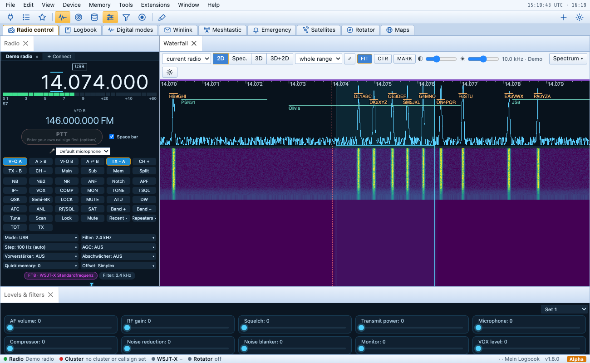

**Layout and views:** A **handle** sits between the spectrum and the waterfall: dragging changes the size of both parts (double-click resets; in 3D+2D the handle sits between the landscape and the rest). The **Spec.** button shows only the spectrum without a waterfall. Both can be switched off under **F8 → Waterfall → Controls**.

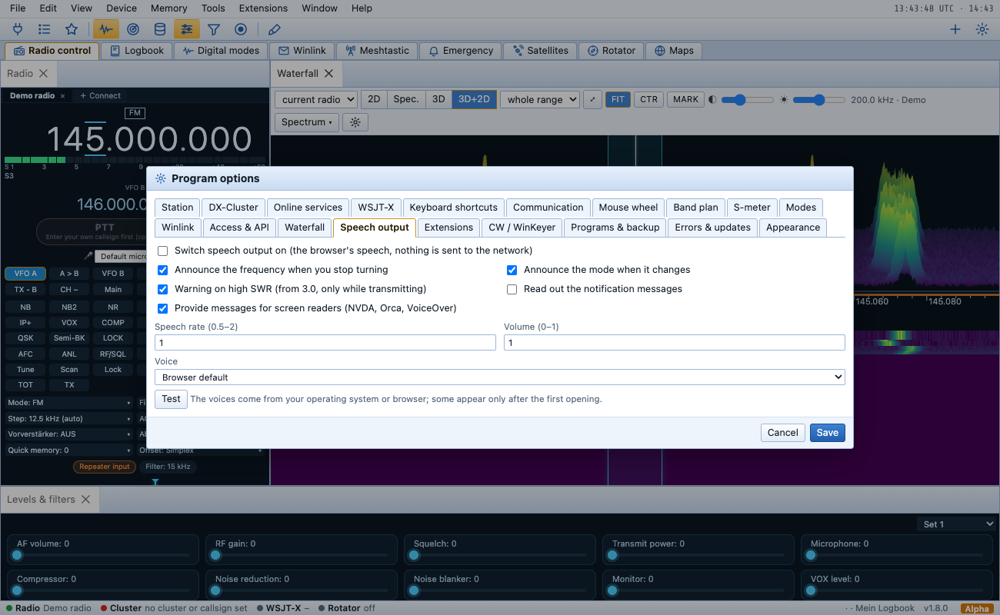

**Speech output:** Under **F8 → Speech output** RigVibe can announce the **frequency** (when you stop turning), the **mode**, warn about a **high SWR** (from 3.0, only while transmitting) and read out the **notification messages**. The voice comes from your browser or operating system (nothing is sent to the network); speed, volume and voice can be set, **Test** plays a sentence. For **screen readers** (NVDA, Orca, VoiceOver) the messages are also provided in an invisible region (can be switched off). Default: off. Frequency, mode and SWR are not announced while the output is off.

The waterfall scrolls at a constant speed even when a source sends its lines in bursts (KiwiSDR, OpenWebRX, internet): RigVibe shows the lines with a small delay and blends between them. Speed, colours, levels and 3D depth under **F8 → Waterfall**.

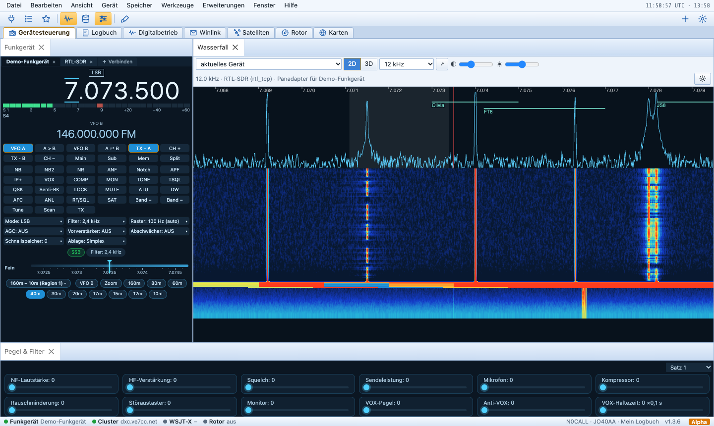

### SDR as panadapter for a radio without a scope

Many radios have no spectrum display of their own. If an SDR is connected as well – e.g. an **RTL-SDR** on the same antenna (via an antenna relay/TX protection or on a separate receive wire) – it takes over as the panadapter:
1. Connect the radio as usual, then add the SDR via **Connect → Receivers (SDR)** as **2nd rx**.
2. The **Waterfall** (source “current radio”) and the **Panadapter** window now show the SDR's spectrum; the toolbar says “panadapter for …”.
3. The SDR follows the radio's frequency and mode. A click in the waterfall tunes the **radio**; the radio is operated completely as usual.

The SDR is still a full receiver: switch its audio on in the **Receivers** window, and **as main radio** makes it the current device – then a click tunes the SDR itself again. The waterfall's source list also offers “… as panadapter for …” explicitly. Under **F8 → Waterfall → SDR as panadapter** the automatic mode can be switched off or a particular SDR chosen; in automatic mode radios with their own scope (Icom) keep their scope. If the radio has a frequency offset (e.g. QO-100), the SDR needs the same receive offset (`rx_offset`) to be able to follow.

Receiver audio plays with about half a second of buffer; on a stuttering internet connection the buffer grows by itself (up to 2 s). If the connection to a receiver drops, RigVibe reconnects by itself. After a restart or an update, the radios and receivers connected before are connected again – with the last frequency and mode.

### Tuning step

Frequencies between channels are of no use – RigVibe therefore tunes in the **raster of the band**. The **Step** selector on the radio shows the current step; “automatic” chooses it by band and mode:

| Range / mode | Step |
|---|---|
| Long and medium wave (AM) | 9 kHz (Region 1), 10 kHz (Region 2) |
| Shortwave broadcast bands (AM) | 5 kHz |
| CB radio | 10 kHz (channels 26.965 … 27.405 MHz) |
| 10 m and 6 m FM | 10 kHz |
| FM broadcast | 50 kHz |
| Airband (AM) | 8.33 kHz |
| 2 m FM, Freenet, marine, 23 cm | 12.5 kHz |
| 70 cm FM (also DMR/D-STAR), PMR446 | 6.25 kHz |
| SSB | 100 Hz |
| CW, digital modes | 10 Hz |

Any step from 10 Hz to 100 kHz can also be set by hand. A **click in the waterfall** snaps to the raster (signal identification also puts its measured frequency on the raster, AM broadcast e.g. on 5 kHz), **Page Up/Page Down** move one step, and the mouse wheel on the tuning scale jumps from channel to channel in channel rasters.

### Band plan: mode and filter automatically

RigVibe knows the band plan (region 1 after the IARU band plan from 160 m to 23 cm, regions 2 and 3 simplified; choose the region on the band row). The segments are coloured on the band scales: **blue** CW, **violet** narrow band/digimodes, **green** SSB, **teal** all modes, **yellow** beacons, **orange** FM and repeaters, **red** satellites. The current segment is shown as a tag below the display (e.g. “CW”, “SSB”, “Digimodes / APRS” or “FT8 · WSJT-X standard frequency”).

**Band stacks (several slots per band):** The band buttons of the radio control remember up to **8 slots** per band (frequency, mode and filter; default 3). When you change the band, RigVibe remembers the current state and recalls the **most recent slot** of the new band. **If you press the button of the band you are already in once more, RigVibe steps to the next slot** – so on 20 m you jump between FT8, CW and SSB. If you tune far away from the slot (more than 3 kHz), the new state is stored as a **new slot**, otherwise the slot is just updated. The tooltip of the band button shows the slots (▶ = current), the **right-click menu** of the button jumps straight to a slot or forgets them. It also applies to the MIDI keys band up/down. **F8 → Band plan** switches band stacks off (then one frequency per band as before) and sets the number of slots.

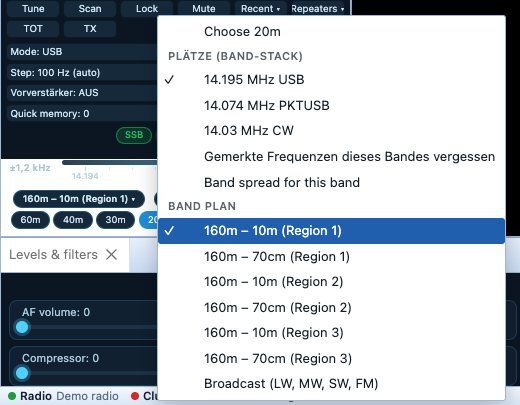

When you move into another segment or tune to a known digital frequency (e.g. FT8 on 7.074 MHz), RigVibe sets **mode and filter** accordingly: CW with 500 Hz, SSB with 2.4 kHz (LSB below 10 MHz, USB above), digimodes PKTUSB with 3 kHz, FM. If you change the mode by hand, it stays until you leave the segment. Band buttons with a remembered mode and signal identification are not overridden. Switch it off under **Options → Band plan**.

**Digimode frequency list:** FT8, FT4, JS8, WSPR, MSK144, PSK31, RTTY, Olivia, SSTV, FreeDV and CW QRP with their activity frequencies per band – a click sets frequency, mode and filter (in digital modes also the matching mode there). Found under **Memory → Digimode frequencies** (radio control), **Frequencies** in the digital-modes toolbar and as a drop-down **Frequencies ▾** in the FreeDV and SSTV windows.

### Noise filters: NB, noise reduction (also AI) and notch

**View → Noise filters** (or the **Noise filters** button in the toolbar) processes the audio you listen to. It works for every source: SDR hardware, KiwiSDR, OpenWebRX and WebSDR as well as radios via CAT whose audio you hear through the PC sound card.

- **NB (noise blanker):** blanks short impulses (ignition, electric fences, switch-mode supplies). The slider sets the sensitivity. With your own SDR hardware (RTL-SDR, Hermes Lite) there is also **“in the receiver (IQ)”** or the **NB** button on the radio display. It blanks on the IQ data before any filter smears the impulses – that works much better. The receiver blanker bridges the blanked spot linearly (instead of inserting zeros) and checks again after decimation to 12 kHz, where even weak impulses stand out; with synthetic ignition noise the signal-to-error ratio for strong impulses rose from 15 to 30 dB. The price is about 10 ms of audio delay.
- **NR (noise reduction):**
  - **Spectral** continuously estimates the noise per frequency and lowers it between and under the speech (Wiener filter with a running estimate of the noise floor). The slider sets the strength.
  - **AI (RNNoise)** is a neural network that separates speech from noise. The noise between and under the speech largely disappears. It is loaded the first time you switch it on (about 5 MB) and runs entirely on your computer.
  - In a test with speech and strong noise both lowered the noise in speech pauses by 15–25 dB. The AI improved speech quality most (about 5 dB at 3 dB signal-to-noise, about 6 dB at −3 dB); the spectral filter gains less (about 2 to 3 dB at 3 dB) and lets the residual noise “gurgle” at high strength. So for poor reception the AI is worth it.
- **Sub-receiver (button “Sub-RX”) and VFO A/B on receivers with an IQ stream** (RTL-SDR, HackRF, SoapySDR, SpyServer, Hermes Lite 2): the frequency of VFO B is monitored at the same time, VFO A left, VFO B right (headphones recommended). **A/B** swaps the VFOs, **A=B** copies. VFO B must lie inside the receive range (within 90 % of the sample rate around the centre), otherwise the right channel stays silent. The interface noise filter is off in stereo.
- **Leveler (audio AGC):** raises quiet stations and lowers loud ones so you don't keep turning the volume. The slider sets the strength. It looks ahead (about 6 ms), pulls peaks down immediately, raises the gain slowly again and does not pull up the noise in speech pauses. In a test with stations from −17 to −41 dB the spread shrank from 24 to about 3 dB.
- **ANF (auto notch):** removes steady whistles (carriers, tuners) automatically; speech stays.
- **Own notches:** right-click in the waterfall → **“Notch here”**. The spot is marked with a dashed red line and stays on the same frequency in the band while you tune. Width 40–300 Hz, up to six notches; remove by right-click or in the window.
- **Radio via CAT:** tick **“Listen to the radio through the PC”** and choose the radio's USB sound card as input; turn the radio's speaker down. This works in the desktop program (in a browser only via localhost or https). The radio's own filters (NB, NR, notch) are still switched with the buttons of the radio display.

Digital decoders (FT8, RTTY, DMR, APRS …) always get the unprocessed audio – the filters only apply to listening.

**Digital modes: NB and NR off automatically.** Noise blanker, noise reduction and auto notch distort digital signals. As soon as you work digital – mode PKT/DATA, RTTY or digital voice, Digital modes running or WSJT-X reporting FT8/FT4 – RigVibe switches **NB, NB2, NR and ANF in the radio or receiver** and in the noise filters off. Back in SSB, AM or CW exactly what was on before is switched on again; what was off stays off. A notice shows what was switched.

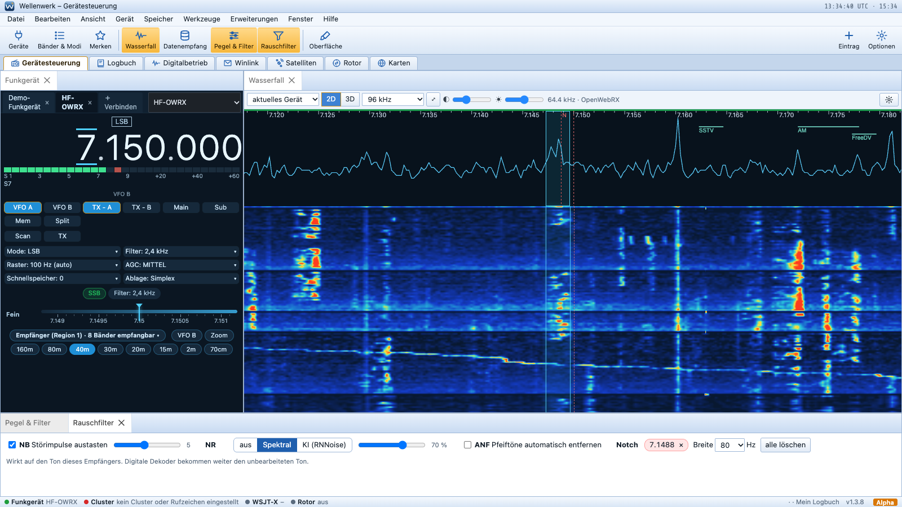

### Markers in the waterfall: typical frequencies, broadcast, repeaters

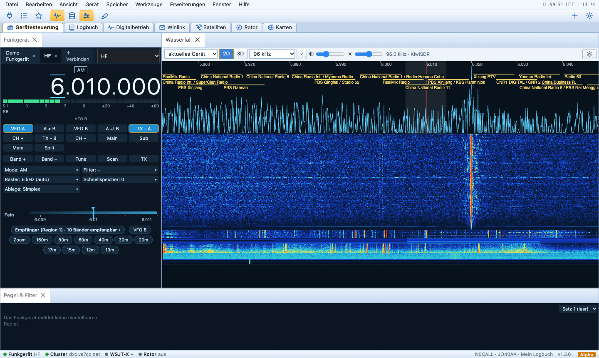

Below the frequency scale the waterfall shows what to expect where – a click on a marker sets frequency **and** mode, hovering shows details:
- **Typical frequencies** (turquoise): FT8, FT4, WSPR, JS8, PSK31, RTTY, SSTV, FreeDV, QRP and emergency centres of activity, calling frequencies, APRS, ISS, NCDXF beacons, QO-100 beacons; plus weather and time stations (DWD RTTY and fax, NAVTEX, VOLMET, DCF77, WWV), CB, PMR446 and Freenet channels, marine 16/70, AIS, air emergency. The list is part of the program and is updated daily from the project on GitHub – additions arrive without a new version.
- **Broadcast** (yellow): stations transmitting on this frequency **now**, from the EiBi schedule (eibispace.de) with language and target area.
- **Repeaters** (green = FM, blue = digital): repeaters within a radius (default 100 km) with callsign, mode, CTCSS or DMR colour code. The centre is the **receiver's location** (OpenWebRX reports it) – with your own devices (RTL-SDR, radio) your station (locator). Sources: DARC repeater list by DL3EL (relais.dl3el.de – it also combines EchoLink, IRLP, D-STAR, Wires-X, DMR and FM-Funknetz), EchoLink directly (worldwide, with current status), BrandMeister (DMR, with last contact) and hearham.com. If a source only gives the output frequency, RigVibe adds the usual offset (2 m −600 kHz, 70 cm −7.6 MHz).

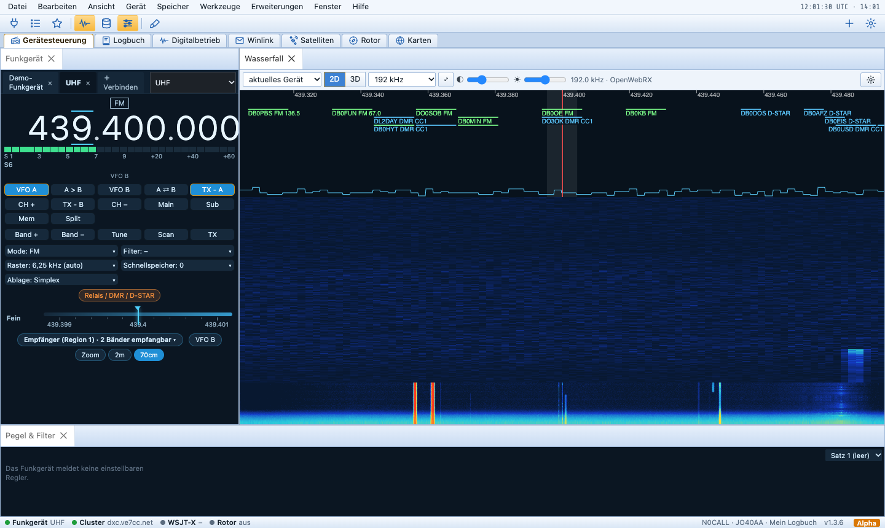

- **Spots** (callsign with country flag): stations from the **DX cluster** and **POTA, SOTA and WWFF** activations (with reference) appear right at their frequency in the waterfall. Cluster colours: magenta = new DXCC entity, orange = new on this band, grey = already worked; POTA/SOTA/WWFF green. A click tunes to the station and sets the spot's mode. On Windows the country code replaces the flag (Windows does not show flag symbols). Can be switched off under **F8 → Waterfall**.

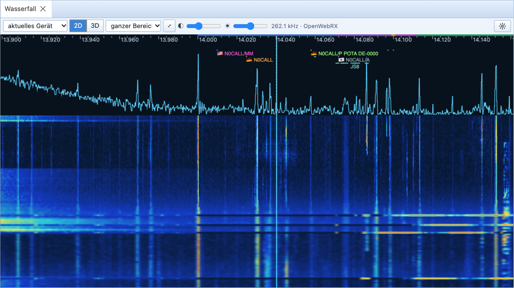

**Repeaters: no guessing.** A click on a repeater – or anywhere in its channel – takes the data from the database: for **DMR, D-STAR, YSF** RigVibe switches on the matching decoder of the OpenWebRX directly, for **FM repeaters** it also sets **offset and CTCSS tone** on a real radio. **TETRA repeaters** (marked “Tetra” next to the place in the DARC list, a continuous 25 kHz wide carrier in the waterfall) are only shown – RigVibe cannot make TETRA audible and leaves the radio unchanged. The card shows callsign, offset, tone or colour code, place, distance and source. Only frequencies that are in no list are determined by signal identification. The three kinds can be switched on and off under **F8 → Waterfall**. The lists are cached in the data folder and fetched again at most once a week.

### Repeaters nearby, band scan and scanner

**View → Repeaters & scan** (or the **Repeaters & scan** button in the toolbar) – mainly for handhelds without a waterfall such as the Quansheng.

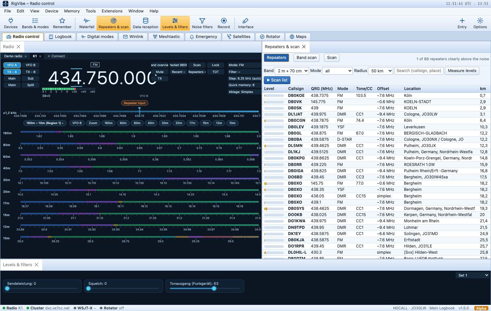

- **Repeaters:** all repeaters nearby (DARC list, BrandMeister, hearham) with callsign, output frequency, mode (FM, DMR, D-STAR, YSF, M17 …), CTCSS or colour code, offset, place and distance – filterable by band, type, radius and search text. **A click tunes:** on a real radio with offset and CTCSS; for DMR, D-STAR, YSF and M17 RigVibe decodes the digital voice right away (callsign and talkgroup in **Data reception** and on the display). **Measure levels** shows with the Quansheng (RigVibe firmware) within about one second which repeaters are active right now.
- **Band scan:** measures a range (2 m, 70 cm, only the repeater outputs or a custom range) using the Quansheng's band sweep – the whole 70 cm repeater band in about 2 seconds – and lists the signals found with their level above the noise; known repeaters are named. A click tunes, **continuous** keeps measuring.
- **Scan** like a scanner radio: channels from the repeater list (with the filters of the Repeaters tab), favourites, quick memory or a band range. The scan **stops where there is activity**, stays as long as someone is talking and continues after the set quiet time. **Next** skips a channel for 30 seconds, **Lock out** leaves it out for this scan. Every activity is listed below with time, channel, level and duration; digital voice is decoded.
  - **Mode per channel:** when stopping, every radio switches to the channel's mode – FM, AM, SSB …; DMR, D-STAR, YSF and M17 to the matching **extension mode** (for favourites with their talkgroup or destination), without an extension FM with the built-in decoder. An analogue channel switches off a selected extension so the FM audio is heard. If a radio does not know a mode, RigVibe approximates it (NFM → FM, RTTY → LSB) or leaves it and notes this in the list – the scan continues. Clicking a DMR, D-STAR or YSF repeater in the Repeaters tab also selects the extension.
  - **Squelch, volume, RF gain** of the current radio are right in the Scan tab.
- **Settings per mode:** squelch, RF gain, AGC, preamp, attenuator, TX power, noise reduction and noise blanker are remembered **per radio and mode** – whether set in RigVibe or on the radio. When the mode changes (by hand, favourite, scan, signal identification), RigVibe restores the values last used there, e.g. FM with closed and DMR with open squelch (extension modes have their own values). Volume stays as it is. **Squelch** is now also available on receivers without their own (RTL-SDR, HackRF, Hermes Lite, Pluto, KiwiSDR): RigVibe gates the audio below the threshold on the S-meter (0 % = open, otherwise S0 to S9+20 dB).

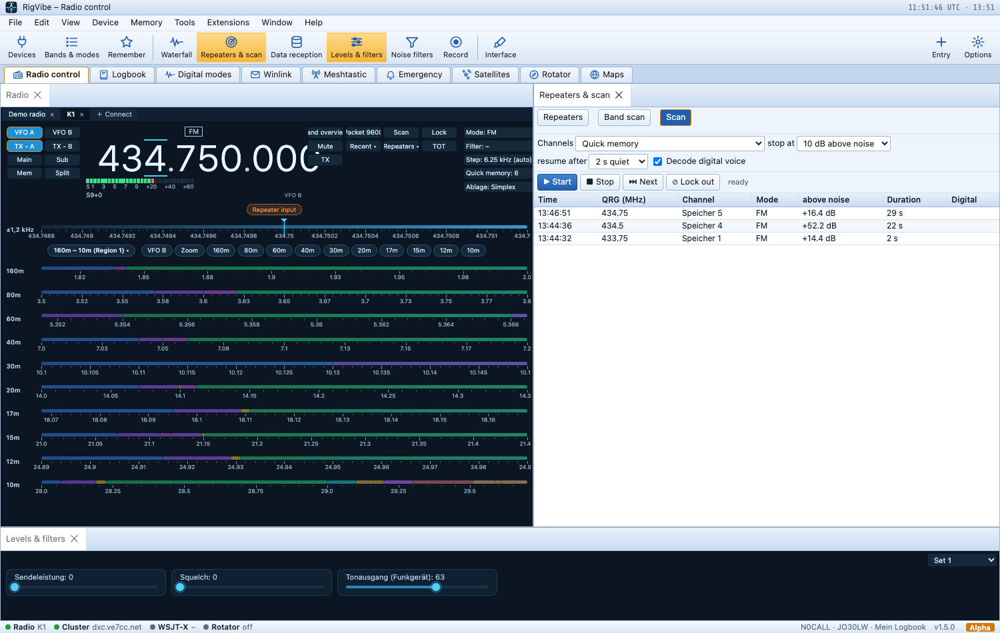

**Threshold above the noise:** RigVibe learns the noise floor of every channel and only stops when the signal is that many dB above it – the noise differs a lot between bands (measured on the K1: 2 m about 20 dB louder than 70 cm), and constant interference carriers do not stop the scan. **Quansheng with RigVibe firmware:** measured with the radio chip's band sweep without retuning (about 7 ms per channel, so 100 repeaters in less than a second). **Other radios:** the scan tunes channel by channel and reads the S-meter (slower); measuring levels and band scan need a band sweep.

### Signal identification by click

**CW:** a click on a CW signal (mode CW, also automatically in the CW segment of the band plan) tunes and opens the **CW decoder**: it finds the tone of the signal and shows the text live with speed (WPM) until you close the window or retune. For SSB speech the identification no longer reports AM just because a speech peak or a neighbouring signal looks like a carrier – AM requires a narrow, steady carrier.

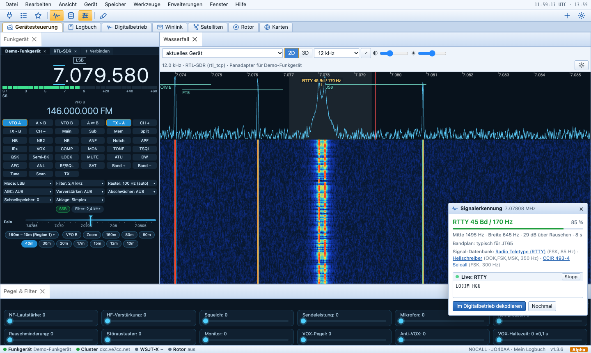

Which mode is that? In **USB/LSB** a click on the signal in the waterfall (window **Waterfall**, **Receivers** or the waterfall in **Digital modes**) is enough. RigVibe tunes so that the signal lies at 1500 Hz audio, listens for up to 15 seconds and shows in a small card what it has identified – with confidence in percent, centre, width and distance from the noise:

- **Digital modes:** RTTY (with baud and shift), SITOR-B/NAVTEX, PSK31/63/125, QPSK, CW (with speed), Hellschreiber, MFSK, Olivia/Contestia, DominoEX/THOR, MT63, ALE
- **WSJT modes:** FT8, FT4 (by their sync patterns), WSPR, JT9, JT65
- **Image and voice:** SSTV (with mode, e.g. “Martin M1” – after just 4 seconds, also off-tune, with fading and in the middle of a picture), weather fax, FreeDV **RADE, RADE V2, 700D, 700E and 1600** (by their symbol clock, also weak and off-tune), voice (also “other sideband”), AM broadcast, unmodulated carrier

Where RigVibe can decode by itself, it decodes on trial to confirm; readable text appears in the card. Buttons lead straight on: **Decode in Digital modes** (mode, baud/shift and audio frequency are taken over), **Open SSTV receive**, **Open FreeDV**, **Tune as LSB**, **Set AM/CW** or for FT8 **Tune to the standard frequency**. Identified signals get a label in the waterfall for 30 seconds.

**Switch automatically and read live:** after identification RigVibe switches AM broadcasts to AM and voice in the wrong sideband to the right sideband. For modes RigVibe decodes (RTTY, PSK, CW, MFSK, Olivia, Contestia, DominoEX, THOR, MT63 …) the text then continues **live in the card** – with **Stop**; the display ends by itself when you retune. Can be switched off under **F8 → Waterfall**.

**Find the signal instead of guessing:** RigVibe first looks for the signal in the spectrum – the occupied range nearest to the click – and analyses only that; neighbouring signals and noise in the rest of the passband are filtered out. A click beside the signal or a too-wide filter therefore hardly matter any more.

**RigVibe reads FT8 and FT4 itself** (decoder ft8_lib): a click anywhere into the FT8 segment is enough. RigVibe waits until a whole time slot (15 s, FT4 7.5 s, UTC) has been recorded, reads the messages and then shows **every time slot live** in the card – with name and place for known callsigns, e.g. “CQ DO5HOK JO41 (Holger, Harsewinkel)”. WSJT-X is not needed for this; the computer clock should be accurate (deviation below one second).

**Exact tuning:** a click is rarely spot on. After identification RigVibe therefore retunes by itself (note in the card, e.g. “tuned to signal centre (−240 Hz)”):
- **Data signals and CW** (RTTY, PSK, Olivia, CW …): the measured signal centre is put exactly at 1500 Hz audio.
- **SSTV:** the sync tone is put at 1200 Hz (where every SSTV receiver expects it). A click on the visible centre of an SSTV signal is otherwise about 250 Hz off; SSTV is recognised up to about ±550 Hz offset.
- **SSB voice:** with USB/LSB the tuning point is not the centre of the signal but the suppressed carrier at the edge of the sideband. RigVibe measures where the voice starts in the audio (about 300 Hz above the carrier when tuned correctly) and tunes to the carrier. If the voice is in the wrong sideband, it switches to the right sideband and looks for the carrier at the upper edge. If the position cannot be determined reliably (radio filters cut off differently), the tuning is left unchanged.
- **AM:** to the carrier. With an SDR waterfall RigVibe also recognises AM from the RF spectrum (carrier with two equally strong sidebands), even when the receiver is set to USB.

**Signal database:** below the result the card lists known signals that occur on this frequency with matching modulation and width – from an extract of the *Signal Identification Wiki* ([sigidwiki.com](https://www.sigidwiki.com), about 550 entries: name, frequencies, modulation, bandwidth). A click opens the description with audio sample and waterfall picture.

**VHF/UHF: DMR, D-STAR, APRS, wireless sensors, radiosondes.** Many OpenWebRX receivers (e.g. “OpenWebRX+”) have their own decoders. RigVibe uses them: a click above 30 MHz measures the **centre of the signal** in the RF spectrum (the one nearest to the click – a strong neighbouring channel does not pull it away), sets the receiver to FM and exactly to that centre – onto the channel raster (6.25 kHz) if it is within the measuring accuracy – and then tries
- by frequency: **APRS** (144.800 MHz etc.), **wireless sensors** of weather stations, thermometers etc. (433.05–434.79 MHz and 868 MHz, decoded with rtl_433 on the server – for your own SDRs see below), **radiosondes** (400–406 MHz, if the server offers them),
- otherwise the digital voice systems **DMR, D-STAR, YSF (C4FM), M17, NXDN, P25**.

**Fast and simultaneous:** RigVibe analyses the signal itself – with your own devices (RTL-SDR, Hermes Lite 2 …) directly from the IQ data, with OpenWebRX and KiwiSDR from the FM audio. Within 1.5 seconds the sync patterns of all systems are searched **at once** (DMR base/mobile station and voice/data, D-STAR, YSF, P25, NXDN48/96, M17); at the same time RigVibe checks for analogue FM with voice or a sub-tone. The result usually comes after 2–3 seconds. With an OpenWebRX the matching decoder is then switched on directly – no more trying one after the other (a server gives each connection only one demodulator; several connections at once would occupy slots and trigger a ban). If its own detection finds nothing and the signal is not analogue, RigVibe tries the server's decoders one after the other as before (the most likely ones by measured width first). With your own devices RigVibe then reads DMR, D-STAR, YSF and M17 itself (see below); for NXDN and P25 the card shows the detected system.

If the station is not transmitting at the moment of the click (repeater idle, DMR between transmissions), RigVibe retunes as soon as the signal appears. While the decoder runs, it keeps following the frequency (transmitters off frequency or drifting); tuning by hand ends this. In the narrowband segments (e.g. 144.0–144.5 and 432.0–432.5 MHz, QO-100 narrowband) it works as on HF with SSB/CW identification.

**Analogue FM:** if none of the digital decoders finds anything, RigVibe listens to the FM audio for 6 seconds and reports **FM voice**, **FM with packet/APRS tones** or other data, a **CTCSS tone** (e.g. “CTCSS 123 Hz” – the tone needed to open a repeater), a **carrier without modulation** or **just noise**.

**Protection against bans:** OpenWebRX+ servers ban addresses for 12 hours if profiles are changed too quickly in a row (protection against robots). RigVibe keeps at least 10.5 seconds between two profile changes (note “profile change in … s”) and does not retry after a ban; the message then reads “the operator has banned this internet address”. If a server is full, RigVibe waits several minutes before the next attempt. **Shared receiver:** all listeners of an OpenWebRX share one SDR. If another user (or the server's schedule) switches to a different profile, RigVibe follows the new range like the web interface and says so above the spectrum – it does not switch back by itself. If the receive frequency is outside the displayed range, that is shown there as well.

The card shows the messages live – **with names**: for DMR time slot, **who is talking** (DMR ID → callsign, first name, city from the RadioID database) and **which talkgroup** (number and name, e.g. “TG 262 Deutschland”, from the BrandMeister list), for D-STAR, YSF and M17 callsigns with name, for NXDN the ID with callsign, for APRS callsign, text and position, for sensors model, temperature (in °C), humidity, wind, rain. Above the messages a status line per DMR time slot shows what is going on (idle, data, voice or the speaker) – so you can see that decoding works even without an ongoing QSO. IDs that are in no list (e.g. from networks other than BrandMeister) remain as numbers. RigVibe downloads the name lists (about 300,000 entries) once a week into the data folder; lookups happen only on your own computer.

**RigVibe reads DMR itself with your own devices** (RTL-SDR, Hermes Lite 2 …): time slot, colour code, burst type, voice header and terminator with source and target (group/individual call), preambles – each with error correction and checksum (Golay, BPTC, Reed-Solomon, CRC), then with names and talkgroup as above. If you tune in mid-transmission, RigVibe reads source and target from the ongoing voice bursts (embedded LC). **If an OpenWebRX does not offer the matching decoder, RigVibe decodes DMR, D-STAR, YSF and M17 from its audio itself** (compensating the server's audio filtering). Voice header and terminator work most reliably there; with weak signals or strong server compression the late entry may not succeed. KiwiSDR covers shortwave only, where these modes are rare.

Also read by RigVibe itself:

- **D-STAR:** the header with your own callsign (MY), the other station (UR, usually CQCQCQ) and the repeater fields (RPT1/RPT2), checked with Viterbi and CRC. If you join in the middle of a transmission, the header comes from the “slow data”. The 20-character text message is voted across the repetitions and gets cleaner with every pass.
- **YSF (C4FM):** source, destination and down-/uplink, even when joining late (every frame carries one field), checked with Golay, Viterbi and CRC.
- **M17:** source, destination (also a reflector like “#M17-XLX” or “@ALL”), CAN, meta text and encryption. Read from the link setup frame or, when joining late, from the six LICH parts of the stream frames, with CRC. RigVibe plays the audio itself (Codec2, **🔈 Audio** button in the live card) – also with the Quansheng over USB-C; encrypted transmissions stay silent.

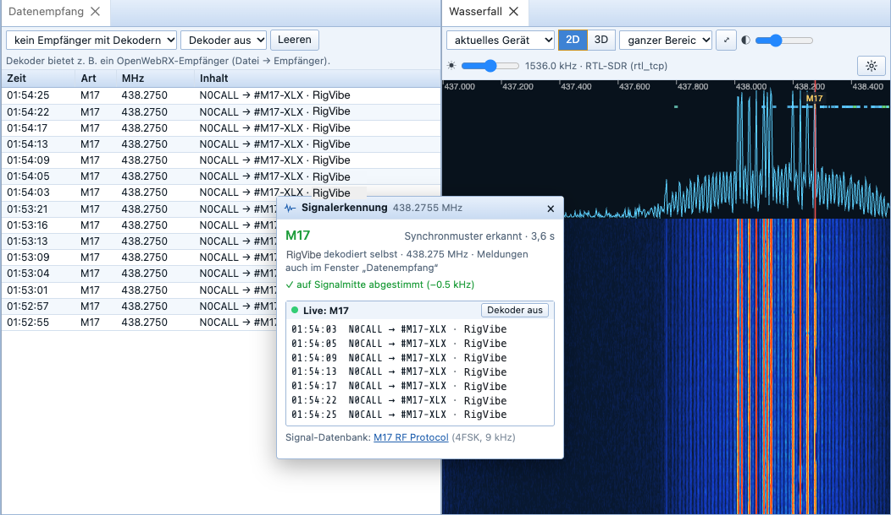

**Wireless sensors with your own SDRs:** RTL-SDR, HackRF and Pluto decode wireless sensors themselves – weather stations, thermometers, tyre pressure, smoke detectors, door and window contacts, remotes and Wireless M-Bus meters (water, heat, electricity). RigVibe ships **rtl_433** for this, which knows more than 250 device types. Tune to the frequency (433.92 MHz, 868.3 or 868.95 MHz for M-Bus meters, 315 or 915 MHz) and choose the **Wireless sensors** decoder in the **Data reception** window – or click a sensor signal in the waterfall. In the 868 MHz band RigVibe uses the higher sample rate M-Bus needs. Many meters encrypt their readings; RigVibe then shows manufacturer, device number and type but no reading.

**Ships (AIS) and radiosondes with your own receivers:** RigVibe decodes AIS (ship positions, names, destinations on 161.975/162.025 MHz) and the **Vaisala RS41** radiosonde used by the German weather service (400–406 MHz, serial number, position, altitude, climb/descent rate) itself – with RTL-SDR, HackRF and Pluto (a wide channel straight from the IQ stream) and with the **Quansheng UV-K1/K5** from RigVibe firmware stage 12 via USB (wideband path with equalizer). In the **Data reception** window choose the receiver and the **AIS** or **Radiosondes RS41** decoder; on the Quansheng RigVibe sets frequency and mode itself and restores them when switched off. Messages appear in the list and on the **world map** (layer "Ships, sondes & APRS", sondes with their flight track). Good reception needs a clear view: ships are heard near coasts and rivers, sondes are launched twice a day (more often at some sites) and can then be heard within 200–300 km.

**Aircraft (ADS-B) on 1090 MHz:** RigVibe decodes the Mode S / ADS-B messages of aircraft itself (identification/flight number, position, altitude, speed, heading, vertical rate, squawk; messages with a single bit error are corrected). In the **Data reception** window choose the receiver and the **ADS-B** decoder: RigVibe then sets the receiver's centre to **1090 MHz** by itself. This needs a receiver with **at least 2 MS/s** (RTL-SDR/rtl_tcp with `rate=2400000`, HackRF, SoapySDR devices) and a suitable **1090 MHz antenna** (a 1090 MHz filter/preamplifier helps a lot). The window then shows an **aircraft list** with identification, altitude, speed, heading, distance and bearing from your own station (locator in the settings), vertical rate, squawk and signal level. **Helicopters** (the identification message gives the emitter category “rotorcraft”) are listed first, highlighted in yellow, drawn larger in yellow on the map, and RigVibe shows a notice with distance and bearing when one is first received. Aircraft on the apron or a helipad are recognised too (surface position, referenced to your own station). Aircraft that only answer radar interrogations (no ADS-B) appear with their address (ICAO) and, if available, altitude or squawk, but without a position. Aircraft also show up on the **world map** (layer “Ships, aircraft, sondes & APRS”, with a trail; they disappear after 5 minutes without a message). The load is about 5 % of one processor core. **Tested** with known messages and with synthetic signals at 2 to 4 MS/s (also with noise and frequency offset) and in the packaged program against a simulated receiver; **not yet with real aircraft.**

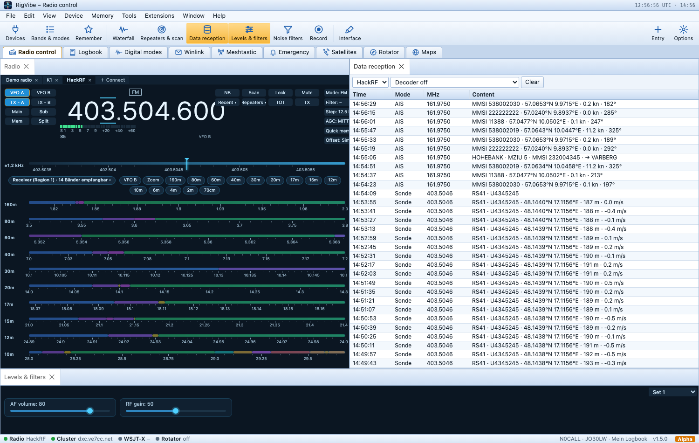

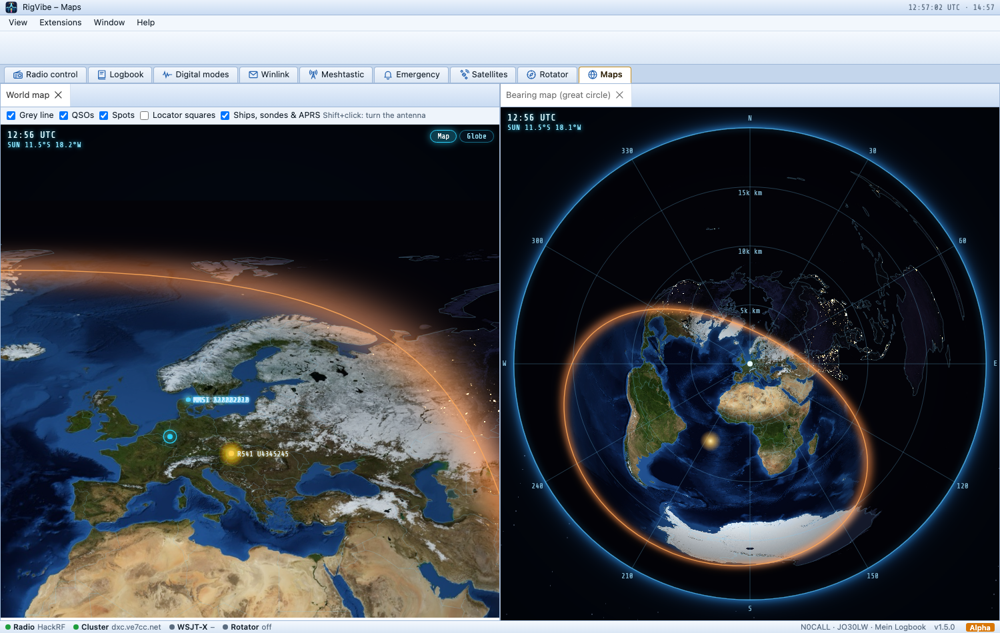

**FM broadcast with RDS (your own SDRs):** RTL-SDR, HackRF and Pluto receive FM broadcast (87.5–108 MHz) in **WFM** mode – with their own wide channel, full-bandwidth audio (48 kHz, mono or stereo) and **RDS**: station name, programme type and radio text appear below the frequency, and the **Data reception** window also lists the programme identification (PI) and the time sent by the station. Choose WFM with the mode button or pick the **Broadcast (LW, MW, SW, FM)** band plan below the band buttons and press **UKW**. The Quansheng cannot do this: its FM radio chip has no RDS and its audio does not go over USB.

**Stereo:** If the station sends the 19 kHz pilot tone, RigVibe plays FM broadcast in **stereo** (the pilot is measured as a phase, from which the 38 kHz carrier for L−R is built). If the pilot is too weak or there is only noise, it stays mono. In stereo the interface noise filter is off (it works with mono only); the decoders still get the mono part. **Tested with synthetic signals only** (channel separation over 30 dB, noise and interference lines stay mono); I could not listen to a real stereo station for lack of reception.

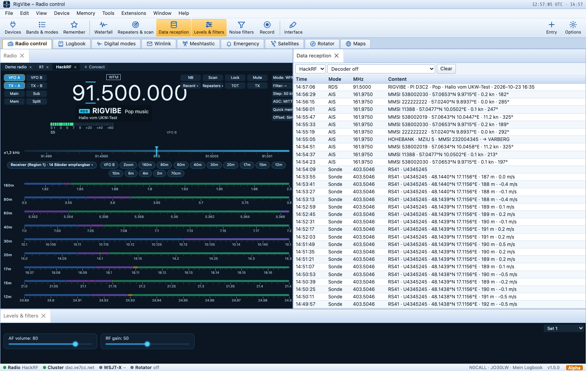

**More receiver decoders:** if an OpenWebRX+ offers them, the *Data reception* window and the card also provide **FT8, FT4, WSPR, JT65, JT9, FST4, Q65, MSK144, JS8Call** (with the name for the callsign), **PSK31/63, RTTY** (also the weather service's 50 Bd/450 Hz), **CW, NAVTEX, SITOR-B, DSC, AIS** (ships), **ADS-B/Mode S** (aircraft with ID, altitude, speed, position), **LoRa APRS, Meshtastic, MeshCom, MeshCore** and **FANET**. A click on 162 MHz (AIS), 1090 MHz (ADS-B), 433.775 MHz (LoRa APRS), 433.175 MHz (MeshCom), 869.5 MHz (Meshtastic), 156.525 MHz or the HF DSC frequencies and 490/518 kHz (NAVTEX) switches on the matching decoder directly; for detected FT8 etc. the card offers “Let the receiver decode”. Deliberately not offered: pagers outside the amateur bands (DAPNET paging see section “Paging”), selective calling/ZVEI, airline company data (ACARS, VDL2, HFDL), utility meters and LoRaWAN – receiving them is not permitted in Germany (§ 5 TDDDG). Marine radar (9 GHz) is outside the receivers' range. All messages are collected in **View → Data reception**; a decoder can also be chosen there by hand. A receiver reports which decoders it offers. Note: you hear digital voice only if the server outputs it; RigVibe shows the IDs and texts.

**Alt+click** only tunes, without identification. In AM, FM and CW a click tunes directly as before. Switch on/off and set the maximum duration under **F8 → Waterfall**. The identification is a well-founded estimate, not proof: with very weak or overlapping signals it prefers to report “unknown signal” with guesses.

### Remote audio

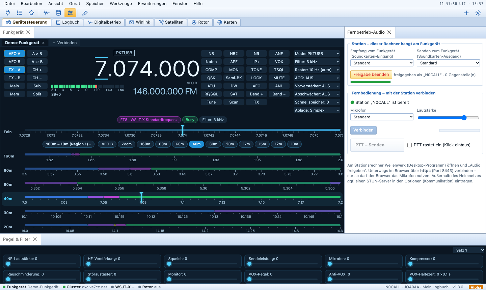

For operating from another room or on the road: **View → Remote audio**.

1. **On the station computer** (where the sound card is attached to the radio): choose **Receive from radio** and **Transmit to radio**, **Share audio**.
2. **On the other computer/tablet** open RigVibe in the browser – because of the microphone via **https** (port 8443), on the home network e.g. `https://stationcomputer:8443` – and **Connect**. Reception is audible immediately.
3. Hold **PTT – transmit** (or choose “latches”): the radio transmits, the microphone goes to the station. Release = receive.

Audio runs directly between the computers (WebRTC, Opus); outside the home network enter a STUN server in the options (**Communication**). Your microphone passes through the processing set in **Transmit audio**.

### Transmit audio: microphone, compressor, equaliser, VOX

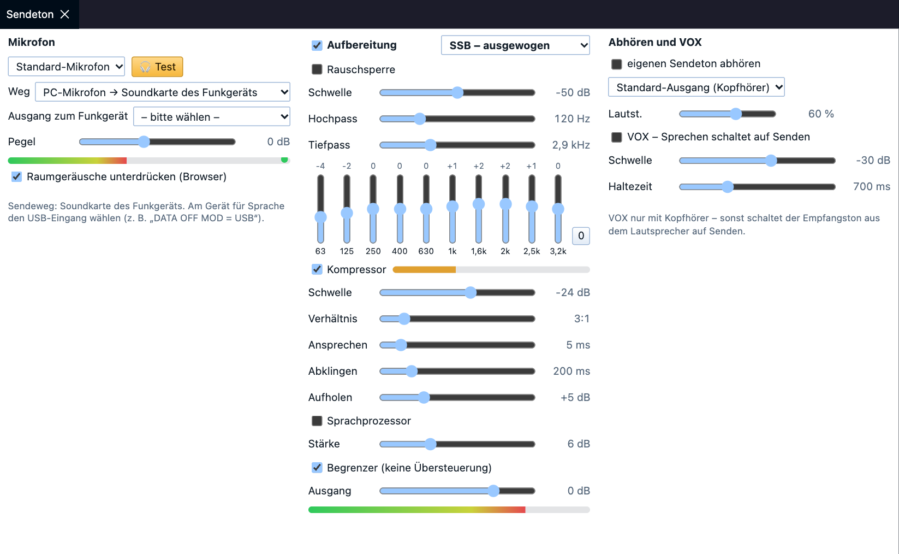

**Tools → Transmit audio** (Sendeton) processes your microphone before it goes on air. It applies to every transmit path: SDRs that transmit (Pluto, HackRF, Hermes Lite 2), a radio via its USB sound card, remote audio, FreeDV and the voice keyer.

- Choose the **microphone** and try it with **🎧 Test**: the microphone runs through the whole chain without transmitting. With “listen to own transmit audio” you hear yourself on headphones. Set the **level** so the input meter reaches about three quarters while speaking.
- **Path** (radios only): “Microphone on the radio” keeps everything as usual; the PC then only transmits the voice keyer. With “PC microphone → radio's sound card” every PTT sends the processed PC microphone to the radio. Choose the **output to the radio** (its USB sound card) and set the radio to take voice from USB (e.g. IC-7300: “DATA OFF MOD = USB”). In data modes (PKT, DATA) and during digital-mode transmissions the microphone stays off.
- **Presets:** “SSB – balanced”, “DX – punch” (narrower, more compression, with speech processor), “Warm – ragchew”, “FM / repeater” and “Neutral”. Any change becomes your own setting.
- **Noise gate:** closes in speech pauses and so hides fans and room noise.
- **High-pass / low-pass:** limit the audio to the speech band (e.g. 120 Hz–2.9 kHz). Low frequencies cost power without improving intelligibility.
- **Equaliser** with ten bands from 63 Hz to 3.2 kHz, ±12 dB each. Button **0** flattens it.
- **Compressor:** lifts quiet syllables and holds back loud ones, raising the average transmit power. Threshold, ratio, attack, release and make-up gain are adjustable. The orange meter shows how hard it is working.
- **Speech processor:** soft-limits peaks for more punch, at the cost of a slightly rougher sound. For DX and contests, not for ragchews.
- **Limiter:** prevents overdrive at the end of the chain. Best left on.
- **VOX:** speaking switches to transmit, after the hang time it returns to receive. Use VOX only with headphones – otherwise receive audio from the speaker keys the transmitter.

Switch the radio's own compressor and equaliser off or keep them gentle, otherwise both act twice. The radio's ALC should barely move – otherwise lower the output in RigVibe or the USB level on the radio.

### Recorder: record and play back reception

The red **Record** button in the toolbar of Radio control records the **received audio**; press it again to stop and save. The **Recorder** window (also **View → Recorder**) shows running time and level and lists all recordings with time, frequency, mode and device; each recording can be named.

- **Source:** for receivers (own SDR, WebSDR/KiwiSDR, OpenWebRX) the audio directly from the program, for radios the sound card input set for the device in Digital modes. Saved as WAV (16 kHz, mono) in the data folder under `recordings`; length limited (5 minutes to 2 hours selectable).
- **▶ Listen** through the computer's speaker.
- **📡 Send** plays the recording on air – so the other station hears how it arrives at your end. It works like the voice keyer: PTT, transmit audio processing and target (radio via its USB sound card, SDR with transmit or remote audio). **Esc** or clicking again ends transmission; for recordings over 3 minutes RigVibe asks first. Your own callsign must be entered.
- **⬇** downloads the file, **×** deletes it.

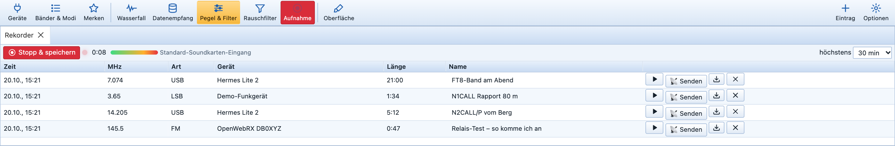

### Beacon monitor (NCDXF/IARU)

**View → Beacon monitor** shows the 18 beacons of the international beacon project, transmitting in turn for 10 seconds each on 14.100 / 18.110 / 21.150 / 24.930 and 28.200 MHz. **Start** tunes the radio to the chosen beacon band in CW; the beacon currently transmitting is outlined. RigVibe measures every transmission in the received audio (as for the recorder: receiver directly or sound card input): **green** = heard, with signal-to-noise ratio in dB; the **dots** show down to which power step the beacon was audible (100 W · 10 W · 1 W · 0.1 W). With **all bands in turn** RigVibe moves to the next band after each 3-minute cycle – giving a picture of current propagation. The computer clock must be correct.

**Meteor showers:** Above the table the window shows the meteor showers that are currently active with their peak and rate (ZHR, approximate values from the IMO calendar) and the next shower – useful for meteor scatter on 50 and 144 MHz. The **Meteor showers** tick in the bar hides the line.

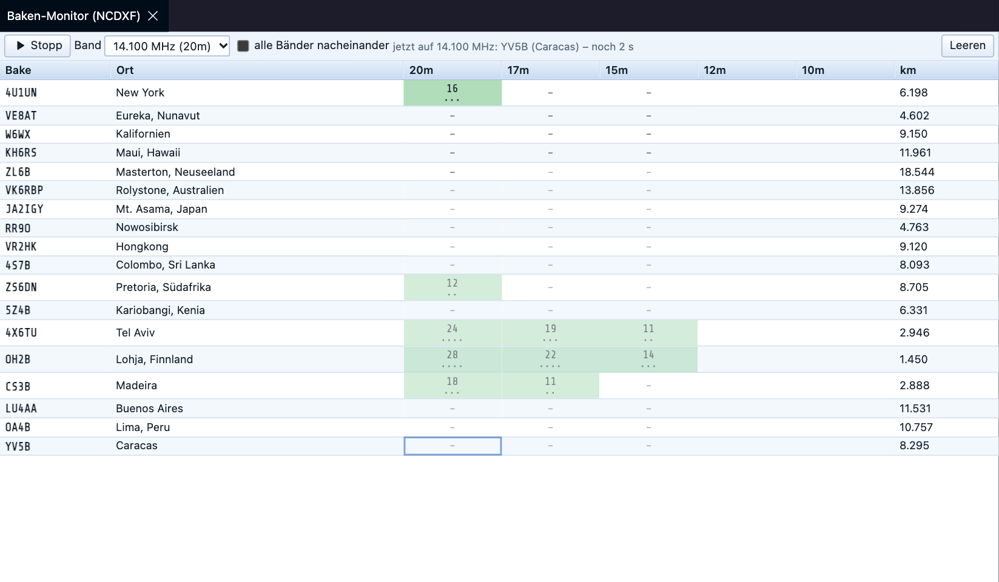

### Voice keyer (automatic CQ)

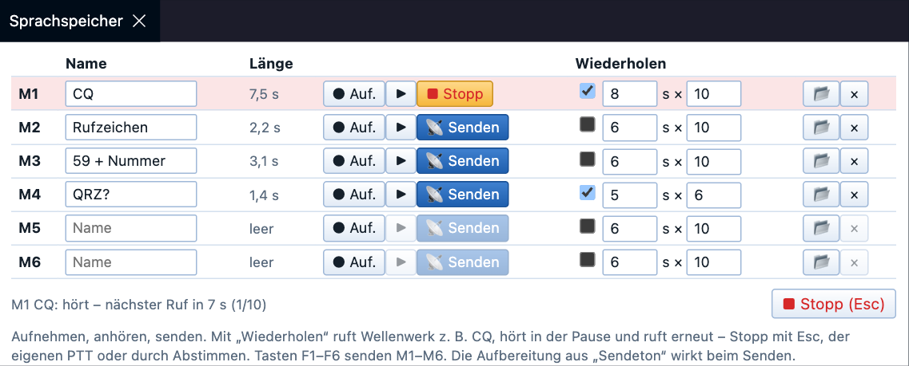

**Tools → Voice keyer** (Sprachspeicher) records up to six messages, e.g. a CQ call, your callsign or a report, and transmits them at the press of a button.

- **● Rec** starts recording, **■ End** stops it. RigVibe trims silence at the start and end and evens out the level. Instead of recording you can load an audio file with 📂 (WAV, MP3, OGG …).
- **▶** plays the message for checking without transmitting. **📡 Send** keys PTT, sends the message through the processing from “Transmit audio” and returns to receive.
- **Repeat:** when ticked, RigVibe calls in a loop – send, listen for the set pause (e.g. 8 s), send again – up to the maximum count. The loop ends with **Stop**, **Esc**, as soon as you key PTT yourself or as soon as you tune. Let RigVibe call CQ and simply answer when someone comes back.
- **Keys F1–F6** send M1–M6 (in rig control); pressing again stops.
- **Transmit paths:** SDRs directly; a radio via its USB sound card (choose the **output to the radio** under “Transmit audio”); remote operation via the audio link to the station.
- The recordings are stored on the RigVibe computer. The phone view shows them as buttons and can send them too. Recordings from the earlier voice keyer dialog are taken over the first time the window opens.

Please keep an eye on the frequency during automatic calling and don't make the pauses too short.

### Meters (S-meter, power, SWR)

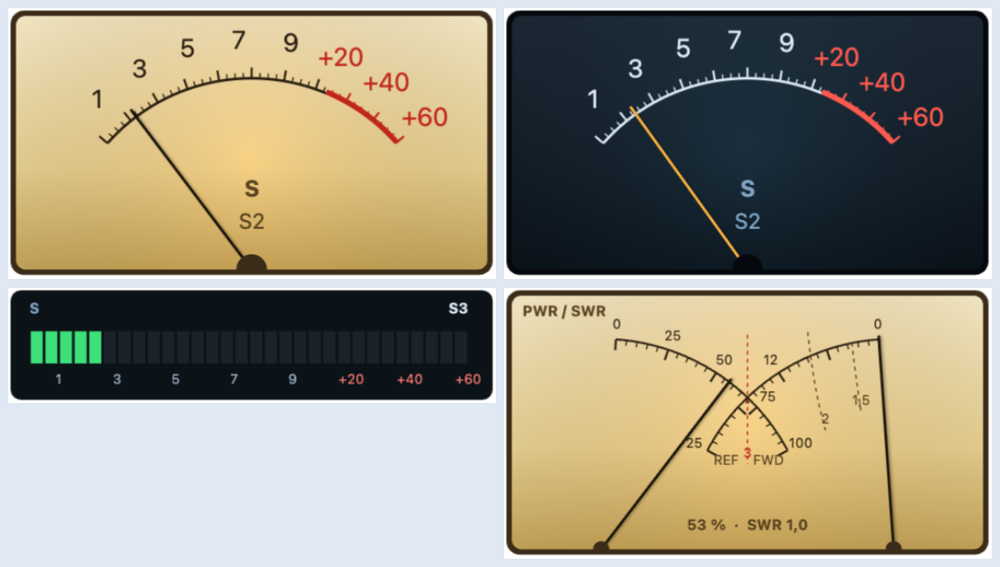

**View → Meters** opens needle meters as a window of their own (dockable, the size adapts):

- **Meters ▾:** S-meter, power, SWR, ALC and compression individually on and off. **Automatic** shows the S-meter on receive and power, SWR and ALC on transmit.
- **Style ▾:** **classic backlit** (cream scale with warm light), **modern dark**, **LED bar** or **cross-needle** – power and SWR in one meter: forward from the left, reflected from the right, the SWR is where the needles cross (curves 1.5 / 2 / 3).
- **Needle ▾:** **slow** like a moving-coil meter, **normal** or **fast**; plus a **peak needle** that briefly holds the maximum.

Drawing only happens while a needle moves – at rest the window costs no processing time. S-meter calibration as before under **F8 → S-meter**.

### MIDI and DJ controllers

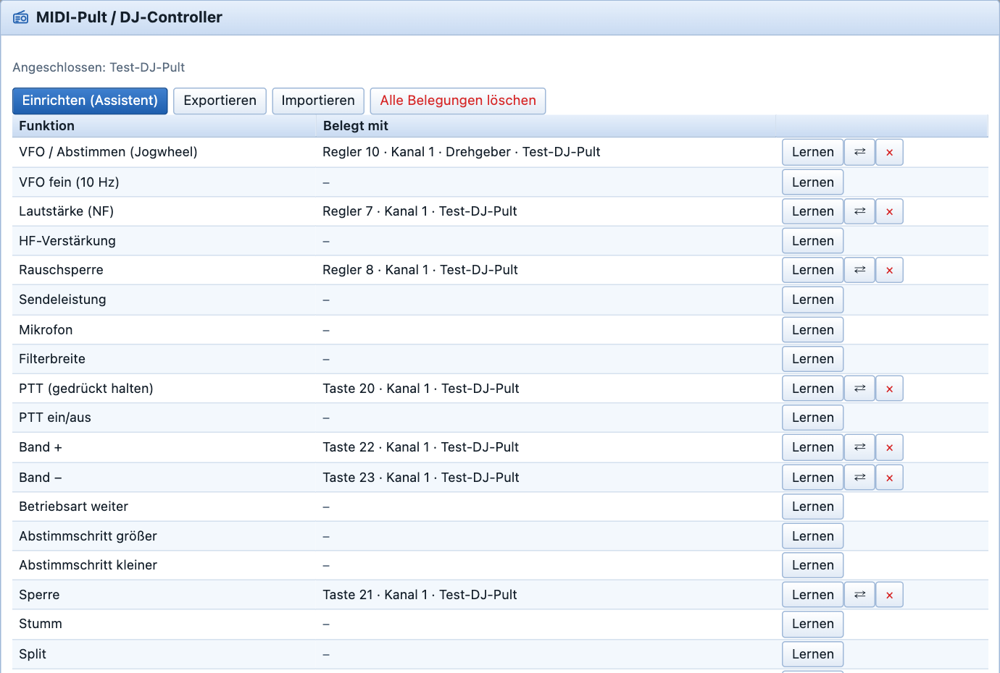

A MIDI or DJ controller becomes a control console: **jog wheel** = VFO, **faders and knobs** = volume, RF gain, squelch, TX power, microphone, filter width, **buttons** = PTT (hold or on/off), band ±, mode, tuning step, lock, mute, split, A⇄B, tune, scan, voice memories 1–4. Just plug the controller in via USB – no driver needed (Windows, macOS, Linux; in the desktop app or in Chrome/Edge).

- **Device → MIDI controller / DJ controller …** shows the connected controller and all functions.
- **Set up (assistant):** asks in turn “turn the jog wheel”, “move the volume fader”, “press the PTT button” and so on – after about a minute the controller is assigned. One by one with **Learn** next to each function: click, move it on the controller, done. **⇄** reverses the direction, **×** deletes the assignment.
- **Encoders** are recognised automatically while learning (the different ways controllers report rotation). Turning the jog wheel fast makes bigger steps (up to five times); the basic step is the tuning step or channel raster and can be changed with the “larger/smaller tuning step” buttons.
- **LEDs on the controller** show the state of assigned buttons: PTT, lock, mute, split, scan.
- **Export / import:** save assignments as a file or pass them on to others.

## 5. Arranging windows and layouts

**Screen size:** RigVibe adapts to the resolution – from laptops (also 4:3, from about 1024 × 660 pixels in the browser) up to 4K. Nothing is simply scaled up: on large screens you see **more details and more windows**, on small ones fewer.
- **Three screen classes with their own arrangement:** small (laptop, below about 1366 × 720), medium (Full HD) and large (from about 2200 × 1100, e.g. 2560 × 1440 or 4K). Each class has its own default arrangement – large adds Bands & modes, Data reception and a full-width waterfall to Rig control, clock, rotator, audio recorder and DX histogram to the logbook, and shows the world map as its own window in Digital modes. Small puts band map and grey line as tabs next to the DX cluster and the macros next to the Send window. RigVibe remembers your changes **per class**: drag the window from the laptop to the big monitor and the arrangement switches, and back again. **Window → Restore default arrangement** restores the arrangement of the current class.
- **Details by window size:** each window decides by its space. The logbook hides secondary columns in narrow windows (submode, QTH, sent QSL confirmations, Club Log, QRZ …) and adds frequency, locator, continent, CQ zone and comment in wide ones. The radio display adds a ±400 Hz scale in large windows.
- On low or narrow screens headers become more compact; toolbars that do not fit in one row show icons only (label on hover).
- The radio display shrinks when needed instead of showing scroll bars; clicks on scales and digits still hit exactly.
- When the **waterfall** is opened, the radio display moves to the left side as a narrow column – frequency, S-meter and buttons stacked – and the waterfall gets the width. Closing the waterfall restores the previous arrangement. Can be switched off under **F8 → Waterfall**.
- If you still want larger text, set it under **F8 → Appearance → Interface size** (80–200 %); there is no automatic enlargement any more.
- **Everything is kept:** window arrangement, views and interface settings are stored in the browser and additionally by the RigVibe service. After a restart, in another browser or after clearing browser data everything is back. Connected radios and receivers are reconnected at the next start with the last frequency and mode.

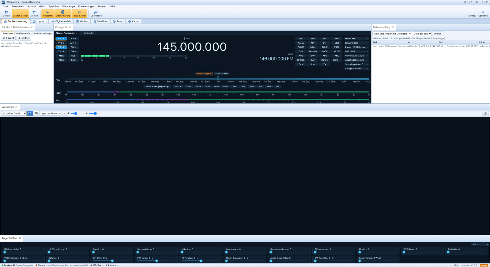

Each area is its own window that can be arranged freely:

- **Move:** drag by the tab (title) and drop at an edge or in the middle of another window (then as a tab).
- **Size:** drag the dividers.
- **Detach:** button ⇱ on the right of the window header – the window floats freely (in the picture above: “Bands & modes”).
- **To a second screen:** button ⧉ – the window becomes its own program window.
- **Maximize:** button □.
- **Window menu:** tile windows, dock all windows, restore default arrangement, save and load **Layout A/B**, full screen (**F11**).

The arrangement is saved automatically per area (radio control, logbook, digital modes …).

## 6. Right-click menus

Almost every element has a right-click menu with the matching commands – for example the frequency display:

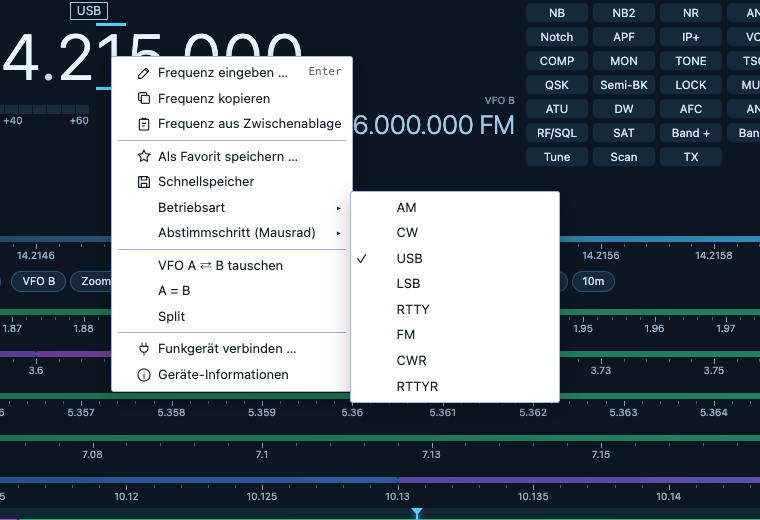

A selection:

| Right-click on … | Commands |
|---|---|
| Frequency display | enter/copy/paste frequency, as favourite, quick memory, mode, tuning step, VFO commands, split |
| Function button | trigger, move, hide, edit interface |
| Band button | choose band, forget stored frequency, zoom, band plan |
| Band scale | tune here, favourite, delete quick-memory markers; on a spot: all callsign commands |
| Slider (levels & filters) | minimum / centre / maximum, slider set |
| Favourite / folder | tune, rename, move, delete |
| Logbook row | edit, delete, copy, ADIF, QSL, upload, tune to QSO frequency, filter, turn antenna, send spot |
| Logbook column header | sort, show/hide columns |
| Cluster spot, FT8 decode, band map | tune, log entry, look up, turn antenna (short/long path), QRZ.com, send spot, alert |
| Map | locator and direction of the point, turn antenna there, copy locator |
| Rotator | turn to degrees, stop, park, compass points |
| Waterfall | receive here, copy frequency, mode, AFC |
| Word in the receive text | as callsign/name/QTH/locator/RST into the QSO, look up |
| Transmit field | transmit, insert macro or placeholder, cut/copy/paste |
| Window tab | detach, own window, maximize, close, arrange |
| Input fields | cut, copy, paste, select all |

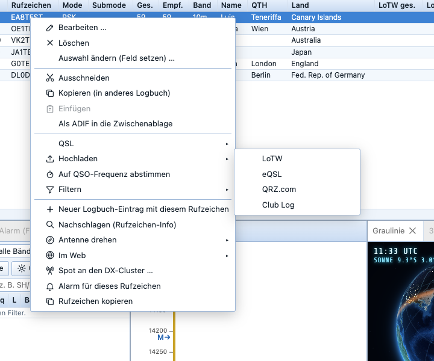

## 7. Logbook

- **Top:** the logbook with its own bar: **New · Edit · Delete**, **Search · Filter · Columns · Change selection**, **QSL · Upload LoTW · Fetch LoTW**, **Contest · Awards · More …** (including cut/copy/paste into another logbook, reload, column widths, QRZ.com, backup, ADIF, Cabrillo, printing). Widen columns by dragging the header, a click on the header sorts.
- **Right:** callsign info (callbook with photo, name, address; “worked/confirmed” matrix per band and mode for callsign and country), favourites, device status.
- **Bottom:** DX cluster (with spot alarm (FT8), POTA / SOTA / WWFF and calendar as tabs), band map with spots, grey line (with solar data and solar cycle).
- **Space weather** (View → Space weather): solar X-ray class (GOES), NOAA scales R/S/G, Kp index, solar flux F10.7, solar wind and magnetic field Bz, three-day storm forecast, current alerts and the maximum usable frequency (MUF for 3000 km) of ionosondes worldwide. The globe or map shows the aurora oval (NOAA OVATION, colour by probability) with the ionosondes as dots (green = MUF from 28 MHz). Sources: NOAA SWPC and KC2G/GIRO; refreshed every 10 minutes.
- **Via View** in addition: clock, rotator, audio monitor, DX histogram, audio recorder, network, statistics.

The logbook toolbar: **Logbooks · New entry**, **DX cluster · Spot alarm · QSL & Online · Awards**, **Settings**; on the right a box with callsign, locator, frequency (click: tune VFO A) and UTC. Menus: **QSO & QSL** (logbooks, QSL matching, awards, statistics) and **Tools** (settings, station profiles, POTA/SOTA/WWFF, cluster alarms, calendar); tune VFO A/B under **Edit**.

**Warnings while logging:** if the frequency is not inside the entered band (e.g. 14.200 MHz with “40m”), RigVibe warns when you change the band and asks again when saving. If the same QSO (callsign, date, time, band, mode) is saved again within 20 seconds, RigVibe asks as well.

**Sharing a QSO:** right-click a QSO → **Share**: copy the text or send it to Bluesky, X, Telegram or WhatsApp (opens the service's page with the text prepared; nothing is sent until you confirm there).

**Logging a QSO:** **New** (or **Entry** in the toolbar). Type the callsign – country, distance, direction, previous QSOs and callbook data appear immediately. Frequency, band and mode come from the radio. **Enter** saves, **Esc** clears.

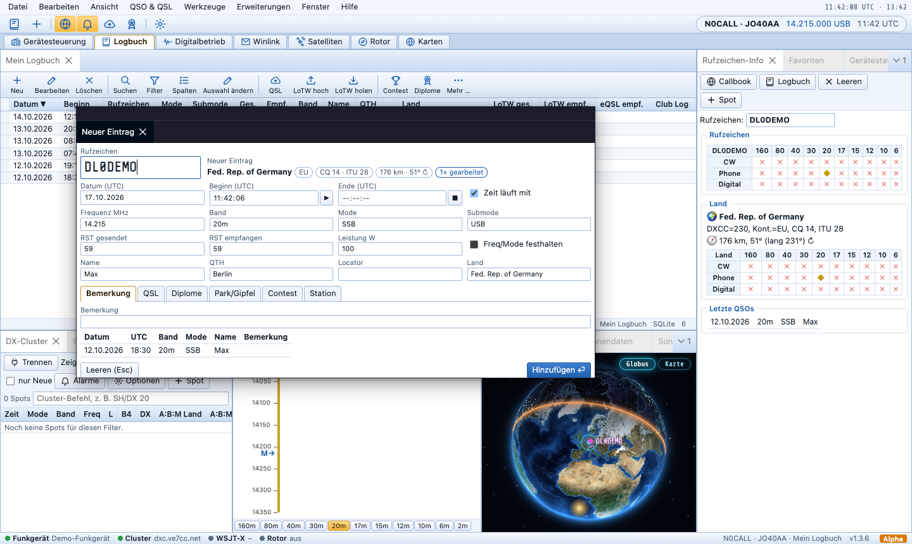

**Several logbooks:** **More … → Logbook management**: create, rename, back up, restore. QSOs can be moved between logbooks with cut/copy and paste.

**Enter paper log** (**More …** or **File → Enter paper log**): type in old log pages quickly – one QSO per line. Date, band, mode and report are taken from the line above; the time can be “1405” or just the minutes (“12” = same hour as above). Enter moves to the next field and at the end of the line to a new line. Country and “new country” appear at once; duplicate QSOs are marked and not saved.

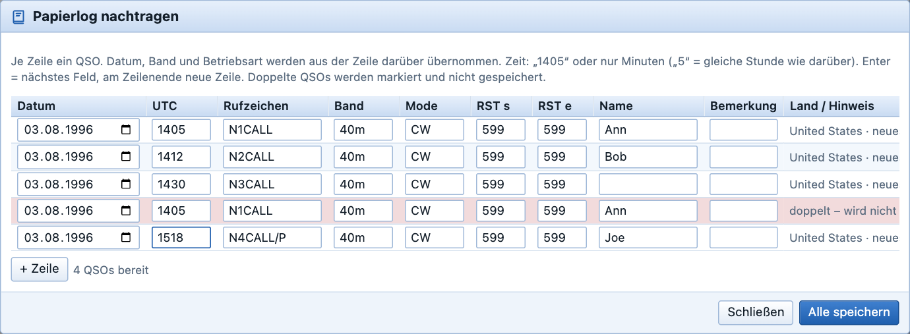

**Hot folder** (**F8 → Programs & backup**): ADIF files that land in this folder – e.g. from another program or from the phone via a cloud folder – are imported into the active logbook automatically; duplicates are skipped and the file is then moved to the sub-folder “importiert”.

**Synchronise two installations** (e.g. shack PC and laptop; **F8 → Programs & backup**): enter the address of the other RigVibe installation (in your own network or via Tailscale; allow network access there under **Access & API**) and click **Synchronise now** – or tick **automatically every 15 minutes**. Missing QSOs are copied in both directions, QSL flags merged (confirmed wins). Nothing is ever deleted; only installations with the same call sign are synchronised.

**QSL cards** (**More …**, **File** or the **QSL & online** pane):

- **Design QSL card:** background picture or colour gradient, large call sign, your own text lines with placeholders (`<NAME>`, `<QTH>`, `<LOC>`, `<COUNTRY>`, `<CQZ>`, `<ITU>`), a box with up to three QSOs and “via bureau/direct”. Optionally RigVibe prints a **QR code** with the QSO data (ADIF) on the card.
- **Send by e-mail (selection):** one card per station as a picture, plus the QSO data as an ADIF file; the address comes from the logbook or callbook. Sent QSOs are marked “QSL sent (e-mail)”. You need an e-mail account under **F8 → Errors & updates → SMTP server**. Comments and other private fields are never sent.
- **Print (selection):** cards in 14 × 9 cm format.
- **Read card (QR code):** hold the QR code of an incoming card in front of the camera or choose a photo – RigVibe finds the QSOs in the logbook and marks them confirmed (bureau, direct or e-mail). QR codes with QSO data in ADIF format are read, e.g. from RigVibe cards.

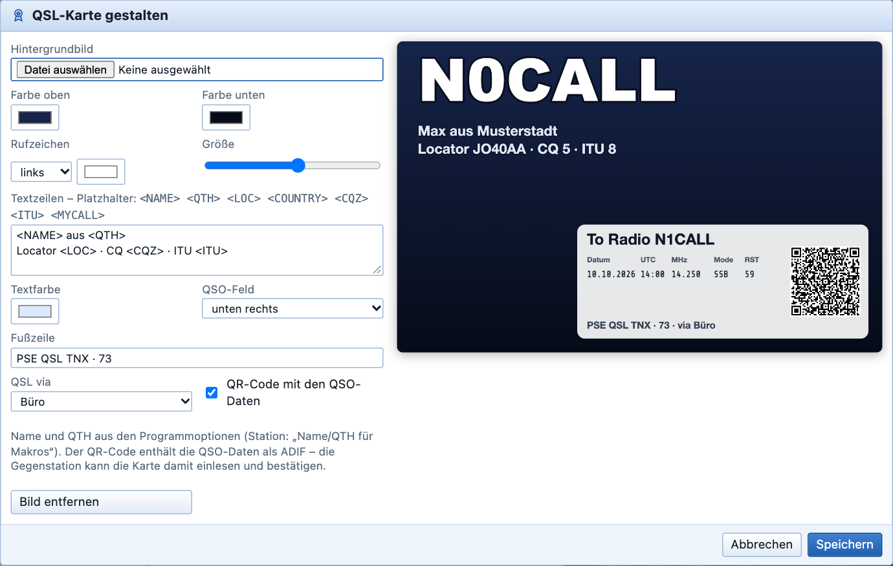

**Import/export:** **More … → import/export ADIF**, Cabrillo export, print logbook, print QSL labels.

**Contest mode:** the **Contest** button opens the settings: **contest name** (written as contest ID into every QSO), **scoring** and next **serial number**.

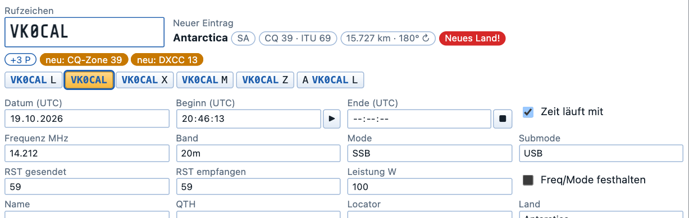

- **Super Check Partial:** while typing, RigVibe shows matching callsigns from the worldwide contest list MASTER.SCP (loaded weekly) – a click takes the callsign. A callsign not in it is often a typo.
- **Dupe and score while typing:** **DOPPELT** (dupe, with band, time and number of the first QSO) or the points the QSO brings and which **multipliers** would be new (e.g. “new: CQ zone 39”, “new: DXCC 13”). Depending on the scoring a station is a dupe on the same band or band and mode – only within this contest.
- **Scoring:** templates for **CQ World Wide**, **CQ WPX**, **IARU HF Championship**, **VHF contest** (points = distance in km), **DOK contest** and **general**; plus **custom scoring** (points for own country / continent / other continent or km; multipliers DXCC, CQ zone, ITU zone, prefix, DOK, grid square – per band or once). The score is your own estimate (claimed score); the contest rules are authoritative.
- **F keys and “Enter sends message”:** **F1** CQ, **F2** exchange, **F3** TU, **F4** own callsign, **F5** other station's callsign, **F7** AGN?, **F8** NR? – in CW via the keyer or CAT, in SSB via voice memories 1–3. With “Enter sends message”: Enter in the empty callsign field calls CQ, with a callsign the exchange goes out (and the cursor jumps to the received number), Enter there sends TU and logs. Messages and placeholders ({MY}, {CALL}, {NR}) in the contest dialog.
- **Contest score** (opens when starting, otherwise **View → Contest score**): score, QSOs, points, multipliers, **rate** of the last 10 and 60 minutes and a table per band.

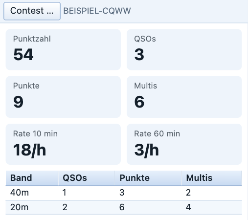

- **Cabrillo export** (**More … → Cabrillo**): only the QSOs of this contest, with category (operator, band, mode, power) and optionally your own score (CLAIMED-SCORE).
- **EDI export** (**More … → EDI export (VHF contest)**): EDI file (REG1TEST) for VHF/UHF contests in IARU Region 1 – one file per band, points = distance in km, new large squares and duplicates marked, totals and ODX in the header.

**Awards:** **Awards** shows DXCC, DXCC Challenge, WAZ, WAS, WAC, WPX, ITU zones, Europe, DOK, IOTA, VUCC grid squares, US counties and the CQ DX Marathon – worked or confirmed.

**Search, filter and saved views:** **Search** shows the filter bar (text, band, mode, QSL status, period). The **Condition** field queries any field, several separated by `;`: `=`, `!=`, `<`, `>`, `<=`, `>=`, `~` (contains), `!~` (does not contain), `empty`, `not empty` – e.g. `cqz=14; iota not empty` or `band=20m; country~Japan; qso_date>=20260101`. **View … → Save current view** remembers filter, columns and sorting under a name.

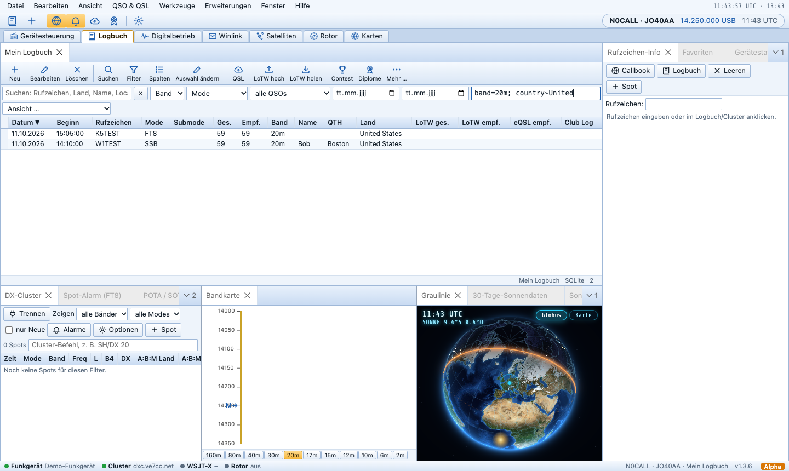

**Modes and RST:** **F8 → Modes** – one line per mode with RST default (e.g. `FT8 -10`, `CW 599`). The list appears in the entry's Mode field; when the mode changes, the RST fields are prefilled.

**POTA, SOTA and WWFF:** the **POTA / SOTA / WWFF** window in the logbook (menu **Tools**) shows current spots (a click tunes, a double-click opens the entry with the reference); the entry has a reference search. For your own activations create **station profiles** (callsign, locator, own park/summit reference) – the counter shows the day's QSOs, **Self-spot** announces the activation, **Export** creates the log file for the portal.

**Connecting other programs** (**F8 → Programs & backup**):
- **Forward QSOs** to other programs (UDP; ADIF, WSJT-X “Logged ADIF” for GridTracker/Log4OM or N1MM format).
- **Receive:** N1MM Logger+ (contacts), **ADIF via UDP** – e.g. from **VarAC**, **JTAlert** or **GridTracker** – as well as WSJT-X/JTDX. Duplicate QSOs are detected.
- **Pass WSJT-X packets on** to GridTracker or JTAlert.

**More tools** under **More …**: Google Earth file (KML), check and optimize database, query the callbook for the selection (fill empty fields), print address labels. **Automatic daily backup** into a folder, e.g. a cloud folder.

**Club scoreboard** (**View → Club scoreboard**): shows what the members of your club are working – **ranking** (QSOs, countries, bands, DOKs, points = QSOs + 10 per country + 3 per DOK, last active, 14-day trend, green dot = RigVibe is running), **shared goals** with progress bars, a **world map** of the countries the club has worked (colour and size by number of members, click shows who) and a **live ticker** of new contacts – "new country for the club!" is highlighted. Choose the period (today, week, month, year, all or custom, e.g. a contest or activity day), bands (HF/VHF) and mode; **Full screen** for the projector at the club evening.
- **Setup:** One RigVibe is the **host** (club name, join code, goals). It accepts only the club reports on a port of its own (default **8095**) – nothing else of RigVibe – and counts itself as a member. The others choose **Member** and enter address and join code; on the local network (club station, field day) **Search network** finds the host by itself. Over the internet: forward port 8095 (TCP) on the router to the host computer or use a VPN such as Tailscale. On Windows the firewall asks for permission the first time – allow it for private networks.
- **Data-minimal:** Per QSO only date, band, mode group, country and DOK are sent – no logbook and no callsigns of the stations worked. Only members who keep the **live ticker** switched on show the worked callsign there. The host can remove members; a new join code locks out everyone who doesn't get it.

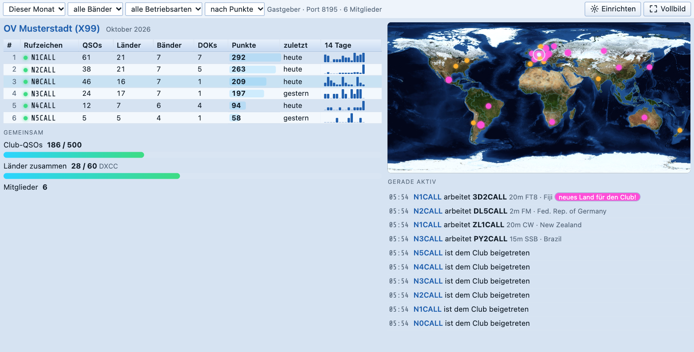

### For German stations

These functions appear only when your own call sign is German (**F8 → Station**); DARC functions only with **DARC member** ticked.

- **Training operation (§ 12 AFuV):** create a station profile with the training call sign and your own call sign as **instructor**; the entry form then asks for the **trainee**, and **More … → Print training record** lists all contacts per trainee with signature lines.
- **Bundesnetzagentur call sign list** as a callbook (see [Online services](#9-online-services)).
- **Exam trainer** (**Tools → Licence exam trainer**): all 1750 official German exam questions for classes N, E and A, with learning progress and practice sheets.
- **Amateur radio glossary** (with German user interface).

## 8. DX cluster, alerts and WSJT-X

- **DX cluster:** enter the server in the options. Spots are marked: **red = new country**, **orange = new band**, grey = already worked. A click tunes radio and mode. **Alerts** reports new countries/bands or particular callsigns (with sound). **Spot** sends your own spot.
- **Filters and alarms:** **DX only** hides stations from your own continent. Under **Alerts** there is an **exclusion list** (words or call signs in call, comment or spotter, `*` at the end = prefix, e.g. `SKIMMER*`) – such spots are hidden and never alarm. While a contest is running, **spot would be a new multiplier** reports every station that would give you a new multiplier.
- **WSJT-X / JTDX:** in WSJT-X under *Settings → Reporting* set “UDP Server” to `127.0.0.1` and port `2237`, tick “Accept UDP requests”. Logged QSOs go into the logbook automatically. The **Spot alarm (FT8)** window shows all decodes with country and status; a **double-click** calls the station in WSJT-X, **TX stop** ends transmitting.
- **What do I need?** (**View → What do I need?**): stations from the DX cluster and WSJT-X, ranked by what they bring to your log – **new country**, country new on the band or in the mode group (CW, phone, digital), **new CQ zone**, on VHF **new grid square**. The more, the higher the value. A click tunes to a cluster spot or lets WSJT-X call the station. Optionally a **desktop notification** for a new country or everything new. After logging the station drops out.

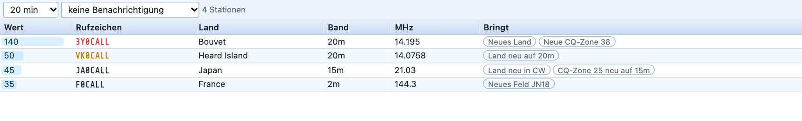

- **Why is nothing decoding?** (button **Why nothing?** in the spot alarm and digital modes, or **Tools**): checks in turn the **computer clock** against a time server (FT8/FT4 need less than about 1 s deviation), whether **WSJT-X** still sends data, whether radio and WSJT-X are on the **same frequency** and whether it is a **usual FT8/FT4 frequency**, the **mode** (USB or data USB), **filter width**, **squelch**, whether the radio is transmitting and – in digital modes – whether **audio from the sound card** arrives or is overloaded. Where possible each finding has a button to fix it.

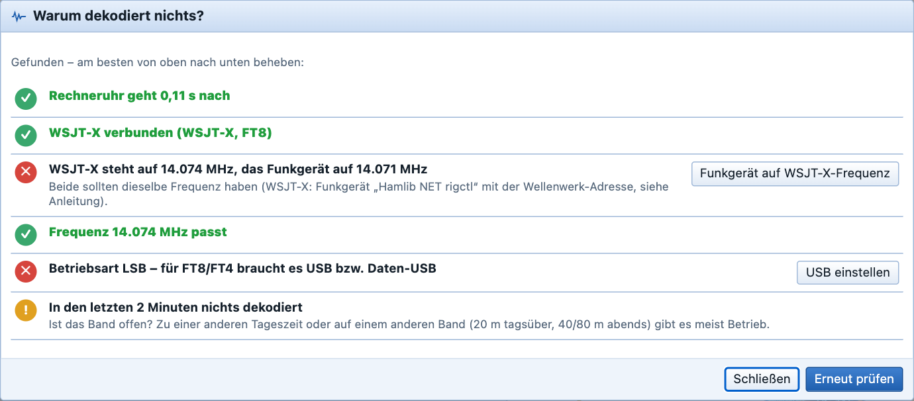

## 9. Online services

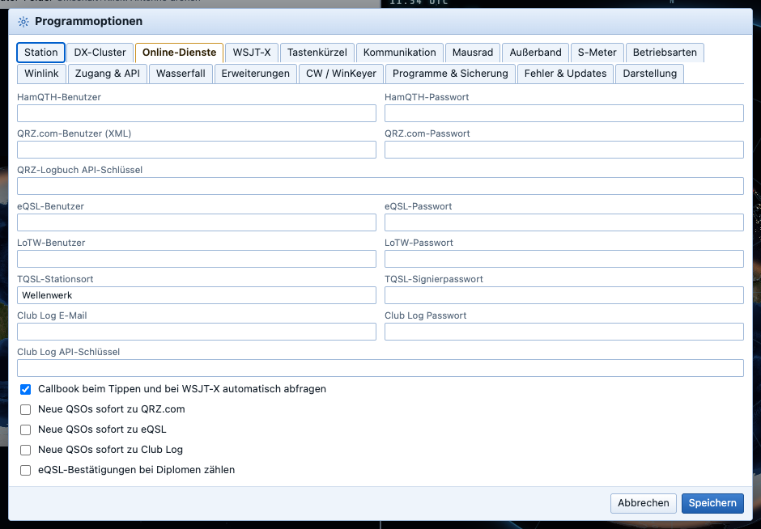

In the options under **Online services**:

- **Callbook:** HamQTH (free) and/or QRZ.com (XML subscription) – deliver name, QTH, locator, photo while typing the callsign.
- **Bundesnetzagentur call sign list** (German call signs only): name, town and licence class of German stations without a callbook account. RigVibe downloads the list monthly directly from BNetzA (about 10 MB) and fills in name and QTH while you type; together with HamQTH/QRZ.com it adds missing details. Can be switched off under **Online services**.
- **QRZ.com logbook:** API key from the QRZ logbook.
- **eQSL:** user name and password.
- **LoTW:** credentials for syncing and the **.p12 certificate** (exported from TQSL) with password for uploading.
- **Club Log:** e-mail, password, callsign.
- **HRDLog.net:** callsign (empty = your own) and the **upload code** from hrdlog.net (My account → upload code). One call per QSO; tick “Send new QSOs to HRDLog.net immediately”.
- **QO-100 Dx Club:** the **API key** from your profile at qo100dx.club. Only QO-100 contacts are sent (satellite name QO-100, or propagation “SAT” on 13 cm/3 cm without a satellite name); RigVibe adds satellite and propagation itself. Tick “Send new QO-100 QSOs … immediately”.
- Both services are **tested against simulated replies only**, not against the real servers (no account at hand).

New QSOs can be uploaded automatically (ticks “New QSOs to … immediately”). Confirmations are fetched with **Fetch LoTW** (logbook toolbar) or in the **QSL & Online** area.

## 10. Digital modes

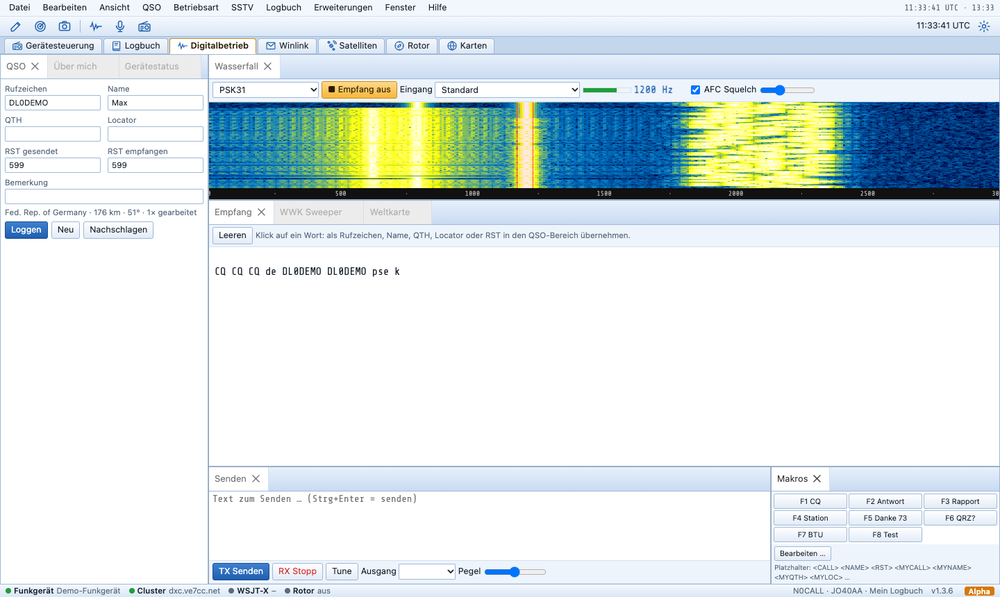

**Setup:** connect the radio's audio to the computer (USB sound card in the radio or an interface). In the **waterfall** choose the **input** and switch on **Receive**; in the **Transmit** window choose the **output** and the **level** (set so that the radio's ALC does not move). The level is finely graded (1 % … 100 %, small values in fine steps) and stored with the radio, so it also applies in other browsers and on the phone. It can also be entered under **Radio → Connect → transmit level to the sound card** (empty = default: 50 %, Quansheng 4 %). It applies to digital modes, APRS/packet, SSTV and paging. Set the radio to USB or the data mode (USB-D/PKTUSB).

**Per device:** RigVibe stores input, output, transmit level (in the device configuration), automatic level and the packet transmit delay separately for each device. Switching e.g. from the HF radio to the handheld switches Digital modes to its sound card. **Pegel auto** (next to the level meter) evens out the input automatically – handy for handhelds whose volume knob is different every time; the current gain is shown next to it. A closed squelch (silence) is not amplified. If the sound card itself is overdriven, RigVibe reports “Eingang übersteuert” – turn the volume on the radio down.

**Modes** (selection top left in the waterfall or menu **Mode**):

| Group | Variants |
|---|---|
| PSK | BPSK31/63/125, QPSK31/63/125 |
| RTTY | 45.45 baud / 170 Hz (amateur radio); adjustable 50, 75, 100 baud and 200, 425, 450, 850 Hz shift – e.g. German weather service DWD: 50 baud, 450 Hz, polarity “reversed” or “automatic”, USOS off |
| CW | via radio or WinKeyer |
| MFSK | MFSK8, MFSK16, MFSK32 |
| DominoEX, THOR | 4, 5, 8, 11, 16, 22 |
| Olivia, Contestia | 4/125 … 64/2000 |
| Throb | 1, 2, 4 |
| MT63 | 500, 1000, 2000 Hz, short and long interleave |
| Hellschreiber | Feld-Hell (picture display instead of text) |
| SSTV | see [chapter 11](#11-sstv-picture-transmission) |

**Operation:**
- **Clicking into the waterfall** sets the receive frequency on the signal (the centre is found automatically).
- The **receive text** runs in the **Receive** window. **Clicking a word** copies it as callsign, name, QTH, locator or RST into the QSO window.
- **Transmit:** type text, **Ctrl+Enter** or **TX transmit**. PTT is switched automatically. **RX stop** aborts, **Tune** sends a 4 s carrier.
- **Macros F1–F12** with placeholders like `<CALL>`, `<NAME>`, `<RST>`, `<MYCALL>`, `<MYQTH>`, `<MYLOC>`, `<TIME>` – **Edit …** to change them. Your own details are under **About me**.
- **QSO window:** collect callsign, name, RST … and **Log** – mode and frequency are filled in automatically.
- **RigVibe Sweeper:** decodes up to 16 signals at the same time (BPSK, RTTY or CW); a click moves a signal to the main decoder.
- **World map:** shows the stations heard.

### FT8 and FT4

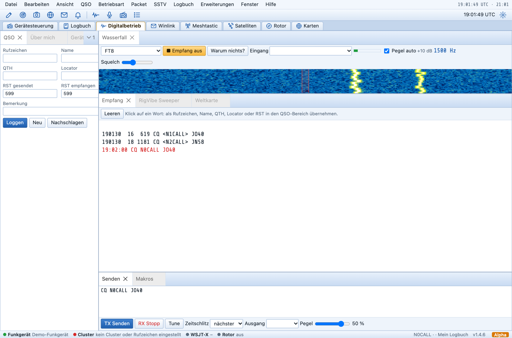

Choose mode **FT8** or **FT4** (group FT8/FT4) in digital modes, then **Receive**. After every UTC time slot (FT8 15 s, FT4 7.5 s) RigVibe decodes all signals in the passband – like WSJT-X, using ft8_lib. Each line: time (UTC), signal-to-noise ratio in dB, audio frequency in Hz, text. Callsigns in angle brackets were only sent as a short hash (e.g. long or unusual callsigns). The computer clock must be accurate to about one second.

- **Transmit:** type the text (e.g. `CQ <MYCALL> <MYLOC>`, `N1CALL <MYCALL> -12`, `N1CALL <MYCALL> RR73`) and **Send** – RigVibe transmits in the **next** time slot, 0.5 s after it starts, on the audio frequency of the red marker in the waterfall (click the waterfall to set it). Under **Time slot** you can fix **even** (:00/:30) or **odd** (:15/:45). A six-character locator is shortened to four. Text FT8 cannot encode is rejected with a hint.
- **Which devices:** any radio via the sound card (audio like WSJT-X), SDRs that can transmit, and the Quansheng UV-K1/K5 over USB-C: with the RigVibe firmware version 8 or later in USB directly as carrier keying, otherwise as a tone sequence. Receiving also works via receivers and WebSDR.

#### QSO with one click

With FT8 or FT4 the **FT8/FT4** window opens (otherwise via **View**). It lists every time slot: CQ calls green, messages to you red, the station of your current QSO highlighted yellow, your own transmissions grey.

- **Click a station:** a click on a line starts the QSO – RigVibe calls the station and then sends the matching next message by itself, always in the station's opposite time slot: call with locator → report → R-report → RR73 → 73. If you click a message addressed to you (e.g. a report), RigVibe joins at the right step. If the other station repeats its message, RigVibe repeats its own.
- **Call CQ:** RigVibe calls CQ and answers the first caller (the strongest if there are several); after the QSO it keeps calling CQ.
- **Tx1–Tx6:** the six messages of the QSO; a click chooses which one goes out next. The report is the measured signal-to-noise ratio of the other station.
- **Already in the log:** stations that are already in the logbook on this band in this mode appear faded with **B4** (FT8 and FT4 count separately). When calling CQ, RigVibe skips them and answers the next caller; if you click such a station, RigVibe asks first. **Allow duplicates** turns this off, e.g. for contests. The band comes from the radio's frequency – without rig control there is no marking.
- **Logging:** after RR73 or 73 the QSO goes into the logbook with reports and locator (**log automatically**; unticked it is only filled into the QSO area for checking).
- **Stop** ends the sequence (so does **RX stop**). If no matching reply arrives for 6 minutes, RigVibe stops by itself (also when calling CQ). If the called station answers someone else close to your transmit frequency, RigVibe stops calling so you don't disturb that QSO. Receive must be running – the next message depends on what comes in. Callsign and locator are set in the options.
- Transmission uses the audio frequency of the red marker in the waterfall. If the reply arrives late, the transmission still starts up to 1.5 s into the time slot – the other station still decodes that.

### JS8 (JS8Call)

Choose **JS8 Normal**, **JS8 Fast**, **JS8 Turbo** or **JS8 Slow** (group JS8) – compatible with JS8Call, checked against the original in both directions. Periods are 15 s, 10 s, 6 s and 30 s; Normal is by far the most used. After every period RigVibe decodes all signals in the passband and assembles multi-frame messages; a complete message ends with ♢. Each line: time (UTC), signal-to-noise ratio, audio frequency, text.

- **Transmit:** type the text and **Send** – RigVibe splits it into frames and sends them in consecutive periods on the audio frequency of the red marker. Like JS8Call, RigVibe understands `CQ CQ CQ <MYLOC>` (CQ), `HEARTBEAT`, directed commands such as `N1CALL SNR?`, `N1CALL HW CPY?`, `N1CALL ACK`, `N1CALL MSG text`, and free text (your own callsign is put in front). **Time slot** fixes the period as with FT8.
- **Reading free text:** JS8Call sends free text as numbers from a large dictionary (262,144 words). Without the dictionary such words show as ▯ – CQ, heartbeat, directed commands and text from RigVibe are always readable. RigVibe does not ship the dictionary (it belongs to JS8Call and is licensed under the GPLv3). To read JS8Call free text, set it up once yourself:
  1. Download the file **`jsc_map.cpp`** from the JS8Call source code: on **github.com/js8call/js8call** open `jsc_map.cpp` and save it via **Raw** or **Download raw file** (about 6 MB).
  2. Put the file, unchanged, into the folder **`js8`** in RigVibe's data folder – `~/Library/Application Support/RigVibe/js8` (Mac), `%APPDATA%\RigVibe\js8` (Windows) or `~/.local/share/rigvibe/js8` (Linux). RigVibe creates the folder the first time JS8 is used.
  3. Reload RigVibe (browser: reload the page). On the next JS8 reception RigVibe reads the file and shows the free text in full.

  RigVibe itself sends free text character by character – every JS8Call reads that even without the dictionary, it just needs a few more frames.
- **Devices:** any radio via the sound card, SDRs that can transmit, receivers and WebSDR (receive only). **Quansheng UV-K1/K5** with the RigVibe firmware in USB: from version 16 **all four submodes** fine-stepped via the FSK unit (tested on air: Normal, Fast, Turbo and Slow 2 of 2 each), with versions 8 to 15 only **JS8 Fast and Turbo** as carrier keying on the 10 Hz grid.
- **Pitch and time offset:** if the same message shows up on several pitches (a weak image from the receiver, e.g. a mixing product), RigVibe shows the strongest – over the air with the K1 an image 25 dB below the signal sat at about 130 Hz and was sometimes reported before. The time offset (dt) for FT8, FT4 and JS8 is referenced as in WSJT-X/JS8Call: 0 = sent on time.
- JS8Call's automatic replies, relaying and message store are not built in.

### Digital voice (DMR, D-STAR, YSF, M17) from the sound card

Mode **Digital voice** (group Digital voice) in digital modes, then **Receive**: RigVibe itself detects whether DMR, D-STAR, C4FM/YSF or M17 is being sent in the sound card audio (P25 and NXDN are only detected) and decodes callsign, destination or talkgroup, repeater and short text. The lines appear in the receive window and, as with the receivers, as **digital voice in the display**. Transmitting works in this mode with **M17** (see below). RigVibe itself plays the speech only for **M17** (Codec2); for DMR, D-STAR and YSF it shows who is talking and to where – it does not decode the voice content.

- **Which audio:** ideally the unaltered demodulator (data jack "9600"/discriminator) – then all modes work. The speaker or headphone output lacks the low frequencies; D-STAR (two levels) copes well with that, DMR, YSF and M17 (four levels) mostly do not.
- **Quansheng UV-K1/K5 with RigVibe firmware:** for the time of reception RigVibe switches to the raw demodulator at full bandwidth and back afterwards. Measured at the audio output with a USB sound card: **D-STAR 119 of 120** headers, DMR practically not. **Without a sound card (input = radio/receiver) digital voice works over USB-C from firmware stage 12 – better than via the sound card:** RigVibe then bypasses the audio filters of the radio chip, samples at 38.4 kHz and compensates the coupling on the board. Measured over the air, once the mode has been detected (the first transmission is used for detection): **D-STAR, DMR, YSF and M17 every transmission** with callsign or ID (previously over USB: DMR, YSF and M17 not detected at all).
- **Reliable for all modes:** a receiver (SDR such as RTL-SDR/HackRF, KiwiSDR, OpenWebRX) – there RigVibe decodes from the unaltered demodulator (window **Receiver**, click the signal or use signal identification).

**Transmitting M17** (voice with Codec2, free): in the Digital voice mode the transmit bar shows **🎙 M17**. Press it: RigVibe keys PTT and transmits while you speak into the microphone – in real time with about a quarter of a second delay (sender = your callsign, **destination** e.g. `@ALL`, a callsign or reflector module). The signal goes through the **output** (sound card) into the microphone input of the FM radio. Pressing again ends the transmission; it ends by itself after 5 minutes.

- **Level:** the transmit level sets the deviation. Full M17 deviation (2.4 kHz) on the Quansheng UV-K1 with a USB sound card: about **17 %**. Too much level makes the radio limit and the signal becomes unreadable.
- **Audio path:** the microphone path of a handheld is built for speech (bass cut, peak around 125 Hz, roll-off above 3 kHz). **Quansheng** compensates the frequency response measured on the UV-K1 before transmitting; **flat** transmits without compensation (for radios with a "9600" data jack).
- **Frequency:** in the test the Quansheng transmitted about 2.9 kHz off the set frequency; M17 receivers usually compensate.
- Measured over the air (UV-K1 → HackRF): with compensation callsign and audio come through, without it about every fifth symbol is wrong.

### FreeDV (digital voice)

**View → FreeDV (digital voice)** in digital modes. Choose the mode (**RADE**, **RADE V2**, **700D**, **700E** or **1600** – on the FreeDV frequencies mostly RADE today), **Receive from** (the radio's sound card or a receiver/WebSDR), **Speaker**, **Microphone** and **Transmit to radio**, then **▶ Receive**. Green = synchronized, next to it the signal-to-noise ratio. To talk hold **PTT** (or choose “latches”). The radio is set to USB.

With a transmit-capable SDR (ADALM-Pluto, HackRF One, Hermes Lite 2, parameter `tx=1`) the FreeDV audio goes straight to the SDR when transmitting, not to the sound card.

**FreeDV RADE and FreeDV Reporter:** In addition to 700D, 700E and 1600, RigVibe supports **RADE** (V1, today's most used FreeDV mode) and **RADE V2**. RADE carries speech with a neural network and still sounds natural on weak signals (down to about 0 dB SNR). Set the radio to USB and tune to the FreeDV frequency; RADE tolerates about ±50 Hz error, RADE V2 about ±20 Hz. When you release PTT, RigVibe sends the end-of-over signal so the other station switches over immediately. In the FreeDV window, **FreeDV Reporter** (qso.freedv.org) shows who is on FreeDV right now: callsign, locator, frequency, mode and last transmission. Click a row to tune there. Your own station is only reported if you tick “report own station” (callsign and locator from the options, plus frequency and transmit state).

### APRS: map of the surroundings, messages and beacon

**Packet → APRS** (or the **APRS** button) in Digital modes. RigVibe decodes APRS itself from the audio (AFSK 1200 baud) – start reception as for the other digital modes via the radio's sound card or a receiver. **APRS frequency** sets 144.800 MHz FM (Region 2: 144.390).

- **Map and list:** all stations heard with position, distance, comment or weather data. With **APRS-IS** the messages from the internet for the chosen radius are added on request (grey, read only – RigVibe forwards nothing to the internet).
- **Messages:** enter the recipient (a click in the list takes it over) and send text up to 67 characters. RigVibe repeats up to three times until the acknowledgement arrives (“✓ quittiert”). Messages to your callsign appear in the window and are acknowledged automatically.
- **Beacon:** **Bake jetzt** sends your position (from the locator); regularly on request, at most every 10 minutes. Under **“Bake einstellen”**: **Gerät für die Bake** (device for the beacon – when fixed, the beacon is sent even while another device is selected), path (default `WIDE1-1,WIDE2-1`), symbol (house, car, bicycle, motorhome, digipeater, emergency … or an **own symbol** as two characters, e.g. `\a`), **personal text**, **DOK**, **QRV frequency** (placed at the front of the comment as “145.500MHz” – the way APRS maps and radios display it), **altitude** above sea level and a **status text** that is sent in addition to the position. The line “Wird gesendet” shows the finished packet; the comment may have at most 43 characters – if it gets too long, RigVibe only shortens the free text.
- Transmission works as in Digital modes: via the sound card to the radio (PTT via CAT) or directly via a transmit-capable SDR.

### Paging (POCSAG / DAPNET)

**Packet → Funkruf** (or the **Funkruf** button) in Digital modes. Amateur radio paging runs over **DAPNET** (hampager.de) with POCSAG on **439.9875 MHz**.

- **Receive:** **DAPNET-Frequenz** sets 439.9875 MHz FM; start reception as for the other digital modes (radio sound card, own SDR or OpenWebRX). RigVibe decodes POCSAG itself – 512, 1200 and 2400 baud, with error correction, even from a radio's speaker audio. The list shows time, path, address (RIC), function and text; known DAPNET addresses (time, Skyper rubrics) are labelled. Addresses entered under **Meine RICs** are highlighted and raise a notice – RigVibe then also listens with the window closed. If an OpenWebRX offers its own pager decoder, it can be chosen in the *Data reception* window; its calls appear here too. **Quansheng UV-K1/K5 with RigVibe firmware version 12 or later:** while the paging window is open, RigVibe decodes directly at the radio's raw discriminator (via USB-C, no sound card; also selectable as “POCSAG pages” in the *Data reception* window, likewise for own SDRs). The speaker audio via USB-C is unsuitable – high-pass and de-emphasis destroy longer runs of equal bits at 1200 baud. Tested over the air (HackRF → K1): 512, 1200 and 2400 baud, every call error-free. Meanwhile the FM audio for listening is muted; closing the window restores the previous state. Decoding works **only in amateur bands** – reading emergency-service or commercial pagers is not permitted.
- **Send via DAPNET (internet):** recipient callsign(s) (several separated by commas), transmitter group (default `dl-all`) and text up to 80 characters; the user name and password of your hampager.de account are stored. DAPNET transmits the call via its transmitters to the recipient's pager.
- **Transmit yourself (radio):** send a call directly with your own equipment – RIC, function (3 = text as in DAPNET; 0 = digits), text and data rate. Transmit-capable SDRs (HackRF, ADALM-Pluto, Hermes Lite; profile parameter `tx=1`) transmit directly with 4.5 kHz deviation. A radio gets the signal via the sound card; it needs a **data input with a flat frequency response** (9k6 data jack or USB in data FM) – via the microphone POCSAG does not arrive reliably. RigVibe sets the transmit frequency and mode for this and restores them afterwards.
- **DAPNET transmitter (node):** RigVibe works as a DAPNET transmitter like a UniPager. First create the transmitter on hampager.de (callsign, location, power); you get the **auth key** there. Enter transmitter callsign and auth key, choose the radio or SDR for the transmissions under **Gerät zum Senden** (otherwise the currently selected one), switch on, **Übernehmen**. RigVibe connects to the DAPNET core (default `dapnet.afu.rwth-aachen.de`, port 43434), receives the calls for its transmitter groups and transmits them **only in the assigned time slots** (16 slots of 6.4 s – the PC clock must be accurate). The status line shows the connection, time slots, received and transmitted calls; the calls also appear in the list (path “DAPNET”). For a radio, the sound card level and polarity from this tab apply; the program window must then stay open.

### Packet chat (AX.25)

**Packet → Packet-Chat:** connection with another station or a mailbox via packet radio (1200 baud), with RigVibe's own modem – no TNC and no extra program needed. Enter the other station's callsign (e.g. `DB0ABC-8`), **Connect**, type text and send with Enter. RigVibe repeats lost frames itself; after eight tries without an answer it disconnects. **Accept calls** lets other stations connect to you. Set frequency and FM on the radio as usual for packet.

**Frequency by band plan:** the list on the left of Packet chat and Packet monitor contains, per band, the channels where packet is allowed by the IARU Region 1 band plan (segment "digital communications") – 10 m 29.210–29.290, 6 m 50.625–50.750, 2 m 144.8125–144.9875 MHz (144.800 = APRS), 70 cm 433.625–433.775 and 438.025–438.175 MHz, 23 cm 1298.025–1298.975 MHz; raster 12.5 kHz (10 m 20 kHz, 23 cm 25 kHz). Selecting one tunes the radio and sets FM (data FM where the radio supports it). **Own frequency …** allows any other; with band plan Region 2 the packet frequencies there appear.

### Packet monitor (all frames)

**Packet → Packet monitor:** shows every received AX.25 frame (1200 baud AFSK) like a TNC in monitor mode – including connections of other stations, node and mailbox traffic, not just APRS. Each line: time, source > destination with digipeaters, frame type (**I** with sequence numbers S/R, **RR/RNR/REJ**, **SABM**, **UA**, **DISC**, **DM**, **UI** …, C = command, R = response, P/F) and the text. **NET/ROM node lists** (broadcast to NODES) are decoded readably: alias, callsign, neighbour, quality. Filter by callsign or text; APRS and acknowledgements can be shown or hidden; **Copy** takes the log as text. Audio comes from Digital modes as for APRS (radio, own SDR or OpenWebRX, mode FM).

**Weak signals:** like Direwolf, the demodulator repairs one or two wrong bits using the checksum (one wrongly detected tone corrupts two adjacent bits). At 4 dB SNR about 17 % more frames get through, at 3 dB about 60 % more. Repaired frames are marked **repaired** in the monitor – in rare cases a repair can be wrong. If the same signal was received error-free at the same time, the repair is discarded.

## 11. SSTV (picture transmission)

**SSTV window** via the toolbar (**SSTV**) or the **SSTV** menu.

- Switch on **Receive**. The mode is detected automatically at the start of the picture (VIS code); slant from inaccurate sound cards is corrected.
- **Joining mid-picture:** if a picture is already running when you switch on or tune in, RigVibe detects the mode from the line timing after a few lines (Martin M1 after about 3 seconds) and decodes from there. The picture is marked **partial** and ends as soon as only noise remains. A weak VIS code that could not be read no longer matters either. Manual start still works: choose the mode and **Start now**.
- **Off frequency?** If the sync tone is not exactly at 1200 Hz (click beside the centre, radio without CAT), the receiver compensates offsets up to about ±550 Hz by itself and follows the frequency during the picture. The VIS code at the start of a picture is read up to ±250 Hz off (measured on the leader tone); before, it was lost from about 60 Hz, and the picture then only started as a partial picture.
- Received pictures are saved automatically in **SSTV pictures** (gallery).
- 18 modes: Martin M1/M2, Scottie S1/S2/DX, Robot 36/72, PD 50/90/120/160/180/240/290, Wraase SC2-180, Pasokon P3/P5/P7.

**Transmit:** **Send picture …**

Choose the background (test picture, own image file, last received picture), up to three text lines with placeholders (`<CALL> de <MYCALL>`, `ur <RST>` …), text colour and position. With **insert the other station's received picture small** the other station sees how its picture arrived. The preview shows the result and the transmit duration.

### KG-STV (digital pictures)

KG-STV transmits the picture digitally in blocks of 16 × 16 pixels, each with its own checksum – a corrupted block is simply missing, the rest of the picture stays sharp. Pictures are compatible with the original KG-STV program (JJ0OBZ), used for example by ARISS for transmissions from the ISS.

- **Receive:** runs automatically as soon as **Receive** is on in the SSTV window – alongside analogue SSTV, no mode selection needed. The picture builds up block by block (display “block 216 / 300”) together with the other station's callsign. Finished pictures go to the gallery with the callsign; text messages appear in the receive window.
- **Transmit:** **Send image …**, mode **KG-STV 4L-FSK** (faster, about 70 s for 320 × 240) or **KG-STV MSK** (more robust, about 90 s). **Picture quality** 0–15 (10 = default; lower = sharper but longer) and **error protection (FEC)** for difficult paths (takes about half as long again). Pictures are always sent as 320 × 240.
- Radio on USB or FM as for SSTV; audio between 1200 and 1800 Hz. Slight mistuning (±60 Hz) does no harm.
- With the **Quansheng UV-K1/K5 with RigVibe firmware** KG-STV also works without a sound card over USB-C (transmit and receive).

### Weather fax (WEFAX)

Weather charts and satellite pictures that weather services send on shortwave (e.g. the German weather service) are received in the **weather fax window** (Digital modes → View → Weather fax, or click the signal in the waterfall and choose **Open weather fax reception**). The picture is an FM signal in the audio: black 1500 Hz, white 2300 Hz, centre 1900 Hz – the receiver is in **USB 1.9 kHz below the transmit frequency**.

- **Sequence:** With **Receive** RigVibe waits for the **start tone** (300 Hz = IOC 576, 675 Hz = IOC 288), measures the start of the line (the black pulse) and the centre of the signal in the **phasing signal**, and then writes the picture line by line. The **stop tone** (450 Hz) ends it; the finished picture goes to the picture gallery (like SSTV) and can be saved as PNG.
- **Settings:** **Lines/min** (60, 90, 120, 240), **IOC** (automatic from the start tone, 576 or 288), **Centre** (tracked from the phasing signal with “automatic”), **Slant** in ppm (if the picture is slanted because the sound card does not run exactly, correct it here), **Offset** (shift the picture left or right if it began without a phasing signal) and **Negative**. **Start now** writes a picture that is already running from the current timing.
- **Tested** are the reception with **synthetic signals** (start tone, phasing, picture, stop tone; with mistuning, clock error, noise and 90 and 120 lines/min) and, in the interface, with an artificial weather chart (the picture above). **I have not tried it with a real weather fax station yet.**

## 12. Winlink (e-mail over radio)

The **Winlink** tab is a complete Winlink mailbox: write messages, exchange them over radio or internet, read, answer. On the left the folders (**Inbox**, **Outbox**, **Sent**, **Archive**), in the centre the messages with the reading pane below, on the right the connection with its log.

**Setup** (**Settings** or **F8 → Winlink**): Winlink callsign (empty = station callsign) and the **Winlink password** of the account on winlink.org. For radio operation also the modem:

| Connection method | What is needed |
|---|---|
| **Telnet – Winlink server** | internet only (exchange directly with the Winlink server, e.g. for testing) |
| **Telnet – peer** | address and port of another station on the network (station-to-station without a server) |
| **ARDOP** (shortwave) | the free modem **ardopcf** runs on this computer, e.g. `ardopcf 8515 <soundcard> <soundcard>` |
| **VARA** | the program **VARA** (separate, own license) is running; RigVibe only uses its TCP interface (port 8300) |
| **Packet** (VHF/UHF) | **Direwolf** (or another modem with AGW interface) is running, AGW port 8000 |

With ARDOP and VARA RigVibe keys the radio as soon as the modem wants to transmit (or the modem does it itself or via VOX – setting **PTT**).

**Writing a message:** **New** – recipients (callsign or e-mail address, several separated by commas), subject, text, attachments. The message waits in the **Outbox** for the next connection. Keep attachments small over radio.

**Connecting:** choose the connection method; for radio enter the **station** (callsign of the RMS gateway or station) and optionally the **frequency** in kHz – the radio is set to it beforehand. **Connect** exchanges in both directions: the outbox is sent, new messages arrive in the inbox (bold = unread). **Receive only** leaves the outbox. The log shows each step.

**Reading and more:** a click on a message shows it below; buttons or right-click: **Reply**, **Reply all**, **Forward**, **Archive**, **Delete**, in the Sent folder **Send again**. Save attachments with a click.

**Chat (keyboard QSO):** open the **Chat** window in the Winlink tab. Choose the connection method (ARDOP, VARA, packet or telnet to `host:port`) and the station, **Call** – or **Wait for calls**, then RigVibe accepts incoming connections (and keeps waiting afterwards). Type text, Enter sends. **Log** puts the station into the logbook. Plain text is sent line by line; this suits simple terminal programs. Chat and Winlink share the modem – only one at a time.

> Messages are stored as files in the data folder under `winlink/` (one folder per mailbox folder) and are thus part of the backup.

### Meshtastic node and Winlink on the go

In the **Meshtastic** program you operate your own Meshtastic node from the PC.

- **Connect:** in the **Connection** window choose **Network** (IP address of the node, port 4403 – nodes with Wi-Fi or Ethernet), **USB** (serial port; “automatic” usually finds the node itself) or **Bluetooth** – handy on the go with a laptop: **Suchen** lists the nodes in range, choose one, **Verbinden**. The first time, the system asks for the pairing PIN shown on the node's display (without display usually 123456). The node must not be connected to a phone at the same time; if the connection drops (out of range), RigVibe reconnects by itself after 20 seconds. RigVibe reconnects at the next start. Newer firmware (2.7 in our test) accepts several programs over the network at the same time, e.g. RigVibe and a script that sends messages. Older firmware allows only one connection – then disconnect other programs first. If the connection drops, RigVibe reconnects by itself after a minute.
- **Messages:** one tab per channel (names as set in the node). Clicking a sender or double-clicking in the node list opens a **direct message**. Long texts are split automatically into parts of at most 200 bytes and sent with pauses so the mesh is not overloaded.
- **Nodes:** all known nodes with device, SNR, hops, battery, distance from your location and when they were last heard; search at the top.
- **Map:** when zoomed in with a dark street map (OpenStreetMap) instead of the earth texture; nodes with a position, your own node highlighted (green = heard directly, orange = via other nodes, grey = via MQTT).
- **Own node:** change the long and short name; region, modem preset and firmware are shown.

**Winlink bridge for on the go:** RigVibe connects Winlink with a defined Meshtastic group (channel). So you read and answer your Winlink mail with a Meshtastic handheld when you are away from the station.

1. In the **Connection** window under “Winlink bridge” tick the box and choose the **group**. Best create a group of your own with its own key – anyone could read along in the open channel.
2. Under **Allowed nodes** enter the IDs of your own handhelds (e.g. `!435915ec`, also via the selection list). RigVibe ignores commands from other nodes.
3. Optionally **fetch automatically** every *n* minutes and choose the path (Telnet over the internet or by radio via ARDOP, VARA, Packet with a gateway station).

RigVibe announces new Winlink messages in the group, e.g. “📨 Winlink von DL1ABC: Treffen Samstag – „wl lies OP7F““. Commands from the group or as a direct message to the station node (command word adjustable, default `wl`):

| Command | Effect |
|---|---|
| `wl liste` | the last five messages in the inbox with short code |
| `wl lies OP7F` | read a message (in parts, at most twelve) |
| `wl an DL1ABC Subject: text` | put a message into the outbox (several recipients with commas) |
| `wl abruf` | start a Winlink connection: send and fetch |
| `wl status` | number of messages in inbox and outbox |
| `wl hilfe` | list of commands |

Answers go back to where the command came from – into the group or as a direct message.

## 13. Satellites

Orbital data and transmitters are loaded automatically. On the left the list with current elevation (green above the horizon), **Choose satellites** (toolbar) chooses up to 100 satellites. Next to it the pass diagram (sky from above, glowing track of the next pass), the **3D Earth** with all chosen satellites as small 3D figures in real time (the ISS with its own shape; darker in the Earth's shadow), track and footprint of the selected satellite at its real altitude, position and frequencies, and the next passes. On the globe the Earth turns smoothly with the selected satellite; drag with the mouse button held to turn it yourself (following pauses), the mouse wheel zooms, a **double-click** resumes following. Clicking a satellite selects it.

- Choose the satellite's **transmitter** – downlink/uplink are shown.
- **Track radio (Doppler):** keeps adjusting the receive frequency; **Uplink via split** also sets the transmit frequency on the same radio; radios with a satellite mode (IC-9700, TS-2000 …) are switched into satellite mode and **duplex** is switched on so you hear your own downlink. **Uplink via** a second radio: the current radio hears the downlink, the second one transmits the uplink, both Doppler-corrected. RigVibe then switches on **duplex** and puts the PTT button and space bar on the uplink radio – you hear yourself through the satellite (use headphones).
- **Track with rotator (az/el):** turns the antenna along.
- **Schedule:** all selected satellites of the next hours sorted by start, with minimum elevation and the filter “only with voice/transponder”. A click selects the satellite.
- **Mutual visibility:** enter the other station's callsign or locator – the list shows when a satellite is above the horizon for **both** stations (for one or all selected satellites).

## 14. Rotator

**Connect rotator:** manufacturer/model, port and speed (as for the radio). Operation: a click into the dial turns there, enter degrees, stop, park. The map on the right shows the beam direction (Mercator or great circle around your location). Enter the target as **callsign, country or locator**, **Short/Long** for short or long path, then **Turn rotator**. From logbook, cluster and maps use right-click → **Turn antenna**.

Also in the Connect dialog: **end stop** in the north (0°…360°) or south (−180°…+180°), **azimuth offset** for calibration (if the rotator shows 10° too much, enter −10), your own **rotation range** for rotators with overlap (e.g. 0…450° – RigVibe then takes the shorter way) and a **movement log**.

## 15. Maps

All maps show the Earth **photorealistically in 3D** from NASA satellite imagery: by day the “Blue Marble” image with relief and sea floor, by night the city lights (“Black Marble”), in between the glowing **grey line**; time and sun position at the edge. The **world map** switches between **Map** and **Globe** at the top right (drag rotates or pans, the mouse wheel zooms, a double-click centres on your location) and shows your station, QSOs, spots, locator fields and the great-circle arc to the DX station with a travelling light dot. Plus the **bearing map** (azimuthal equidistant around your location – directions are exact there) with distance rings and a glowing antenna beam. The same view is used by the grey line (logbook), the rotator map (great circle, map, globe), the satellite map (follows the satellite) and the map in digital modes; the rotator dials are glowing holo displays. Graphics acceleration (WebGL) is required. Right-clicking a point shows locator, direction and distance and turns the antenna on request.

## 16. Keyboard shortcuts

| Key | Effect |
|---|---|
| F8 | Program options |
| Ctrl+F8 | Edit interface |
| F11 | Full screen |
| Mouse wheel over a digit | change this digit (on the bars: Shift ×2, Ctrl ×5) |
| ← / → | change active digit |
| ↑ / ↓, + / − | increase / decrease active digit |
| 0–9 | type digit |
| Enter | frequency entry (radio control) or save QSO (entry) |
| Esc | clear entry, close menu, stop voice keyer |
| F1–F6 | send voice keyer M1–M6 (rig control) |
| F1–F12 | macros in digital modes |
| Ctrl+Enter | transmit text (digital modes) |

Your own shortcuts: **Options → Keyboard shortcuts**.

## 17. Data, backup and moving

All data (logbooks, settings, favourites, SSTV pictures) is stored in the user folder:

- Windows: `%APPDATA%\RigVibe`
- macOS: `~/Library/Application Support/RigVibe`
- Linux: `~/.local/share/rigvibe`

**Backing up:** **More … → Back up now** (logbook bar) makes a copy of the current logbook; **More … → Backups** restores. To move to another computer copy the whole folder or export the logbook as ADIF and import it on the new computer. The radio-control layout is transferred with **Edit interface → Save layout as file / Load layout from file**.

### RigVibe on the phone (also on the go with Tailscale)

Under **/m** there is a dedicated **phone view** with large buttons; phones are taken there automatically when opening RigVibe (full view via ⤢ top right). Tabs at the bottom:

- **Radio:** frequency (tap to enter), step ±, band, mode, S-meter, volume, noise filters (NR, AI, NB) and a large **PTT** button to hold. Audio: directly from receivers; from a radio via the station's **remote audio** (enable at the station under Rig control → Tools) – then holding PTT also puts the phone's microphone on air. With transmit-capable SDRs the microphone goes straight to the SDR. Recorded **voice keyer** slots appear as buttons (📡 CQ …): tap to send – with “repeat” as a CQ loop; tap again to stop.
- **Waterfall:** tap to tune.
- **Mesh:** read and write Meshtastic messages per channel.
- **Winlink:** read the inbox, compose messages, **Abrufen** starts the station's Winlink connection.
- **APRS:** send messages via the station and see the history (the APRS window must be open in Digital modes at the station).
- **Log:** quick logbook entry with the radio's frequency and mode.

Via the browser menu **“Add to Home Screen”** it becomes an app.

**On the go with Tailscale:** Tailscale connects your devices through a private network, without port forwarding on the router.

1. Install Tailscale on the station computer and the phone and sign in with the same account.
2. In RigVibe **Program options → Access & API → On the go with the phone → set up HTTPS via Tailscale**. RigVibe sets up “tailscale serve” and shows the address (e.g. `https://station.tailnet-name.ts.net/m`) with a QR code to scan. If Tailscale refuses a certificate: enable “HTTPS Certificates” under *DNS* in the Tailscale admin console.
3. **Be sure to set a password** (same page at the top). Access via Tailscale counts as a foreign device and must then log in once.

Via the HTTPS address microphone and app installation work as well – browsers don't allow that over plain http in the home network.

## 18. Access, API and AI assistants

Settings under **F8 → Access & API**.

**Password:** on the computer running RigVibe no sign-in is ever needed. If a password is set, RigVibe asks for it once on access from other devices (tablet, phone, second PC – also via `https://…:8443`). **Always set it before any access from the internet.**

**Station data in one place:** callsign, locator, operator, power and language come from **Station** or the active **station profile** and apply to all parts of the program (logbook, Winlink, maps, rotator, satellites …), to the interface and to extensions. When the profile changes, everyone knows immediately.

**API:** everything the interface can do also works via the interface. The description of all functions to try out: **API documentation** (address `/api/docs`). Programs on other computers need an **API key** (**Generate new key**) and send it as `Authorization: Bearer <key>`. Events (frequency, spots, QSOs, station data …) arrive in real time via the WebSocket `/ws`.

**AI assistants (MCP):** RigVibe includes an MCP server. With it e.g. Claude Desktop or other AI programs can query and operate the station: frequency and mode, look up callsigns, search the logbook, log QSOs, DX spots, rotator, Winlink messages. The ready-made entry is shown in the **MCP entry** field – **Copy** and paste it into the AI program's configuration (Claude Desktop: *Settings → Developer → Edit config*). RigVibe must be running.

**Extensions:** under **F8 → Extensions** extensions (plugins) can be installed (ZIP), switched on and off and configured. An example is included. How to write your own is described in the [developer guide](Extensions.md) (in the program: link on the same tab). Extensions automatically receive the station data, the interface language and all events. Interfaces for extensions: **interface** (own windows, tabs, menu items), **server** (own API functions, events, radio, logbook), **receiver types** (connect your own receivers) and the **frame interface** (receive payload frames of DMR, D-STAR, YSF and M17 from RigVibe's own decoding and return audio).

**Custom operating modes from extensions:** an extension can bring a complete operating mode (coding, modulation, decoding) – RigVibe provides radio, PTT, microphone, audio and display. It is treated like a built-in mode: it appears in every mode selection (mode button on the radio, Bands & modes, Digital modes, phone), can be stored in favourites and memory channels, and signal identification (click into the waterfall, scanner) detects or tries it and switches to its path. It is operated in the window **Extension operating mode** (Radio control or Digital modes → View). While it is selected, **all** PTT paths of this radio (transmit button, space bar, MIDI, phone, voice keyer) go through the extension, with the usual locks: callsign, amateur band, maximum length, transmit lock, **emergency stop**. While transmitting, the top of the window shows **“transmitting (extension …)”** – a click or `Esc` ends it.

In the window: the mode's input fields (values are remembered, with “per channel” per frequency), **Transmit**, **Emergency stop**, audio source (microphone, no audio, voice keyer), “Processing” (microphone through RigVibe's transmit audio chain), **Dry run** (no PTT, signal into a file, with “play back” into the extension's own receiver), **Recording**, maximum length and audio volume. Below: transmit and receive path of the radio, the last transmission and the received stations (they also appear under the frequency and in “recently heard”). **Radio …** sets lead time (PTT → first value), reserve, polarity, transmit lock and **calibrates the deviation**: 2-s test tone, measured with an own SDR on the same frequency (do not change the transmit level afterwards). **Log** shows underruns, gaps and errors of the extension. Radios on a sound card need an open RigVibe window: the audio goes unprocessed to the sound card from there, and receive comes from the Digital modes input. To try it: **F8 → Extensions → example “Eigene Betriebsart: FSK-Text”**.

> AI assistants may only **transmit** (PTT, CW, Winlink over radio) if **“AI assistants (MCP) may transmit”** is switched on. The radio amateur remains responsible for everything that is transmitted.

## 19. Error reports and updates

**RigVibe is an experimental alpha version** – not everything works without errors yet. A notice says so when it opens (can be hidden until the next version, shown again via **Help → About the alpha version**). Every user helps to improve the program by testing it and reporting problems.

**Feedback / report a problem** (menu **Help** or the orange **Alpha** badge at the bottom right): choose the type, describe the problem in your own words, optionally attach the error log and system data (no passwords). **Submit** e-mails the report to the address entered under *Errors & updates*; **Report on GitHub** opens a pre-filled issue in the public project (GitHub account needed).

**F8 → Errors & updates.**

**Anonymous user count:** a running RigVibe reports to the developers' receiving service every 10 minutes. This produces the “RigVibe online” display (number of users and countries) on the developer's website. Only a random program number (file `instanz-id` in the data folder) and the version number are sent. The receiving service (Cloudflare) determines the country from the connection. Neither IP address nor callsign or location is stored; an entry disappears after 25 minutes without a report, immediately on exit. To switch off, untick *Be counted anonymously as “online”*.

**Error report by e-mail:** RigVibe collects program errors from the service, the interface and the desktop program in the **error log** (**Help → Error log**). With *Report errors automatically by e-mail*, a message goes to the entered address about a minute after an error – at most one per set period (default 30 minutes) and at most 20 a day. Identical errors are combined, passwords and keys are blanked out. Enter an e-mail account for sending (SMTP server, port, user name, password). Without an account RigVibe tries to deliver the message directly; many providers reject that. **Send test message** checks the settings.

**Updates:** at every start RigVibe checks whether there is a newer version on GitHub.

| Setting | Behaviour |
|---|---|
| install automatically at start (default) | Desktop program: downloads the matching package (checksum verified), installs it and restarts – a small window shows the progress, **Skip** starts the current version. Server (Linux, from source): replaces the program files, installs changed Python packages and restarts; the previous version is kept as a backup in `data/update/`. |
| only notify | Notice in the interface; install via **Help → Check for updates**. |
| do not check | no check |

What is new or fixed is shown in the progress window while downloading, and once more at the first start of the new version (any time again: **Help → What's new in this version**). A server that runs permanently also checks once a day. RigVibe does not install while transmitting. On macOS the program needs write access to the Applications folder; otherwise RigVibe opens the new disk image for dragging. On Linux a .deb package is installed with `pkexec` (password prompt), an AppImage is simply replaced.

## 20. Troubleshooting

| Problem | Solution |
|---|---|
| “Radio does not answer” | Check COM port and baud rate (**Search baud rate**), for Icom the CI-V address. No other program may use the same COM port – connect other programs via “For other programs” (Hamlib NET rigctl) instead. |
| No COM port in the list | Install the radio's USB driver, replug the cable, reopen the dialog. Linux: group `dialout`. |
| No audio in digital modes | Choose the right **input**; macOS: allow microphone access for RigVibe (*System Settings → Privacy → Microphone*). |
| Transmit signal distorted | Reduce the **level**, watch the radio's ALC, speech processor off. |
| PTT does not switch | Check **PTT via** in the Connect dialog (CAT, DTR or RTS). |
| Panadapter stays empty | Icom: switch on the scope in the radio, “CI-V USB Port” to Unlinked, 115200 baud, tick “Panadapter” in the Connect dialog. IQ: choose the right stereo input. |
| WSJT-X QSOs do not arrive | In WSJT-X UDP server `127.0.0.1`, port 2237; the status bar at the bottom shows “WSJT-X” in green as soon as data arrives. |
| Cluster does not connect | Enter your callsign in the options; try another server. |
| Something does not work as expected | Look at **Help → Error log**; **Download** saves it as a text file to pass on. |

The status bar at the bottom always shows radio, cluster, WSJT-X and rotator – a right-click on it opens the matching settings.

---

## 21. Emergency communication

The **Emergency** tab is a message system for amateur radio emergency communication. Stations exchange messages, status reports, images and files over whatever works at the moment: network (HAMNET, LAN, VPN), Meshtastic, packet radio, KG-STV/SSTV images, paging or, if all else fails, a USB stick. RigVibe keeps track of which remote station is really reachable over which transport, picks a suitable route, retries when needed and reassembles files at the receiver with a checksum check.

> **Important:** RigVibe Emergency supports amateur radio emergency communication. It does **not** replace public safety (BOS) communication. The rules of the amateur service apply: give your call sign, no encryption, only permitted content and frequencies. Open radio links are not confidential.

### Roles: lighthouse and control station

- **Lighthouse:** takes messages on site, numbers them and passes them to the responsible control station. If the preferred transport is down, the message stays stored and goes out over another transport or later.
- **Control station:** collects the messages of several lighthouses, sees their state, acknowledges incoming messages, asks back and distributes messages to stations or **distribution lists** (e.g. “ALLE-LT”).

Both roles use the same message format and the same transports. The role changes the window layout (the control station sees its inbox first, sorted by priority) and the forwarding defaults.

### Setting up in five steps

1. **Configuration:** enter a station ID (unique, e.g. `DM5MN-LT1`), call sign, role, region and the responsible control station. At the control station create distribution lists (one line each: `ALLE-LT: DM5MN-LT1, DL1ABC-LT2`).
2. **Transports:** enable the transports you have and decide for each how it may transmit: **off** (receive only), **manual** (every transmission needs your approval) or **automatic**. Radio transports default to manual.
3. **Network:** enter remote stations with station ID, address (e.g. `http://44.1.2.3:8088`) and their API key – on both sides. On the remote side allow network access under **Access & API**.
4. **Radio modems:** for packet, KG-STV and SSTV tick “This window provides the radio modems” under **Transports** and start digital modes receive (sound card, SDR or Quansheng over USB).
5. **Send a heartbeat:** with “Send heartbeat now” the stations announce themselves to each other. They then appear in the station list.

### Messages

**New message** asks for destination (station, distribution list or `*` for all), priority (routine, important, urgent, emergency), category, type (text, alert/short message, status, query, image, file), subject, text, attachments and validity. Before sending, RigVibe shows the **planned route** – and whether approval is needed. Without a route the message stays stored in the queue.

Every message gets a number made of station ID and a running count (e.g. `DM5MN-LT1-00042`). That lets every station detect duplicates – even if the same message arrives over two transports. The states:

| State | Meaning |
|---|---|
| queued | stored, waiting for a ready transport or the next attempt |
| approval needed | only goes out after your approval |
| transmitting / sent | handed to the transport or actually transmitted – **not yet delivered** |
| forwarded | a relay station has taken it over for forwarding |
| delivered | the destination station acknowledged reception |
| acknowledged | the operator at the destination confirmed it |
| failed / expired | no receipt after all attempts or validity over – “Send again” queues it again |

Acknowledge incoming messages with **Acknowledge** – the receipt goes to the originating station. **Reply** writes a query with reference, **Forward** passes the message on (control station) to other stations or distribution lists. **Export**/**Import** saves messages with attachments as an `.rvnf` file for the USB-stick route.

### Images and files

Under **Images and files** you add images and files (up to 32 MB). Each file gets an ID derived from its SHA-256 checksum and is split into numbered fragments of 160 bytes; images automatically get a small preview. At the receiver the card shows progress, missing fragments and checksum errors. If something is missing after a pause, RigVibe re-requests exactly the missing fragments – also after a restart.

- **Redundant:** the same file over several transports – the first complete, verified copy is enough.
- **Bundled:** fragments of the same file may arrive over different transports; they are only combined if ID, fragmentation and checksum match.
- **Too large for the transport:** large files wait for a fast transport; the preview goes ahead over slow transports (e.g. Meshtastic).

**Radio images:** images sent via KG-STV or SSTV are lossy. The receiver only stores them as **unverified radio images** – with the tag “NF <message> <object>” (KG-STV) or without (SSTV) – and never uses them as file fragments.

### Stations and reachability

The station list shows role, call sign, age of the last heartbeat, transports and capabilities of every station. **Reachable** means: confirmed in both directions over a transport and current. **Limited** means: only heard (return direction unconfirmed) or only known via a relay station. An old heartbeat never makes a station “reachable” – the information ages per transport (network 10 min, Meshtastic and packet 1 h).

The **heartbeat** contains station ID, call sign, role, sequence number, time (UTC), overall state, the enabled transports with state and capabilities, the supported data types, the queue length and the freshly heard neighbour stations. No settings, passwords or IP addresses. Over radio, heartbeats only go out automatically if the transport is set to “automatic”; the interval is set per transport (default network 2 min, Meshtastic and packet 30 min).

### Routing, forwarding and approvals

For every transmission RigVibe picks the best ready transport: a confirmed link before a heard one, a heard one before a detour via a relay station, last a transport that is only locally ready (for first contact). Content type, size, data rate, queue and error rate are taken into account. Short alerts go over the fastest transport, large files only over transports that can carry them.

- **Store-and-forward:** a station forwards messages for others if it hears the destination (from the neighbour's heartbeat). It confirms the takeover (“forwarded”), stores if needed and sends on. Loops are detected, the number of forwards is limited (default 4).
- **Retries:** without a receipt RigVibe retries with growing waiting times (default 3 attempts), using another transport where possible.
- **Manual route:** “Choose route …” in the message window (transport and optional relay station).
- **Approvals:** everything that needs approval is listed under **Forwarding** – one by one or “Approve all”. Personal data over radio always needs approval.

### The transports in detail

| Transport | Status | Notes |
|---|---|---|
| Network (HAMNET/LAN/VPN) | done | RigVibe ↔ RigVibe over HTTP, fast, also large files; enter remote stations on both sides |
| Meshtastic | done, not tested with real hardware | data packets (port 256) via the node connected in the Meshtastic tab; at most 233 bytes per packet, 3.5 s gap; messages and preview images |
| Packet 1200 Bd (AX.25 UI) | done, tested over a simulated audio path | own packet modem via sound card, SDR or Quansheng USB; UI frames to “RVNF”, sender is your call sign; about 70 bytes/s |
| Quansheng data link (FSK 1200 Bd) | done, tested over the air with one K1 (transmission recorded and played back to the K1: 32 of 32 blocks, bit-identical) | two Quansheng radios with RigVibe firmware stage 10 or later exchange data directly through the radio chip – no sound card and no open window; compressed, with error correction; about 95 bytes/s, effectively around 160 bytes/s for messages thanks to compression |
| Image via KG-STV | done, tested over a simulated audio path | sends an image (preview) with tag; received only as an unverified radio image |
| Image via SSTV | done, tested over a simulated audio path | mode adjustable (default Robot 36); received as an unverified radio image |
| Pager (DAPNET) | done | alerting only, at most 80 characters, one-way – never confirmed as delivered; automatic from an adjustable priority |
| Storage medium | done | export/import of `.rvnf` files |
| ARDOP (ARQ, HF) | done, tested with two real ardopcf modems | connected mode: RigVibe calls the other station, accepts calls and disconnects after an idle time; ARDOP acknowledges and repeats by itself; about 20–200 bytes/s |
| VARA HF/FM (ARQ) | done, tested with two real VARA HF modems (4.9.0, unregistered) | like ARDOP, via the TCP interface of the VARA program (which you provide yourself) |
| Packet via Direwolf (AGW, connected) | done, tested with two real Direwolf modems | AX.25 connected mode via Direwolf, QtSoundModem or AGWPE; every frame is acknowledged; no open window needed; about 50–80 bytes/s |
| Digital modes text (PSK, RTTY, MFSK, Olivia …) | done, tested through the RigVibe modems with noise | every message as a protected text line “NFQ …” (Base32 with checksum); broken lines are dropped and resent via the acknowledgements; slow (1–15 characters/s) |

**Quansheng data link:** with RigVibe firmware stage 10 or later the UV-K1/K5 has a data transport of its own: the radio chip itself sends and receives 2-FSK at 1200 Bd. Enable the transport, enter a common frequency under **Transports** (e.g. 433.500 MHz) and use the same one on all stations. RigVibe sets the radio to FM and keeps reception running; if you tune away by hand, the transport shows “degraded” until the next transmission.

- **Compression:** everything that goes out together in one transmission (messages, acknowledgements, file fragments) is compressed together using a built-in emergency dictionary. A typical situation report shrinks from 329 to 168 bytes, a report with a 2.3 kB text file from 2.6 kB to 1.2 kB. Files that are already compressed (JPEG, ZIP) do not get smaller – they are sent uncompressed. Compression applies to this transport only; messages and checksums stay unchanged.
- **Error protection:** data goes out in 64-byte blocks. Each block carries a checksum and Reed-Solomon correction (up to 4 wrong bytes per block are corrected). Every 8 blocks are followed by a parity block – if one block is lost entirely, it is rebuilt from it. Whatever is still missing is requested again by the emergency system as usual.
- **Limits:** only between radios with RigVibe firmware stage 10 or later; one transmission is at most about 14 s (2 kB), larger amounts go out in several transmissions. As with every radio transport, sending only with a call sign and after approval (or “automatic” if you deliberately enable it).

**ARDOP, VARA and packet (connected):** these transports use a modem program through its TCP interface – the same settings as Winlink (Program options → Winlink) or an address of its own on the transport. Under **Transports** enable the transport and enter the **peer stations**: station ID and callsign (if the ID is a callsign itself, that is enough). Before sending, RigVibe calls the peer; if a connection to it already exists, the data goes over it. The peer's acknowledgement comes back over the same connection. After the idle time (default 30 s) the calling side disconnects.

- **Accept calls:** with “Accept calls” on (default) and sending not switched off, the transport waits for calls to your callsign. The modem acknowledges by itself – that is a transmission.
- **Delivered** is only reported once the modem reports all data as acknowledged by the peer.
- **One modem, one part of the program:** if you start Winlink or the chat on the same modem, the emergency transport stops accepting calls and takes over again afterwards. While an emergency connection is running, Winlink/chat waits until it has ended.
- **Frequency:** optionally enter a frequency in kHz on the transport; RigVibe tunes the radio to it before calling and accepting.

**Digital modes text:** for stations without an ARQ modem. Under **Transports** set the mode (e.g. PSK63, MFSK32, Olivia 8/500, Contestia) and the audio frequency – the same on all stations – and start reception in Digital modes (an open RigVibe window is needed). Every emergency frame goes out as a line `NFQ <data>` with a checksum; the lines are readable in other programs' receive windows too, but only RigVibe reassembles them. Measured through the RigVibe modems with noise: at 0 dB signal-to-noise ratio (2.5 kHz) the lines arrived in all offered modes; only with DominoEX 11 one line was lost in one of two runs. Expect 1–2 minutes for a short message in PSK31, about 30 seconds in MFSK32.

**Quansheng UV-K1/K5:** besides the Quansheng data link the radio carries packet, KG-STV and SSTV. Under **Transports → Devices** RigVibe only shows what the radio actually reports: with RigVibe firmware stage 6 or later, transmit and receive over USB without a sound card; without RigVibe firmware only via the sound card. A connected radio alone does not enable any transport.

**Meshtastic:** connect the node in the **Meshtastic** tab, enable the transport in Emergency and choose the channel (all stations on the same channel). In Europe Meshtastic usually runs in the licence-free 868 MHz band – the rules for short-range devices apply there, not those of amateur radio.

**SSTV/KG-STV:** open an image under **Images and files** and choose “or as radio image”. Transmitting is a deliberate operator action with the call sign in the picture or the call-sign frame.

### Pagers (paging pagers nearby)

The **Pagers** view keeps a directory of paging receivers (POCSAG): call sign, RIC (pager address), name and location.

- **Filling it:** **Load DAPNET directory** fetches all call signs with registered pagers from DAPNET (your own DAPNET account under Options → Paging). In addition **Read CSV** (one line per pager: `callsign;RIC;name`) or **Add pager**. The directory is stored – so it is still there when the Internet fails.
- **Radius:** RigVibe estimates the location from the BNetzA call sign list (postcode of the published address, centre point from GeoNames) or uses a locator entered by hand. With **Radius … km** and **select all shown** pages go to all pagers nearby; click to pick single ones. A pager without location never appears within a radius.
- **Sending via your own radio:** POCSAG 1200 Bd on the paging frequency from the options, several pagers in one transmission. The Quansheng UV-K1/K5 does this directly through its radio chip from RigVibe firmware stage 9 (measured: 19 of 20 pages without a single bit error); other radios via a transmit-capable SDR or the sound card. Your call sign is put in front of the text. You trigger the transmission yourself – RigVibe shows frequency, number and text first.
- **Sending via DAPNET:** to the call signs of the selected pagers via the selected **transmitter groups** (tick list; with a DAPNET account the real list comes from DAPNET, otherwise suggestions such as `dl-all` and the state groups – unverified). The smaller the group, the fewer transmitters are used.
- Pagers are **one-way**: delivery is never confirmed. At most 80 characters; umlauts are transcribed.

### Log, storage and troubleshooting

The **Log** shows every transmission, reception, heartbeat, receipt, forwarding, approval and error with UTC time, station, message and transport (filters, CSV export). Everything lives in its own database in the RigVibe data folder (`notfunk/`); files are stored only once. Finished messages and logs are deleted after 30 days, files are kept up to the storage limit (default 500 MB). After a crash or restart the queue comes back completely; transmissions that were running are queued again.

Common reasons when nothing goes out:

- **“no suitable transport ready”:** transport disabled, radio or node not connected, no modem window open, or the file is too large for the ready transports.
- **“approval needed”:** transport set to manual, personal data or forwarding over radio.
- **“call sign missing”:** RigVibe never transmits over radio without a call sign.
- **Network “no remote station answers”:** check address, network access of the remote station (Access & API) and API key; the remote station must report the station ID you entered.

### Tests

The automated tests are part of the source (`tests/test_notfunk.py`, `tests/notfunk_integration.py`). For radio transports without hardware they use explicitly marked **simulations**; inside RigVibe simulated transports only appear in test mode (`WW_NF_MOCK=1`) and are labelled “SIMULATION”. The network transport is tested with three real RigVibe services, packet, KG-STV and SSTV over a simulated audio path between two windows.

**LoRa/Meshtastic with HackRF or PlutoSDR (own receiver and transmitter):** Under *Data reception → decoder* you find "LoRa/Meshtastic LongFast" and the other presets (SF7–SF12, 125–500 kHz). RigVibe decodes unencrypted packets itself and shows sender, destination and text. Tune the frequency by hand, e.g. 434.100 MHz (EU433). Encrypted channels are read when the key is known: built in are the Meshtastic default channel ("AQ==" and short keys 2–10) and the public MeshCore channel; add more keys in the device profile under Parameters: `lora_keys=base64key,#hashtagname` (16-byte keys in Base64 for Meshtastic and MeshCore, `#name` for MeshCore hashtag channels). Everything else shows as "encrypted". Decryption follows the public descriptions but has not yet been verified on a real encrypted packet. Sending: `POST /api/radios/<id>/rig/lora` with `{"text": "…", "preset": "LongFast", "channel": "name"}` on the tuned frequency; only within 433.05–434.79 MHz, 863–870 MHz and 902–928 MHz and only with HackRF or PlutoSDR. The Quansheng UV-K1 cannot do LoRa (no chirp modulator, narrow channel). With a LoRa decoder selected, the Data reception window shows a send row (text, channel name, Send); the device needs tx=1 in its profile and, on a HackRF, usually power=20.

**LoRa analysis (Meshtastic, MeshCom, MeshCore, LoRa-APRS, FANET):** In the *Data reception* window choose the decoder "LoRa analysis" on a HackRF, RTL-SDR or similar receiver and tune to the 433, 868 or 915 MHz band (e.g. 433.175 MHz for MeshCom, 434.1 MHz for Meshtastic, 869.618 MHz for MeshCore, 433.775 MHz for LoRa-APRS). RigVibe reads several settings at once and assigns each packet to a network by sync word and content: **Meshtastic** (unencrypted), **MeshCom** (text, position, acknowledgement), **MeshCore** (adverts with name and position; texts and groups only as "encrypted" with identifiers) and **LoRa-APRS**. Packets from unknown networks appear as **LoRa (raw)** with sync word, coding rate, length, hex and text. The chirp detector additionally reports **LoRa signal** (bandwidth, spreading factor) even when nothing can be decoded. **LoRaWAN is deliberately not decoded** (sync word 0x34 shows up only as a signal). MeshCom and MeshCore formats follow public descriptions but have not yet been verified on real nodes; neither have coding rates 4/6–4/8. The analysis loads the computer noticeably (about one CPU core at 4.8 MS/s); use a lower sample rate if needed.

